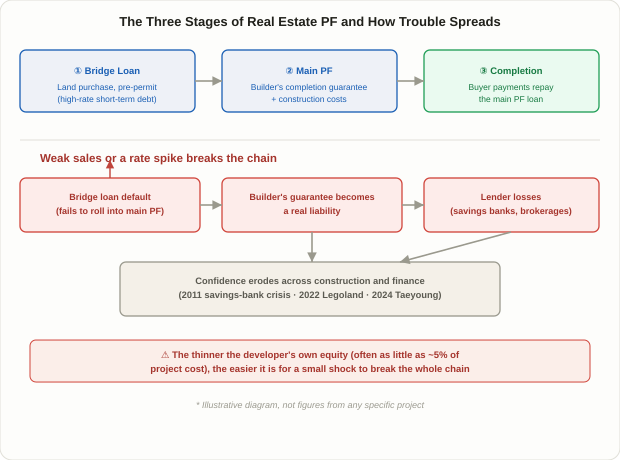

## Why One Word — "PF" — Can Move Builder and Savings-Bank Stocks Together

In early 2024, news that Taeyoung Construction had asked its creditors for a workout (a court-free restructuring under Korea's Corporate Restructuring Promotion Act) sent not just construction stocks but savings-bank, capital-firm, and brokerage shares lower at the same time. Taeyoung hadn't borrowed the money itself — it had promised "responsible completion" guarantees on project sites where other companies held the loans, and when the property market cooled, those guarantees turned into real debt almost overnight. Something similar happened in 2022, when a single province-backed guarantee default on project-financing-backed [asset-backed commercial paper (ABCP)](/en/basics/commercial-paper-abcp-explained/) froze Korea's entire corporate bond market for weeks — the Legoland incident. Both events trace back to the same root: real estate project financing (PF), a financing structure that looks like a construction-industry matter on the surface but routes losses straight through to savings banks, brokerages, and builders' own shareholders. This lesson covers what PF actually is and why it keeps becoming the epicenter of financial stress in Korea specifically.

## What Real Estate PF Actually Is: Lending Against a Project's Future, Not Its Collateral

An ordinary corporate loan is sized against the borrower's credit rating or existing assets. Real estate project financing works differently: the lender advances money against the future profitability and cash flow of a building that doesn't exist yet. Two distinct players split the work. The **developer** buys the land, secures permits, and plans the project. The **builder** (general contractor) physically constructs it. If the developer is the planner, the builder is the executor.

This is where the first structural weakness of Korean-style PF shows up. In many advanced economies, developers are reported to typically put up roughly 30–40% of total project cost as their own equity, financing the rest with debt — a commonly cited rule of thumb, not a hard rule. Korean developers, by contrast, have often been reported to contribute as little as roughly 5% of project cost in equity, financing nearly everything else with borrowed money. With that little of its own capital at stake, a developer has almost no buffer if presales disappoint or construction costs run over — and that shortfall gets passed straight to the lenders and to whichever builder guaranteed the project.

## Bridge Loan → Main PF → Sales Proceeds: The Three-Stage Financing Chain

PF financing is structured so that different kinds of money flow in — and get repaid — in sequence, matched to the project's stage.

<figure class="diagram">
  
  <figcaption>Land purchase (bridge loan) → permits and construction (main PF) → repayment from sales proceeds</figcaption>
</figure>

**Stage 1: The bridge loan.** This short-term loan covers buying the land and obtaining permits — before there's a real "project" to point to yet. Without a completed asset to pledge as collateral, rates run high, and savings banks, capital firms, and brokerages' PF desks are the typical lenders here.

**Stage 2: The main PF loan.** Once permits are in hand and the builder has signed a completion guarantee, this larger, lower-rate loan (often including banks and insurers) repays the bridge loan and funds construction. Presale deposits and installment payments from buyers help cover costs along the way.

**Stage 3: Repayment from sales proceeds.** Once the building is finished, the final payments from buyers retire the main PF loan. Reaching this stage cleanly is what counts as the project "succeeding."

The problem is that these three stages form a single chain. If sales disappoint or rates rise sharply enough that a project can't roll from a bridge loan into a main PF loan, the borrower is left servicing bridge-loan interest that has reportedly exceeded 15% annually in distressed cases — and defaults often start at that very first link. In the second half of 2022, rising rates and a slowing presale market left a wave of projects stuck exactly there, unable to cross from bridge financing into a main PF loan.

## A Simple Number: What "5% Equity" Actually Means

The importance of the equity ratio is easier to feel with a simple illustration. Take a project with a total cost of 100 billion Korean won. If the developer puts up only 3.5 billion won (3.5%) in equity and borrows the remaining 96.5 billion, a mere 5% miss on either presale prices or construction costs — roughly 5 billion won — already exceeds the developer's entire equity cushion. At that point the developer is insolvent, and the remaining loss has to be absorbed by the lenders and by whichever builder signed a completion guarantee. Had the developer instead put up 30% or more of project cost, that same 5% shock would have stayed within the equity cushion and never reached the lenders at all. The equity ratio, in other words, decides who absorbs the first hit when a project stumbles. The thinner that cushion is, the more small shocks turn into outright defaults — and the more that stress can propagate outward into the broader financial system.

## How a Builder's "Completion Guarantee" Turns Into a Real Liability

Lenders rarely extend PF financing to a thinly capitalized developer without more support. Because the developer's own equity is so small, lenders commonly require the builder to sign a responsible-completion guarantee or agree to assume the project's debt if something goes wrong. Day to day, this sits quietly in the footnotes of the builder's financial statements as a **contingent liability** — a promise to pay only if a specific condition is triggered, not an actual cash outflow.

When the property cycle turns and a developer fails to sell units or can't roll into a main PF loan, that contingent liability becomes a real one in an instant: the builder must either finish construction itself or repay the loan on the developer's behalf. This is exactly what sat behind Taeyoung Construction's 2024 workout request — not debt the company had borrowed directly, but a stack of completion guarantees across multiple project sites that all came due roughly at once, turning what looked like a solvent construction company into one in crisis almost overnight.

## How Trouble Spreads: From the 2011 Savings-Bank Crisis to the 2024 Taeyoung Workout

This isn't the first time real estate PF stress has rattled Korean financial markets. In 2011, savings banks that had expanded PF lending aggressively saw defaults pile up as the property market slumped, and roughly 30 savings banks were ultimately suspended from operations — triggering depositor runs severe enough that people lined up to pull their money out before the institutions could fail further.

The 2022 Legoland episode showed how a single guarantee dispute on PF-backed [ABCP](/en/basics/commercial-paper-abcp-explained/) could freeze confidence across the entire short-term debt market, while the 2024 Taeyoung Construction workout showed how a builder's own completion guarantees could convert from footnote risk into an existential threat for the company itself. Industry data reported around 2025 put savings banks' combined construction-and-PF exposure above their total equity capital, and separately flagged savings banks as carrying the highest share of PF loans to financially weak borrowers among Korean lenders. At the same time, more recent reporting has pointed to gradually declining overall PF delinquency rates as regulators pushed through project reclassification and restructuring — a reminder that these figures shift meaningfully depending on when you check them.

## The Three Channels Through Which PF Stress Reaches Stock Prices

PF-related stress reaches equity prices through roughly three channels.

**First, a builder's contingent liabilities becoming real.** Once a completion guarantee crystallizes into actual debt, a builder's balance sheet deteriorates quickly, credit ratings get cut, and funding costs rise — all of which hit the stock directly.

**Second, lender losses.** Savings banks, capital firms, and brokerages are the main buyers of PF loans and PF-backed ABCP. When a developer defaults, these lenders face writedowns on loans they can't fully collect, have to set aside larger loss provisions, and see earnings deteriorate as a result — hitting savings-bank stocks especially hard given their outsized PF exposure.

**Third, contagion in investor sentiment.** As covered in the lesson on [commercial paper and ABCP](/en/basics/commercial-paper-abcp-explained/), once one project's trouble becomes public, investors tend to extend their suspicion to other, seemingly unrelated projects across the entire construction and financial sector. That's how a single developer's default can snowball into sector-wide — or even broader risk-asset — selling. The reverse also happens: when regulators announce support measures or looser project-viability standards, stocks in the hardest-hit sectors often recover together.

## Where Policy Stands: Minimum Equity Requirements

Having identified thin developer equity as the structural root of repeated PF crises, Korean regulators have been moving toward phased minimum equity requirements for new PF projects. As of discussions reported in late 2025, non-residential PF projects were slated to face a 5% minimum equity ratio starting in 2027, rising roughly five percentage points a year toward 20% by 2030, while the timeline for residential projects — where housing-supply concerns are more pressing — has reportedly been pushed back, with later reporting pointing to a 2029 start instead. The goal is to give developers enough of their own capital at stake to absorb a modest shock without defaulting, but critics have also raised concerns that higher equity requirements could discourage smaller developers from starting new projects. Because the exact timeline and thresholds continue to be revised, anyone tracking this for investment purposes should check the Financial Services Commission's latest announcements directly rather than relying on any single figure as final.

## Key Takeaways

- Real estate PF lends against a project's expected future profitability rather than collateral, with developers planning projects and builders constructing them.
- Financing flows through three linked stages — a bridge loan for land, a main PF loan for construction, and final repayment from buyer proceeds — and a break at any early stage tends to stall the whole project.
- Korean developers have often been reported to contribute unusually little equity, which pushes builders into signing completion guarantees that sit as contingent liabilities until a downturn turns them into real debt.
- The 2011 savings-bank crisis, the 2022 Legoland ABCP incident, and the 2024 Taeyoung Construction workout are different expressions of the same structural weakness.
- PF stress reaches stock prices through builders' crystallizing guarantees, lender loss provisions (especially at savings banks and brokerages), and sentiment contagion across the sector.

## Frequently Asked Questions

### Which stage is riskier — the bridge loan or the main PF loan?
The bridge loan is generally considered riskier. It's used before permits are secured and before there's a completed asset to pledge as collateral, so rates run higher, and any delay in reaching presales or the main PF stage can make the interest burden unmanageable — which is why defaults often start right there.

### Can individual investors invest directly in PF loans?
Direct investment in PF loans themselves is uncommon for individuals. However, holding subordinated bonds from savings banks, certain publicly offered REITs, or shares of financial firms and builders with significant PF exposure can create indirect exposure to PF risk. Before investing, it's worth checking a company's disclosed PF exposure and the scale of any completion guarantees it has signed.

### Are PF distress and unsold units the same thing?
Not exactly — unsold units are one major cause of PF distress, but not the only one. Even a project that sells well can run into PF trouble if construction costs rise sharply or rates spike enough to block the move from a bridge loan to a main PF loan. Weak sales is just one of several ways the PF chain can break.

> ⚠️ This lesson is for educational purposes only and is not investment advice regarding any specific company or financial product. Equity ratios, exposure figures, and regulatory timelines mentioned here are simplified based on reporting available at the time of writing; actual figures and rules should be confirmed through the Financial Services Commission's and Financial Supervisory Service's latest disclosures.
