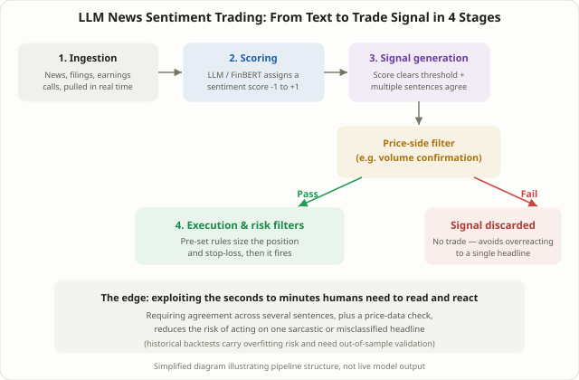

## By the Time a Human Finishes Reading the Headline, the Machine Already Has a Position

When an "earnings beat" headline hits the wire, a human reader needs several seconds to a minute to read it, interpret it, and actually click a button. **LLM news sentiment trading** is built to compete for exactly that window — the moment a headline lands, it's converted straight into a numeric sentiment score before a human has finished the sentence. Lesson 69's [FOMC and CPI News Trading](/en/strategies/fomc-cpi-news-trading/) covers scheduled events where a number drops at a known time. LLM sentiment trading covers the opposite case: an unscheduled, continuous stream of news wires, filings, and earnings-call transcripts, read and scored for meaning in real time.

## What This Actually Is: A Four-Stage Pipeline

In practice, this technique runs as a pipeline with four stages.

1. **Ingestion**: unstructured text — news wires, exchange filings, press releases, earnings-call transcripts — is pulled in as it's published.
2. **Scoring**: a finance-tuned model like FinBERT, or a general-purpose LLM, reads each sentence and classifies it as positive, negative, or neutral, or assigns a continuous sentiment score (say, -1 to +1). At the same time, the model extracts which company and which type of event — earnings, litigation, a contract win, a management change — the sentence is actually about.
3. **Signal generation**: a sentiment score alone rarely triggers a trade. Most setups require the score to clear a threshold and require multiple sentences about the same event to agree on direction before counting it as a real signal.
4. **Execution and risk filters**: a price-side confirmation, such as a volume spike, is layered on top, and position size and stop-loss levels are set by pre-defined rules before anything executes automatically.

Seen this way, the technique is less "AI deciding when to trade" and more "a rule-based strategy with one extra preprocessing step that converts unstructured text into a numeric input."

## Why It's Claimed to Work: What the Actual Research Shows

The case for this approach doesn't rest on speculation — it comes from a specific set of studies. That said, the figures below come from particular time periods and particular datasets, and there's no guarantee they repeat going forward.

- A September 2025 S&P Global study of earnings-call sentiment reported that a long-short strategy built on an LLM-derived signal returned roughly 8.4% annually — nearly double the 4.2% produced by a traditional lexicon-based benchmark on the same calls. The authors also noted that the lexicon approach's explanatory power appears to have weakened in recent years.
- Research by Kirtac and Germano (2024-2025) fine-tuned BERT, FinBERT, and LLaMA-family models on firm-specific news and fed the resulting sentiment signal into a reinforcement-learning portfolio. They reported improved risk-adjusted performance (including Sharpe ratio) relative to models without the sentiment signal.
- A Sogang University thesis applied ChatGPT-based sentiment analysis to Naver Finance news headlines and built a KODEX ETF strategy around the resulting scores, reporting returns that beat the market average. The same paper noted, however, that the correlation between the sentiment score and the actual index move was itself fairly weak.

The logic tying these together: a traditional lexicon just counts how many words from a pre-built "positive" or "negative" list show up in a sentence. An LLM reads the whole sentence in context, so it can correctly classify mixed or ambiguous statements — "loss narrower than expected," "guidance raised but below consensus" — along with sarcasm and negation, that a pure word-count approach tends to misread.

## Lexicon-Based Sentiment vs. LLM-Based Sentiment

| | Traditional lexicon | LLM / transformer |
|---|---|---|
| How it works | Counts occurrences of words from a pre-built positive/negative list (e.g., the Loughran-McDonald dictionary) | A model trained on contextual understanding infers meaning from the full sentence |
| Handling sarcasm and negation | Weak — likely to misclassify "the loss was smaller than expected" as negative based on the word "loss" alone | Comparatively strong — classifies based on the sentence's full context |
| Computational cost | Very low, near-instant | Rises with model size and adds latency |
| Explainability | High — easy to see exactly which words drove the score | Low — closer to a black box where the reasoning is hard to trace |
| Domain specificity | The dictionary itself is built around financial text | Needs finance-specific fine-tuning (as in FinBERT) to perform well |

The table makes the trade-off explicit: LLM-based scoring wins on contextual understanding, but gives up some speed, cost-efficiency, and explainability to get there. In practice, a common compromise is a two-stage filter — a cheap lexicon pass narrows the stream first, and only the sentences that pass get the more expensive LLM treatment.

<figure class="diagram">
  
  <figcaption>The basic pipeline behind LLM news sentiment trading: text becomes a sentiment score, and that score only becomes an actual trade signal after it clears a threshold and additional confirmation.</figcaption>
</figure>

## A Worked, Hypothetical Signal Example

This is a simplified, illustrative example meant to show the mechanism, not actual model output. Suppose three headlines about one stock hit within a 30-minute window.

| Headline (gist) | LLM sentiment score (-1 to +1) | Note |
|---|---|---|
| "Q3 revenue beats consensus, guidance raised" | +0.78 | Strongly positive |
| "Controlling shareholder sells stake via block trade" | -0.25 | Mildly negative |
| "New factory ramp-up normalizing faster than expected" | +0.52 | Positive |

The simple average of the three scores is (+0.78 − 0.25 + 0.52) / 3 ≈ +0.35. If the trading rule is "enter long only if the average score clears +0.3 and trading volume is clearly above its recent average in the same window," this episode clears the threshold — assuming the volume check also passes — and gets classified as a long signal. Notice that if you'd looked at the block-trade headline alone, its negative score would have pointed the opposite way. The point of the example is that aggregating several sentences, rather than reacting to any single headline, is itself a safeguard against overreacting to one noisy data point.

## Limitations Worth Taking Seriously

- **One widely cited study reported that most LLM-based trading strategies failed to beat simple buy-and-hold over a 20-year backtest.** The same research noted that AI tended to confirm existing trends after the fact rather than discover genuinely new signals. This appears to contradict the positive results cited above, but the contradiction comes from the studies using entirely different time periods, models, and validation methods — not from one study being "right" and the other "wrong." The honest conclusion is that "LLM sentiment trading works" or "doesn't work" can't be stated as a single, universal fact.
- **Sarcasm and complex negation still cause real misclassifications.** A sentence like "the loss was smaller than feared, which is a relief" mixes negative vocabulary with a positive underlying message — the kind of nuance that even human readers sometimes disagree about, let alone a model.
- **There's a hard ceiling on the speed race.** Institutional players invest in direct exchange and newswire connections and microsecond-level dedicated hardware. A retail setup pulling from a standard news API simply can't compete at that layer, which means the realistic use case is minutes-to-hours position trading, not sub-second scalping.
- **Overfitting risk in backtests is significant.** Tuning a model's parameters to a specific historical news corpus can look great on that exact period and fall apart the moment genuinely new events or new vocabulary appear. Lesson 85's [Walk-Forward Analysis](/en/strategies/walk-forward-analysis-overfitting/) in-sample/out-of-sample discipline applies here — arguably more strictly than almost anywhere else in this course.
- **Data and API costs add up fast.** Machine-readable real-time news feeds and commercial LLM API calls carry real, recurring costs that can quietly eat into returns on a smaller account size.

## How This Differs From Other News- and Sentiment-Based Techniques

Lesson 36's [PEAD (Post-Earnings-Announcement Drift)](/en/strategies/pead-earnings-drift/) works off a number — the EPS surprise — and tracks a slow price adjustment that plays out over weeks to months. Lesson 94's [Social Sentiment and Mention Velocity](/en/strategies/social-sentiment-mention-velocity/) counts volume — how often and how fast a stock gets mentioned on Reddit or StockTwits, without judging what's actually being said. LLM sentiment trading sits on a different axis from both: it's not counting numbers or mention frequency, it's reading the meaning of the text itself and scoring the direction and strength of what's actually said. Combined, the three give three independent checks: how much a stock is being talked about (social sentiment), whether what's being said is positive or negative (LLM sentiment), and whether the actual numbers beat expectations (PEAD).

## FAQ

### Can an individual investor actually use this technique?
Yes. Open finance-tuned models like FinBERT, or a commercial LLM API combined with a news API, are enough to build a working pipeline at individual scale. The realistic application, though, is a slower horizon — minutes to hours — rather than ultra-short scalping where you'd be competing directly against institutional low-latency infrastructure.

### Does LLM sentiment analysis guarantee consistent outperformance?
No. Even the studies cited above reflect specific periods and specific datasets, and other research reports the opposite — that over the long run, these strategies failed to beat simple buy-and-hold. Multiple sources agree it can be a useful research-assistance tool for narrowing down signal candidates quickly, but final judgment and risk management still need a human in the loop.

### Does this apply to earnings call audio and transcripts too?
Yes — and some research suggests the performance gap between LLM-based and lexicon-based scoring is actually larger on earnings calls, because long, carefully hedged management language and evasive answers in the Q&A section carry nuance that simple word-counting tends to miss entirely.

### Should I enter a trade the instant a headline breaks?
As the worked example above shows, acting on a single headline alone raises the risk of trading on a sentence that got misclassified due to sarcasm or complex context. Aggregating scores across multiple related sentences and adding a price-side check like volume confirmation is the more commonly cited approach in practice.

## Summary

- LLM news sentiment trading scores unstructured text — news, filings, earnings calls — with AI in real time, aiming to exploit the time gap before human readers can fully process and act on the same information.
- It runs as a four-stage pipeline (ingestion, scoring, signal generation, execution with risk filters), and typically requires agreement across multiple signals rather than acting on any single headline.
- Research suggests LLM-based scoring understands context better than traditional lexicon methods, but that comes at the cost of higher computational expense and lower explainability.
- Positive results have been reported by S&P Global, Kirtac and Germano, and a Sogang University study, but a separate 20-year backtest found most LLM-based strategies failed to beat buy-and-hold — so "this works" can't be stated as a settled fact.
- Misclassification on sarcasm and complex negation, a structural speed disadvantage versus institutional infrastructure, backtest overfitting risk, and real data/API costs are all limitations to weigh seriously before relying on this approach.
