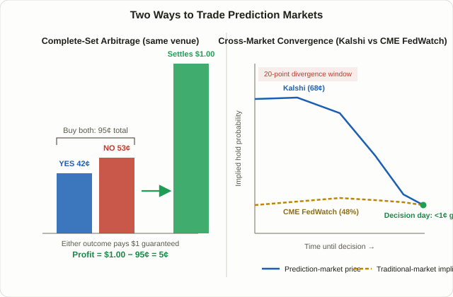

## Why Prediction Markets Are Suddenly a Trading Topic

A few years ago, "prediction markets" meant little more than novelty election-betting sites that surfaced once every four years. That changed fast between 2024 and 2026. **Kalshi** is now a CFTC-registered exchange trading cash-settled "event contracts" in U.S. dollars, and **Polymarket** runs on stablecoin rails with enough institutional interest that ICE — the parent company of the New York Stock Exchange — reportedly invested up to $2 billion into it. Both platforms have expanded well past elections and sports into pure macro and financial events: FOMC rate decisions, nonfarm payrolls, even contracts on whether the S&P 500 hits a new all-time high this week.

This lesson sits at a different layer from Lesson 69's [FOMC/CPI news trading](/en/strategies/fomc-cpi-news-trading/), which is about trading the price-action volatility spike the instant a number crosses the wire. Here, we're not trading the underlying asset's reaction to news — we're trading the binary contract structure itself, looking for moments where contract prices are mathematically inconsistent, or where two markets pricing the same event disagree with each other.

## A Prediction Market Price Is a Probability, Priced in Cents

A prediction market contract resolves to one of two outcomes — YES or NO — much like a binary option. Prices are quoted out of $1.00 (or 100 cents), and that price number is literally the market's implied probability that the event happens. If a contract for "the Fed holds rates at the December meeting" trades at 68 cents, the market is collectively saying it sees roughly a 68% chance of that outcome.

Two mathematical properties fall directly out of this structure, and they're the foundation for everything in this lesson:

1. **Mutually exclusive outcomes for the same event should sum to $1.00.** If a "hold," a "25bp cut," and a "25bp hike" contract are mutually exclusive and exhaustive, buying one share of each guarantees you exactly $1.00 back no matter what happens — because exactly one of them settles at $1 and the rest settle at $0. Occasionally, the combined cost of buying all of them drifts away from $1.00.
2. **The same event listed on two venues should, in theory, price identically.** If Kalshi and Polymarket both run a "Fed holds in December" contract, their prices can — and sometimes do — temporarily diverge.

These two properties define the two core techniques this lesson covers: **complete-set arbitrage** and **cross-market divergence trading**.

<figure class="diagram">
  
  <figcaption>Left: complete-set arbitrage — when YES and NO prices sum to less than $1.00, buying both locks in the gap as risk-defined profit regardless of outcome. Right: cross-market divergence — prediction-market pricing and CME FedWatch-implied odds can sit far apart for weeks, then converge to within a cent or two by decision day.</figcaption>
</figure>

## Technique A — Complete-Set Arbitrage: Trading a Math Error, Not a Forecast

**Complete-set arbitrage** (sometimes called rebalancing arbitrage) targets a single event on a single venue, where the prices of mutually exclusive outcomes no longer sum to $1.00.

- **When the sum is below $1.00 (underpriced):** buy one share of every outcome. Whichever one happens, it settles at $1.00, so the gap between your total cost and that $1.00 is locked-in profit.
- **When the sum is above $1.00 (overpriced):** sell (short) every outcome instead. You only ever owe $1.00 at settlement regardless of which outcome wins, so the premium you collected up front minus that $1.00 is your profit.

This mispricing can appear because each individual contract trades on its own supply and demand — different traders have different views on that one specific outcome — even though, taken together, buying the full set is mathematically equivalent to buying a guaranteed $1.00 payout. Thin order books or a sudden wave of one-sided betting on a single outcome can push the combined price briefly outside that $1.00 constraint.

### A Worked Numeric Example

Suppose a hypothetical FOMC event has three mutually exclusive contracts trading like this:

| Outcome | Price | Description |
|---|---|---|
| Hold | 58¢ | "Rates held" YES |
| 25bp cut | 32¢ | "25bp cut" YES |
| 25bp hike | 5¢ | "25bp hike" YES |
| **Sum** | **95¢** | Combined cost of one share of each |

Assuming these three outcomes are exhaustive and mutually exclusive (no fourth possibility), buying one share of each costs 95 cents total. Whatever the Fed actually does, exactly one of the three settles at $1.00 and the other two go to zero — so you always receive $1.00. That's a **5-cent gap on 95 cents invested, or roughly a 5.3% return**, before accounting for fees.

That 5.3% looks attractive on paper, but in practice, maker/taker fees on each leg, slippage from filling three separate orders, and execution risk from needing all three fills to happen close together usually eat into — or erase — that edge. A recurring criticism of third-party "arbitrage scanner" tools is that many surface this kind of raw, pre-fee price gap as a headline number without netting out what it actually costs to execute, which is exactly the trap to watch for before trading on one of these alerts.

## Technique B — Cross-Market Divergence: When Two Markets Disagree on the Odds

**Cross-market divergence trading** targets the gap between two different markets pricing the same event. The two comparisons that come up constantly are ① Kalshi versus Polymarket pricing the identical contract, and ② prediction-market pricing versus the implied probability that traditional markets assign through tools like CME FedWatch (which backs out rate-decision odds from fed funds futures prices).

This gap exists because the two markets are built from **fundamentally different participant bases and price-formation mechanics**. CME fed funds futures prices come from institutional traders putting real rate exposure on the line, while prediction-market contract prices are shaped more heavily by smaller retail-sized bets on comparatively thin order books, where a handful of large orders can push price around disproportionately. On top of that, confirming that two venues are actually answering the exact same question is harder than it looks — subtle differences in resolution rules often hide underneath an identical-looking headline.

Analysts tracking several 2025–2026 FOMC meetings have reported cases where Kalshi and Polymarket priced a "hold" outcome roughly 20 cents richer than CME FedWatch implied, with that gap persisting for several weeks before converging to within a cent or so of each other by the day before the decision. The Kalshi-versus-Polymarket spread specifically has been observed to run small on average — often around a single cent — and to flip sign over time, which reads less like a stable exploitable edge and more like two competing venues racing to match each other's pricing. These are observations from specific episodes, not a statistical law that repeats on a fixed schedule or magnitude — treat any specific percentage you see cited elsewhere as a snapshot, not a rule.

### Two Ways to Approach a Cross-Market Gap

| | Position Trade on Convergence | Observation-Only Signal |
|---|---|---|
| Approach | Take a position on the richer venue, betting the gap narrows | No position at all — just track the gap as a sentiment input for another strategy |
| What it requires | Funded accounts on both venues, confirmed identical resolution rules | Nothing — just public price data |
| Main risk | The gap widens instead of converging; a resolution-rule mismatch can lose money on both legs | The signal isn't guaranteed to lead price at all |
| Overlaps with | Similar in spirit to reading positioning gaps in Lesson 51's [COT report](/en/strategies/cot-report-commitment-of-traders/) | — |

The second approach — treating "is the prediction market more dovish or hawkish than traditional futures right now" as one more sentiment input, the same way Lesson 60's [put-call ratio](/en/strategies/put-call-ratio-sentiment/) is used alongside other signals rather than traded on its own — carries far less risk than actually putting capital on both sides and waiting for convergence. A position trade is, at its core, a bet that today's gap must close. That assumption isn't guaranteed to hold.

## A Worked Scenario: What Actually Happens When You Spot a Gap

Say Kalshi prices "Fed holds in December" at 68 cents while CME fed funds futures imply roughly a 48% probability of a hold at the same moment. Seeing a 20-point gap, you decide Kalshi looks overpriced and sell the hold contract (or equivalently, buy the cut contract).

For this trade to work out as expected, Kalshi's price needs to converge toward CME's by decision day. In reality, a few different things can happen:

- **The gap widens instead of closing.** New economic data between now and the decision could push broad sentiment further toward a hold, sending Kalshi's price up to 80 cents. You'd be sitting on an unrealized loss until the position closes.
- **The two markets aren't actually asking the same question.** CME FedWatch reflects the rate decision exactly as announced in the FOMC statement, while a Kalshi contract's fine-print resolution rules might define the window slightly differently — say, "as of a specific date following the meeting." If so, the two numbers were never fully comparable in the first place. Analysts repeatedly flag this kind of **resolution-rule mismatch** as the hidden explanation behind a meaningful share of "gaps" that look exploitable on the surface but aren't.
- **The gap converges cleanly by decision day.** In the episodes most commonly cited, the spread narrowed to within a cent or two as the decision approached. If your original directional call was right, you capture roughly the size of the original gap.

The takeaway from this scenario is simple: profit in cross-market divergence trading comes only from correctly calling which direction the gap closes in. The mere existence of a gap is not itself a source of profit.

## Risks and Traps: Be Skeptical of the Word "Arbitrage"

- **The word "arbitrage" gets thrown around loosely.** Plenty of scanner tools and newsletters market raw, pre-fee price gaps as "risk-free arbitrage opportunities." Serious analyses of this space keep coming back to the same conclusion: once you net out trading fees, bid-ask spreads, resolution-rule mismatches, thin liquidity, and execution timing, the headline gap often doesn't translate into an executable profit.
- **Always read the actual resolution rules.** Two contracts with identical-sounding headlines can differ in their precise settlement conditions, reference timestamps, and data sources. Assume they're asking the same question without checking, and you can lose money on both legs even if the "gap" fully converges.
- **Liquidity is genuinely thin.** Compared to fed funds futures or major index options, prediction-market contract volume and order-book depth are far smaller. Trying to put on a sizable position can itself move the price before you finish filling it.
- **The platforms are structurally different.** Kalshi is a CFTC-regulated exchange settling in U.S. dollars; Polymarket runs on stablecoins. Running a true cross-venue position between the two means dealing with currency/stablecoin conversion, transfer delays, and each platform's own funds-movement constraints.
- **Legal and regional access varies and keeps changing.** Where each platform can legally operate, and under what terms, differs by jurisdiction and is still evolving. Before putting real money in, it's each trader's own responsibility to confirm whether the platform is available where they live and what identity-verification or tax-reporting obligations come with it.

## FAQ

### Is complete-set arbitrage really "risk-free"?
Mathematically, once you've locked in all legs of the set at a given price, the payout is guaranteed regardless of outcome — but execution is where the risk actually lives. You need to fill three or more separate orders near your target prices; if even one leg fills late or at a worse price than planned, the edge you calculated can shrink or flip into a loss. Fees have to be baked into the math up front, not treated as an afterthought.

### Which is safer, Kalshi or Polymarket?
They're structured differently rather than one being straightforwardly "safer." Kalshi is a CFTC-registered exchange settling in U.S. dollars, which appeals to traders who want regulatory clarity; Polymarket runs on a stablecoin-based, more decentralized structure, which is a lower-friction entry point for traders already comfortable in crypto. Both carry real risk of loss as trading platforms — neither is risk-free by virtue of its structure.

### Should I trust prediction-market odds or CME FedWatch more?
There's no reliable basis for saying one is always more accurate. CME FedWatch has traditionally been seen as more credible because it's backed by institutional capital actually holding rate exposure, but as prediction markets have grown deeper and more liquid, some analyses have reported cases where they reacted to new information faster than traditional futures. Treating the two as cross-checks on each other is a safer habit than leaning on either one alone.

## Summary

- Prediction markets like Kalshi and Polymarket let traders bet on event outcomes through binary contracts, where the contract's price is literally the market's implied probability.
- Complete-set arbitrage targets moments where mutually exclusive outcome prices fail to sum to $1.00, but fees, slippage, and the need to fill multiple legs simultaneously usually shrink the realizable edge well below the raw headline gap.
- Cross-market divergence trading targets the gap between Kalshi and Polymarket, or between prediction markets and traditional pricing like CME FedWatch — but that gap can widen instead of closing, and a resolution-rule mismatch can mean the two markets were never pricing quite the same question to begin with.
- A large share of what gets marketed as "arbitrage" in this space shrinks or disappears once fees, liquidity, and resolution rules are properly accounted for — that's the single most common trap in practice.
- Using prediction-market pricing as a no-position sentiment input for another strategy carries far less risk than putting capital on both sides of a gap and waiting for convergence.
- Before committing real money, confirm each platform's resolution rules, fee structure, and — critically — whether using that platform is legally permitted and properly reportable where you actually live.
