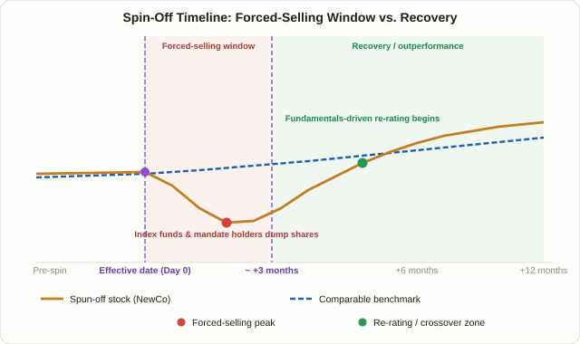

## What a Spin-Off Actually Is, and Why Shrinking a Company Creates an Opportunity

A spin-off happens when a company separates one of its business units into an independent, publicly traded company and distributes shares of that new company to its existing shareholders, pro rata to how much stock they already held. If you own 100 shares of Parent Co., a spin-off might leave you with 100 shares of Parent Co. plus, say, 25 shares of NewCo — stock you never placed an order for, sitting in your account the morning the deal closes.

That's what makes spin-offs structurally different from an IPO. An IPO prices shares through a process built around demand: investors actively bid for stock, and that bidding helps set the offering price. A spin-off skips that step entirely. Shares get distributed first, with no discovery process asking whether the recipients actually want them. That one difference is the foundation of the entire strategy covered in this lesson.

The past few years have been widely described as a banner stretch for corporate spin-offs. GE separated GE HealthCare in January 2023 and GE Vernova in April 2024, leaving GE Aerospace as the remaining parent; Johnson & Johnson spun off its consumer health business as Kenvue in 2023; 3M spun off Solventum in 2024. Kraft Heinz added to the wave by announcing in September 2025 that it would split into two companies (expected to close in the second half of 2026). Coverage of the wave frames it as a renewed push by boards to unlock value trapped inside sprawling conglomerates, which is exactly the setup that makes this strategy worth revisiting now.

## Why It Works: Stock Nobody Asked For Tends to Get Sold

The core logic here is simple: a large share of the people who receive spinoff stock never chose to own that specific company. They bought the parent, not the new business getting carved out of it, and their decision to sell has nothing to do with whether the new company is a good business — it's driven by constraints that have nothing to do with valuation.

Three groups tend to drive this selling.

1. **Index funds and other passive capital.** The parent company may have sat comfortably inside a benchmark like the S&P 500, but the newly spun-off entity is usually too small to qualify for the same index on its own. A fund that mechanically tracks that index has no mandate to keep holding a stock that isn't in it, so it sells — regardless of price. This is the mirror image of the mechanism covered in [the index inclusion effect lesson](/en/strategies/index-inclusion-effect/): there, index tracking forces buying; here, it forces selling.
2. **Institutional mandates.** A large-cap fund that suddenly holds a small-cap spinoff, or a fund concentrated in one sector that suddenly holds a company in a completely different industry, often breaches its own investment mandate. The sell order goes out before anyone on the team has had time to actually analyze the new business.
3. **Retail shareholders who never researched the new company.** Someone who bought the parent for reasons that have nothing to do with the spun-off unit often has neither the time nor the inclination to evaluate an unfamiliar company. Selling immediately becomes the path of least resistance.

When all three kinds of selling land in a short window, the new company's stock can trade well below what its underlying business is actually worth — purely because of who's doing the selling and why. Joel Greenblatt built this exact observation into the core thesis of his book *You Can Be a Stock Market Genius*: because the selling is driven by mandate and apathy rather than judgment about value, the gap between price and value tends to be widest right around the point where that selling finally exhausts itself.

There's a second piece to the mechanism worth noting. Spinoff executives are frequently compensated directly in the new company's stock or options — a sharper, more direct incentive than the one they had running a division buried inside a larger conglomerate. Greenblatt cites management's own equity stake in the spinoff as one of the first things worth checking before getting involved.

<figure class="diagram">
  
  <figcaption>Right after the effective date, forced selling from index funds and mandate-constrained holders drags the new stock below a comparable benchmark (red zone); once that selling pressure clears, fundamentals-driven buying often pushes it back above the benchmark (green zone).</figcaption>
</figure>

## Spin-Offs vs. Carve-Out IPOs: A Distinction That Changes the Whole Trade

This mechanism only applies to a genuine spin-off — where existing shareholders actually receive stock in the new company. It does not apply to what's often called a carve-out IPO (in Korean markets, this structure is called a "물적분할," distinct from a true spin-off, or "인적분할"), where the parent floats a minority stake of a subsidiary to new investors while retaining majority ownership itself.

| | True spin-off (인적분할) | Carve-out IPO (물적분할) |
|---|---|---|
| Who receives new-company shares | Existing parent shareholders, pro rata | New public investors; existing parent shareholders get none directly |
| What existing shareholders hold afterward | Shares in both the parent and the new company | Only their original parent shares |
| Does the forced-selling edge in this lesson apply? | Yes — shareholders who didn't want the new stock sell it | No — there's no distributed stock to sell |
| The real debate | Whether the new stock is underpriced after the selling clears | Whether the parent's remaining shareholders are getting diluted out of value they already owned |

LG Chem's 2022 carve-out of its battery unit into LG Energy Solution is the textbook example of the second structure, and it generated real controversy in Korea precisely because existing LG Chem shareholders received zero shares of the new, faster-growing business — the parent simply sold a minority stake to new investors and kept the rest. That's a value-dilution problem for the parent's existing holders, not a forced-selling mispricing opportunity in the new listing. Confusing the two structures means applying the wrong analytical framework entirely.

## Timing: Think in Months, Not Days

The most common mistake with this strategy is buying the moment the spin-off starts trading. Forced selling rarely finishes in a day or two — institutional rebalancing and index-driven unwinding tend to play out over weeks, sometimes months, as different holders reach their own decision at their own pace.

Some academic research has found spun-off stocks underperforming a comparable benchmark for roughly the first 27 trading days after the effective date, followed by a period — months to, in some studies, a few years — of outperformance relative to peer groups. Based on patterns like that, spinoff-focused investors commonly wait a few months, often cited loosely as three to six months, before building a position, giving the forced-selling wave time to run its course.

Treat both of those figures as rules of thumb, not fixed laws. The 27-trading-day window and the "wait three to six months" convention come from specific studies covering specific time periods, and there's no guarantee any single spin-off will follow the same script — some clear their selling pressure in a couple of weeks, others stay under pressure for much longer. The more reliable signal is watching volume and price actually stabilize, rather than counting to a specific number of days.

## A Checklist: Which Spin-Offs Are Actually Worth Looking At

Not every spin-off offers the same opportunity. Practitioners drawing on Greenblatt's framework tend to check a similar short list of items.

| Check | What to look for |
|---|---|
| Management incentives | Does the new CEO and executive team hold meaningful stock or options in the spinoff? A bigger personal stake usually signals stronger alignment with shareholders. |
| Debt load | Did the parent saddle the new company with disproportionate debt while keeping the cleaner business for itself? Check the pro forma financials, not just the headline split. |
| Likelihood of index exclusion | The smaller the spinoff's expected market cap relative to the index the parent sat in, the larger the potential forced-selling wave tends to be. |
| How different the two businesses are | A spinoff whose business looks nothing like the parent's was more likely to be mispriced as part of one combined valuation before the split. |
| The filing itself | Read the actual spin-off filing — the distribution ratio, the listing date, and each entity's pro forma financials — rather than relying on secondhand summaries. |

## A Worked Example (Simplified, for Teaching Purposes Only)

This is a hypothetical illustration of the mechanics, not a record of any real spin-off.

| Item | Value | Note |
|---|---|---|
| Parent's weight in its benchmark index | 1.2% | Pre-spinoff index weight |
| NewCo's expected market cap | ~15% of the parent's | Based on the distribution ratio and segment valuation estimates |
| NewCo's likelihood of qualifying for the same index | Low (falls short of market-cap thresholds) | Index-tracking passive capital has no mandate to keep holding it |
| Share of index-tracking AUM estimated to receive — and then sell — NewCo stock | ~8–10% | Rough estimate across major passive holders |
| Estimated forced-selling size relative to NewCo's average daily volume (ADV) | ~4–6x | Assuming the selling concentrates into a short window |

The last row is the one that matters most: the larger the forced-selling estimate relative to normal trading volume, the more the stock's early price is likely to get pushed around. If the spinoff happens to come out already large and heavily traded, that same percentage of forced selling leaves a much fainter mark. These figures are a rough way to compare candidates against each other — not a formula for predicting an exact return.

## Risks and Limitations: The Research Doesn't All Point One Way

- **Long-run performance evidence is genuinely mixed.** Greenblatt's book and some academic work argue spinoffs outperform on average, but other analysis calls the long-term record inconclusive, and at least one well-known piece of research argues spinoffs have underperformed. Treat any specific win-rate or average-return figure as directional, not as a fixed statistic to anchor on.
- **Parents sometimes dump the weaker business.** It's not unusual for a parent to load the spinoff with debt or a slower-growing segment while keeping the stronger business for itself. Read the pro forma financials before assuming "it's a spinoff" automatically means "it's an opportunity."
- **The edge shrinks as more people chase it.** Once Greenblatt's book made the strategy well known, more dedicated spinoff funds and sell-side coverage emerged to hunt the same mispricing — the same "disappearing anomaly" pattern covered in [the index inclusion effect lesson](/en/strategies/index-inclusion-effect/).
- **Small-cap risk is real.** Freshly spun-off companies often have little to no analyst coverage and thin trading volume, which makes sizing a position harder and widens the uncertainty around any entry. Per [Lesson 6 on risk/reward and position sizing](/en/strategies/risk-reward-money-management/), a less certain edge calls for more conservative sizing, not less.
- **Don't confuse this with a carve-out IPO.** As covered above, the forced-selling logic in this lesson simply doesn't apply to a structure where existing shareholders never received stock in the first place.

## FAQ

### Can I just buy on the day the spin-off starts trading?
You can, but it's the riskiest entry point. The forced selling has often barely started on day one, and the stock can keep drifting lower for weeks or months afterward. Waiting for volume and price to visibly stabilize is the more conservative approach.

### How is this different from merger arbitrage?
[Merger arbitrage](/en/strategies/merger-arbitrage-deal-spread/) targets a fairly calculable, fixed spread between a deal's offer price and the market price after an M&A announcement. Spin-off investing is closer to directional value investing — betting that forced selling has created a mispricing, with no fixed spread to lock in. Greenblatt groups both under the umbrella of "special situations" investing in his book.

### Does the same strategy apply to carve-out IPOs?
No. In a carve-out IPO (물적분할 in Korean markets), existing shareholders of the parent never receive stock in the new entity, so there's no forced-selling dynamic to exploit. The relevant question there is whether the parent's remaining shareholders are being diluted out of value, which calls for a completely different analysis.

## Summary

- A spin-off distributes shares of a newly independent business to existing shareholders pro rata, and the 2023-2025 wave of major spin-offs — GE, Kenvue, Solventum, Kraft Heinz, and others — has put the strategy back in focus.
- The core mechanism is forced, indiscriminate selling: index funds facing exclusion, institutions breaching mandates, and uninterested retail holders all tend to sell regardless of the new company's actual value, which Joel Greenblatt identified as the central source of the opportunity.
- A true spin-off and a carve-out IPO are structurally different — only the former distributes stock to existing shareholders, so only the former carries the forced-selling edge this lesson describes.
- Forced selling tends to play out over weeks or months rather than a single day, which is why many spinoff-focused investors wait before entering rather than buying on day one.
- The long-run performance evidence is genuinely mixed, and parents sometimes offload a weaker business onto the spinoff, so checking management's own stake and the pro forma balance sheet matters as much as the mechanism itself.
