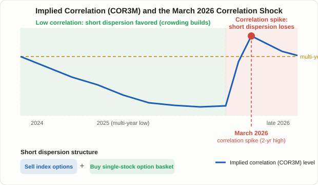

## Why an Index Trades Calmer Than the Stocks Inside It

Any single member of the S&P 500 can swing several percent in a day on earnings, guidance, or sector news. The index itself almost never moves that much on an average day. That gap exists because the 500 stocks don't move in lockstep — a chunk of each stock's individual volatility cancels out against the others. **Dispersion trading** is the strategy built around pricing exactly that cancellation effect: sell options on the index, buy options on the stocks that make it up, and get paid for the degree to which those stocks end up moving independently rather than together.

Through 2025, dispersion became one of the most widely cited volatility trades on hedge fund desks. S&P 500 realized correlation had fallen to multi-decade lows, and "short dispersion" positions — betting correlation would stay low — collected steady gains as a result. Then, in March 2026, the trade showed its other side. A broad spike in realized correlation hit the strategy hard enough that a major bank's index tracking dispersion trades fell roughly 4.9% that month, and S&P 500 implied correlation jumped to a two-year high in the aftermath. That single episode is a clean illustration of both why this trade tends to make money and why it can suddenly stop.

## The Core Mechanics: Index Variance Isn't a Simple Average

To understand dispersion trading, start with the math linking index volatility to the volatility of its pieces. Take a toy index built from two stocks with weights w₁ and w₂ and implied volatilities σ₁ and σ₂. Index variance (volatility squared) is approximately:

```
Index variance ≈ w1²σ1² + w2²σ2² + 2·w1·w2·σ1·σ2·ρ
```

Here ρ is the **correlation** between the two stocks. Hold the weights and the individual volatilities fixed, and ρ is the only thing left that can move index variance. As ρ approaches 1 (the stocks move almost identically), index volatility converges toward a weighted average of the constituent volatilities. As ρ approaches 0 (they move independently), index volatility falls well below that average, because the moves partly offset each other. Scale this up to 500 names and the logic holds — index option prices always have some market-implied average correlation baked invisibly into them.

Back that correlation out of observed option prices — comparing index implied volatility against the weighted implied volatility of the constituents — and you get **implied correlation**: the average correlation the options market is currently pricing in. Cboe publishes this directly as the Cboe S&P 500 Implied Correlation Index (1-month COR1M, 3-month COR3M, and longer tenors), and in 2023 it launched the Cboe S&P 500 Dispersion Index (DSPX), which tracks the payoff of the dispersion trade itself rather than correlation alone.

## How the Trade Is Built: Short the Index, Long the Basket

A classic "short dispersion" position has two legs:

1. **Sell index options (or index variance)** — typically a short straddle or a short variance swap on the index. This is a bet that the index is priced too rich, i.e., that it's implicitly assuming too high a level of correlation.
2. **Buy a weighted basket of single-stock options** across the index's constituents — sized by market-cap or vega weight so the position's net vega starts out close to zero (vega-neutral).

Vega-neutral construction matters because it strips out the simple "will volatility rise or fall overall" bet and isolates something closer to pure exposure to how correlated the constituents turn out to be. In that sense dispersion trading belongs to the same family as the mean-reversion and pairs-trading ideas in [Lesson 10](/en/strategies/mean-reversion-four-ways/) and [Lesson 18](/en/strategies/pairs-trading-stat-arb/) — it's a bet on a *relationship*, not a direction. The difference is what relationship: pairs trading watches the price spread between two names, while dispersion trading watches the volatility spread between an index and the basket of stocks underneath it.

<figure class="diagram">
  
  <figcaption>Implied correlation ground down to multi-year lows as short dispersion positioning built up, then spiked sharply in March 2026, hitting those positions with losses.</figcaption>
</figure>

## Why the Trade Has a Structural Edge

Dispersion trading's long run of profitability isn't pure coincidence — there's a supply-and-demand story behind it. Index options, index puts especially, see persistent buying from pension funds and asset managers hedging entire portfolios. That demand for downside protection is one-directional and structurally sticky, and it tends to push index implied volatility — and the correlation baked into it — higher than it would otherwise be. Single-stock options, by contrast, are driven by a much more scattered mix of flows: earnings speculation, merger rumors, single-name thematic bets. There's no equivalent persistent one-way bid pushing single-stock implied vols up the same way.

The upshot, as it's commonly explained in options-flow circles, is that implied correlation priced into index options tends to run higher on average than the correlation that actually materializes later (realized correlation). That gap is the **correlation risk premium** — conceptually similar to the volatility risk premium that shows up elsewhere in options markets (see the IV crush discussion in [Lesson 38](/en/strategies/iv-crush-earnings-options/)), just measured on correlation rather than volatility itself. Short dispersion is an attempt to collect that premium repeatedly.

## A Hypothetical Walk-Through With Numbers

This is a simplified, hypothetical example meant to show the mechanism — not a real backtest result. Say an index consists of two equally-weighted stocks, A and B, and both trade options at 30% implied volatility. The index options market is pricing in an assumed correlation of 0.70 between them. Plugging into the formula above:

```
Variance = 0.5²×0.30² + 0.5²×0.30² + 2×0.5×0.5×0.30×0.30×0.70 = 0.045 × 1.70 = 0.0765
Implied index volatility = √0.0765 ≈ 27.7%
```

Now suppose a trader sells the index at that 27.7% implied level and buys A and B's options near their 30% implied level. Time passes, and A and B each move on their own company-specific news, ending up with realized correlation closer to 0.30 instead of 0.70. Plug ρ = 0.30 into the same formula:

```
Variance = 0.045 × 1.30 = 0.0585
Realized index volatility = √0.0585 ≈ 24.2%
```

A and B each realized roughly the volatility implied at the outset — call it close to 30% apiece — so the long single-stock leg is roughly breakeven to modestly profitable on its own. But because A and B moved in different directions rather than together, the index itself only realized about 24.2% volatility, well below the 27.7% level at which the index leg was sold. The short-index leg profits from selling richer than what actually materialized. Combine the two legs and the net result is a profit driven purely by correlation coming in lower than priced — the mechanism, in miniature.

## Short Dispersion vs. Long Dispersion

| | Short Dispersion | Long Dispersion |
|---|---|---|
| Structure | Sell index options + buy single-stock options | Buy index options + sell single-stock options |
| Directional bet | Correlation stays low or falls further | Correlation rises (crisis, broad selloff) |
| Favorable regime | Stock-picker's market driven by idiosyncratic, company-specific news | Macro shocks and panic selling where everything moves together |
| Main risk | Large losses when correlation spikes sharply (the March 2026 episode) | Steady premium bleed in calm markets — behaves like paying for insurance |
| Character | Carry-style strategy collecting small, repeated gains | More like a tail-risk hedge than an income strategy |

The two positions mirror each other. Short dispersion resembles the VIX contango roll-yield trade from [Lesson 28](/en/strategies/vix-term-structure-contango-backwardation/) — steady collection in calm regimes, concentrated giveback when the regime flips. Long dispersion is closer to deliberately buying that insurance.

## Reading the Implied Correlation Index in Practice

| State of implied correlation (COR3M, etc.) | Common interpretation |
|---|---|
| Notably above its historical average | Index options may be priced rich relative to single names — often read as a setup worth considering for short dispersion |
| Near multi-year lows | A frequently cited crowding warning — many traders already positioned the same way, which argues for risk management over fresh entries |
| Spiking sharply ahead of a macro event (FOMC, tariff news, geopolitical risk) | The market pricing in a higher chance that stocks move together on the event, rather than on their own idiosyncratic news |

The second row describes exactly the setup that preceded March 2026: implied correlation had ground down to multi-year lows, short dispersion had become a widely cited "crowded trade," and then a broad liquidity shock sent realized correlation sharply higher, hitting the strategy hard across the market.

## Limitations and Caveats

- **Retail traders generally can't replicate the full structure.** Building and maintaining a vega-neutral basket across dozens or hundreds of single names requires constant rebalancing and is largely the domain of hedge funds and bank derivatives desks. A more realistic retail use is reading Cboe's correlation and dispersion indices as a market-regime gauge rather than trying to run the trade directly.
- **The risk profile is structurally asymmetric.** Small, steady gains accumulate in calm regimes, but losses can arrive in a concentrated burst when correlation spikes — the same "slow gains, fast losses" shape discussed around the short-premium options strategies in [Lesson 97](/en/strategies/jade-lizard-options-strategy/) and [Lesson 98](/en/strategies/iron-butterfly-options-strategy/).
- **Transaction costs run far higher than a single index trade.** Trading dozens of single-stock option legs simultaneously compounds slippage and bid-ask spread costs that a single index position doesn't face.
- **Popularity itself becomes a risk.** The low-correlation environment of 2024–2025 pulled in more capital chasing short dispersion, and that crowding is widely cited as part of what made the March 2026 reversal so sharp. Any strategy where "everyone is already doing it" carries an extra layer of risk beyond the underlying thesis.

## FAQ

### How is dispersion trading different from pairs trading in Lesson 18?
Both bet on a relationship rather than an outright price level. Pairs trading bets that the price spread between two stocks reverts to its mean; dispersion trading bets on the volatility (correlation) spread between an index and the basket of stocks beneath it. Pairs trades can be run with simple long/short equity positions, while dispersion trading inherently requires an options structure.

### Can an individual investor actually access dispersion trading?
Building a true vega-neutral basket yourself is impractical for most individual traders. What is accessible is Cboe's published implied correlation indices (COR1M, COR3M) and the Dispersion Index (DSPX), which give a read on how the options market is currently pricing correlation — useful context for judging whether index options look rich or cheap relative to single names, even without running the full trade.

### Is low correlation always a good sign for the market?
Not necessarily. Low correlation usually reflects a healthier, more idiosyncratic market where stocks move on their own fundamentals rather than a single macro narrative. But it can also signal that short-dispersion-style positioning has become crowded. As March 2026 showed, a long stretch of unusually low correlation can set up the conditions for a sharp reversal rather than guaranteeing the calm continues.

## Summary

- Dispersion trading sells index options and buys options on the index's constituents, turning the gap between implied correlation (priced into index options) and realized correlation (what actually happens) into a profit source.
- Index variance isn't a simple average of constituent volatilities — it depends on correlation (ρ), and inverting that relationship produces Cboe's implied correlation indices (COR1M, COR3M) and the DSPX dispersion index.
- Because index option demand, especially for downside hedging, is more structurally persistent than single-stock option demand, implied correlation tends to run richer on average than what later materializes — the correlation risk premium that short dispersion tries to harvest.
- Short dispersion (sell index, buy single names) thrives in low-correlation, stock-picker's markets but carries an asymmetric risk of sharp losses when correlation spikes, as it did in March 2026.
- Running a true vega-neutral basket is realistically an institutional activity; for individual investors, the more practical use is reading implied correlation and dispersion indices as a market-regime and crowding signal.
