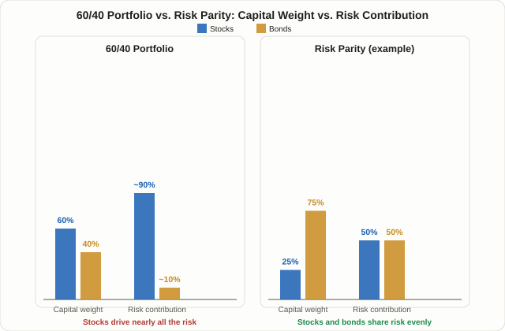

## Risk Parity: Allocating by Risk, Not by Dollars

A 60% stocks / 40% bonds split has long been treated as the textbook definition of a "balanced" portfolio. The **risk parity** strategy pushes back directly on that assumption with one question: if you split your dollars 60/40, does that mean you've split your *risk* 60/40 too? The answer is no. Stocks are far more volatile than bonds, so regardless of the dollar split, almost all of a portfolio's day-to-day price swings come from the equity side.

Risk parity flips the usual process around. Instead of deciding dollar weights first, it starts by deciding how much each asset should contribute to total portfolio risk — usually an equal share — and then works backward to find the dollar weights that produce that outcome. The approach was first brought into institutional asset management in a systematic way by Bridgewater Associates under Ray Dalio, through the All Weather fund launched in 1996. Where Lesson 42's [Kelly Criterion](/en/strategies/kelly-criterion-position-sizing/) answers "how much should I bet on one trade," risk parity asks essentially the same question at the level of an entire portfolio spanning multiple asset classes.

## Why 60/40 Is Really a "90% Stocks" Portfolio in Disguise

Here's the problem risk parity tries to fix, in concrete numbers. Assume stocks have roughly 15% annualized volatility and bonds roughly 5% — commonly cited approximations that move around depending on market conditions, not fixed constants. Simplifying by treating the two as independent, a 60/40 portfolio's total volatility works out to roughly:

```
Portfolio volatility ≈ √[(0.6×15%)² + (0.4×5%)²] ≈ √(81 + 4) ≈ 9.2%
```

What matters here is how much of that 9.2 percentage points comes from each asset. Converting to variance contribution, the equity term (81) is roughly 20 times larger than the bond term (4). In other words, even though stocks are only 60% of the dollars, they're responsible for most of the portfolio's actual price movement — often cited as somewhere around 90%. The 40% allocated to bonds looks substantial on paper, but it barely moves the needle on why the portfolio actually goes up or down. The core critique from risk parity advocates is that 60/40's sense of "diversification" is largely a dollar-weight illusion — from a risk standpoint, it behaves much closer to an unleveraged stock portfolio.

## How It Actually Works: Inverse-Volatility Weighting, Then Leverage

Risk parity equalizes risk contribution in two distinct steps.

**Step 1 — Inverse-volatility weighting.** Lower-volatility assets get a larger dollar weight; higher-volatility assets get a smaller one. If stocks are 3x as volatile as bonds, as in the example above, equalizing risk contribution at 50/50 requires giving bonds roughly 3x the dollar weight of stocks. Working the math out gives stocks 25% and bonds 75% — at which point each contributes an equal 50% share of risk (0.25×15% = 0.75×5% = 3.75 percentage points each).

**Step 2 — Leveraging back up to a target volatility.** This creates a new problem: a portfolio with only 25% in stocks is safer, but its expected return drops along with the risk. Running the same calculation on the 25/75 mix gives a total volatility of around 5.3 percentage points — well below the original 60/40's 9.2 points. So Bridgewater-style risk parity doesn't stop there. It uses futures and leverage to scale up the low-volatility side of the book until total portfolio volatility reaches a chosen target (say, 10%), bringing expected returns back into a range that can compete with an equity-heavy portfolio. In short: first build a low-risk portfolio where risk is spread evenly, then apply leverage to scale the whole thing back up to a usable return level.

<figure class="diagram">
  
  <figcaption>A 60/40 portfolio's capital weight (60/40) and risk contribution (roughly 90/10) diverge sharply, while risk parity adjusts capital weight (25/75) specifically to bring risk contribution back to an even 50/50 split.</figcaption>
</figure>

## Why It Works: Stacking Several Low-Correlation Risks Together

The real goal of risk parity isn't simply "buy more bonds" — it's **stacking several risks that don't move together, in roughly equal size, to improve the portfolio's return per unit of risk (its Sharpe ratio)**. Mixing assets that respond differently to the economic cycle — stocks, bonds, commodities, gold — in similar risk-weighted amounts means that when one asset struggles, another is more likely to hold up. A commonly cited framework splits the business cycle into regimes: stocks tend to do relatively well during growth, bonds during recession or disinflation, and commodities during inflationary periods. When one asset like stocks dominates the risk budget, as in a traditional 60/40, the portfolio effectively becomes "a portfolio that only does well when stocks do well" — and the 40% held in bonds contributes almost nothing toward actual diversification.

## 60/40 vs. Risk Parity, Side by Side

| | 60/40 Portfolio | Risk Parity (example) |
|---|---|---|
| Capital weight (stocks:bonds) | 60% : 40% | 25% : 75% |
| Assumed annual volatility | Stocks 15%, bonds 5% | Stocks 15%, bonds 5% |
| Risk contribution (stocks:bonds) | ~90% : 10% | 50% : 50% |
| Leverage used | Usually none | Commonly used to reach a target volatility |
| Core assumption | Dollar weight = adequate diversification | Risk contribution must be matched for real diversification |
| Weakest scenario | Stocks and bonds falling together (the 2022 pattern) | Any shared drawdown across leveraged assets gets amplified |

What this table makes clear is that the two approaches are vulnerable to a surprisingly similar scenario. Risk parity fixes 60/40's equity concentration problem, but in doing so it takes on a new one — leverage — and weighing that trade-off is essential to evaluating the strategy honestly.

## 2022: The Year Leverage Cut Both Ways

Risk parity's logic depends heavily on the assumption that stocks and bonds generally move independently of each other, or in opposite directions. 2022 is frequently cited as the year that assumption broke down. During the Fed's rapid rate-hiking cycle that year, stocks and bonds both fell by double digits at the same time — commonly described as the first simultaneous decline of that size in both asset classes since 1969. Bonds normally exist in this framework to offset equity losses; with that offsetting effect gone, leveraged risk-parity-style portfolios reportedly suffered larger losses in several cases than unleveraged traditional allocations did over the same period. This isn't really evidence that risk parity's logic is wrong — it's a reminder of a principle that applies to any leveraged strategy: **leverage amplifies losses just as readily as it amplifies gains, the moment the correlation assumptions underneath it break.**

## Approaches Commonly Used in Practice

Fully replicating textbook risk parity — running your own futures and leverage book — isn't realistic for most individual investors. In practice, a few simplified approaches come up most often:

- **An unleveraged, simplified version.** Apply only the inverse-volatility weighting step (the 25/75 example above) and skip leverage entirely. Risk gets spread evenly, but you accept the lower expected return that comes with it.
- **All-Weather-style ETFs.** Products like RPAR or ALLW handle the rebalancing and leverage mechanics on your behalf. These products' methodology, fees, and leverage levels differ by issuer and can change over time, so always check the actual prospectus before buying rather than relying on a general description.
- **A partial blend.** Rather than replacing an entire portfolio, some investors carve out a smaller slice (say, 10-20%) of an existing 60/40 allocation and run that slice with risk-parity-style weighting.

Risk parity is often compared with Lesson 80's [Dual Momentum (GEM) strategy](/en/strategies/dual-momentum-gem-strategy/). Dual Momentum is a tactical switching strategy — it checks trend signals monthly to decide whether to be in stocks at all or step aside into cash. Risk parity, by contrast, makes no attempt to forecast market direction; it holds every asset class at all times and only ever adjusts how much of each, based on risk. One asks "when should I be in?"; the other asks "how much of each should I always be holding?" — genuinely different questions.

## Limitations and Caveats

- **Leverage amplifies losses just as it amplifies gains.** When correlation assumptions break down, as in 2022, leverage works against the portfolio. Using leverage at all also brings additional operational risks — ongoing volatility re-estimation, margin calls, and rollover costs.
- **Volatility and correlation estimates are only historical data.** The inverse-volatility weights depend entirely on past volatility and correlation figures, with no guarantee those relationships persist going forward. This is the same caveat Lesson 13's [ATR-based risk filters](/en/strategies/risk-filters-atr-cmf/) make elsewhere in this course: volatility itself changes over time.
- **Performance is highly sensitive to the interest rate environment.** Because the structure leans heavily on bonds plus leverage, it has tended to do relatively well in falling-rate environments and relatively poorly when rates rise quickly — a pattern frequently pointed out in critiques of the approach.
- **Operational complexity and cost.** Regular volatility re-estimation, leverage rebalancing, and futures rollovers require meaningfully more effort and cost than most individual investors can realistically manage on their own.

## FAQ

### Is risk parity always safer than a 60/40 portfolio?
No. The unleveraged, simplified version trades lower volatility for lower expected return, and the fully leveraged version can produce larger losses than 60/40 during periods — like 2022 — when the underlying correlation assumptions break down. "Risk is spread evenly" and "losses are always smaller" are two different claims.

### Can individual investors actually run risk parity themselves?
Running the full version with your own futures-based leverage realistically requires professional-grade infrastructure. More accessible alternatives commonly cited include building an unleveraged, volatility-weighted allocation yourself, or using an All-Weather-style listed ETF that handles the mechanics for you.

### How is this different from Dual Momentum or the Kelly Criterion?
Dual Momentum ([Lesson 80](/en/strategies/dual-momentum-gem-strategy/)) uses trend signals to decide monthly whether to be in stocks or in cash — a tactical switching strategy. The Kelly Criterion ([Lesson 42](/en/strategies/kelly-criterion-position-sizing/)) sizes a single bet given a known win rate and payoff ratio. Risk parity does neither — it makes no directional market call and holds multiple asset classes simultaneously at all times, only ever adjusting the weighting between them based on risk.

## Summary

- Risk parity allocates assets based on risk contribution rather than dollar weight, and was first systematized by Ray Dalio's Bridgewater through the All Weather fund.
- A 60/40 portfolio looks balanced in dollar terms, but because stocks are far more volatile than bonds, stocks typically account for the large majority (often cited around 90%) of total portfolio risk.
- Risk parity works in two steps: inverse-volatility weighting to bring risk contribution close to an even 50/50, followed by leverage applied to restore the expected return that lower-risk weighting gives up.
- In periods like 2022, when stocks and bonds fall together, leverage amplifies losses — meaning leveraged risk parity can underperform an unleveraged traditional allocation during exactly those stress periods.
- Volatility and correlation estimates are drawn from historical data with no guarantee of holding in the future, a limitation that should always be weighed alongside the strategy's theoretical appeal.
