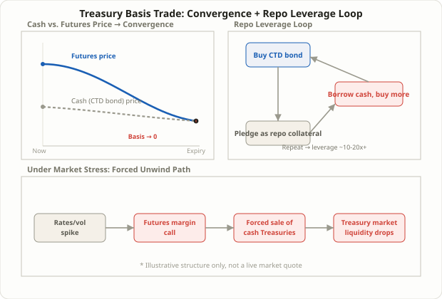

## The Trade the Fed Keeps Warning About

A phrase keeps showing up in Fed financial stability reports and OFR briefs: hedge fund leverage in the Treasury market is building up again, and the trade at the center of that warning is the **Treasury basis trade**. It sounds like a plain-vanilla arbitrage — buy a Treasury bond, sell the matching Treasury futures contract — but in practice it's hundreds of billions of dollars of exposure held up by short-term repo borrowing. A 2026 Fed note from the Office of Financial Research put the trade at roughly $830 billion as of September 2025, accounting for about 35% of large hedge funds' long Treasury exposure. A separate Morgan Stanley estimate cited around the same time put leveraged investors' notional basis positions at roughly $900 billion, down from about $1.26 trillion at the start of 2026. The two estimates don't agree exactly — they're measuring slightly different things at different moments — but they agree on the shape of the story: this is a trade measured in the hundreds of billions, and its size is something regulators track closely for a reason.

This lesson walks through what the basis trade actually involves, why its leverage gets so extreme, and why its unwind risk — the mechanism widely blamed for part of the March 2020 Treasury market stress — keeps resurfacing in official warnings years later. It belongs with the other rate-positioning lessons in this course, like [the yield curve steepener/flattener](/en/strategies/yield-curve-steepener-flattener/) (Lesson 100) and [the carry trade](/en/strategies/carry-trade-yen-unwind/) (Lesson 93), but it's a fundamentally different bet: not on the direction of rates, not on the shape of the curve, but on **the narrow gap between the cash price and the futures price of the same bond**. Almost no individual trader will ever replicate this trade directly, but understanding how it's built and how it unwinds explains why Treasury yields occasionally move far more than the macro news of the day would seem to justify.

## What "Basis" Means, and Why It Has to Converge to Zero

The basis, in its simplest form, is the futures price minus the cash (spot) price of the underlying bond. Treasury futures are designed to settle through actual physical delivery of a bond at expiration, which forces the futures price and the cash price to converge as expiration approaches. If they didn't converge — if the futures and cash prices stayed meaningfully different right up to delivery — arbitrageurs would simply buy the cheap side and sell the expensive side until the gap closed. That mechanical pull toward convergence is the first leg of the trade's logic.

Treasury futures don't settle against one single bond; the short side gets to choose which bond to deliver from a basket of eligible issues that share the same maturity range and coupon characteristics. Whichever bond is cheapest for the short to deliver is called the **cheapest-to-deliver (CTD)** bond, and in practice the basis trade is built around it: buy the CTD bond in the cash market, and sell the futures contract written against that same delivery basket. When the futures price sits above what the CTD bond's cash price implies (a positive basis), buying the bond and selling the future locks in that spread, realized as the two prices converge by expiration.

## Why It Works: Two Separate Sources of Profit

The basis trade's return comes from two distinct sources.

The first is **carry**. Holding the cash bond pays coupon income; financing that purchase through repo costs the repo rate. Carry is simply the coupon yield minus the repo financing cost, and when it's positive, the position earns money every single day it's held — even if the basis itself never moves.

The second is **convergence**. Because the futures price is mechanically pulled toward the cash price as expiration nears, a futures contract that started out trading rich relative to the CTD bond delivers a second stream of profit as that premium erodes over the life of the contract.

The catch is that both of these are usually tiny. A typical basis runs only a handful of basis points (1bp = 0.01 percentage point). To turn that into a return worth bothering with, the trade has to be scaled up dramatically — and that's exactly what repo financing allows. A fund can pledge the Treasury it just bought as collateral to borrow more cash, buy more Treasuries, and repeat, building enormous notional exposure on a comparatively small sliver of actual capital. Various sources, including Wikipedia's summary of the trade, cite typical leverage in the 10x–20x range in recent years, with some BIS-cited estimates pointing to considerably higher multiples in certain stretches. Exact leverage figures shift with market conditions and position construction, so the number itself matters less than the underlying mechanic: a razor-thin spread, magnified by heavy borrowing, into a return that's actually worth the operational effort.

What makes this structure unusual is that the party supplying the leverage (the bank or dealer on the other side of the repo) and the party using it (the hedge fund) have genuinely different incentives, and both point toward more leverage rather than less. Treasury-collateralized repo lending is treated as low-risk under bank capital rules, so banks can supply that funding cheaply without much capital charge. On the other side, the hedge fund's return on its own capital rises directly with how much of that cheap financing it uses, so there's little structural incentive to cut leverage voluntarily. That two-sided pull toward more leverage is precisely what regulators are watching.

<figure class="diagram">
  
  <figcaption>Long the cash bond, short the matching futures contract — capturing the basis while repeated repo borrowing builds leverage. Under stress, margin calls can force a rapid unwind.</figcaption>
</figure>

## Building the Trade: Repo Financing Is the Variable That Matters Most

Putting the trade on, in practice, follows roughly this sequence:

1. Identify the CTD bond within the futures delivery basket — the one that's cheapest to deliver and offers the best implied yield for the short.
2. Buy the CTD bond in the cash market, financing the purchase through a **repo (repurchase agreement)** collateralized by that same bond — buying the bond, pledging it right back as collateral to borrow the cash, and repeating this cycle to scale up leverage.
3. Sell futures contracts against that same delivery basket, sized to match the cash position.
4. Hold the position to expiration (or until the basis reaches its target), rolling the repo financing daily or weekly along the way.

The variable that dominates everything here is the **repo rate**. Because repo is typically overnight, ultra-short-term financing, the trade runs smoothly and accrues carry reliably when repo rates are low and funding is readily available. When demand to borrow a specific bond as collateral spikes, that bond's repo rate can trade meaningfully below the general market rate — a condition traders call **"special,"** which actually works in favor of whoever holds that bond. The opposite case is the dangerous one: a repo squeeze, where funding costs spike broadly, eating into or overwhelming the carry the trade was supposed to earn and potentially flipping the whole position into a loss.

| | Calm conditions | Repo-stress conditions |
|---|---|---|
| Repo rate | Low and stable — carry accrues steadily | Spikes sharply — financing cost can exceed carry |
| Futures-cash basis | Narrows gradually toward zero | Can widen abruptly or behave erratically |
| Margin requirements | Move gradually | Futures exchange margin calls jump quickly |
| What the position does | Holds, collecting carry | Faces forced liquidation and selling pressure |

## A Worked Example (Illustrative, Not Live Market Data)

The following is a **hypothetical, illustrative example** only — not a live market quote. Suppose the CTD bond's basis is 4 basis points (0.04%), and the coupon yield running 0.3 percentage points above the repo financing rate produces positive carry. With $1 million of capital levered 15x through repeated repo borrowing (giving $15 million of notional exposure), the annual carry comes to roughly $15 million × 0.3% ≈ $45,000 — about a 4.5% return on the actual capital at risk. Without leverage, that same 0.3-point carry on $1 million would have produced just $3,000, or 0.3%. Leverage is what turns a negligible spread into a return worth pursuing — but it scales losses by exactly the same multiple.

Running the same scenario across different leverage levels shows how sharply the outcome changes (again, illustrative figures only):

| Leverage | Notional (on $1M capital) | Annual return from +0.3pt positive carry | Loss from a +0.5pt repo-stress funding spike |
|---|---|---|---|
| 5x | $5M | +1.5% | -2.5% |
| 15x | $15M | +4.5% | -7.5% |
| 30x | $30M | +9.0% | -15.0% |

Doubling the leverage exactly doubles both the ordinary-conditions upside and the repo-stress downside. That's the asymmetry people point to when they call this trade "steady small gains, occasional outsized losses": daily P&L accrues gently most of the time, but the rare repo-stress episode compresses losses into a short window, scaled by whatever multiple the fund was running.

## Why Regulators Keep Flagging This Trade

In March 2020, as COVID-19 shook markets, hedge funds holding large basis positions faced margin calls and sold Treasuries en masse to meet them — a dynamic widely cited as a contributor to the sudden breakdown in liquidity across what's normally considered the world's safest, most liquid market. Reconstructing the sequence: equity and credit markets sold off hard, pushing investors to raise cash broadly; Treasury futures moved against cash prices more sharply than usual, hurting basis positions directly; exchanges raised margin requirements in response to the spike in volatility; and leveraged funds, needing to meet those margin calls, were forced to dump cash Treasuries into an already-stressed market. The twist is that this selling ran exactly opposite to the usual flight-to-safety pattern — instead of buyers rushing into Treasuries for safety, forced sellers were dumping the "safe asset" itself, making Treasury market liquidity worse at precisely the moment it was needed most. The Fed ultimately had to step in with large-scale Treasury purchases to stabilize the market, and that episode has been cited repeatedly in financial stability reports ever since as the textbook case of basis-trade unwind risk. The trade's reputation since then has settled into something two-sided: when it's working normally, it supplies liquidity and keeps futures prices aligned with cash bonds; when it unwinds all at once, it can drain exactly the liquidity it normally provides.

- **Margin calls don't unwind leverage smoothly.** An adverse move in futures prices triggers additional margin requirements, forcing cash-bond sales to meet them — and when many funds are running similar positions, simultaneous unwinds can push prices further against everyone involved, a feedback loop rather than an isolated event.
- **Repo financing has to be renewed constantly.** It's short-term funding by design, so any broad tightening in the repo market — collateral scarcity, dealer balance-sheet constraints — can make it hard to simply keep the position funded, independent of whether the trade itself is still profitable.
- **Position sizes are tracked but genuinely contested.** The Morgan Stanley figure of roughly $900 billion, down from about $1.26 trillion at the start of 2026, gets read by some bank strategists as arbitrage opportunities simply narrowing — a benign explanation — but the fact that the size is worth tracking closely at all says something about how seriously regulators take the risk.
- **Retail traders can't realistically replicate this directly.** Repo market access, CTD identification, and futures account infrastructure all assume institutional-grade plumbing. The point of this lesson isn't execution guidance — it's understanding how the positioning of large, leveraged players shapes the liquidity and volatility of the Treasury market that everyone else's borrowing costs ultimately depend on.

## FAQ

### Is this the same mechanism as the funding rate arbitrage covered in Lesson 62?
The basic idea is related — both are "cash-and-carry" strategies that amplify a cash-derivative price gap with leverage. But [Lesson 62's funding rate arbitrage](/en/strategies/funding-rate-arbitrage/) runs on crypto perpetual futures, where the funding rate is the financing cost and exchange liquidation is the main risk; the Treasury basis trade runs on repo market rates as the financing cost, with repo-market stress and futures exchange margin calls — not exchange liquidation — as the dominant risk. Different market plumbing, different failure modes.

### Is the basis always positive?
No. When futures trade cheap relative to the cash bond, the basis turns negative, and the trade flips — short the cash bond, long the futures. In practice, a positive basis has tended to be the more commonly observed structural condition in the Treasury futures market, though that isn't a fixed rule.

### Is this trade dangerously large right now?
Estimates genuinely disagree, and the size shifts over time. Some bank strategists read recent declines in position size as arbitrage opportunities simply shrinking — a benign explanation. The Fed and OFR, on the other hand, keep emphasizing that the underlying structure — a highly leveraged position funded in short-term markets — amplifies how fast and how far things move when stress hits, regardless of the current headline size. Both views carry some truth; the honest takeaway is to keep watching the trend in position size rather than treating either claim as settled.

### Does this affect ordinary investors who've never touched a Treasury future?
Indirectly, yes. A disorderly unwind transmits through Treasury yields and market liquidity into mortgage rates, corporate bond spreads, and broader market volatility. When the market for the world's reference "safe asset" itself seizes up, as it briefly did in March 2020, the effects reach investors who hold no Treasuries at all, through the channel of higher borrowing costs and tighter credit conditions.

## Summary

- The Treasury basis trade buys a cash Treasury bond and sells the matching Treasury futures contract, profiting from two sources: carry (coupon income minus repo financing cost) and convergence (the mechanical narrowing of the futures-cash price gap as expiration nears).
- Because the basis itself is usually only a few basis points, the trade's defining feature is scaling up through repeated repo borrowing — and that leverage amplifies gains and losses by exactly the same multiple.
- The core risks are a repo-rate spike (funding stress) and futures margin calls, both of which can force rapid liquidation when prices move the wrong way; the March 2020 episode is the standard case study for how a mass unwind can drain liquidity from the very market it normally helps stabilize.
- Reported position sizes differ across sources but consistently run into the hundreds of billions of dollars, and tracking the trend in that size matters more than pinning down an exact figure.
- Retail traders can't realistically replicate this trade given the repo-market and futures-account infrastructure it requires — this lesson is about reading institutional positioning that shapes Treasury market stability, not a how-to guide for executing it.
