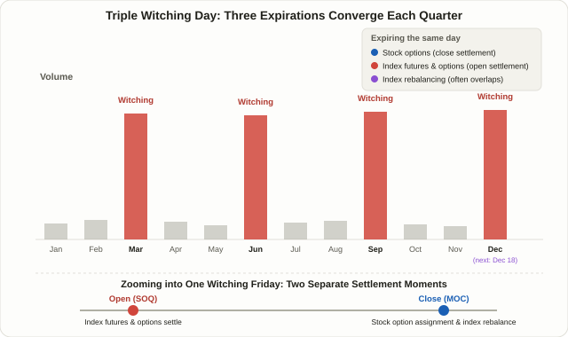

## What Triple Witching Day Actually Is

Four times a year — the third Friday of March, June, September, and December — US trading volume jumps noticeably above normal. That day has a slightly spooky name, **Triple Witching Day**, but nothing about it is mysterious: it just marks the day three different kinds of derivatives expire at once — stock options, stock index futures, and stock index options. Add a fourth leg, single-stock futures, and you get **Quadruple Witching**, a term still used even though single-stock futures have largely disappeared from the US market, which is why the two names now get used almost interchangeably for the same day.

This isn't a pattern-reading technique like Lesson 5's [ICT Smart Money Concepts](/strategies/ict-smart-money-basics/) or Lesson 39's [Order Blocks](/strategies/order-blocks/), where you're inferring institutional footprints from price action. Triple witching is a **mechanical, calendar-fixed event** — the date is known years in advance, and no interpretation is required to know it's coming. In that sense it resembles Lesson 69's [FOMC and CPI Release Trading](/strategies/fomc-cpi-news-trading/), another date you can mark ahead of time. But the resemblance stops there: FOMC and CPI move markets because *new information* forces a repricing. Triple witching moves markets with *zero new information* — the volume and short-term volatility come purely from position unwinds, settlements, and hedge rebalancing that are structurally required to happen that day. As of this writing (November 2026), the next Triple Witching Day is **Friday, December 18, 2026**; March 20 and September 18 have already passed this year.

## Why It All Lands on One Day: Three Different Settlement Mechanics

To understand why volatility clusters here, it helps to know that the three instrument types settle differently, even though they share the same calendar date.

- **Stock index futures** (ES, NQ, RTY, and similar contracts) settle in cash against the **Special Opening Quotation (SOQ)** — essentially Friday's opening price. The open, not the close, locks in the final settlement value.
- **Stock index options** (SPX, NDX, RUT) mostly use **AM settlement**, cash-settling against that same SOQ. Because futures and options reference the identical benchmark, position unwinds in both markets converge on the same narrow window around the open.
- **Individual stock options** settle differently — through physical delivery. Out-of-the-money contracts simply expire worthless, but in-the-money contracts trigger an actual 100-share delivery priced off Friday's **closing print**, generally resolved through the Market-on-Close (MOC) auction. Option sellers (mostly market makers) have to keep adjusting their delta hedge in the underlying stock right up to that close to manage the resulting assignment risk.

Put simply: the index side settles at **Friday's open**, while the single-stock side settles at **Friday's close**. One trading day effectively has two separate "settlement moments" baked into it, and order flow converges on each one in turn — that's the structural backbone of triple witching volatility.

## Two More Ingredients That Make the Mechanism Complete

The settlement mismatch above already explains the volume spike, but two additional forces usually compound it.

The first is a **sudden unwind of dealer gamma hedging**. As covered in Lesson 15, [Gamma Exposure (GEX)](/strategies/gamma-exposure-gex/), market makers hold offsetting positions in the underlying to keep the delta of the options they've sold near zero. When those options expire, the entire hedge either disappears at once or has to roll into the next expiration cycle. If open interest had been concentrated around a particular strike, the "pin risk" that was holding price near that level all week switches off right at expiration — and volatility that had been suppressed can actually pick up right afterward. Lesson 57's [Max Pain Theory](/strategies/max-pain-theory/) and Lesson 59's [Vanna and Charm Exposure](/strategies/vanna-charm-dealer-flow/) both describe this same pattern from different angles: price gets squeezed toward a level as expiration approaches, then that constraint lifts the moment expiration actually hits.

The second is **timing overlap with quarterly index rebalancing**. Major index reconstitutions, S&P 500's among them, are frequently scheduled to take effect at the close of the same Friday as triple witching. As Lesson 75's [Index Inclusion Effect](/strategies/index-inclusion-effect/) explains, passive funds' mechanical buy-and-sell orders concentrate in the closing auction — landing in the exact same order book, at the exact same moment, as the options-driven flow described above. Two entirely separate mechanisms (derivatives settlement and index reconstitution) firing simultaneously is one of the most commonly cited reasons the triple-witching closing auction tends to stand out so much in reported volume.

<figure class="diagram">
  
  <figcaption>Volume spikes only four times a year, on the third Friday of March, June, September, and December. Stock options, index futures, and index options all expire that day, and index reconstitution effective dates often land on the same Friday — concentrating order flow into the Market-on-Close (MOC) window.</figcaption>
</figure>

## How Much Does It Actually Move? Reading Conflicting Findings Honestly

Here's where a lot of commentary overstates the case: "Triple Witching always produces a big move" is not well supported. Several firms have studied this day's volatility and returns, and their conclusions diverge meaningfully. The table below reports each source's own stated conclusion as-is — different sample windows and methodologies mean none of these should be read as the definitive answer.

| Source | Stated finding |
|---|---|
| Citi | Historically high volume but often *lower* intraday volatility than other monthly expirations |
| Robinhood | Volume over 3x normal since 2020; VIX modestly higher on these days (median 20.76 vs. 18.94) — "a bit hotter, not dramatically so" |
| Dow Jones Market Data | Average S&P 500 return on Triple Witching Days since 2020 is roughly −0.5%, skewed to the downside |
| eToro | Weak evidence of a decline on the day itself, but a clearer tendency toward weakness over the following week |
| Seasonax | A modest dip heading into the event followed by a rebound, though December specifically carries a seasonal bullish bias |

The one point of near-consensus is that volume rises. Beyond that, whether price tends to go up, down, or nowhere in particular depends on who you ask. That's not surprising given the sample size — four events a year means even five years of data is only 20 occurrences — and each study uses a different index and window. **The directional bet is not a statistically validated edge; treat it as, at best, a loosely observed tendency.** The volume and short-term-liquidity effect is the far more consistent finding, which is exactly why the strategies below focus on handling concentrated order flow rather than predicting direction.

## Technique A — Avoid It: Sidestep the Volatility Window Entirely

The more conservative approach, and the one that suits most traders.

1. **Don't let new option positions expire on this specific Friday if you can help it**, especially single-stock options near the money, where in-the-money assignment can leave you holding (or shorting) shares you didn't plan on.
2. **Avoid initiating new positions in the final 30–60 minutes before the close** — often called the "witching hour." Orders converging on the MOC auction tend to widen spreads and increase slippage in this window.
3. **Re-check stop distances on existing swing positions against Lesson 13's [ATR-based stops](/strategies/risk-filters-atr-cmf/).** A day with a reasonable chance of wider-than-usual intraday range can trigger a stop sized for an ordinary day well before the real move even starts.
4. **Trade smaller than usual.** Following Lesson 6's [risk-reward and money management](/strategies/risk-reward-money-management/) principle, the same nominal stop distance carries more real dollar risk once volatility expands, so sizing down is the way to keep risk constant rather than letting it drift upward.

## Technique B — Trade It: Treat the Concentrated Flow as the Signal

The opposite approach treats the day's structural quirks as something to watch and trade, not avoid — with the key caveat that this means reading the *flow*, not forecasting direction.

1. **Watch MOC imbalance indicators.** NYSE and Nasdaq both publish real-time estimates of expected buy/sell imbalance ahead of the close. A stock showing an unusually large imbalance is a signal that order flow is likely to concentrate in one direction into the closing print.
2. **Map out where open interest is concentrated beforehand.** Using the same lens as Lesson 57's Max Pain and Lesson 15's GEX, knowing where OI clusters for a given index or stock lets you watch for price pinning near that level — or, just as often, for a sharper move once that pin effect switches off at expiration.
3. **Flag any stocks also tied to index reconstitution that same Friday.** A name covered in Lesson 75 for being added to or dropped from a major index on this exact date sees both options-related flow and passive-fund flow converge, making it the most volatile candidate on the list.
4. **Think in terms of the following week, not just the day itself.** As the eToro and Seasonax findings above suggest, the clearer pattern in several studies shows up in the days *after* triple witching rather than on the day itself. Some traders wait for the following week's potential mean-reversion setup instead of chasing the day's own move.

## Avoid It vs. Trade It: Side by Side

| | Avoid It | Trade It |
|---|---|---|
| Goal | Minimize exposure to volatility and slippage | Read the footprint of concentrated order flow |
| Tools required | None — smaller size is enough | Real-time MOC imbalance feed, OI data, index rebalance announcements |
| Difficulty | Low | High — requires interpreting live data under time pressure |
| Best suited for | Most retail and swing traders | Short-term traders with data-feed access |
| Main risk | Opportunity cost — missing a potential move | Misreading the signal in a window that's already more volatile than usual |
| Requires predicting direction? | No | No — reading flow structure, not betting on direction |

Both approaches share the same core discipline: neither one tries to call direction. Avoiding the window sidesteps the volatility outright; trading it means reading the mechanical footprint the volatility leaves behind. For the large majority of individual investors, avoiding it is the more sensible default — trading it is better suited to traders who already have the real-time imbalance and OI data pipes this approach depends on.

## A Worked Example (Simplified, for Illustration Only)

This is not real data for any actual stock — it's a simplified, hypothetical scenario meant to make the mechanism concrete.

Suppose hypothetical stock XYZ is confirmed for addition to the S&P 500 effective the December Triple Witching Friday, and its options open interest happens to be heavily concentrated at the $100 strike. The stock is currently trading at $98.

- **Index rebalancing flow**: If passive funds' expected buying is estimated at roughly 6x the stock's average daily volume, buy-side imbalance is likely to build toward the closing auction.
- **Options pin risk**: With OI clustered near $100, market-maker delta-hedging flow around that strike can act as a magnet, pulling price toward it.
- **The two forces collide**: Rebalancing flow is pushing price above $100; the options pin is trying to hold it near $100. Going into the close, these two forces fighting it out in the same order book can produce noticeably wider price swings than an ordinary session.
- **Applying risk management**: A trader holding this name as a swing position might cut position size for just that one session, or trim part of the position ahead of the MOC auction, rather than relying on the usual ATR-based stop distance unchanged.

To be clear, this example uses made-up numbers purely to illustrate how two independent mechanisms can collide in the same order book — it is not a backtested result or a real trade.

## What About Markets Outside the US?

Everything above — the statistics and the mechanics — is built on US market structure (S&P 500, US index futures and options). Markets elsewhere have their own expiration calendars that don't map cleanly onto this US-specific event; expiration cycles, settlement rules, and rebalancing schedules vary by exchange and index. If you trade outside the US, confirm your own market's official expiration calendar and settlement conventions directly with that exchange rather than assuming the patterns described here transfer over.

## FAQ

### What's the actual difference between Triple and Quadruple Witching?
Quadruple Witching originally referred to four expirations landing on the same day, with single-stock futures as the fourth leg alongside stock options, index futures, and index options. Since single-stock futures trading has effectively vanished in the US, only three expirations remain in practice, and the two terms are now mostly used to describe the same day. Some sources still use "Quadruple Witching" out of habit — in context, it means the same event as Triple Witching.

### Should I always avoid opening new positions on Triple Witching Day?
Not necessarily. As covered above, the volume increase is fairly consistently observed, but the evidence on price direction is mixed at best. For most retail and swing traders, trading smaller and staying out of the final "witching hour" is the sensible conservative default — but a trader with access to real-time imbalance and OI data can reasonably choose to treat the window as something to watch and trade instead.

### Is the Index Inclusion Effect the same thing as Triple Witching?
They're different mechanisms that frequently share a calendar date. Lesson 75's Index Inclusion Effect is about passive funds being mechanically forced to buy a fixed index weight regardless of price. Triple Witching is about derivatives settlement and dealer hedge unwinds — a completely different structure. The two often coincide because major index reconstitutions are commonly scheduled to take effect on the same Triple Witching Friday, so both mechanisms can end up firing in the same order book at the same moment.

## Summary

- Triple Witching Day is the quarterly event, on the third Friday of March, June, September, and December, when stock options, index futures, and index options all expire together. The next one is December 18, 2026.
- Volatility clusters because the index side settles against Friday's opening price (SOQ) while individual stock options settle against Friday's closing price — two separate settlement moments on one calendar day — compounded by dealer gamma-hedge unwinds and, often, same-day index reconstitution.
- Volume increases fairly consistently, but studies disagree on price direction, so a directional bet on the day itself isn't a reliable, statistically validated edge.
- Avoiding the window (sidestepping the volatility) and trading it (reading imbalance and OI data for footprints) both avoid predicting direction outright — avoiding it is the more realistic default for most individual traders.
- All of the statistics and settlement mechanics described here are specific to US market structure; traders outside the US should verify their own exchange's expiration calendar before assuming any of this transfers over.
