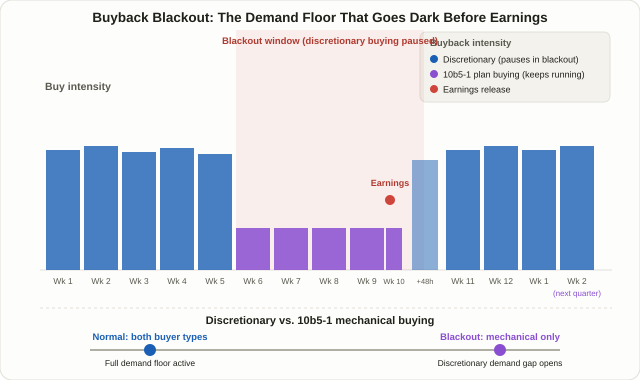

## What a Buyback Blackout Actually Is

Public companies don't buy back their own stock year-round without interruption. For a stretch of time before earnings, and for a day or two after, most of them voluntarily stop — a practice known as a **buyback blackout window**. The first thing to get straight is what this isn't: it's not a rule the SEC enforces with a fixed calendar. There is no federally mandated blackout period in the US. It's a **self-imposed policy**, set independently by each company's own insider-trading guidelines.

Why would a company restrict itself this way? Because its own executives know things about the upcoming quarter that the market doesn't yet know. If the company keeps buying its own stock while sitting on material non-public information, that invites an obvious appearance problem — and potentially real legal exposure. So most companies choose to pause buying ahead of earnings as a blanket way to sidestep that risk entirely, rather than trying to judge case by case whether a given purchase is "clean."

The catch is that the exact window differs company to company, and most firms don't publish it. Two definitions show up most often in practitioner discussion. The narrower one is **roughly two weeks before quarter-end through 48 hours after the earnings release**. The broader one, used in Goldman Sachs's own research, runs from **about five weeks before earnings through two trading days after**. There's no single agreed answer for which is "correct," and that ambiguity is itself the first caveat worth internalizing here — unlike Lesson 107's [Triple Witching Day](/en/strategies/triple-witching-day/), which sits on a fixed exchange calendar, a buyback blackout is something you can only estimate.

## Why a Demand Gap Opens: The Disappearance of a Steady Buyer

To see why this matters for price, start with what buybacks do in normal times. Independent of news or earnings, a company steadily buys its own shares within a set budget — a price-insensitive source of demand that effectively sits under the market as a quiet floor. Goldman's strategists have specifically flagged this: pull that demand out and, if no other investor category steps in to replace it, the overall demand curve can shift down, pressuring valuations and raising volatility.

During a blackout window, that floor temporarily goes dark. If no other buyer shows up to fill exactly the gap the company leaves behind, the same amount of ordinary selling can move price further than it normally would — that's the core logic behind this entire topic. One complication worth flagging up front: the blackout window overlaps almost exactly with earnings itself, an event that moves prices through genuinely new information (guidance changes, surprises). Cleanly separating "volatility from the missing buyer" from "volatility from the earnings news" is difficult, and no study fully isolates the two.

<figure class="diagram">
  
  <figcaption>Buyback intensity holds steady for most of the quarter, drops as discretionary buying pauses heading into earnings — leaving only the residual floor kept alive by pre-set 10b5-1 plans — and recovers roughly 48 hours after the earnings release.</figcaption>
</figure>

## Does Volatility Actually Rise During the Window? Conflicting Findings

Before accepting "blackouts always shake the market harder" at face value, it's worth laying the actual research side by side — because it disagrees more than most summaries let on.

| Source | Stated finding |
|---|---|
| Goldman Sachs (25-year study) | Return dispersion during blackout windows runs about 16 percentage points vs. 14 points outside them; volatility runs about 16.4 points vs. 15.8 — both modestly higher |
| A Goldman trader (older estimate) | Buyback flow may drop by roughly 35% once a blackout window opens |
| A trader cited by CNBC (2018) | Put the same flow decline lower, at 30% or less |
| LuxAlgo and other skeptics | Call the evidence largely anecdotal, arguing that earnings results and macro news dominate any single quarter's volatility far more than the blackout calendar does |
| S&P Dow Jones Indices (2025 data) | S&P 500 buybacks hit a record $293.5B in Q1 2025, slowed to $234.6B in Q2 as blackout season bit, then rebounded toward record levels again in Q3 |

The real takeaway isn't that these sources disagree on direction — almost all of them point the same way, toward somewhat higher volatility and somewhat lower demand during the window. What they disagree on is **magnitude and statistical significance**. Goldman's own 16-vs-14 gap is modest enough to read either as "a real, measurable effect" or as "barely distinguishable from noise," depending on how much weight you want to put on it. The 2025 quarterly buyback figures — a record quarter, followed by a blackout-season dip, followed by a snapback — are consistent with the mechanism, but they're aggregate flow data, not proof that any specific stock's price or volatility moved because of it. **Treat this as a reasoned hypothesis, not a validated statistical edge.**

## The Buffer: Why 10b5-1 Plans Blunt the Effect

Part of why findings vary so much is that buying rarely stops completely during a blackout. SEC Rule 10b5-1 is a **safe harbor**: if a company sets up a predefined buying plan while it isn't holding material non-public information, purchases executed under that plan can continue mechanically even once a blackout window opens later. Discretionary buying — someone deciding day to day whether and how much to buy — is what actually pauses. Scheduled, rule-based buying under a 10b5-1 plan generally does not.

That means a blackout window isn't really "zero demand" — it's closer to "discretionary demand goes away, mechanical demand stays." Companies that lean heavily on 10b5-1 plans should, in theory, show a weaker blackout effect; companies that do most of their buying at a trading desk's discretion should show a sharper one. The problem is that how much any given company relies on a 10b5-1 plan isn't something an outside trader can verify in real time, so this stays an assumption rather than a known input.

## Technique A — Risk Management: Handling Positions Through the Window

This approach doesn't try to call direction; it just adjusts for a window where volatility has a reasonable chance of expanding. It's the more realistic default for most individual traders.

1. **Flag the roughly 2-to-5-week stretch heading into the next earnings date as a "volatility-expansion-possible" zone.** You don't need the exact blackout dates — just the next confirmed earnings date, which is public.
2. **Re-check stop distances against Lesson 13's [ATR-based risk filters](/en/strategies/risk-filters-atr-cmf/), and lean conservative.** With a steady buyer temporarily out of the market, an ordinary-sized stop can get triggered more easily than it would in a normal stretch.
3. **Pay closer attention to stocks that rely heavily on discretionary buying.** Smaller and mid-cap names tend to have a thinner base of passive or institutional demand to begin with, so losing the buyback floor can be felt more acutely than in a mega-cap with deep, diversified ownership.
4. **Size down in line with Lesson 6's [risk-reward and money management](/en/strategies/risk-reward-money-management/) principle.** The same nominal stop distance carries more real dollar risk once volatility expands, so reducing size is what keeps actual risk constant.

## Technique B — Watching the Reopen: What Happens After the Window Closes

This approach treats the moment discretionary buying resumes as the thing worth watching, not the blackout itself — but it needs to be handled with considerably more caution, for reasons covered right below.

1. **Mark roughly 48 hours after the earnings release as the point discretionary buying is generally assumed to resume.**
2. **One older analysis, using data since 2000, reported that holding for a month after the blackout lifted produced gains 71% of the time in Utilities and 63% of the time in Financials.** That figure comes from a single source with an unstated sample size and methodology — it should be treated as a historical curiosity to note, not a validated rule to trade on.
3. **Watch volume alongside price as the window reopens.** Whether volume picks up as discretionary buying returns, and whether price retraces in the direction that had been suppressed during the blackout, are both worth observing.
4. **Never use this alone.** It only makes sense as supporting context alongside an independent technical signal, such as Lesson 47's [MACD divergence](/en/strategies/macd-signal-divergence/) or Lesson 9's [trend pullback re-entry](/en/strategies/trend-pullback-ma/).

## Technique A vs. Technique B

| | Technique A: Risk Management | Technique B: Watching the Reopen |
|---|---|---|
| Goal | Reduce exposure during a possible volatility-expansion window | Watch for a retracement as discretionary buying resumes |
| Information needed | Next earnings date (public) | Earnings date plus low-confidence historical sector stats |
| Difficulty | Low | Moderate — requires handling weak statistical backing honestly |
| Best suited for | Most retail and swing traders | Traders who use it as supporting context alongside other signals |
| Main risk | Opportunity cost | Over-trusting a pattern built on a thin sample |
| Requires calling direction? | No | Partially — but not reliable enough to stand alone |

Both techniques start from the same premise: a buyback blackout is a voluntary practice, not a legal mandate, and the size of its market effect hasn't been nailed down statistically. Technique A treats that uncertainty itself as the risk to manage. Technique B treats the pattern that emerges from that uncertainty as a secondary data point, never a standalone signal.

## A Worked Example (Simplified, for Illustration Only)

This isn't real data for any actual stock — it's a simplified, hypothetical scenario meant to make the mechanism concrete.

Suppose hypothetical mid-cap stock ABC is three weeks from its next earnings release. Over the past three years, roughly 70% of its buyback volume has been discretionary and about 30% has run through a 10b5-1 plan. If ABC's average daily buyback has historically equaled about 8% of its ADV (average daily volume), the blackout window would remove the discretionary 5.6 percentage points of that figure, leaving only the mechanical 2.4 points running on autopilot. A trader holding this name as a swing position might respond by trimming size for the duration of the window, or widening stops modestly, rather than keeping the pre-blackout ATR-based stop unchanged. To be clear, every number here is invented purely to illustrate how the discretionary-versus-mechanical split works — it isn't a backtested result or a real trade.

## Outside the US

Every statistic cited above — Goldman's 25-year study, the 2025 S&P 500 figures — is specific to the US market. There's no federally mandated blackout outside the US either, and insider-trading restrictions around company buybacks are generally handled through each jurisdiction's own securities law rather than an SEC-style framework. Markets with a smaller free float and more concentrated ownership can see a related but distinct phenomenon: a controlling shareholder personally buying shares, which gets reported and discussed publicly but works through an entirely different mechanism than a corporate blackout — it's an individual's purchase, not the company's. If you trade outside the US, treat the US-specific statistics here as a mental model for the mechanism, not a transferable number, and check the company's own buyback disclosures directly.

## FAQ

### Where can I find the exact blackout dates for a stock?
In most cases, you can't — exact start and end dates are rarely published. The practical workaround is to back into an estimated window from the next confirmed earnings date: roughly 2 to 5 weeks before it, through about 48 hours after. Treat it as an approximate range, not a confirmed calendar.

### Does the company really buy zero stock during the blackout?
Not necessarily. Purchases executed under a pre-set 10b5-1 plan can continue mechanically through the window. What actually stops is discretionary buying — purchases a trading desk decides on day by day.

### Is this a statistically validated trading edge?
No. The direction of the effect — somewhat higher volatility, somewhat lower demand — has reasonable support, but the magnitude and statistical significance vary a lot across studies. It's safer to treat this as a reason to dial risk management down conservatively than as grounds for a directional bet.

## Summary

- A buyback blackout isn't a legal requirement — it's a voluntary practice companies use to sidestep insider-trading risk by pausing stock purchases around earnings.
- Because buybacks normally act as a steady, price-insensitive source of demand, temporarily removing them during the blackout window is the core mechanism behind any resulting demand gap and volatility increase.
- Goldman's research found modestly higher return dispersion and volatility during blackout windows, but other analyses call the effect largely anecdotal — the conclusions genuinely conflict.
- 10b5-1 plans let mechanical, pre-scheduled buying continue through the blackout, so the real-world size of the effect likely varies by how much any given company relies on discretionary purchases.
- The most realistic use of this concept isn't a directional bet — it's a reason to conservatively widen stops and trim position size heading into a company's next earnings release.
