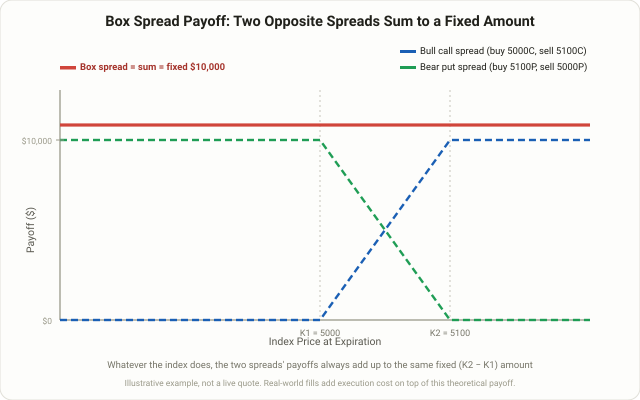

## Four Options, One Fixed Payout

A few years ago, an ETF called **BOXX** turned a strategy long used almost exclusively by hedge funds and market makers into something regular investors could buy with a single ticker. It's a **box spread**: a combination of four options — two calls and two puts, same underlying, same expiration, two different strikes — built so that at expiration, the payout is **the same fixed number no matter where the underlying ends up**. That makes it fundamentally different from every other options strategy in this course. Lesson 58's [iron condor](/en/strategies/iron-condor-credit-spread/) is a bet that price stays inside a range; a box spread isn't a bet on price at all. The calls and puts are arranged so their payoffs cancel each other out exactly, leaving a locked-in number behind.

Why does that matter to a trader who isn't trying to predict price? Because a fixed payout at a fixed future date, bought for a known price today, is exactly what a zero-coupon bond is. Once you know what you pay now and what you collect later, you can back out an **implied interest rate**. If that rate sits below prevailing lending rates, buying the box is effectively lending money below market — not attractive. If it sits below your own borrowing cost, selling the box becomes a way to borrow cheaply instead. That dual use — as either a near-risk-free return or a low-cost financing tool — is exactly why institutions have leaned on box spreads for decades, and why retail capital has recently piled into box-spread ETFs like BOXX.

## The Structure: A Bull Call Spread Plus a Bear Put Spread

A box spread isn't a new invention — it's two familiar spreads stacked on top of each other.

**Legs one and two — the bull call spread.** Buy a call at the lower strike (K1), sell a call at the higher strike (K2). On its own, this leg pays (K2 − K1) if price finishes above K2, and progressively less, down to zero, below that.

**Legs three and four — the bear put spread.** Buy a put at the same higher strike (K2), sell a put at the same lower strike (K1). On its own, this leg pays (K2 − K1) if price finishes below K1, and progressively less above that.

Hold all four at once, and wherever price lands at expiration — below K1, above K2, or anywhere in between — the two spreads' payoffs always add up to exactly (K2 − K1). Wherever the call spread's payoff is rising, the put spread's is falling by the same amount, and vice versa. They fill in each other's gaps perfectly.

<figure class="diagram">
  
  <figcaption>The bull call spread (blue dashed line) and bear put spread (green dashed line) move opposite to each other across price, but their sum — the box spread (solid red line) — stays fixed at the same amount no matter where the underlying ends up.</figcaption>
</figure>

## Why It Works: Put-Call Parity Locks the Payout

This isn't an approximate cancellation — it's exact, and the reason is put-call parity. For options sharing the same strike and expiration, (call price − put price) equals (underlying price − the present value of the strike). Apply that relationship at K1 and again at K2, then subtract one from the other, and the underlying-price term cancels out completely. What's left is just the present value of (K2 − K1). The stock price drops out of the equation entirely, which is exactly why the position doesn't care where price goes.

That's what makes a box spread economically identical to a **synthetic zero-coupon bond**: pay a fixed amount now, collect a fixed and larger amount at a known future date. Exchanges like CME and Cboe describe it in almost those terms — closer to a fixed-term deposit than to a directional options trade. All of this logic, though, rests on the four legs being priced correctly relative to each other. Real markets add friction on top of the theory, and that friction is where the next two sections pick up.

## A Worked Example

The numbers below are illustrative only, not a live quote. Say an index is trading at 5000, and you build a 12-month box spread using the 5000 and 5100 strikes.

- **Bull call spread**: buy the 5000 call, sell the 5100 call → net cost of roughly $6,200 (scaled to a 100-multiplier contract)
- **Bear put spread**: buy the 5100 put, sell the 5000 put → net cost of roughly $3,500
- **Total box spread cost**: $6,200 + $3,500 = **$9,700**
- **Fixed payout at expiration**: (5100 − 5000) × 100 = **$10,000**, whether the index settles at 3000 or 8000

Pay $9,700 today, collect $10,000 in a year, and the implied rate works out to (10,000 − 9,700) / 9,700 ≈ **3.1% annualized**. That number means nothing on its own — it only matters next to an alternative. If 1-year Treasury bills are yielding something close to 4% at the same moment, buying this box is a worse deal than just buying T-bills, and there's no reason to do it. Flip the trade and **sell** the box instead — collect $9,700 now, owe $10,000 at expiration — and you've effectively borrowed money at 3.1%. Against a typical retail margin loan rate in the high-single to low-double digits, that's a meaningfully cheaper way to access leverage.

## Long Box vs. Short Box: Lending vs. Borrowing

| | Long Box (Buy) | Short Box (Sell) |
|---|---|---|
| Cash flow today | Pay net debit (e.g. −$9,700) | Receive net credit (e.g. +$9,700) |
| Cash flow at expiration | Receive fixed amount (+$10,000) | Pay fixed amount (−$10,000) |
| Economic effect | Equivalent to lending money | Equivalent to borrowing money |
| Typical user | Investors comparing the implied rate to T-bills or cash, BOXX-style ETFs | Traders seeking cheaper funding than a margin loan, or extra leverage |
| Attractive when | Implied rate beats the risk-free rate | Implied rate beats your margin borrowing rate |
| Main risk | Execution costs erode the rate edge | Early assignment or a margin call forces an unfavorable unwind |

The real point of this table: neither side of a box spread is inherently "cheap" or "expensive." It only means something relative to an alternative. A long box gets judged against T-bills or cash; a short box gets judged against a margin loan or a securities-based line of credit. Either side only has a reason to exist when it beats that alternative — there's no edge baked into the box spread structure itself.

## Why It's Not Perfectly Risk-Free

In theory, a box spread carries zero price risk. In practice, calling it fully risk-free overstates the case.

- **Execution costs can swallow a thin rate advantage.** All four legs need to be filled, and each one carries its own bid-ask spread. A theoretical 3.1% edge can shrink sharply once real fill prices and commissions are counted against it.
- **American-style options carry early assignment risk.** Most single-stock options can be assigned at any time before expiration. If one short leg is assigned early, the four-leg balance breaks, and the "fixed payout" assumption no longer holds. This is why box spreads are typically built with **cash-settled, European-style** index options like SPX, where early assignment is structurally impossible.
- **Unwinding the position early isn't always easy.** Exiting all four legs at once at a fair price can be harder than entering them, and needing the cash back before expiration may force an unfavorable close.
- **Your broker's margin treatment makes or breaks the trade.** If you're using a short box as cheap financing, whether your broker recognizes it as a defined-risk combination (modest margin) or treats each leg separately (far larger collateral requirements) decides whether the strategy is even usable for you.
- **Regulators and exchanges pay attention to it.** Box spreads were historically a tool for institutions and market makers, and aggressive use for leverage has drawn regulatory scrutiny at times. Plenty of retail brokers restrict or simply don't support the structure.

Put together, a box spread is best described as "fixed in theory, nearly fixed in practice." The gap between those two is transaction costs and execution risk, and underestimating that gap is how the trade ends up less attractive than the math first suggests.

## BOXX and the Retail Route In

Building a box spread yourself as a retail trader means filling four legs well, and bid-ask costs make that inefficient at small account sizes. That's the gap products like **BOXX** (the Alpha Architect 1-3 Month Box ETF) fill. Instead of holding actual Treasuries, it continuously rolls SPX-based box spreads to replicate something close to short-term T-bill returns. Much of its appeal reportedly has less to do with the yield itself than with **tax treatment** — a T-bill ETF or money market fund distributes interest income that gets taxed every year, while BOXX's return shows up mostly as price appreciation, deferring taxation until the shares are actually sold. Tax treatment depends heavily on account type, jurisdiction, and future rule changes, so treat this as a description of a general mechanism rather than tax advice, and check with a tax professional before relying on it.

It's also worth remembering that an ETF like BOXX typically carries a higher expense ratio than a plain T-bill fund, and that its return tracks the **options market's implied rate**, not the Treasury market directly. The two usually move together, but they can diverge when options-market liquidity thins out. As covered in Lesson 106's [Treasury basis trade](/en/strategies/treasury-basis-trade-repo-arbitrage/), structures that use leverage to amplify a tiny, mathematically locked-in price gap tend to run quietly most of the time — and then get tested hard in the specific stretches when the underlying market's liquidity dries up.

## FAQ

### Is a box spread really 100% risk-free?
The theoretical payout is fixed regardless of price, but real-world execution costs, bid-ask spreads, and early assignment risk (on single-stock options) mean it isn't perfectly risk-free in practice. "Nearly fixed" is the more accurate description.

### Why use index options like SPX instead of single stocks?
SPX, XSP, and similar index options are European-style (exercisable only at expiration) and cash-settled, which removes early assignment risk entirely. Single-stock options are American-style and can be assigned at any time, which can break the fixed-payout assumption a box spread depends on.

### Can a retail trader build a box spread directly?
Yes, but all four legs need to fill at reasonable prices, and your broker's margin treatment of the combination matters. Smaller accounts tend to lose more of the theoretical edge to bid-ask costs, which is a big part of why many investors access this structure indirectly through an ETF like BOXX instead.

## Summary

- A box spread combines a bull call spread and a bear put spread at the same strikes and expiration, locking the payout at expiration to a fixed (K2 − K1), regardless of where the underlying ends up.
- That fixed payout follows directly from put-call parity and makes the position economically equivalent to a synthetic zero-coupon bond — pay a known amount now, collect a known, larger amount later.
- Buying it (long box) is a lending trade judged against T-bills and cash; selling it (short box) is a borrowing trade judged against margin loan rates. Neither side has an inherent edge — it only matters relative to the alternative you'd otherwise use.
- It isn't perfectly risk-free: execution costs, early assignment risk on American-style single-stock options, difficulty unwinding early, and your broker's margin treatment can all erode the theoretical advantage.
- ETFs like BOXX roll this structure using SPX options to give retail investors indirect access, but the return still depends on options-market liquidity and carries its own expense ratio.
