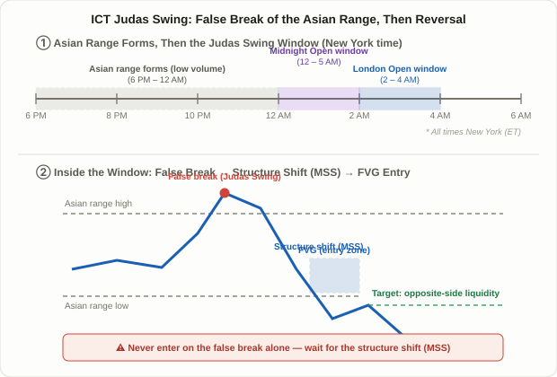

## What a Judas Swing Actually Is

The **Judas Swing** is an ICT (Inner Circle Trader) term borrowed from the biblical story of a trusted figure who betrays that trust at the decisive moment. In trading, it describes a move at the open of a major session that first pushes convincingly in one direction — enough to make it look like "today's trend" — and then, right as that read gets accepted, reverses hard the other way. It's a specific case of the liquidity sweep covered in Lesson 5's [ICT Smart Money Concepts Basics](/en/strategies/ict-smart-money-basics/), but what sets it apart is that it ties the sweep to a named clock window and a named reference range, rather than leaving "when" and "against what level" open-ended.

Recall Lesson 7's [PO3 and Confirm DOL](/en/strategies/po3-confirm-dol/) and its Accumulation-Manipulation-Distribution cycle. The Judas Swing is essentially a zoomed-in lens on the middle step — Manipulation. PO3 describes the shape of the whole session; the Judas Swing spells out, in much more concrete terms, exactly which level gets broken during that manipulation phase and exactly what candle has to show up to confirm the reversal.

## Why This False Move Keeps Showing Up

Two structural reasons are commonly cited for why this pattern recurs. First, the Asian session (Tokyo and Sydney hours) tends to trade thin, which compresses price into a narrow range. Just outside that range's high and low, two kinds of orders tend to stack up: stop-losses from traders who got caught inside the range, and fresh breakout entries from traders waiting for a move outside it. Second, once a higher-volume session like London or New York opens, it doesn't take much size to push price just past that thin range and trigger both pools of resting orders at once. In other words, there's a structural gap where relatively little capital can absorb the liquidity sitting outside a quiet overnight range — before the session's actual directional move even begins.

This explanation assumes large participants are deliberately exploiting that gap, which is a shared premise across ICT/SMC concepts generally, not an academically verified fact. What is fair to say is that the resulting pattern — a false break right at session open followed by a sharp reversal — is something reported repeatedly across trading communities, independent of whether the underlying cause is intentional manipulation or simple market mechanics.

## Three Timing Variants: Midnight Open, London Open, New York Open

Exactly when a Judas Swing is defined to occur varies by source. The three most commonly cited windows are:

| Variant | Time (ET) | Reference range |
|---|---|---|
| Midnight Open | 12:00–5:00 AM | Midnight open price, or the Asian range high/low |
| London Open | 2:00–4:00 AM (some sources: 3:00–5:00 AM) | Asian session high/low |
| New York Open | Around 9:30 AM | Prior day's close, or the pre-market range |

<figure class="diagram">
  
  <figcaption>A false break of the Asian range's high or low marks the Judas Swing; after a market structure shift confirms the reversal, the entry comes on the retracement into the FVG it leaves behind.</figcaption>
</figure>

All three variants pair the same two ingredients: a range built during a quieter, lower-volume stretch, and the open of a session where volume picks up sharply. Whichever variant you use, the reference range — the Asian high/low, the midnight open, or the prior close — has to be marked clearly in advance. Without it, there's no fixed point against which to even call something a "false" break.

## The Entry Logic: Reference Range → False Break → Structure Shift → FVG Entry

Turning the Judas Swing into an actual trade comes down to four steps.

1. **Mark the reference range first**: before the window opens, write down the Asian range's high and low (or the midnight open level) as hard numbers. Without this, there's nothing to measure a "false" break against.
2. **Wait for the false break**: once the window opens, wait for price to poke slightly past that level and trigger the resting orders stacked just beyond it. On its own, this step proves nothing yet — it could just as easily be the start of a genuine breakout.
3. **Confirm a market structure shift (MSS/CHoCH)**: right after the false break, the lower timeframe (1- to 15-minute chart) needs to show the prior swing structure breaking in the opposite direction — the same concept covered in Lesson 48's [BOS and CHoCH](/en/strategies/market-structure-bos-choch/). Only this structure shift turns "price poked past a level" into "that poke was false, and the real direction is the other way." Entering immediately on the false break, without waiting for this shift, is not the intended sequence.
4. **Enter on the FVG or order block retracement**: the candle that confirms the structure shift usually leaves behind a Fair Value Gap or order block. That becomes the entry zone as price retraces into it. The stop goes just beyond the false break's extreme (its high or low); the target is the opposite end of the reference range — the liquidity pool on the other side of the one the false break just swept.

Step 2 and step 3 need to happen in that exact order. Entering purely because a false-looking break occurred, without the structure shift confirming it, means betting blind on whether that break actually reverses or simply continues as the real trend.

## A Worked Example: EUR/USD at the Midnight Open

Assume the daily chart shows a bearish structure — lower highs and lower lows — so the broader bias favors shorts.

1. **Asian session (6:00 PM–12:00 AM ET)**: EUR/USD trades in a tight range between 1.0820 (low) and 1.0845 (high) — the Asian range is set.
2. **12:15 AM**: as the midnight open window opens, price spikes to 1.0855, breaking above the Asian range high — triggering both breakout buy orders and stop-losses from shorts caught inside the range.
3. **12:22 AM**: on the 5-minute chart, price breaks a recent swing low to the downside — a market structure shift (MSS) confirming that the breakout above 1.0855 was false and the real direction is down.
4. **12:31 AM**: price retraces into the FVG left by the reversal candle, between roughly 1.0838 and 1.0843. You short at 1.0840, with a stop just above the false break's extreme at 1.0858 — an 18-pip risk.
5. **Targets**: the first target is the Asian range low at 1.0820 (20 pips, roughly 1.1:1), with an extended target at the prior day's low of 1.0795 (45 pips, roughly 2.5:1).
6. **1:40 AM**: price reaches 1.0797, near the extended target, where the remaining position is closed out.

If step 3's structure shift had never materialized and price had simply kept making new highs above 1.0855, that would point to a genuine breakout rather than a Judas Swing — and the short entry should have been skipped.

## Judas Swing vs. Silver Bullet: What Actually Differs

Lesson 54's [ICT Silver Bullet](/en/strategies/ict-silver-bullet-strategy/) and the Judas Swing are both time-anchored ICT frameworks, but they answer different questions.

| | Judas Swing | Silver Bullet |
|---|---|---|
| Core question | "Was this break real or false?" | "Is this even a window where I should be looking?" |
| Reference level | Asian range high/low, or the midnight open | None — the time window itself is the filter |
| Required confirmation | False break + market structure shift (MSS/CHoCH) | Liquidity sweep + a displacement candle |
| Entry direction | Opposite the false break | Same direction as the HTF bias |
| Typical windows | Midnight Open, London Open (12:00–5:00 AM) | Three fixed one-hour windows (London Open, AM, PM) |

In practice the two aren't mutually exclusive. A trader might use the Judas Swing to establish that a given session-open move was false and the real direction is the opposite way, then look for a Silver Bullet-style sweep-and-FVG setup later in the day to re-enter in that confirmed direction. The Judas Swing also shares a family resemblance with Lesson 77's [Turtle Soup](/en/strategies/turtle-soup-false-breakout-fade/) — both fade a false breakout — but Turtle Soup anchors to a 20-day daily-chart level rather than a specific session-open clock window.

## FAQ

### Does a Judas Swing happen every single day?
No. Plenty of sessions open with only a minor touch of the reference range, or with a clean, uninterrupted move in one direction and no false break at all. If the conditions — a break of the reference range followed by a structure shift — don't show up, the correct response is simply not to trade that window.

### Where exactly should the stop go?
Just beyond the false break's extreme — the high or low of the sweep itself. Placing it too close, right inside the sweep's wick, makes it vulnerable to a second poke back into that same zone before the real move gets going.

### Is there a verified win rate or risk-reward statistic for this?
No backtest from an independent, credible source exists for this. Specific win-rate figures that circulate online mostly trace back to marketing material from vendors selling indicators or courses, and haven't been independently verified. The pip and risk-reward figures in the worked example above are illustrative only, not a guarantee of results.

## Limitations and Caveats

- **An unvalidated, observation-based framework**: like the rest of the ICT/SMC toolkit, the Judas Swing rests on community observation rather than any peer-reviewed statistical edge.
- **The "false false break" risk**: a move that looks like a Judas Swing can simply continue as a genuine trend without any structure shift ever confirming a reversal. Skipping step 3 and acting on step 2 alone exposes you to exactly this trap.
- **Stops getting re-tagged**: traders in these communities commonly report price running close to the target and then snapping back to take out the stop before the real move resumes — a byproduct of how sharp the volatility around these windows tends to be.
- **Overlap with scheduled news**: the New York Open variant in particular can coincide with scheduled U.S. data releases, making it hard to separate a genuine false break from ordinary news-driven volatility.
- **No standardization**: the exact window (12:00–5:00 AM vs. 2:00–4:00 AM vs. around 9:30 AM) varies by source. Pick one definition, apply it consistently, and backtest it before trading it live.

## Summary

- A Judas Swing is a false break of the Asian range (or the midnight open level) right as a major session opens, absorbing stop-losses and breakout orders before price reverses the other way.
- The two most commonly cited timing variants are the Midnight Open (12:00–5:00 AM ET) and the London Open (2:00–4:00 AM ET), and both pair a quiet overnight range with the open of a higher-volume session.
- The entry sequence is **mark the reference range → wait for the false break → confirm a market structure shift (MSS/CHoCH) → enter on the FVG or order block retracement** — skipping the structure-shift confirmation is the single biggest risk in using this concept.
- Compared to the Silver Bullet, the Judas Swing answers a different question — whether a specific break was real or false, rather than when you're allowed to look for a setup — and the two are often chained together.
- No verified win-rate or risk-reward statistic exists for this pattern, so treat every number here as illustrative and pair it with independent stop-loss and position-sizing rules rather than trading it in isolation.
