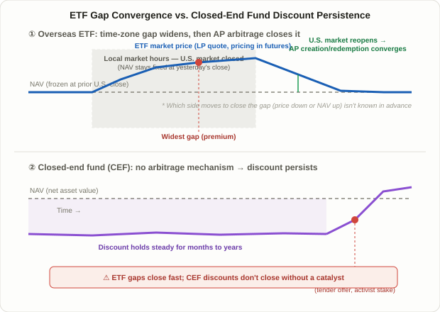

## What a Premium or Discount Actually Means

The price you see when you buy an ETF is not always the same as the real value of what it holds. That gap is called the **premium or discount to NAV**, and the formula is simple:

```
Premium/Discount (%) = (Market Price − NAV) / NAV × 100
```

A positive number means the ETF trades at a **premium**; a negative number means a **discount**. NAV (Net Asset Value) is the value of the fund's holdings divided by shares outstanding, calculated once, officially, after the market closes. During the trading day, exchanges publish an **intraday indicative value (iNAV)** every few seconds, estimated from the prior day's holdings. When traders say they "checked against NAV" during market hours, they're almost always looking at this iNAV estimate, not the official end-of-day NAV — a distinction that matters more than it sounds, because misreading which one you're comparing against is the single most common way retail traders misjudge a gap.

## Why Price Snaps Back to NAV: The AP Arbitrage Mechanism

Unlike an ordinary stock, an ETF's price structurally resists drifting far from NAV for long. The reason is a special class of participant called an **Authorized Participant (AP)** — a large broker-dealer that can transact directly with the fund issuer.

- **When the ETF trades above NAV (premium)**: an AP buys up the basket of underlying securities the ETF tracks, delivers that basket to the issuer, and receives newly created ETF shares (**creation**) in return — which it then sells into the market at the richer price. That extra supply pushes the ETF price back down.
- **When the ETF trades below NAV (discount)**: an AP buys the cheap ETF shares in the market, hands them back to the issuer for **redemption**, and receives the underlying basket in return — which it sells at full value. That buying pressure on the ETF pushes its price back up.

Because this creation/redemption loop is close to risk-free once costs are accounted for, APs have a built-in incentive to close the gap whenever it opens. That's the core structural reason ETF prices converge to NAV far more reliably than, say, a closed-end mutual fund or an individual stock trading on sentiment. The part worth understanding, though, is that this mechanism doesn't work equally well in every situation — which is exactly where today's lesson is headed.

## Why Overseas and Leveraged ETFs See the Gap Widen

Even a domestically listed ETF can see its premium/discount swing wider when the assets it tracks trade overseas. Three structural reasons are commonly cited:

1. **NAV gets frozen by the time difference**: when a Korean investor trades a Nasdaq-tracking ETF during KRX hours (9:00 AM–3:30 PM local), the U.S. market is closed. The official NAV is still anchored to yesterday's U.S. close, while the ETF's actual market price keeps moving in real time, reacting to overnight index futures and other live signals. If U.S. futures moved sharply overnight, the KRX-session NAV is effectively "yesterday's number," while the market price has already priced in the new information — and that gap is the premium or discount.
2. **Liquidity providers hedge with imperfect substitutes**: LPs typically quote prices while hedging through index futures or correlated assets, and when those hedging instruments don't trade on the exact same hours or depth as the underlying market, bid-ask spreads widen and the gap grows with them.
3. **Leveraged and inverse products are structurally non-linear**: 2x or inverse ETFs are built to replicate a daily return, and exchanges and issuers commonly note that premiums/discounts tend to widen disproportionately during high intraday volatility. That's a property of the product's design, not a predictable pattern any single trader can reliably exploit.

| ETF type | Main driver of the gap | Typical volatility of the gap |
|---|---|---|
| Domestic-asset ETF | Real-time pricing during market hours; usually small | Low |
| Overseas-asset ETF | Time-zone gap freezes NAV; FX swings | Moderate–high |
| Leveraged/inverse ETF | Non-linear widening during intraday volatility | High |
| Commodity/futures-based ETF | Roll timing, time-zone mismatch with the physical market | Moderate–high |

<figure class="diagram">
  
  <figcaption>An overseas ETF's overnight gap closes once the underlying market reopens and AP arbitrage resumes, but a closed-end fund's discount has no such mechanism and can persist indefinitely without an external catalyst.</figcaption>
</figure>

## A Worked (Hypothetical) Example

The numbers below are illustrative, built to show the mechanism — not real data for any specific fund.

1. **Prior U.S. close**: the Nasdaq-100 finishes up 1.2%. A Korea-listed ETF tracking it calculates tomorrow morning's official NAV at ₩10,000 based on that close.
2. **Overnight futures move further**: during the Asian session, Nasdaq-100 futures add another 0.8%, and that information is already circulating in the market.
3. **KRX open (9:00 AM)**: the official NAV is still ₩10,000 (frozen at yesterday's close), but the LP quotes the ETF near ₩10,080, pricing in the overnight futures move. The gap is roughly +0.8%.
4. **Midday volatility**: a sharp FX swing widens bid-ask spreads, and the gap briefly expands to about +1.3%.
5. **U.S. market reopens (11:30 PM local)**: the Nasdaq-100 opens roughly in line with where futures had been pointing, and the next official NAV recalculates to reflect it. The gap closes — but it could close either because the ETF price came down or because NAV caught up to the price. A shrinking gap, by itself, says nothing about which direction that resolution takes.

The number that matters here isn't the +0.8% itself — it's the structural point that **the gap isn't a "wrong price," it's the distance between a reference value that hasn't updated yet and new information the market has already absorbed.**

## ETF Arbitrage vs. Closed-End Fund Discounts: Why They're Not the Same Thing

A concept frequently confused with ETF premiums/discounts is the **discount on a closed-end fund (CEF)**. Both describe "market price diverging from net asset value," but why the gap forms and how long it survives are fundamentally different.

| | ETF premium/discount | Closed-end fund (CEF) discount |
|---|---|---|
| Arbitrage mechanism | AP creation/redemption, operating continuously | No formal mechanism exists |
| Typical duration | Hours to a few days | Months to years |
| What closes it | Underlying market reopening, normal arbitrage | Tender offers, activist campaigns, liquidation/open-ending |
| Primary cause | Time-zone gaps, liquidity, product structure (leverage) | Investor demand/supply, manager reputation, tax/distribution issues |
| Room for a retail edge | Limited — the gap closes too fast | Comparatively larger — persistence gives time to analyze |

The practical takeaway follows directly from this. Treating a temporary ETF premium or discount as a "buy the dip" opportunity means competing against AP arbitrage that's already closing that exact gap, often faster than a retail order can react. A CEF discount is different precisely because no mechanism forces it shut — which is why value-oriented investors in this space tend to focus less on the discount number itself and more on *why* it exists (weak performance, a distribution cut scare, simple supply/demand imbalance) and on what catalyst — a tender offer, board pressure, an activist stake — might eventually force it to close.

## Practical Checkpoints

- **Confirm which NAV you're comparing against.** Intraday iNAV can be an estimate built on stale holdings data; confusing it with the official NAV leads to over- or under-reading the gap.
- **Avoid trading, or size down, when the gap looks unusually wide.** Leveraged and inverse products in particular see the gap itself behave like a volatility measure — trading into an abnormally wide one adds price risk that has nothing to do with your actual market view.
- **Check the bid-ask spread and volume alongside the gap.** A premium/discount number in isolation can mislead; an unusually wide quoted spread from the LP is often the more honest signal that conditions are abnormal.
- **For large orders, contact the issuer or an AP directly** — a common recommendation once an order approaches creation-unit size.
- **A related but distinct risk**: Lesson 91's [Single-Stock Covered Call ETF Decay](/en/strategies/single-stock-covered-call-etf-decay/) covers NAV erosion from the product's own structure, a different problem from the premium/discount discussed here — but both are reminders that the number on an ETF's price tag doesn't always equal the value you actually receive.

## FAQ

### Is there a specific percentage gap that signals danger?
There's no industry-standard threshold. Figures like "watch out above 3–5%" circulate on blogs and forums, but they're anecdotal rules of thumb, not validated benchmarks. What matters more is tracking a given ETF's normal range for yourself and investigating the cause — a time-zone gap, breaking news, thin liquidity — whenever it moves outside that range.

### If the gap shrinks, does that guarantee a profit?
No. A premium can close two ways: the ETF price falls toward NAV, or NAV rises to meet the price. If you bought at the premium and it closes the first way, you lose money even though "the gap closed." A shrinking gap and a profitable outcome are two separate questions.

### Do domestic-asset ETFs ever show a premium or discount?
Yes, but usually a much smaller one. Because the underlying assets trade in real time on the same exchange, NAV and market price move almost in lockstep, and AP arbitrage tends to respond more immediately.

## Limitations and Caveats

- **Arbitrage isn't guaranteed to work smoothly everywhere.** For fixed-income ETFs with less liquid underlying bonds, research has found that creation/redemption baskets sometimes represent only a small slice of a fund's holdings, which can slow how quickly the gap closes.
- **Wide spreads can themselves discourage arbitrage.** ETFs with larger bid-ask spreads give APs less incentive to step in, so a visible gap can persist longer than the mechanism would suggest it should.
- **This is a checklist, not a validated edge.** Nothing here is a backtested strategy claiming to generate excess returns from trading the gap; it's a defensive routine for avoiding unfavorable fills, not a source of alpha.
- **Don't conflate this with FX and tax effects.** For overseas-asset ETFs, the premium/discount is often entangled with currency hedging decisions and FX moves, making it hard to isolate a "pure" gap signal.

## Summary

- **Premium/discount** = (Market Price − NAV) / NAV × 100; positive is a premium, negative is a discount.
- ETF prices converge to NAV because of **Authorized Participant creation/redemption arbitrage**, the structural feature that makes ETFs more price-efficient than most other fund structures.
- Overseas-asset ETFs widen their gap mainly through a **time-zone-driven NAV freeze**, while leveraged/inverse ETFs widen it through the **non-linear effect of intraday volatility**.
- A **closed-end fund discount** is a fundamentally different phenomenon: with no formal arbitrage mechanism, it can persist for months or years and typically closes only with an external catalyst like a tender offer or activist campaign.
- A shrinking gap says nothing on its own about profit direction, so the safer approach is a defensive routine — confirm which NAV you're using, and check whether the quoted spread looks normal — rather than treating the gap as a tradable edge by itself.
