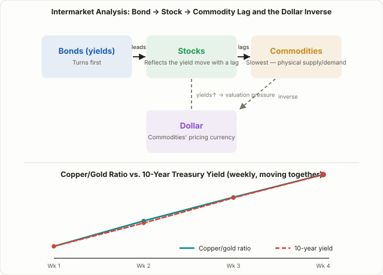

## Stop Looking at One Chart — Watch Four Asset Classes at Once

Almost every strategy in this course starts from a single chart, a single ticker, a single indicator. But what actually moves a stock's price isn't confined to the stock market. When rates rise, equity valuations get squeezed. When the dollar strengthens, commodity prices tend to fall. When commodities rise, inflation expectations shift, which in turn feeds back into interest rates. Reading how **bonds, stocks, commodities, and currencies (mainly the dollar)** push and pull on each other is called **intermarket analysis**.

The technician who formalized this framework is John J. Murphy, whose 1991 book *Intermarket Technical Analysis* and its 2004 revision, *Intermarket Analysis*, laid out the typical lead-lag sequence and correlation patterns across the four asset classes. That framework is still a widely cited reference point today. Through 2026, long-end Treasury yields have stayed stubbornly elevated while commodity prices kept printing fresh cycle highs, and bond-market commentary has repeatedly made the point that checking whether bonds have turned first is worth doing before reading too much into a move in stocks or commodities. Unlike [the yield curve steepener/flattener lesson](/en/strategies/yield-curve-steepener-flattener/) (Lesson 100), which trades the rate spread itself, this lesson is about reading the order in which a rate move propagates into other asset classes — as context, not as a tradeable spread. It shares a family resemblance with [the RRG sector rotation lesson](/en/strategies/rrg-sector-rotation/) (Lesson 26) in that both compare multiple things on one screen, but here the comparison is across entire asset classes rather than sectors within one.

## Four Core Relationships: What Pulls on What

The fastest way into intermarket analysis is to learn these four relationships. All four are **frequently observed tendencies, not physical laws** — that caveat matters and will come back in the risks section below.

| Relationship | Typical pattern | Why it tends to hold |
|---|---|---|
| Dollar ↔ Commodities | Inverse (weaker dollar → stronger commodities) | Major commodities like gold and oil are priced in dollars, so a weaker dollar makes them relatively cheaper for holders of other currencies, lifting demand |
| Bonds (yields) ↔ Stocks | Usually inverse (higher yields → valuation pressure) | Yields are the discount rate applied to future cash flows, so a higher discount rate lowers the present value of the same future earnings |
| Copper/gold ratio ↔ long-term Treasury yield | Usually moves the same direction | Copper reflects industrial demand (growth optimism), gold reflects safe-haven demand, so the ratio acts as a rough proxy for growth and inflation expectations |
| Sequencing | Bonds turn first, then stocks, then commodities | Bond markets are the largest and fastest to reprice on new information; commodities lag because physical inventory and production cycles take time to adjust |

These four relationships aren't independent — they chain together. A weaker dollar lifts commodities, rising commodities push up inflation expectations, which pushes up long-end yields, and that yield increase then pressures equity valuations. Murphy described this as a rotating chain: in a typical slowdown, bonds tend to bottom first (yields stop falling), stocks follow, and commodities are usually the last of the three to confirm a bottom.

## Why It Works: Same Variable, Different Speed

Intermarket analysis isn't built on some mysterious leading indicator. It works because all four asset classes respond to the **same underlying macro variables** — growth expectations, inflation expectations, liquidity conditions — but they respond to them at different speeds and through different mechanisms.

Bond markets are the largest and most liquid markets in the world, and they reprice almost instantly on a single central-bank sentence. That makes them one of the fastest, most efficient markets at pricing in new information. Equities have to digest that same discount-rate move alongside a shifting earnings outlook, so they often lag by a beat. Commodities are constrained by physical reality — inventory levels and production/consumption cycles mean prices take time to fully reflect a shift in supply and demand. Currencies, meanwhile, price in interest-rate differentials and capital flows almost immediately, and because commodities are dollar-denominated, the dollar ends up in a near-mechanical inverse relationship with them.

So the claim that "bonds move first" isn't a mystical forecasting power — it's a fairly ordinary structural fact that the fastest, most efficient market tends to price in new information first.

<figure class="diagram">
  
  <figcaption>Bonds typically turn first, with stocks and commodities following in sequence (solid arrows). The dollar and commodities carry the dashed inverse relationship shown at left. The lower panel shows the copper/gold ratio tending to move in the same direction as the 10-year Treasury yield.</figcaption>
</figure>

## Using It in Practice: A Regime Filter, Not a Signal

The most common misreading of intermarket analysis is trying to use it as a standalone buy/sell trigger. In practice, it's not a tool for pinpointing entries and exits on an individual stock — it's a **top-down filter** for figuring out what macro regime you're currently in.

| | Single-asset technical analysis | Intermarket analysis |
|---|---|---|
| What's analyzed | One stock or index chart | Bonds, stocks, commodities, and the dollar together |
| Purpose | Precise entry/exit timing | Context for the current macro regime |
| Timeframe | Daily/intraday, short-term | Weekly/monthly, longer-term |
| How it's used | Can stand alone as a signal | Combined as a filter on top of other strategies |

In practice, traders watch a handful of representative tickers: the dollar via the DXY index or the UUP ETF, long-duration Treasuries via TLT or IEF, gold via GLD, copper via CPER or copper futures, and broad commodities via something like DBC. For example, if an equity index is making new highs while long-end yields are simultaneously spiking (bond prices falling sharply), that's a reasonable cue to size new positions more conservatively, since the valuation pressure from higher yields may not be fully priced in yet. Conversely, a weakening dollar alongside a rising copper/gold ratio is often read as a backdrop that favors commodities, emerging markets, and cyclical sectors relatively more than defensives.

## A Worked Example (Illustrative, Not Live Market Data)

The table below is a **hypothetical, illustrative example** meant only to show how the copper/gold ratio and the 10-year Treasury yield tend to move together — it is not live market data.

| Week | Copper futures ($/lb) | Gold futures ($/oz) | Copper/gold ratio (×1000) | 10-year Treasury yield |
|---|---|---|---|---|
| Week 1 | 4.20 | 2,650 | 1.585 | 4.10% |
| Week 2 | 4.35 | 2,620 | 1.660 | 4.22% |
| Week 3 | 4.48 | 2,590 | 1.730 | 4.35% |
| Week 4 | 4.60 | 2,560 | 1.797 | 4.47% |

Over four weeks, the copper/gold ratio climbs steadily from 1.585 to 1.797, and the 10-year yield climbs right alongside it, from 4.10% to 4.47%. The two moving in roughly the same direction is consistent with a market pricing in both growth optimism (stronger copper demand) and firmer inflation expectations at the same time. If instead the ratio kept climbing while yields fell — a divergence — that would be a cue to suspect one of the two is being distorted by a temporary supply-side factor (say, a copper mine disruption) and to cross-check against another indicator before drawing a conclusion. In practice nobody calculates this by hand each week; most traders just pull up a ratio chart of the two futures prices on a platform like TradingView.

## Limitations and Risks You Need to Know

- **Correlations are regime-dependent, not fixed.** The bond-stock relationship isn't a constant. In the 1970s, when inflation was the dominant worry, stocks and bonds frequently moved together (positive correlation). During the 2000s–2010s disinflationary period, they more often moved opposite each other (negative correlation). 2022 is the textbook counterexample people cite: a shared inflation shock sent both stocks and bonds down together, breaking the "bonds act as a safe haven when stocks fall" assumption for an extended stretch.
- **The dollar-commodities inverse relationship isn't airtight either.** A real supply shock — war, a logistics disruption — can push a specific commodity higher even while the dollar stays strong, overriding the usual inverse tendency.
- **There are lag periods and divergences.** The copper/gold ratio looks like a leading indicator for yields in some stretches, but there have also been quarters where the two diverged noticeably. Don't lean on one ratio alone; cross-check several relationships before drawing a conclusion.
- **It's not a standalone trading signal.** Intermarket analysis gives you macro context, not a specific entry price or stop-loss level. The risk-management principles covered in [Lesson 6 on risk/reward and money management](/en/strategies/risk-reward-money-management/) apply here exactly as they do everywhere else in this course.

## FAQ

### Can intermarket analysis alone tell me when to buy or sell?
Not with precision. It's best used to establish the bigger picture — whether you're in a rising-rate regime, a weak-dollar period, an early-cycle expansion, and so on — while actual entries and exits are decided with individual-stock technical analysis or another strategy layered on top.

### Can the dollar be strong and commodities rise at the same time?
Yes. A real supply shock — a war, a shipping disruption, anything that directly hits physical supply and demand — can override the usual inverse relationship for a stretch. The inverse pattern is a frequently observed tendency, not a fixed rule, and it's worth repeating that point.

### What should I do if the copper/gold ratio and bond yields diverge?
First suspect that one of the two is being distorted by a temporary supply-side factor — a mining strike, a shift in gold ETF flows, something specific to that market. Watch whether the divergence persists or closes quickly, and cross-check it against other macro indicators, such as the data releases covered in [Lesson 69 on trading FOMC and CPI releases](/en/strategies/fomc-cpi-news-trading/).

## Summary

- Intermarket analysis reads the lead-lag relationships between bonds, stocks, commodities, and the dollar together, surfacing macro context that a single-asset chart can't show on its own.
- The four core tendencies are the dollar-commodities inverse relationship, the yield-stock inverse relationship, the copper/gold ratio tracking long-end yields, and a sequencing pattern where bonds tend to turn first, stocks second, and commodities last.
- This works because all four asset classes respond to the same macro variables but at different speeds, with the bond market — the largest, fastest-repricing market — typically pricing in new information first.
- In practice, traders track representative tickers like DXY, TLT, GLD, and CPER, and use the combined picture as a top-down filter for position sizing and risk management rather than a standalone buy/sell signal.
- Correlations shift with the macro regime — inflationary versus disinflationary periods flip the sign of the bond-stock relationship, and 2022 showed it can break down entirely — so cross-check multiple relationships and combine this with the risk-management discipline used elsewhere in this course.
