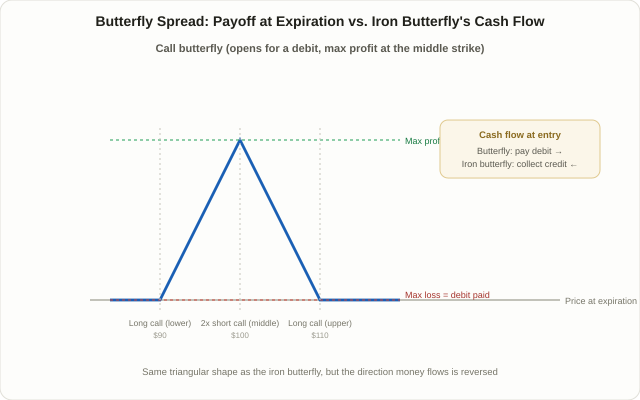

## The Iron Butterfly's Debit-Paying Cousin

Lesson 98 covered the [iron butterfly](/en/strategies/iron-butterfly-options-strategy/): four legs mixing calls and puts, built to collect a net credit. The **butterfly spread** covered in this lesson — often called a "long butterfly," or a "call butterfly" / "put butterfly" depending on which option type builds it — produces almost the exact same sharp-triangle payoff shape as the iron butterfly, but the construction and the direction cash flows is flipped. It's built from calls only (or puts only) across three strikes, and it starts by paying a small amount of money (a debit) rather than collecting one.

This structure has come back into focus lately alongside the surge in 0DTE (zero days to expiration) options volume. Multiple market-data providers have reported that same-day-expiring contracts now account for more than half of SPX options volume on the CBOE — the exact figure varies by source and by the date measured, so treat any single percentage as a snapshot rather than a fixed number — and within that flow, the butterfly is frequently described as one of the most asymmetric, capital-efficient 0DTE structures available. Lesson 24 on [0DTE options trading](/en/strategies/0dte-options-trading/) covered the extreme gamma and theta behavior of same-day options; this lesson covers one of the most basic structures for harnessing that extreme gamma while knowing the maximum loss up front.

## The Structure: Three Strikes in a 1-2-1 Ratio

A butterfly spread stacks three options of the same expiration and the same type (all calls, or all puts) in a 1-2-1 ratio. Using the call version as the reference:

- **Buy one call at the lower strike** — below, or at, the current price.
- **Sell two calls at the middle strike** — the "pin point" price the trade is betting on.
- **Buy one call at the higher strike** — above the middle strike.

The three strikes are usually spaced evenly (say, $90 / $100 / $110). Because the premium collected from the two middle calls sold is smaller than the combined premium paid for the two outer calls, the trade nets out to a debit overall. Splitting the structure into pieces makes it easier to follow: it's exactly a **bull call spread** (built from the lower and middle strikes) stacked on top of a **bear call spread** (built from the middle and higher strikes), sharing the middle strike. Two vertical spreads facing opposite directions, fused into one. Building it from puts instead produces a "put butterfly," which carries essentially the same payoff as the call version thanks to put-call parity.

<figure class="diagram">
  
  <figcaption>A butterfly spread peaks at the middle strike like an iron butterfly, but unlike the iron butterfly it starts by paying a debit rather than collecting a credit.</figcaption>
</figure>

## Why It Can Work: Collected Theta Offset by a Paid Debit

The core mechanic behind a butterfly spread's profit is the same one covered in Lesson 98 on the iron butterfly: options near the money carry the richest time value, and selling two of them at the middle strike collects that rich premium. The difference is that an iron butterfly mixes calls and puts to collect a pure net credit, while a butterfly spread uses only one option type, so the intrinsic and time value of the options bought doesn't fully offset the time value of the options sold — the leftover gap is the debit paid upfront.

As time passes, and especially as expiration nears, the two middle-strike short options bleed time value fast, while whichever outer long option is in the money holds onto its intrinsic value. The closer the stock sits to the middle strike, the more favorably this "theta collected minus debit amortized" dynamic plays out, pushing the position's value above the debit paid — and if the stock lands exactly on the middle strike at expiration, the trade reaches its theoretical maximum profit. If the stock instead finishes entirely beyond either outer strike, the whole position simply loses the debit paid and nothing more — which is exactly why the maximum loss is capped at that fixed, known number from the moment the trade is opened.

## A Worked Example: One Cycle in Numbers

Say a hypothetical stock trades at $100 with 35 days to expiration — the same price level used in Lesson 98's iron butterfly example, so the two structures sit side by side.

**Call butterfly (evenly spaced, $10-wide)**

| Leg | Strike | Direction | Premium |
|---|---|---|---|
| Long call (lower) | $90 | Buy | Pay $11.50 |
| Short call (middle) × 2 | $100 | Sell | Collect $5.80 × 2 = $11.60 |
| Long call (upper) | $110 | Buy | Pay $2.10 |

- Net debit = (11.50 + 2.10) − 11.60 = **$2.00 ($200 per contract)**
- Maximum loss = the debit paid = **$200** (if the stock finishes entirely below $90 or above $110)
- Maximum profit = (middle strike − lower strike − debit) × 100 = (10 − 2.00) × 100 = **$800** (if the stock expires at exactly $100)
- Breakevens: $90 + 2.00 = **$92** on the downside, $110 − 2.00 = **$108** on the upside.

Lesson 98's iron butterfly on the same $100 stock (net credit $470, max loss $530, breakevens $95.30–$104.70) makes the structural contrast concrete.

| | Iron Butterfly (Lesson 98) | Call Butterfly (this example) |
|---|---|---|
| Cash flow at entry | Collect $470 credit | Pay $200 debit |
| Maximum profit | $470 | $800 |
| Maximum loss | $530 | $200 |
| What causes max loss | Price stays exactly at center | Price finishes entirely outside the outer strikes |
| Breakeven range | $95.30–$104.70 | $92–$108 |
| How it frames the trade | Credit — a volatility-selling view | Debit — a pin-point-betting view |

The table makes the key point explicit: the two payoffs share the same triangular shape, but money moves in opposite directions and the conditions for the worst outcome are reversed. Both structures pay off when the stock sits near the center, but an iron butterfly's profit comes from a credit eroding favorably, while a butterfly spread's profit comes from a debit growing. The fact that the maximum loss is fixed and known from the moment of entry also makes it unusually easy to apply the principle from Lesson 42 on [Kelly criterion position sizing](/en/strategies/kelly-criterion-position-sizing/) — decide the maximum acceptable loss first, then size the position backward from that number.

## Why Butterflies Keep Coming Up in 0DTE Discussions

The reason butterflies get mentioned so often in 0DTE trading is straightforward. Gamma on a same-day option grows extreme as expiration approaches: buying a naked call or put outright exposes the position to fast losses from even a small move in the wrong direction, while selling one naked opens up unlimited loss in the other direction. A butterfly mixes long and short legs so that extreme gamma exposure is capped on both sides, and because the debit paid to enter is small to begin with, the risk-to-reward ratio is often described as more asymmetric than other common 0DTE structures. What gets mentioned less often, but matters just as much, is that this same asymmetric structure tends to produce little or no profit on days when price trends strongly in one direction. Profit declines in a straight line the further price moves from the center and hits zero once it clears an outer strike — at which point there's nothing left to lose, but also nothing left to gain, so a strongly trending session usually calls for a different structure from the start.

## Picking Strikes and Width

- **Middle strike (the pin target).** Choose the price the stock is expected to settle near by expiration. Setting it near the money frames a neutral bet; setting it above or below the current price adds a mild directional lean.
- **Width.** Widening the gap between the outer strikes and the middle strike raises both the debit paid and the maximum profit, while also widening the breakeven range — an easier target to hit, at a higher cost. A narrower width lowers the debit and raises the reward-to-risk ratio, but demands the stock land inside a tighter zone.
- **Broken wing butterfly.** Making the two wing widths unequal is a common variation in practice. Widening one side can shrink the risk on that side, or even turn the net debit into a small credit — an approach that, like Lesson 97's [jade lizard](/en/strategies/jade-lizard-options-strategy/), deliberately builds an asymmetric risk profile favoring one direction.

## Managing the Position and Its Pitfalls

- **Transaction costs stack up across four fills.** Selling two contracts at the middle strike means four separate fills in practice, not three. As with the net-of-cost view covered in Lesson 13 on [ATR and CMF risk filters](/en/strategies/risk-filters-atr-cmf/), commissions and slippage eat a larger share of returns the smaller the debit paid, so this matters more here than in bigger trades.
- **Because it's a debit trade, exit timing matters in a different way.** An iron butterfly is typically managed around protecting the credit collected; a butterfly spread is more often managed around a pre-decided multiple of the debit paid — for example, closing once the position is worth some target multiple of what was paid. Holding to expiration gets theoretically closest to maximum profit, but that's also the zone where a small move away from the pin erodes profit fastest.
- **Early assignment risk on American-style options.** Whichever long leg finishes in the money is exercised automatically; whichever short leg finishes in the money can be assigned early — a short call near an ex-dividend date carries a meaningfully higher chance of that, so checking the dividend calendar matters.
- **A day that "looks pinned" doesn't guarantee the next one will be.** Even when the middle strike looks like a reasonable pin target, unexpected news or a gap can push price outside the breakeven range easily. The one structural safeguard that doesn't change is that the worst-case loss was capped at the debit paid from the very start — a meaningfully different risk profile from the iron butterfly's.

## FAQ

### What's the difference between a call butterfly and a put butterfly?
Thanks to put-call parity, a call butterfly and a put butterfly built from the same strikes and expiration carry essentially the same theoretical payoff. In practice, available capital, small pricing differences between calls and puts (skew), and early assignment risk can tilt the choice slightly toward one or the other.

### Should I learn the butterfly spread or the iron butterfly first?
Both share the same center-peaked payoff shape, so the first thing worth understanding is that the cash flow direction is reversed between them. Many traders find it easier to start with the butterfly spread, since the maximum loss is a clean, fixed number (the debit paid), before moving on to the iron butterfly's credit-based structure.

### Does trading butterflies in 0DTE improve the win rate?
A favorable risk-to-reward ratio and a high win rate are two different things. Because profit erodes quickly once price drifts even slightly from the center strike, there's no solid basis for assuming the win rate is unusually high amid the large intraday swings typical of same-day options. This is a commonly cited structural characteristic, not a validated statistic, and should be treated accordingly.

## Summary

- A butterfly spread stacks three calls (or puts) in a 1-2-1 ratio as a debit trade — it shares the same triangular payoff shape as Lesson 98's iron butterfly, but the direction of cash flow is reversed.
- Selling two options at the middle strike collects the richest available time value, while buying one option at each outer strike caps the worst-case loss at the debit paid.
- It's mathematically identical to a bull call spread stacked on a bear call spread sharing a middle strike, and building it with puts instead produces nearly the same payoff thanks to put-call parity.
- The fact that maximum loss is fixed at the debit paid from the outset is the most practically important difference from the iron butterfly, and it's a key reason the structure comes up so often as a basic tool for managing extreme gamma exposure in 0DTE trading.
- It produces little or no profit on strongly trending days, so transaction costs, a pre-decided exit threshold, and an honest check on whether the pin-point view is actually reasonable all matter before putting the trade on.
