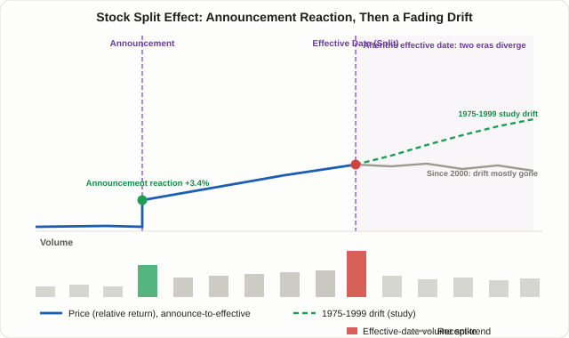

## What Is the Stock Split Effect: Price Moves When Nothing Fundamental Changed

A **forward stock split** changes none of a company's fundamentals. Split 10-for-1 and share count multiplies by ten while the price per share divides by exactly ten — the real value of any shareholder's stake is mathematically identical before and after. Cutting a pizza into sixteen slices instead of eight doesn't give you more pizza. And yet, in real markets, prices around split announcements move in ways that are too consistent to be pure noise. That contradiction — nothing fundamental changes, but the price moves anyway — is the whole puzzle behind the **stock split effect**.

Compare it to the other "effect" lessons in this course, like [Lesson 75's index inclusion effect](/en/strategies/index-inclusion-effect/) or [Lesson 108's buyback blackout window](/en/strategies/buyback-blackout-window/), and the mechanism looks completely different. Index inclusion is driven by a visible, forced flow of money — passive funds that must buy regardless of price. A stock split involves no such forced buyer. The entire effect, to the extent it exists, runs through investor psychology and interpretation alone, which makes this one of the more purely behavioral phenomena in the whole course — and one whose size has swung dramatically across different eras, which is the part worth understanding before trading it.

## Why It Might Work: Signaling Theory and the Trading-Range Hypothesis

Two main theories explain why a purely cosmetic event moves price. Neither is settled fact — both are competing, complementary hypotheses, and that distinction matters.

**Signaling theory** comes first. Companies rarely split at random moments. They almost always split after the stock has already run up substantially, once management is confident the higher price level is durable or will keep climbing. The logic cuts both ways: if the stock stumbles right after a split, it reads as a management misjudgment and damages credibility, so a management team that isn't confident tends to avoid splitting in the first place. A split announcement is therefore an implicit message — "we believe the recent strength is real and sustainable" — and the market prices in some, though not all, of that signal on the spot.

**Second is the trading-range theory**, sometimes called the liquidity theory. When a per-share price climbs too high, the pool of investors who can comfortably buy a round lot shrinks. Splitting lowers the per-share price and, in theory, widens that buyer pool, improving liquidity and narrowing relative bid-ask spreads. A behavioral layer sits on top of this: a lower nominal price can trigger a "cheapness" illusion — money illusion — that draws in buyers even though their percentage ownership of the company hasn't changed at all.

<figure class="diagram">
  
  <figcaption>The announcement-date reaction, the modest grind into the effective date, and the fork afterward — the drift found in 1975–1999 data versus the largely vanished drift found in post-2000 data.</figcaption>
</figure>

## The Timeline: Announcement, Effective Date, and What Comes After

Research on this effect almost always breaks the data into three windows.

1. **Announcement date.** This is when the board approves and discloses the split ratio and effective date. One of the most-cited figures here is a market-adjusted abnormal return of roughly 3.38% on the announcement date itself — commonly cited as evidence that the market underreacts to the signal rather than pricing it in fully and immediately.
2. **The run-up between announcement and effective date.** There's usually a gap of several weeks here, during which media coverage and retail attention tend to concentrate, and price often grinds higher in a stair-step pattern. One industry analysis claims that measuring from one month before the effective date, the stock closed higher by the effective date about 64% of the time — but that figure uses a different reference point (one month before the effective date, not the announcement date) and its sample and methodology weren't disclosed, so it isn't directly comparable to the academic, announcement-based numbers below.
3. **The effective date and afterward.** On the effective date, share count actually increases and the per-share price divides by the split ratio. The psychologically "cheaper" stock often draws fresh buying, and volume frequently spikes well above normal. It's in the period after this date that the most heavily studied phenomenon in this space begins: the **post-split drift**.

## The Core Study: What Ikenberry, Rankine, and Stice (1996) Found

The most frequently cited paper here is David Ikenberry, Graeme Rankine, and Earl Stice's 1996 study, "What Do Stock Splits Really Signal?" Analyzing 1,275 two-for-one splits, they reported the following:

| Measurement window | Reported abnormal return | What it means |
|---|---|---|
| Announcement date | ~+3.38% | The market's immediate reaction to the split announcement |
| 1 year post-effective | ~+7.93% | Excess return that continued accumulating well after the announcement |
| 3 years post-effective | ~+12.15% | The reported drift extending even further than the one-year window |

The most important detail in this study is a **negative correlation** between how much the stock had already run up before the split and how much excess return it generated afterward. The authors used this to argue against a pure momentum explanation — if the drift were just "splitting companies keep rallying because they were already rallying," you'd expect the opposite relationship. Instead, they argued the more convincing explanation is **underreaction**: the market doesn't fully price in the split's implicit signal right away, and the price keeps adjusting gradually as that signal gets absorbed over time. That's the same family of phenomenon as [Lesson 36's PEAD](/en/strategies/pead-earnings-drift/) — the idea that markets digest good news slowly rather than all at once.

## The Disappearing Effect: What Post-2000 Research Actually Found

This is the part of the lesson that deserves the most honesty. Ikenberry's sample ran from 1975 into the early 1990s. Later research, including work by Gharghoria and Nguyen (2017), found that the **post-split drift was concentrated in the 1975–1999 period and was essentially absent from 2000–2011**. On top of that, even where some residual effect survived, it was found almost entirely in **small- and micro-cap stocks** — large caps showed no statistically meaningful drift at all.

Why did the effect fade? Several structural shifts likely overlapped.

- **Decimalization.** U.S. markets moved from fractional pricing (e.g., sixteenths of a dollar) to penny-denominated quotes in 2001, fundamentally altering market microstructure. The bid-ask spread improvements that splits used to produce became far less pronounced.
- **The rise of commission-free, fractional-share investing.** Today, most online brokers let someone buy $10 worth of a $1,000 stock. The entire premise of the trading-range theory — that a high per-share price locks out retail buyers — has been structurally undermined. If fractional shares already solved the "problem" a split used to fix, there's less liquidity benefit left over from splitting at all.
- **More arbitrage capital, more efficient pricing.** This is the same logic covered in Lesson 75's "disappearing index effect." As more capital tries to exploit a known anomaly, that anomaly gets priced in faster and the surviving edge shrinks.

## The 2024–2026 Forward-Split Wave, in Practice

Real-world examples make this structural shift concrete. 2024 was a notably heavy year for forward splits. **Walmart (WMT)** executed a 3-for-1 split in February 2024, with its CEO explicitly framing it as making it easier for employees to buy whole shares. **Nvidia (NVDA)** carried out its largest-ever 10-for-1 split in June 2024. **Chipotle (CMG)** went further still with an extreme 50-for-1 split around the same time, bringing its share price down from the $3,000s into double digits. But the overall count of forward splits has been shrinking since then — Wall Street Horizon's tracking shows 76 forward splits in 2024, dropping to 62 in 2025, and down to 37 in the first half of 2026. That decline lines up neatly with the idea that fractional-share investing has already solved the accessibility problem splits were historically meant to address, leaving companies with less reason to bother.

Korean market cases argue for even more caution. Local analysis of a set of Korean companies that executed splits found that five of seven saw their stock decline over the following three months — only Kakao and HD Hyundai were exceptions. Samsung Electronics saw a huge volume spike on its first trading day after its 2018 split, but the stock kept declining afterward; Kakao, by contrast, hit a new all-time high roughly two months after its 2021 split. That split in outcomes is itself the lesson: there's no formula here that says "split, therefore it rises" that holds up in the Korean market. As of 2026, SK Hynix chairman Chey Tae-won has been reported discussing the possibility of a split for that company — worth noting as a live example, though it remains a discussed possibility rather than a confirmed plan.

## Forward Split vs. Reverse Split: Opposite Signals

The clearest way to understand what a forward split signals is to contrast it with its mirror image: the **reverse split**. Both use the word "split," but the market tends to read them as nearly opposite signals.

| | Forward split | Reverse split |
|---|---|---|
| Typical trigger | Price has risen a lot; the goal is to lower it | Price has fallen too far; the goal is to raise it |
| Common motivation | Broaden accessibility, signal confidence, ease employee stock purchase plans | Avoid delisting for falling below an exchange's minimum bid price (often $1 on Nasdaq), clear institutional minimum-price screens |
| How the market tends to read it | A positive signal — management believes things will keep going well (in theory) | Often read as a warning sign that the company is taking action to survive |
| Historical price reaction | Positive announcement-day abnormal return, with a modest drift reported for 1975–1999 | Usually neutral to negative on average, and continued decline afterward is not unusual |
| Recent examples | Walmart, Nvidia, Chipotle (2024) | Small caps facing delisting risk, low-priced post-de-SPAC companies |

This asymmetry isn't an iron law. A reverse split isn't automatically bad news — some companies use it legitimately after a turnaround to meet relisting requirements. And a forward split isn't automatically good news, as Samsung Electronics' case shows. But the average direction of market psychology around the two is clearly different, and that's worth keeping in mind in practice.

## Putting This to Use: A Practical Checklist

Using this effect as a standalone trading signal isn't advisable. A more realistic way to use it:

1. **Don't chase the announcement-day pop.** A chunk of the gap-up may already reflect the expectation, and chasing it means absorbing the risk of a reversal around the effective date without a clear edge.
2. **Don't apply Ikenberry's historical numbers to a mega-cap.** Follow-up research found the drift is essentially absent in large caps today. A split in a name like NVDA or WMT shouldn't be assumed to carry the historical average statistics — those numbers describe a different population of stocks in a different era.
3. **Treat a split announcement as a confirming signal, not a new reason to buy.** If you already hold a position based on a trend-following or momentum thesis (see [Lesson 9's pullback entries](/en/strategies/trend-pullback-ma/)), a split announcement can reasonably reinforce that thesis. Starting a brand-new position purely because of the split is a weaker proposition.
4. **Treat a reverse split as a warning flag first.** Given the historical tendency toward negative outcomes, the safer default is to treat a reverse-split announcement as a cue to re-examine a position rather than to add to it.
5. **Keep position sizing conservative, per [Lesson 6's risk/reward framework](/en/strategies/risk-reward-money-management/).** If you accept that the edge is small and has clearly changed character over time, your bet size should reflect that uncertainty.

## A Worked Example (Simplified, for Teaching Purposes Only)

This is a hypothetical illustration of the mechanics and the statistical trap, not real trade data.

| Item | Before the split | After the split (hypothetical 10-for-1) |
|---|---|---|
| Price per share | $1,000 | $100 |
| Shares outstanding | 50 million | 500 million |
| Market capitalization | $50 billion | $50 billion (unchanged) |
| Investor A's stake (holding 100 shares before) | 100 shares × $1,000 = $100,000; 0.0002% ownership | 1,000 shares × $100 = $100,000; 0.0002% ownership (identical) |

The table's point is simple: Investor A's actual value and ownership percentage didn't move at all. But if someone sized a position expecting this hypothetical mega-cap to replicate Ikenberry's "+7.93% in year one" statistic, that's exactly the trap the later research warns against. As Gharghoria and Nguyen's work shows, post-2000 data finds no statistically meaningful drift for a stock of this size. Plugging a historical small-cap-era average into a 2020s mega-cap split is the precise error this topic needs to guard against.

## Risks and Limitations

- **Research results flip depending on the era studied.** The 1975–1999 and 2000–2011 periods tell opposite stories, so which paper you cite can completely change your conclusion.
- **The effect concentrates in small and micro caps, not mega-caps.** The historical drift statistics don't transfer cleanly to the headline-grabbing NVDA- or WMT-scale splits that dominate recent news.
- **Selection bias is hard to rule out entirely.** Companies that choose to split were already doing well, so some of the observed drift may reflect pre-existing momentum rather than the split itself.
- **Korean market data is limited and mixed.** A handful of cases (Samsung Electronics, Kakao) isn't enough to generalize from, and published Korean academic statistics on this specific effect are thinner than the U.S. literature.
- **Overlapping catalysts muddy the picture.** When a split announcement lands near an earnings report or other news, isolating the split effect from everything else moving the stock becomes difficult.

## FAQ

### Does a stock split always push the price up?
No. Ikenberry's 1996 study reported a positive average drift, but post-2000 research found that drift had largely disappeared, and Korean market cases have shown more declines than gains in some periods. "Split equals rally" is not a reliable equation.

### Is a reverse split always bad news?
It's usually read as a warning sign, but it's not an absolute rule. A reverse split executed to avoid delisting tends to carry a negative context, but one done by a company that has completed a turnaround to meet relisting requirements can mean something different. Checking the stated reason in the company's own filing matters more than the mechanical fact of the split itself.

### Does the stock split effect still matter now that fractional shares are everywhere?
The accessibility benefit the trading-range theory relied on has clearly weakened. But the signaling-theory interpretation — a split as a public statement of management confidence — along with practical reasons like adjusting options contract sizes and easing employee stock purchase plans, still exist. It's more accurate to say the effect has shrunk than that it has vanished entirely.

## Summary

- A stock split is a purely cosmetic adjustment that changes neither market cap nor ownership percentage, but signaling theory and trading-range theory both offer reasons why markets have historically reacted to it anyway.
- Ikenberry, Rankine, and Stice (1996) documented a post-split drift across 1,275 two-for-one splits: roughly +3.38% on the announcement date, +7.93% over one year, and +12.15% over three years.
- Later research found that drift was concentrated in 1975–1999 and had largely vanished by the 2000s, and that even the historical effect was mostly a small- and micro-cap phenomenon rather than a large-cap one.
- Despite the high-profile 2024–2026 wave of mega-cap forward splits (NVDA, WMT, CMG), the overall count of forward splits is declining, consistent with fractional-share investing having already solved the accessibility problem splits used to address.
- In practice, treat a split announcement as a confirming signal rather than a standalone reason to buy, and don't apply historical average statistics to large-cap splits where the research shows the drift no longer holds.
