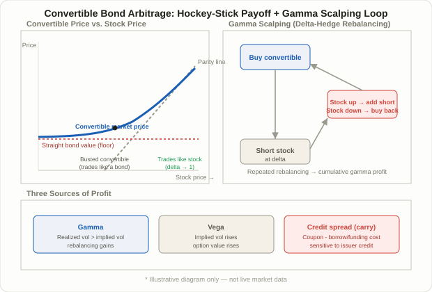

## The Quiet Hedge Fund Trade That Had a Loud 2025

Of all the hedge fund strategies that had a strong 2025, one of the least flashy and most consistent was **convertible bond arbitrage** (often just called "convertible arb"). The HFR convertible arbitrage index was up roughly 6% through July 2025, and some individual managers did far better — LMR Partners' convertible and capital-structure fund was reportedly up around 30% by late October 2025. Part of what fueled that run was a supply shock: global convertible bond issuance hit roughly $157 billion in 2025, the highest since 2021, and a meaningful slice of that new supply came from companies issuing converts to fund AI and data-center buildouts, plus a wave of so-called "bitcoin treasury companies" issuing converts specifically to buy more bitcoin.

This lesson walks through exactly what convertible arbitrage buys and sells, why the strategy works mechanically, and what the most talked-about example of the trade — hedge funds piling into Strategy's (formerly MicroStrategy's) convertible notes — reveals about both its opportunity and its risk. Structurally, this belongs with [Lesson 73's gamma scalping with a long straddle](/en/strategies/gamma-scalping-long-straddle/): both strategies buy optionality and turn price movement into profit through delta-hedge rebalancing. But convertible arb swaps the listed option for a bond with an option embedded inside it, which adds an entirely new axis of risk — credit risk — that a straddle simply doesn't have. It also shares something with [Lesson 44's merger arbitrage](/en/strategies/merger-arbitrage-deal-spread/): the entire payoff depends on a single corporate fact pattern (here, the issuer's creditworthiness and stock price) rather than on broad market direction. Almost no retail trader will replicate this trade directly, but understanding how it prices and hedges the option buried inside a bond explains why issuers of large convertible programs often see outsized stock volatility and sudden swings in short-interest data.

## What a Convertible Bond Actually Is: A Bond With a Call Option Attached

A convertible bond (CB) looks like an ordinary corporate bond on the surface, but it carries an extra right: the holder can exchange it for a fixed number of the issuer's common shares at a preset **conversion price**. That extra right means a convertible bond is really two things bolted together:

- **Straight bond value** — what the bond would be worth with zero conversion right, based purely on its coupon, the issuer's credit quality, and prevailing interest rates.
- **Embedded call option value** — the value of the right to convert into stock once the share price clears the conversion price, driven by the stock price, the conversion price, time to maturity, and implied volatility.

Because that embedded option has real value, convertible bonds carry lower coupons than a comparable straight bond from the same issuer — investors accept less current income in exchange for free exposure to the issuer's stock upside. Two terms matter here: the **conversion premium** is how much higher the conversion price sits above today's stock price, and **parity** is simply what the bond would be worth if converted right now (shares received × current stock price). A convertible bond's market price almost always trades at or above whichever is higher — the straight bond value or parity — and that extra cushion above both is the option premium the market is pricing in.

## The Trade: Long the Convert, Short the Stock at Delta

The mechanics of convertible arbitrage are fairly straightforward on paper:

1. Buy the convertible bond — ideally one where the embedded optionality looks cheap relative to how much the underlying stock actually moves.
2. Short the underlying stock in an amount equal to the bond's **delta** — the sensitivity of the convertible's price to a $1 move in the stock. Delta sits near zero when the stock is far below the conversion price (the bond behaves like a bond) and climbs toward 1 as the stock moves well above the conversion price (the bond behaves like stock).
3. Rebalance that short position continuously as delta shifts with the stock price.

Step 3 is where the actual profit lives. Because a convertible bond contains a long call option, the whole position carries **positive gamma**: when the stock rises, delta rises too, so the hedge needs more shares shorted; when the stock falls, delta falls, so some of the short gets bought back. Repeating that "sell more as it rises, buy back as it falls" cycle locks in a small profit on every swing of the stock, regardless of direction. This is exactly the same mechanism as the gamma scalping covered in Lesson 73 on a long straddle — the only real difference is the container holding the optionality: an options contract there, a bond with an option baked in here.

<figure class="diagram">
  
  <figcaption>Left: a convertible bond's price traces a "hockey stick" shape — flat along the bond floor at low stock prices, curving up toward parity as the stock rises. Right: rebalancing the short hedge as the stock moves is the actual source of gamma-scalping profit.</figcaption>
</figure>

## Three Separate Sources of Profit: Gamma, Vega, and Credit Carry

Convertible arbitrage doesn't earn its return from one single source — it blends three distinct ones at the same time.

| Profit source | What it captures | Grows when |
|---|---|---|
| Gamma (delta-hedge rebalancing) | How much the stock actually moves (realized volatility) | Realized volatility exceeds the implied volatility already priced into the convert |
| Vega | Changes in implied volatility itself | The market starts pricing more future turbulence into the embedded option |
| Credit spread (carry) | Coupon income minus the cost of financing and borrowing the short | The issuer's credit is stable or improving |

The key point is that this is not a directional bet on the stock going up or down. With delta held neutral, the position profits from gamma rebalancing as long as the stock moves a lot **in either direction**, and it can profit further from vega if the manager was right that the market had mispriced the embedded option as too cheap. The three sources don't always move together, either — if an issuer's credit quality deteriorates, the credit-spread leg can lose money even while rising implied volatility (driven by that same credit worry) generates an offsetting gain on the vega leg.

## Why This Trade Is Back in the Spotlight: Bitcoin Treasury Companies and the Issuance Boom

Supply dynamics were the real driver of this trade's 2025 comeback. When issuance surges faster than the market can absorb it, new convertibles routinely get priced cheap relative to the volatility of the underlying stock — and finding those mispricings is the entire point of the strategy. U.S. convertible issuance alone topped $65 billion by mid-2025, and full-year figures came in around $119 billion domestically (roughly $157 billion globally) — the heaviest annual total since 2021.

The signature case study is Strategy (formerly MicroStrategy), which has repeatedly issued convertible notes to finance continued bitcoin purchases. Large funds including Calamos, Linden Advisors, Context Capital, Graham Capital, and Millennium reportedly bought more than $6 billion of the company's converts, running the textbook "long the convert, short the stock" structure. The edge they were after: implied volatility priced into the converts sat well below the stock's realized volatility, given how sharply a bitcoin-linked equity actually swings. That same example illustrates the strategy's risk just as clearly. A company like this has credit quality that's tightly linked to the value of the bitcoin it holds, so a sharp drop in bitcoin can widen credit spreads and hurt the bond leg directly. There's also a separate, less settled wrinkle worth flagging rather than stating as fact: some analysts have argued that when an issuer buys back a chunk of its own outstanding converts, it can reduce the hedging-driven short demand that arbitrageurs were relying on, changing the position's character — but that interpretation is still contested, not an established fact, so it's worth tracking rather than treating as settled.

## A Worked Example (Illustrative, Not Live Market Data)

The following is a **hypothetical, illustrative example** only, not a quote on any real security. Suppose a company issues a convertible bond with a $1,000 face value and a $50 conversion price. The conversion ratio works out to 20 shares ($1,000 ÷ $50), so with the stock trading at $40, parity equals 20 shares × $40 = $800. Assume the bond's delta at this point is 0.5. An arbitrageur buying $1 million face value of these bonds would short roughly $500,000 worth of stock (0.5 × $1,000,000) to hold the position delta-neutral.

Now suppose the stock rises 10%, from $40 to $44, and delta climbs from 0.5 to 0.62 along the way. The arbitrageur has to add to the short to match the new delta — and that act of selling more stock at a higher price is the gamma-rebalancing step itself. If the stock then pulls back from $44 to $41, delta falls again, and the arbitrageur buys back part of that short at a lower price than it was sold for, locking in the difference. Repeat that "sell high, buy back lower" cycle every time the stock swings, and the cumulative rebalancing profit builds up — this is the mechanism that turns realized volatility into cash. The catch is that this only works if the stock's actual realized volatility exceeds the implied volatility baked into the convertible's price; if realized volatility runs below implied volatility, repeated rebalancing can quietly bleed money instead of making it.

| Scenario | Implied vol < realized vol | Implied vol > realized vol |
|---|---|---|
| Gamma-rebalancing P&L | Cumulative profit | Cumulative loss |
| What it implies | The convert's optionality was priced cheap | The convert's optionality was priced rich |
| Typical response | Hold or add to the position | Trim the position or re-check the conversion assumptions |

## Convertible Arbitrage vs. Gamma Scalping a Long Straddle: Same Engine, Different Chassis

Both strategies share a core principle — buy optionality, hold delta neutral, and turn price movement into profit — but the risk profiles diverge in some important ways.

| Comparison point | Convertible bond arbitrage | Gamma scalping a long straddle (Lesson 73) |
|---|---|---|
| Container holding the optionality | A bond (the convertible) | Listed options (a call and a put) |
| Extra risk layered on top | Issuer credit risk | Essentially none beyond exchange counterparty risk |
| Time pressure | Relatively relaxed — runs to bond maturity | Daily theta decay erodes the position constantly |
| Financing the short hedge | Depends on stock borrow availability and cost | No separate borrow needed — the options themselves hedge |
| Downside protection | The straight bond value provides a floor | Maximum loss is the full premium paid |
| Retail accessibility | Very difficult — needs bond-market and borrow infrastructure | Comparatively accessible with a standard options account |

The biggest difference is that floor. Because a convertible bond's price can't fall below its straight bond value (assuming the issuer doesn't default), a convert whose stock has drifted far below the conversion price ends up trading almost like an ordinary corporate bond — a condition the market calls a **busted convertible**. A long straddle has no equivalent floor: if the stock barely moves at all, the entire premium can decay away to zero through theta. In short, convertible arbitrage trades credit risk for a bond-shaped downside cushion, while straddle gamma scalping avoids credit risk entirely but pays for that with a daily time-decay cost.

## Key Risks: Credit, Borrow, and Liquidity

- **Credit risk.** A deterioration in the issuer's credit quality lowers the straight bond value itself, pulling down the "floor" under the convertible's price. For bitcoin-treasury-style issuers, where credit quality is closely tied to a single volatile asset's price, a sharp drop in that asset can translate directly into credit deterioration.
- **Borrow risk.** Delta hedging requires borrowing the stock to short it. If borrow demand spikes, borrow costs rise, or — in the worst case — shares simply become unavailable to borrow (short-squeeze risk), the cost of maintaining the hedge can eat into or exceed the strategy's profit.
- **Liquidity risk.** The convertible bond market is generally thinner than the equity or Treasury markets. If a manager needs to exit a position quickly and can't find a buyer, the gap between the position's marked value and what it actually sells for can be substantial.
- **Retail replication is genuinely impractical.** Access to the convertible bond itself, precise delta calculation, and a reliable stock-borrow line all assume institutional-grade infrastructure. The point of this lesson isn't a how-to guide — it's background for understanding why stocks with large outstanding convertible programs so often show elevated volatility and sudden swings in reported short interest.

## FAQ

### Is this the same as exchangeable bond arbitrage?
Nearly identical in structure. A convertible bond converts into the issuer's own stock; an exchangeable bond (EB) converts into shares of a different company (often an affiliate) that the issuer holds. The arbitrage mechanics — buy the bond, short the underlying stock at delta — are the same either way, but exchangeable bonds add an extra layer of credit analysis, since the issuer's creditworthiness and the stock being converted into belong to two different companies.

### Why does heavier convertible issuance create more arbitrage opportunity?
New supply takes time for the market to fully absorb, and that absorption lag often leaves pricing temporarily cheap. Issuers that are new to the convertible structure, or that attach complicated terms (call provisions, anti-dilution clauses), can also make it harder for the market to price the embedded optionality correctly. Reporting around 2025's issuance surge suggested these inefficiencies tend to cluster when issuance is concentrated, but that's an analyst interpretation, not a rule that applies evenly to every deal.

### Does heavy hedge fund shorting in this trade hurt the stock?
The short leg here is a hedge, not a directional bet against the company, so it isn't inherently designed to push the stock down. That said, when a large convertible offering is announced, the resulting wave of hedging-related short demand from arbitrageurs can create short-term downward pressure — sometimes called **CB overhang** — and conversely, when an issuer buys back converts, that hedging-driven short demand can unwind, pushing in the opposite direction. Both effects are discussed by analysts, but neither should be treated as a guaranteed, mechanical outcome.

## Summary

- Convertible bond arbitrage buys a convertible bond and shorts the underlying stock at the bond's delta to stay delta-neutral — sharing its core mechanism with Lesson 73's gamma scalping, just with a bond standing in for a listed option.
- Profit comes from three distinct sources: gamma (rebalancing gains when realized volatility beats implied volatility), vega (rising implied volatility), and credit spread carry — and because delta stays neutral, the trade isn't a directional bet, just a bet that the stock will move a lot in either direction.
- 2025's surge in convertible issuance to its highest level since 2021 — including a wave of bitcoin-treasury-company converts — revived this strategy's hedge fund performance, but also exposed the risk that issuer credit quality tightly tied to one asset's price can turn a volatility play into a credit problem.
- Compared with straddle gamma scalping, convertible arbitrage trades a bond-shaped downside floor for added credit risk and stock-borrow dependency.
- Retail traders can't realistically replicate this trade given the bond-market access, precise delta modeling, and borrow infrastructure it requires — but understanding the mechanism explains why heavily-converted issuers often show outsized volatility and shifting short-interest data.
