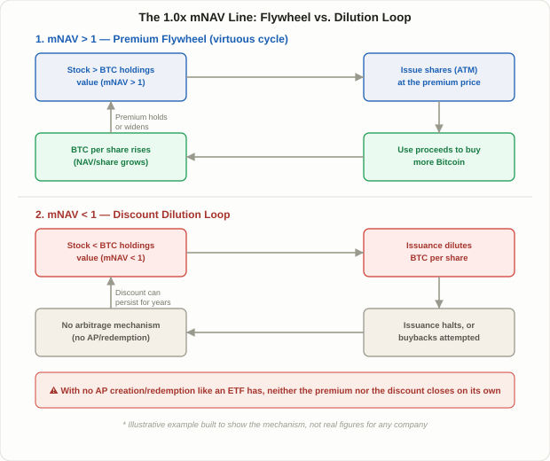

## What mNAV Actually Measures

**mNAV (market Net Asset Value)** is the core valuation yardstick for "digital asset treasury" companies (DATs) — public companies that raise capital specifically to accumulate Bitcoin (or another crypto asset) on their balance sheet. The formula looks simple:

```
mNAV = Enterprise value (or market cap) / Current market value of BTC holdings
```

An mNAV above 1.0 means the market is pricing the company above the Bitcoin it holds; below 1.0 means it's pricing the stock below that value. The metric went mainstream because of Strategy (formerly MicroStrategy): it reportedly traded above 3x mNAV at points in late 2024, then multiple reports through 2026 described it compressing toward and below 1.0x. Treat any specific figure you read as a snapshot from that article's publish date — check a live source before acting on it.

Here's the trap: the same company's mNAV can come out wildly different depending on what goes into the "value" side. At one point, Strategy's own disclosures and press coverage cited three different readings for essentially the same moment — 0.856 on a basic common-share-market-cap basis, 0.954 on a diluted basis accounting for convertible notes, and 1.105 on an enterprise-value basis that adds debt and preferred stock and subtracts cash. All three were called "mNAV," yet they tell different stories. The first thing to check with any quoted mNAV is which definition produced it.

| mNAV variant | What's in the numerator | Why it matters |
|---|---|---|
| Basic | Common-share market cap only | Simplest, but hides debt and preferred-dividend load |
| Diluted | Market cap adjusted for convertible/option dilution | Prices in future conversion risk |
| Enterprise-value (EV) | Market cap + debt + preferred − cash | Leveraged companies often show a higher EV mNAV than basic mNAV |

## Why a Premium Exists: The Self-Reinforcing Flywheel

When mNAV sits above 1.0, a DAT gains a structural privilege. It can sell new shares — typically through an at-the-market (ATM) program — and use the proceeds to buy more Bitcoin. The key mechanical point: at a premium, each new share sold raises more cash than the Bitcoin it "represents" on a per-share basis, so buying more BTC with that cash actually **increases** Bitcoin-per-share for every existing holder rather than diluting them.

Repeat that loop — premium funds an issuance, the issuance raises BTC-per-share, the larger holding re-justifies the premium — and you get what the market calls a **flywheel**. This dynamic is widely credited with much of Strategy's early run, where the stock outpaced Bitcoin itself. Drop mNAV below 1.0, though, and the exact same mechanism runs backward: new shares now raise less cash than their BTC-per-share claim is worth, so issuing stock actively dilutes existing holders. That gives management an incentive to slow or halt issuance — or pivot to buybacks — which, in turn, means giving up the growth engine (buying more coin) that built the premium in the first place.

<figure class="diagram">
  
  <figcaption>The 1.0x mNAV line decides whether issuance acts as an accretive flywheel or a dilutive drag — and either way, no outside arbitrageur is structurally forced to close the gap.</figcaption>
</figure>

## Two Ways to Trade mNAV

**① Mean-reversion bets — buy the discount, sell the premium.** The simplest approach is betting on reversion whenever mNAV strays far from 1.0. But the forced-convergence machinery covered in [ETF Premium/Discount to NAV](/en/strategies/etf-premium-discount-nav-arbitrage/) — Authorized Participant creation and redemption — simply doesn't exist for DAT stocks. A discount isn't automatically a "cheap" signal; it can just as easily mean the market doubts the company's debt load or the sustainability of its flywheel. The realistic catalysts for closing a discount are share buybacks or — a less common structure research firms have flagged — one premium-trading DAT acquiring a discount-trading DAT outright, instantly absorbing underpriced coin exposure onto its own balance sheet.

**② Pairs trading — strip out directional risk, keep the mNAV spread.** Borrowing the logic from [Pairs Trading and Statistical Arbitrage](/en/strategies/pairs-trading-stat-arb/), you can go long (or short) the DAT stock while simultaneously shorting (or buying) spot Bitcoin or a perpetual future in the opposite direction, which removes most of the directional Bitcoin-price risk and isolates the mNAV spread itself. If mNAV looks unusually stretched to the upside, for instance, you'd short the stock and buy Bitcoin, aiming to profit as the premium normalizes. This structure carries three separate friction costs, though: shorting the equity requires checking share availability and borrow fees, the Bitcoin leg usually carries a funding-rate cost if done through perpetual futures (see [Funding Rate Arbitrage](/en/strategies/funding-rate-arbitrage/)), and DAT share prices commonly show a reported beta of roughly 1.5x–2.5x to Bitcoin rather than a clean 1x — so sizing the hedge at a flat one-to-one ratio will leave you under- or over-hedged.

## A Worked (Hypothetical) Example

The figures below are illustrative only, built to show the mechanism — not real disclosure data for any company.

**① Starting at a premium (mNAV 1.3x).** Hypothetical Company A holds 10,000 BTC, with Bitcoin priced at $100,000, so its holdings are worth $1 billion. It has 1,000,000 shares outstanding and a $1.3 billion market cap (mNAV = 1.3x), putting its share price at $1,300. Before any issuance, **BTC per share = 10,000 / 1,000,000 = 0.0100**.

Company A raises $130 million through an ATM program at the current $1,300 share price, issuing 100,000 new shares (bringing the total to 1,100,000) and using all of the proceeds to buy 1,300 more BTC ($130M ÷ $100,000), taking its holdings to 11,300. After the raise, **BTC per share = 11,300 / 1,100,000 ≈ 0.01027** — higher than before. At a premium, each new share raises more cash than its "fair share" of Bitcoin, so the extra purchasing power flows to every existing holder.

**② The same company at a discount (mNAV 0.8x).** Now assume the identical balance sheet trades at an $800 million market cap instead (mNAV = 0.8x, share price $800). Raising the same $130 million this time requires issuing 162,500 new shares ($130M ÷ $800), bringing the total to 1,162,500. The $130 million still buys the same 1,300 BTC, taking holdings to 11,300 — but now **BTC per share = 11,300 / 1,162,500 ≈ 0.00972**, lower than the starting 0.0100.

| Scenario | BTC/share before | BTC/share after | Effect |
|---|---|---|---|
| Issuance at a premium (mNAV 1.3x) | 0.0100 | ≈0.01027 | Accretive |
| Issuance at a discount (mNAV 0.8x) | 0.0100 | ≈0.00972 | Dilutive |

Raising the exact same dollar amount and buying the exact same amount of Bitcoin produces opposite outcomes for existing holders. The number that matters isn't the specific figures — it's that **the 1.0x mNAV line is the arithmetic pivot deciding whether issuance helps or hurts current shareholders.**

## mNAV vs. ETF Premium/Discount vs. Closed-End Fund Discount

| | ETF premium/discount | Closed-end fund (CEF) discount | DAT stock mNAV |
|---|---|---|---|
| Arbitrage mechanism | AP creation/redemption, continuous | None exists | None exists |
| Typical duration | Hours to days | Months to years | Months to years, or structurally indefinite |
| What closes the gap | Risk-free AP arbitrage | Tender offers, activist campaigns | Management's own issuance/buyback decisions, or one DAT acquiring another |
| Management's role | Neutral — arbitrageurs move the price | Limited | **Decisive** — issuance and buyback timing directly flip the flywheel's direction |
| Sensitivity to leverage | Low (confined to product design) | Moderate | High — companies with heavy convertible/preferred issuance see EV mNAV diverge sharply from basic mNAV |

The defining difference between a DAT stock and an ETF or CEF is *who* closes the gap. For an ETF, outside arbitrageurs do it almost mechanically. For a DAT, it's **the company's own management** — deciding how fast to issue shares to defend a premium, or whether to buy back stock to narrow a discount. That decision is simultaneously a financing choice and a signal worth reading in its own right.

## Practical Checkpoints

- **Confirm which mNAV definition you're looking at.** Basic, diluted, and EV readings for the same company on the same day can differ meaningfully; never compare figures computed on different bases.
- **Check the debt and convertible-maturity schedule.** As covered in [Convertible Bond Arbitrage](/en/strategies/convertible-bond-arbitrage/), heavily convertible-funded DATs face rising busted-convertible and dilution risk together once the stock falls below conversion price.
- **Weigh preferred-dividend obligations against actual cash flow.** Perpetual preferred issuance creates a fixed annual dividend burden, but holding Bitcoin itself generates no cash flow — so check where the dividend money is actually coming from.
- **Don't treat the stock as a clean Bitcoin proxy.** Reported betas in the 1.5x–2.5x range are common, so a position sized as if it were spot Bitcoin will behave very differently from spot Bitcoin.
- **Compare across companies carefully.** Not every DAT behaves the same way — debt-light, simple-balance-sheet companies and heavily convertible/preferred-funded companies can show opposite mNAV readings at the exact same Bitcoin price.

## FAQ

### If mNAV is below 1, is that automatically a buying opportunity?
No. A sub-1.0 reading is frequently a signal that the market doubts the company's debt load, the sustainability of its flywheel, or management's capital discipline — not simply that the stock is "on sale." Because there's no ETF-style mechanism forcing convergence, you have to rule out the possibility that the discount is a structurally justified price before assuming it's a bargain.

### Do all Bitcoin treasury companies move the same way?
No. Debt and preferred-stock loads, market cap relative to Bitcoin holdings, and management's capital-allocation choices vary enough that one company can trade at a premium while another trades at a discount on the exact same day with Bitcoin at the exact same price. Always normalize for which mNAV definition is being used before comparing across companies.

### Does an mNAV discount close as fast as an ETF premium/discount?
No. ETFs converge in hours to days thanks to continuous AP arbitrage. DAT stocks have no equivalent mechanism, so a discount can persist for months, years, or indefinitely unless management actively responds with buybacks or an acquisition.

## Limitations and Caveats

- **The metric itself is contested.** Industry research (including from NYDIG) has criticized the original mNAV definition for failing to capture the value of any operating business or the cash-redemption risk embedded in convertible debt. Reducing an entire company to one ratio is a real simplification.
- **Disclosed holdings can lag reality.** A company's Bitcoin holdings can change between a filing date and whenever you check it, so verify against the most recent official disclosure rather than a cached figure.
- **This is not a validated, backtested edge.** The checkpoints above are a routine for not misreading the number, not a strategy with demonstrated excess returns.
- **Regulatory and accounting treatment is still evolving.** Rules around how digital-asset treasuries are accounted for and regulated continue to shift, so past patterns shouldn't be assumed to persist unchanged.

## Summary

- **mNAV** = enterprise value (or market cap) ÷ value of Bitcoin held, and the basic, diluted, and EV versions of that ratio can diverge sharply for the same company.
- Above 1.0x, premium-priced issuance acts as a **flywheel**, raising Bitcoin-per-share; below 1.0x, the same issuance becomes **dilutive**, creating the opposite pressure.
- Unlike an ETF's AP arbitrage or a CEF's tender-offer catalyst, the party that closes a DAT's premium or discount is **the company's own management**, through its issuance and buyback decisions.
- A **pairs trade** against spot or futures Bitcoin isolates the mNAV spread more cleanly than a simple mean-reversion bet, but adds borrow costs, funding-rate drag, and the need to size for a beta well above 1.0x.
- Knowing which mNAV definition you're reading, and how large the debt and preferred load is, matters more than reacting to a single headline number.
