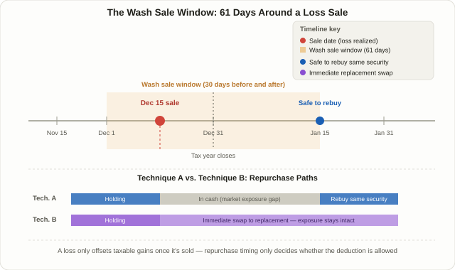

## What Tax-Loss Harvesting Actually Is

Every November, the same question shows up in investor forums: "I'm sitting on a gain in one stock and a loss in another — should I sell the loser before year-end?" The technique that answers that question is **tax-loss harvesting**: deliberately selling a position that's trading below your cost basis before the tax year closes, so the loss becomes "realized" and can offset gains you've already locked in elsewhere in the same year.

It's a strategy built entirely around a quirk of how capital gains tax is calculated, not around predicting where a stock is headed next. That distinction matters for how you should think about it. Tax-loss harvesting doesn't make your portfolio worth more — it changes how much of what you've already made the government gets to keep. In the US, this applies to taxable brokerage accounts; it's irrelevant inside a 401(k) or IRA, where gains and losses aren't taxed on a per-trade basis in the first place.

## Why It Works: The Tax Code Only Counts Losses You've Actually Realized

The mechanism rests on one simple asymmetry in how tax authorities treat gains and losses. A position that's down 30% but still sitting in your account is an **unrealized loss** — it exists on paper, but it has zero effect on your tax bill until you sell. A position you've already sold for a profit is the opposite: the moment you sell, that gain becomes realized and taxable, whether or not the rest of your portfolio is up or down for the year.

That asymmetry is the whole point. Gains count the instant you lock them in. Losses count only if you lock them in too. If you've already realized a $8,000 gain on one stock this year and you're also sitting on a $3,000 unrealized loss in another, holding onto that loser past December 31 means forfeiting the chance to offset $3,000 of that gain — even though, on a net basis, your portfolio made less money than your tax bill will reflect. Selling the loser converts a paper loss most people never think about into a real deduction. This is why the technique is better understood as an **accounting adjustment that reduces a tax bill you already owe**, not an investing edge that predicts future returns.

In the US, the mechanics go one step further than most countries' rules: realized losses first offset realized capital gains dollar-for-dollar, any excess loss can offset up to $3,000 of ordinary income per year, and whatever is left over after that **carries forward indefinitely** into future tax years. That carryforward is a genuinely favorable feature worth knowing about — plenty of other tax regimes don't offer it, which changes how urgent year-end timing actually is (more on that below).

## The Wash Sale Rule: The 61-Day Window That Can Erase the Deduction

If you still believe in the stock you just sold for a loss, can you buy it right back the next day? In the US, the answer is governed by a specific anti-abuse rule: **IRC §1091, the wash sale rule.** It disallows the loss deduction if you buy the same security, or one the IRS considers "substantially identical" — which can include deeply in-the-money call options on the same stock — within 30 days before or 30 days after the sale. That's a 61-day window in total, counting the sale date itself.

The penalty isn't that the loss disappears forever. It's deferred: the disallowed loss gets added to the cost basis of the shares you bought back, so you'll eventually recapture it when you sell those new shares — just not on the schedule you wanted. One subtlety that trips people up: the 30-day count runs on **trade date**, not settlement date, and it applies across *all* your accounts, including a spouse's accounts and even an IRA, not just the one where you sold. Buying the same stock back in a retirement account you forgot about still triggers the rule.

<figure class="diagram">
  
  <figcaption>The wash sale window spans 30 days before and after the sale date — 61 days total. Buying back the identical security has to wait until that window closes, but swapping immediately into a similar, non-identical replacement fund keeps market exposure intact while the loss is still locked in.</figcaption>
</figure>

## Technique A vs. Technique B: Wait It Out vs. Swap Into a Replacement

Realizing the loss doesn't mean sitting in cash for a month. Two approaches are common in practice.

**Technique A — Hold cash, then rebuy.** Sell the position, realize the loss, and wait out the full 61-day window before buying the exact same security back. This is the cleanest approach and carries the least interpretive risk, since there's no question about what counts as "substantially identical" — you simply aren't buying anything similar during the window. The cost is opportunity: if the stock rallies hard while you're in cash, you miss that move entirely.

**Technique B — Swap into a replacement immediately.** Sell the losing position and, on the same day, buy something similar in sector or exposure but not legally identical — for example, swapping one large-cap tech-heavy ETF for a different fund tracking a related but distinct index, or swapping an individual stock for a close competitor in the same sector. This keeps you roughly in step with the market the whole time. The tradeoff is that "substantially identical" isn't always a bright line. Swapping between two ETFs that track the *same* underlying index, just from different issuers, is a gray area even under established US guidance — it's a closer call than most investors assume, and it hasn't been fully tested in every scenario.

| | Technique A: Cash, Then Rebuy | Technique B: Immediate Replacement Swap |
|---|---|---|
| Core approach | Realize the loss, wait 61 days, rebuy the same security | Realize the loss and immediately buy a similar, non-identical security |
| Market exposure gap | A full window with no position | Little to none |
| Wash sale risk | Lowest — no ambiguity about what's "identical" | Depends on how closely the replacement tracks the original |
| Effort required | Minimal — just wait | Requires researching a genuinely distinct replacement in advance |
| Best suited for | A position you don't mind missing a short-term bounce in | Index or sector exposure you want to keep uninterrupted |
| Main risk | Opportunity cost if the stock rallies during the wait | Choosing a replacement that's arguably too similar to the original |

Both techniques share the same starting premise: a loss only counts for tax purposes once you actually sell. Technique A removes ambiguity by stepping fully out of the trade for the duration of the window. Technique B keeps the portfolio's market exposure intact, at the cost of the investor having to judge, on their own, how different "different enough" really is.

## A Worked Example (Simplified, for Illustration Only)

This isn't a real investor's data — it's a simplified scenario meant to make the arithmetic concrete.

Suppose an investor has already realized an $8,000 long-term gain on Stock A this year, and is still holding Stock B at an unrealized loss of $3,000.

- **Without harvesting the loss:** taxable gain = $8,000. At a hypothetical 15% long-term capital gains rate, tax owed = $1,200.
- **Selling Stock B before year-end to realize the loss:** taxable gain = $8,000 − $3,000 = $5,000. Tax owed = $5,000 × 15% = $750.

That's $450 saved in this simplified example, purely by timing a sale that was going to happen eventually anyway. If the investor still wants exposure similar to Stock B, Technique B lets them capture that $450 while staying invested in a comparable name. The 15% rate here is just a round illustrative number — actual rates depend on your income bracket, holding period, and whether the position even qualifies for long-term treatment (over one year held).

## Outside the US: How This Works for Korean Investors

Every rule cited above — IRC §1091, the $3,000 ordinary-income offset, indefinite carryforward — is specific to US tax law and doesn't automatically transfer to other jurisdictions. South Korea is a useful contrast. Ordinary Korean investors currently owe no capital gains tax on domestic Korean stock trades at all (a separate financial investment income tax that would have changed this was repealed and is not currently in effect), so tax-loss harvesting has essentially no use for a Korea-only domestic portfolio. It becomes directly relevant, however, for **overseas stock holdings**, which Korean investors tax at 22% (20% national plus 2% local surtax) on net gains above an annual exemption of roughly ₩2.5 million, with gains and losses netted only within the same overseas holdings, in the same calendar year. Korean tax guidance generally confirms there is **no indefinite loss carryforward** for these overseas-stock gains — an unused loss doesn't survive into next year the way it does under US rules — which makes year-end timing arguably more urgent for a Korean investor holding US stocks than for a US investor holding the same position. Whether Korea has anything functionally equivalent to the wash sale rule is genuinely unsettled: some guidance says no such repurchase restriction is written into the law, while other sources warn that an immediate repurchase could draw scrutiny under Korea's general substance-over-form tax principle. If you're filing taxes outside the US, treat the mechanics in this lesson as a transferable mental model, not a set of numbers you can use directly — confirm the actual rule with a local tax professional before acting on it.

## Pitfalls and Limits

- **The wash sale rule applies across every account you control**, including a spouse's accounts and retirement accounts — not just the brokerage account where you sold.
- **"Substantially identical" has no exhaustive legal list.** Two different stocks in the same sector are safe; two ETFs tracking the identical index from different issuers are a genuine gray area that hasn't been fully litigated.
- **This only helps if you have realized gains to offset**, or at least $3,000 of ordinary income capacity (in the US). Harvesting a loss with nothing to offset it against just defers the deduction to future years via carryforward, which is useful but less immediately valuable.
- **Transaction costs and bid-ask spreads can erode the benefit** on small positions, where the tax savings may be smaller than the combined cost of selling and rebuying.
- **Settlement-date cutoffs matter.** Your broker needs the trade to settle within the current tax year for it to count — check your broker's published last trading day for the calendar year well before December 31.
- **Don't let the tax tail wag the investment dog.** Selling a fundamentally sound position purely to harvest a modest tax benefit, without a credible replacement to hold in the meantime, can cost more in missed upside than it saves in tax.

## FAQ

### Does selling a losing position always lower my tax bill?
Only if you have realized gains (or, in the US, at least some ordinary income) for it to offset. If you have no gains this year, the loss still counts — the US lets you carry it forward indefinitely, but jurisdictions without a carryforward provision may let the benefit disappear if you don't use it in time.

### Can I buy the stock back the next day if I still like it?
Not in the US, not within 30 days, without losing the deduction — that's exactly what the wash sale rule prevents. If you want to stay invested through the waiting period, buying a genuinely different but similarly exposed security (Technique B) is the standard workaround.

### Does this strategy improve my actual investment returns?
No. It's a tax-accounting technique, not an investing edge. It doesn't change what the market does to your holdings — it only changes how much of your already-realized gains you get to keep after taxes, and the saving depends entirely on your marginal tax rate and the gains you already have on the books.

## Summary

- Tax-loss harvesting means selling a position at a loss before year-end so that loss becomes realized and can offset capital gains you've already locked in elsewhere, reducing your tax bill rather than your investment risk.
- It works because tax authorities only count realized gains and losses — an unrealized loss sitting in your account has zero effect on your tax bill until you actually sell.
- The US wash sale rule (IRC §1091) disallows the deduction if you buy the same or a substantially identical security within a 61-day window spanning the sale date, deferring rather than erasing the benefit.
- Waiting out the window in cash is the cleanest approach; swapping immediately into a similar but non-identical replacement keeps market exposure intact but requires judgment about what counts as "different enough."
- Outside the US — Korea's overseas-stock tax being one concrete example — the rules differ meaningfully, including whether losses carry forward at all, so confirm local rules before relying on the US framework.
