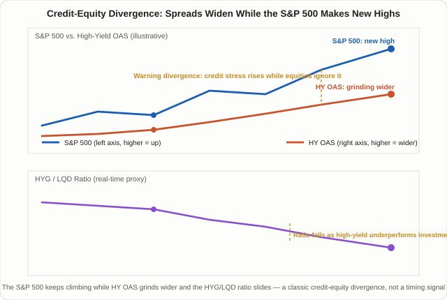

## Does the Bond Market Really Know First?

"The bond market is smarter than the stock market" is one of those Wall Street lines that sounds like a cliché but has a real structural reason behind it. When a company goes bankrupt, bondholders get paid before shareholders do. That seniority gives credit investors — especially those holding lower-rated, high-yield debt — a structural reason to react to deteriorating fundamentals before equity holders do. The number that captures this tension is the **high-yield credit spread**. [Lesson 112 on intermarket analysis](/en/strategies/intermarket-analysis/) already covered how bonds, stocks, commodities, and the dollar lead and lag one another, but it didn't drill into corporate credit specifically — the spread on high-yield bonds, where credit risk is priced most aggressively. This lesson walks through what that spread actually measures, why it's often described as an early warning for stocks, and why the real-time shortcut most retail traders reach for — the HYG/LQD ratio — has a structural trap built into it.

## What OAS Actually Measures

The most precise way to measure the high-yield credit spread is the **Option-Adjusted Spread (OAS)**: the extra yield a corporate bond pays over a Treasury of similar maturity. If a high-yield bond index yields 8% while a comparable Treasury yields 4.5%, the raw spread is 3.5 percentage points, or 350 basis points. The "option-adjusted" part matters because many corporate bonds carry embedded options — most commonly a call feature letting the issuer redeem early — and that embedded optionality distorts the headline yield. Stripping it out leaves something closer to pure compensation for credit risk: the market's price on the odds this company can't pay you back.

The most widely cited benchmark is the ICE BofA US High Yield Index OAS, published daily (with roughly a one-day lag) and free to check on the St. Louis Fed's FRED database under the ticker **BAMLH0A0HYM2**. When the spread **narrows**, investors are demanding less compensation for credit risk — the market is betting these companies are unlikely to default anytime soon. When it **widens**, lenders want more compensation for the same risk, which reads as rising concern about credit quality.

## Why It Works: Senior Creditors See the World Differently

There are three structural reasons credit spreads are so often described as an early-warning system for equities.

First, **liquidation priority is different.** Bondholders recover assets first in a bankruptcy, so credit investors care most about a downside floor — will I get my principal back? — while equity investors also chase an upside ceiling: growth narratives, valuation multiples, momentum. In the early stages of fundamental deterioration, the market watching the floor tends to move before the market still chasing the ceiling.

Second, **the investor base is different.** High-yield credit is dominated by insurers, pension funds, and credit-focused hedge funds doing detailed balance-sheet and cash-flow work. Equities, at times, are driven more heavily by momentum, flows, and retail sentiment — factors with a looser connection to fundamentals. When specialized credit money repositions first, it can take time for that signal to work its way into broader equity risk appetite.

Third, **spreads respond non-linearly.** The lower the credit rating, the more a small deterioration in fundamentals moves the market's estimate of default probability. That's why high-yield spreads tend to be far more sensitive than investment-grade spreads, often described as reacting earlier — and more sharply — to turning points in the credit cycle.

<figure class="diagram">
  
  <figcaption>Credit spreads (orange) widen while the S&P 500 (blue) keeps printing new highs — a divergence — shown alongside the falling HYG/LQD ratio (bottom) over the same stretch.</figcaption>
</figure>

One important caveat here: a private data vendor has published an analysis claiming that in every major equity downturn since 1997, high-yield OAS began widening from its trough before the S&P 500 topped out, with a median lead time of several months. That's worth knowing about, but it's one vendor's own methodology on one dataset — not an audited, universally validated law. Treat it as a historical observation to keep in mind, not a mechanical rule that guarantees stocks will fall within a fixed window once spreads cross some threshold.

## The Real-Time Shortcut — and Its Trap

OAS is precise, but FRED-style sources update with a lag. The common real-time workaround is a ratio of two ETFs:

- **HYG** — the largest high-yield corporate bond ETF
- **LQD** — the largest investment-grade corporate bond ETF

A falling HYG/LQD ratio means high-yield bonds are underperforming investment-grade bonds — money moving toward safer credit and away from riskier credit, a classic risk-off signature. It updates in real time and is checkable through any ordinary brokerage account, which is exactly why it's so popular.

But there's a structural trap: **duration mismatch.** Investment-grade issuers can borrow cheaply for a long time, so they tend to issue longer-maturity debt — LQD's average duration typically runs around 8–9 years. High-yield issuers usually can't borrow long as comfortably, so they lean toward shorter maturities — HYG's average duration typically runs closer to 3–4 years.

That gap matters because when rates move broadly — with no change in credit risk whatsoever — the longer-duration LQD will move far more than the shorter-duration HYG purely on rate sensitivity. A broad rate decline can push LQD up more than HYG, lifting the ratio and producing a false "risk-on" reading with nothing to do with credit. A broad rate rise can do the opposite. Analysts have pointed to stretches like 2018, when the HYG/LQD ratio kept sliding on rate effects even as equities pushed to new highs — a case where the ratio and the equity tape told conflicting stories. Because of this, treat HYG/LQD as a cross-check alongside OAS, not a clean substitute for it.

## Credit Spreads vs. VIX: Two Different "Fear Gauges"

Credit spreads get described as a cousin of the VIX, but the two measure genuinely different things.

| Comparison | High-Yield Credit Spread (OAS) | VIX |
|---|---|---|
| What it measures | Compensation the bond market demands for credit risk | 30-day forward implied volatility on S&P 500 options |
| Dominant participants | Fundamentals-driven institutions (insurers, pensions, credit funds) | Options traders, hedgers, volatility traders |
| Typical behavior | Grinds wider gradually, cumulatively | Spikes sharply on news and shocks |
| What it tends to catch best | Slow-building credit-cycle deterioration (energy sector stress, regional-bank strain) | Sudden shocks (flash crashes, pandemic-style jolts) |
| Data access | Official sources like FRED, roughly one day delayed | Real-time quote |

[Lesson 28 on the VIX futures term structure](/en/strategies/vix-term-structure-contango-backwardation/) covers a gauge that excels at telling you how scared the market is *right now*; credit spreads excel at telling you whether fundamentals are quietly rotting underneath. The combination widely flagged as most dangerous is credit spreads grinding wider while the VIX stays calm — a signature often read as "the options market isn't scared yet, but credit already is."

## A Worked Example (Hypothetical, Not Live Data)

The following is a **hypothetical, illustrative example** meant only to show how the two signals move together — not a real market quote. Suppose high-yield OAS starts a six-week stretch at 300bp and grinds up to 380bp, while the S&P 500 trades within 1% of all-time highs the entire time, barely wobbling. That combination is the textbook description of a credit-equity divergence.

Over the same stretch, say HYG moves from $77.00 to $75.50 and LQD moves from $108.00 to $109.80. The HYG/LQD ratio goes from 77.00/108.00 ≈ 0.713 to 75.50/109.80 ≈ 0.688 — a roughly 3.6% decline, pointing the same direction as the 80bp (about 27%) widening in OAS. The two signals cross-confirm each other here. But remember the duration trap: if rates also moved meaningfully over that stretch, part of this ratio move could be a rate effect rather than a pure credit signal. These numbers are illustrative only, not a reproduction of any actual historical period.

Finding a divergence like this isn't a "sell everything now" signal. A more realistic response is trimming portfolio beta, slowing new buying, or checking the cost of a protective put — treating it as a risk-management overlay rather than a precise entry or exit trigger, since credit spreads are better at flagging that risk is building than at pinpointing when it detonates.

## Limitations to Keep in Mind

- **The lead time isn't fixed.** It can run for months, or not show up at all — spreads can widen and stocks can simply shrug it off.
- **The HYG/LQD ratio blends rate effects and credit effects.** Because of the duration mismatch covered above, never read the ratio alone as proof that credit risk is rising.
- **OAS data is lagged.** For intraday decisions, pair it with a real-time proxy like HYG/LQD.
- **The spread itself isn't easy to trade directly.** Most retail traders can't trade OAS; they approximate exposure through HYG, LQD, or a pair trade between them — a construction similar in spirit to [the pairs trading / stat-arb approach in Lesson 18](/en/strategies/pairs-trading-stat-arb/).
- **It's a filter, not a standalone signal.** It's most reliable cross-checked against market breadth, the VIX, and other macro indicators rather than used in isolation.

## FAQ

### Why do people say high-yield spreads move before stocks?
Bondholders have senior claims on assets in a bankruptcy, giving them a structural reason to react to deteriorating fundamentals sooner, and the high-yield market is weighted toward institutions doing detailed credit analysis, which can price in deterioration before broader equity sentiment catches up. That's a general tendency often observed historically, not a guaranteed rule that holds every time.

### If the HYG/LQD ratio rises, is that always good news?
No. A rising ratio can mean two very different things: genuine improvement in credit risk appetite, or a broad decline in interest rates that lifts the longer-duration LQD more than the shorter-duration HYG. To tell them apart, check which direction Treasury yields moved over the same period.

### Where can a retail investor actually check OAS data?
The St. Louis Fed's FRED database publishes the ICE BofA US High Yield Index OAS for free, daily, under the ticker BAMLH0A0HYM2 — though it typically updates with roughly a one-day lag.

## Summary

- The high-yield credit spread (OAS) is the extra yield lower-rated corporate borrowers must pay over Treasuries; widening signals rising concern about credit risk, narrowing signals it easing.
- Three structural reasons — bondholders' senior claim, a fundamentals-focused institutional investor base, and the non-linear sensitivity of lower-rated credit — are commonly cited for why credit spreads often move before stocks, though this is a historical tendency, not a proven law.
- The real-time HYG/LQD ratio is accessible to anyone, but the duration mismatch between LQD (roughly 8–9 years) and HYG (roughly 3–4 years) means pure rate moves can shake the ratio even when credit risk hasn't changed at all.
- The VIX tends to catch sudden shocks fast, while credit spreads tend to catch slow-building fundamental deterioration — the two are complementary, not interchangeable.
- The combination considered most concerning is credit spreads grinding wider while stocks and the VIX stay quiet; the practical response to that divergence is trimming beta or checking hedges, not selling everything at once.
