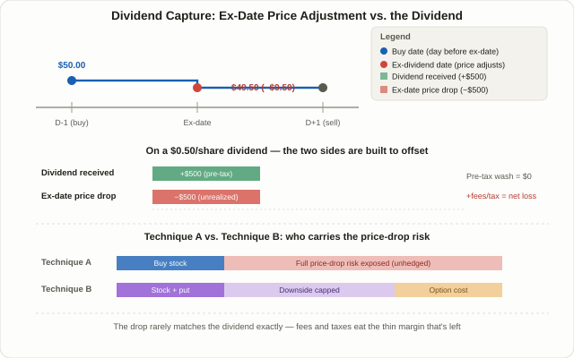

## What the Dividend Capture Strategy Actually Is

"If I buy a stock just to get the dividend and sell right after, do I come out ahead?" That question resurfaces every dividend season in investor forums, and it's exactly what the **dividend capture strategy** (sometimes called dividend harvesting) tries to answer. The idea is to buy a stock shortly before its ex-dividend date purely to qualify for the upcoming payout, collect the dividend, and then sell the position almost immediately — with no interest in the company's fundamentals or a multi-year holding period.

On paper it sounds almost too easy: buy a $50 stock paying a $0.50 dividend, hold it for the one day that matters, collect the cash, and move on. Whether that actually produces a profit is a separate question entirely, and it hinges on a mechanic most casual investors never think through: the price is designed to adjust against you the moment the dividend is paid.

## Why the Price Drops on the Ex-Dividend Date

The reason dividend capture isn't free money comes down to basic valuation logic. When a company pays a dividend, that cash leaves the balance sheet. The company is worth that much less the instant the payment happens, and the market prices that in immediately. That's why, at the open on the **ex-dividend date**, a stock's price is theoretically marked down by roughly the amount of the dividend. Anyone buying on or after the ex-date isn't entitled to that payment, so the "fair" price they should pay is the pre-dividend price minus the dividend itself.

That single mechanic is what makes the payoff of dividend capture close to a wash by construction. Buy right before the ex-date and you receive the dividend as cash, but the stock you're holding is simultaneously marked down by roughly the same amount. Add the two together and the theoretical result is close to zero — what feels like "free income" is really just cash and equity trading places inside the same position. Missing this point is exactly how dividend capture gets mistaken for a reliable source of extra yield rather than a wash with costs layered on top.

Real markets don't follow the textbook exactly, though. Decades of market microstructure research — going back to classic work by Elton and Gruber — has found that the actual ex-day price drop frequently falls short of the full dividend amount, a gap often attributed to tax effects and trading frictions around the ex-date. That doesn't mean the strategy reliably makes money, though. The drop can also land above the dividend amount on a volatile day, and which way it goes is closer to noise driven by that stock's volatility and the broader market's mood than a dependable edge a trader can count on.

<figure class="diagram">
  
  <figcaption>On the ex-dividend date, the price is theoretically marked down by roughly the dividend amount. The dividend received and the price drop are built to offset each other — Technique A accepts the full risk that this offset holds, while Technique B pays for a put option to cap that risk.</figcaption>
</figure>

## Timing Is Everything: T+1 Settlement and the Record Date / Ex-Date Merge

Getting the dividend requires understanding two specific dates. The **record date** is when your name needs to already be on the shareholder register, and the **ex-dividend date** is the cutoff after which a new buyer no longer qualifies for the upcoming payment.

One detail changed recently enough that it still trips people up: when the US market shortened settlement from T+2 to T+1 on May 28, 2024, exchange rules were updated so that the **record date and the ex-dividend date now fall on the same calendar day**. Under the old T+2 cycle, the ex-date sat one business day ahead of the record date, giving buyers a small cushion. That cushion is gone. In practice, your buy order has to be filled by the close of business the day *before* the ex-date — buying on the ex-date itself means you've already missed that dividend.

The same logic runs in reverse for anyone deliberately trying to avoid a dividend payment, for instance to sidestep the associated tax event: the sale needs to be completed before the ex-date, not on it. Getting this single date wrong undoes the entire premise of the trade, so confirming the exact ex-dividend date through an official dividend calendar before placing any order is non-negotiable.

## Technique A vs. Technique B: Naked Stock Capture vs. Options-Hedged Dividend Arbitrage

There isn't just one way to run this trade. The two common approaches differ mainly in how much price risk the trader is willing to carry.

**Technique A — Naked stock capture.** Buy the shares before the ex-date, collect the dividend, and sell the position on or shortly after the ex-date. It's the simplest version, with no extra position to manage, but it also means the trader absorbs the full risk that the ex-date drop turns out larger than the dividend itself. A piece of bad news or a rough market day stacked on top of the mechanical drop can easily turn a dividend "gain" into a net loss.

**Technique B — Options-hedged dividend arbitrage.** Buy the same shares, but also buy a put option with a nearby expiration — or construct something closer to a [collar strategy](/en/strategies/collar-strategy-protective-hedge/) by selling a call to help fund the put. The put puts a floor under how far the position can fall, insulating the trade from a drop that exceeds the dividend. The catch is that the put isn't free — its time value is a real cost, and if that cost exceeds the dividend being captured, the hedge has already made the trade unprofitable before the ex-date even arrives. That only tends to work out for stocks with a high dividend yield relative to low volatility, so the put stays cheap, and it's the kind of thin, repeatable margin that mostly favors market makers and institutional arbitrageurs trading at near-zero transaction costs — not retail traders, for whom commissions and the bid-ask spread on the option usually eat whatever edge remains.

| | Technique A: Naked Stock Capture | Technique B: Options-Hedged Arbitrage |
|---|---|---|
| Core approach | Buy stock, collect dividend, sell | Buy stock + put (or collar) to cap downside |
| Price-drop exposure | Full, unhedged | Limited by the put's strike |
| Extra cost | Commissions only | Commissions + option time value |
| Who it suits | Retail traders testing the mechanic on a small scale | Institutions and market makers with very low execution costs |
| Payoff structure | Dividend ± full price movement | Dividend − option cost ± limited price movement |
| Main risk | A larger-than-expected drop wipes out the dividend | Option cost alone can exceed the dividend |

Both techniques start from the same premise: the dividend and the ex-date drop are meant to offset each other. Technique A bets that the offset holds closely enough and keeps the full risk; Technique B pays an upfront cost to shave that risk down.

## A Worked Example (Simplified, for Illustration Only)

This isn't real market data for any specific stock — it's a simplified scenario meant to make the mechanics concrete.

Say an investor buys 1,000 shares of Stock XYZ at $50 the day before the ex-dividend date — a $50,000 position — ahead of a $0.50-per-share quarterly dividend ($500 total).

- **If the price drops by exactly the dividend amount:** the stock opens at $49.50 on the ex-date. Selling the next day at $49.50 produces a $500 unrealized loss on the shares (1,000 × −$0.50), which is offset dollar-for-dollar by the $500 dividend received, before taxes. Add a round-trip commission and spread of roughly $10–20, and this already nets out to a small loss.
- **Add taxes, and the picture gets worse for a non-US holder.** A 15% US withholding tax under a typical tax treaty cuts the $500 dividend down to $425 net. That income then gets taxed again in the investor's home country as ordinary financial income — separately from the $500 unrealized loss on the shares, which usually falls under a completely different capital-gains tax category and can't be used to offset the dividend tax bill directly.

That second point matters well beyond any one country's rules: dividend income and capital gains or losses are frequently taxed under entirely separate schedules, with no automatic netting between them. So even in the textbook-neutral case, where the price drop lines up almost exactly with the dividend, the dividend still gets taxed while the matching stock loss can only offset other capital gains, if any exist in the same tax year — not the dividend tax itself. The numbers above are illustrative only; actual rates, exemptions, and currency effects depend on an investor's own jurisdiction and timing.

## Pitfalls and Limits

- **The price drop rarely matches the dividend exactly.** It can land below or above that figure depending on the stock's volatility and the market's mood that day, which is part of what makes the "theoretical wash" unreliable in practice.
- **An unusually high dividend yield can be a warning sign**, not an opportunity — it sometimes reflects a weakening share price, deteriorating cash flow, or the market pricing in a future dividend cut.
- **US qualified dividend tax treatment requires a holding period dividend capture can't satisfy.** Getting the lower 0/15/20% qualified rate requires holding the shares for more than 60 days within the 121-day window centered on the ex-date — far longer than this trade's holding period, so a dividend collected this way is typically taxed at the higher ordinary-income rate instead, even for a US taxpayer.
- **Transaction costs scale badly with position size.** Institutions and market makers can run this trade because their execution costs are near zero; retail-sized attempts frequently see commissions and spreads outrun the already-thin theoretical edge.
- **Getting the date wrong voids the entire trade.** With the record date and ex-dividend date now merged under T+1 settlement, missing the cutoff by even one day means carrying the stock's price risk without ever qualifying for the dividend.

## FAQ

### Is it safe to sell right after collecting the dividend?
Not reliably. In theory the dividend and the ex-date price drop cancel out, but transaction costs and taxes come out of that already-thin margin, and the price drop frequently doesn't match the dividend exactly — so a small net loss is a common outcome.

### Which date matters more — the record date or the ex-dividend date?
Since the US moved to T+1 settlement in May 2024, they're now the same calendar day. The only cutoff that matters now is this: your buy order needs to be filled by the close of business the day before the ex-dividend date.

### Does this strategy make sense for retail investors?
Structurally, it favors institutions and market makers trading at near-zero execution cost. A retail-sized attempt usually sees commissions, spreads, and taxes outweigh the theoretical edge, so it's more useful as a lesson in how ex-dividend pricing and tax treatment actually work than as a dependable source of profit.

## Summary

- Dividend capture means buying a stock just before its ex-dividend date, collecting the payout, and selling shortly after — with no interest in the company beyond that one payment.
- The strategy is designed to be close to a wash: the stock's price is marked down by roughly the dividend amount on the ex-date, so the dividend received and the price drop tend to offset each other before costs.
- Since the US shifted to T+1 settlement in 2024, the record date and ex-dividend date fall on the same day, so a buy order must be filled the business day before the ex-date to qualify for the dividend.
- Naked stock capture (Technique A) carries the full price-drop risk; options-hedged dividend arbitrage (Technique B) trades a put's time-value cost for a capped downside, which mostly favors low-cost institutional execution.
- Dividend income and capital gains or losses are usually taxed under separate schedules that don't net against each other, so even the textbook-neutral case can end up a net loss once taxes and transaction costs are counted.
