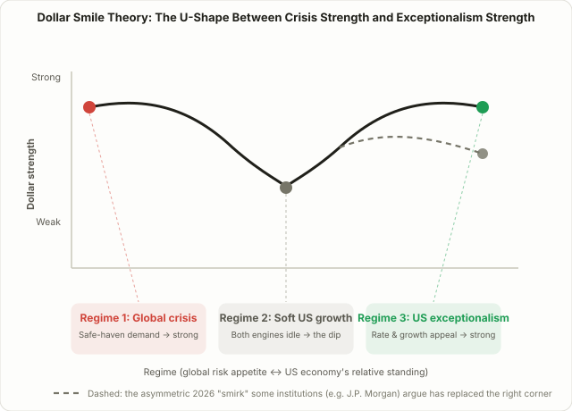

## What the Dollar Smile Theory Actually Says

It sounds contradictory at first: the dollar rallies when the world is panicking, and the dollar also rallies when the US economy is firing on all cylinders. The **Dollar Smile Theory**, first laid out in 2001 by Stephen Li Jen (then an economist at Morgan Stanley) and refined in later work with co-researchers, explains why both statements can be true at once. Plot US economic conditions and global risk appetite along the x-axis, and the dollar's value along the y-axis, and the result traces a **U-shape** — a smile — with the dollar strong at both ends and weak in the middle.

Earlier in this course, [the carry trade lesson](/en/strategies/carry-trade-yen-unwind/) explained currency moves through a single lens — the interest-rate gap between two countries — and [intermarket analysis](/en/strategies/intermarket-analysis/) covered how bonds, stocks, commodities and the dollar lead and lag each other. The Dollar Smile Theory is a separate framework: it focuses on how the dollar by itself can rally for two completely different reasons depending on which macro regime the world happens to be in.

## The Three Regimes: Both Corners of the Smile and the Dip in Between

The easiest way to read the smile is to split the x-axis into three zones.

| Regime | Position on the curve | Dollar direction | What's driving it |
|---|---|---|---|
| Regime 1 — Global crisis | Left corner (high) | Strong | Flight to safety — in a panic, capital worldwide rushes into the deepest, most liquid market: US Treasuries and dollars |
| Regime 2 — Soft US growth, gentle Fed easing | Middle (low) | Weak | The "nothing special" zone — not a crisis, but the US isn't outperforming either, so neither safety demand nor yield appeal is strong |
| Regime 3 — US economic exceptionalism | Right corner (high) | Strong | US growth and rates clearly outpace other developed markets, pulling in yield-seeking capital |

The two corners push the dollar up for **entirely different reasons**. Regime 1 is defensive buying — "buy dollars because you're scared." Regime 3 is offensive buying — "buy dollars because it pays." Both look like "dollar strength" on a chart, but they're different signals for a trader, and mixing them up is an easy way to end up positioned backward.

## Why It Works: Two Engines Running on Different Fuel

The dollar smile holds together because the US dollar carries two separate identities at once.

First, it's the **world's reserve currency and ultimate safe haven**. A large share of global trade is invoiced in dollars, and a huge amount of corporate and sovereign debt worldwide is denominated in dollars. When a crisis hits, two forces converge: borrowers scrambling to cover dollar liabilities (short covering), and investors fleeing into the deepest, most liquid market available — US Treasuries. This mechanism showed up clearly in both 2008 and the 2020 pandemic panic — notably, the dollar rallied in 2008 even though the crisis originated in the US itself.

Second, the dollar is **a yield-and-growth asset that pulls in capital on its own merits**. When the US economy is clearly growing faster than Europe or Japan, and the Fed holds rates higher than other central banks, investors chase that yield into dollar assets. This echoes the rate-differential logic from [the carry trade lesson](/en/strategies/carry-trade-yen-unwind/) — the difference here is that the dollar itself plays the role of the target currency being bought, not the funding currency being sold.

The catch is that these two engines don't always run together. In a period that's neither a crisis nor a stretch of clear US outperformance — the Fed easing preemptively, or US growth converging toward the same mediocre pace as everyone else — both engines idle at once, and that's exactly where the dollar sits at its weakest.

<figure class="diagram">
  
  <figcaption>The dollar strengthens at both the left corner (global crisis — safe-haven demand) and the right corner (US economic exceptionalism — rate and growth appeal), forming a U-shaped curve that dips lowest in the middle (soft US growth, gentle Fed easing). The dashed line marks the asymmetric "smirk" some institutions argue has replaced the symmetric smile in 2026.</figcaption>
</figure>

## 2026: Still a Smile, or Has It Become a Lopsided "Smirk"?

Two decades later, the Dollar Smile Theory is still a standard reference framework for reading currency markets in 2026 — but there's a live debate over whether **the shape of the curve itself has changed**.

A J.P. Morgan Asset Management portfolio-manager perspective argues that today's dollar smile looks less like a symmetric grin and more like a **"smirk"** — the left corner (safe-haven demand during crises) still holds up, but the right corner (US exceptionalism) isn't pulling the dollar up as forcefully as it once did. On the other side, an analysis from asset manager Wellington raises an interesting alternative: if tariff policy and related frictions slow the flow of foreign capital into the US, some of the dollar's traditional safe-haven role could shift toward the yen instead — a "**Yen Smile**" taking shape alongside, or in place of, the dollar's.

A few 2026 realities feed this debate. Uncertainty around who will eventually lead the Fed (names like Kevin Warsh have circulated as possibilities), volatility around tariff policy, and the recurring de-dollarization conversation have all added pressure to the premise that "US exceptionalism" can keep reliably pulling the right corner higher. These assessments differ by institution and are genuinely hard to verify after the fact — which is exactly why the Dollar Smile Theory should be treated as an **interpretive framework**, not a formula that spits out trade signals.

## Trading It: Left-Corner Setups vs. Right-Corner Setups

Even though both corners read as "dollar strength," the triggers and the way you'd actually position around them are completely different. Splitting them apart makes the framework far more actionable.

| | Left-corner setup (crisis-driven) | Right-corner setup (exceptionalism-driven) |
|---|---|---|
| Trigger | Credit crisis, sharp equity selloff, geopolitical shock | Strong US payrolls/GDP surprises, the Fed staying relatively tight |
| Confirming signals | VIX spiking, credit spreads widening (see Lesson 118) | Widening US-vs-Europe/Japan rate differentials, US equities outperforming on relative strength |
| What else rallies with it | US Treasuries (TLT) and gold (GLD) rallying together | US equities showing relative strength over other developed markets |
| Typical duration | Short and sharp (days to weeks) | Longer and gradual (months to years) |
| Reversal risk | Snaps back quickly once the panic fades | Hinges on catching the first crack in "exceptionalism" (e.g., a payrolls miss) |

In practice, traders express a dollar view through the DXY index or ETFs like UUP (long dollar) and UDN (short dollar). The key is figuring out which corner you're actually looking at before sizing a position. If the VIX is spiking while Treasuries and gold rally alongside the dollar, that points to Regime 1 (crisis-driven). If the VIX is calm but US payrolls are clearly beating European prints while the dollar climbs, that points to Regime 3 (exceptionalism-driven). The distinction matters because a position built on crisis-driven strength can reverse sharply the moment the panic fades — holding it like a long-term exceptionalism trade is a common way to get caught on the wrong side of a snapback.

## A Worked Example (Illustrative Path, Not Real Data)

The following is a **simplified, illustrative path** for the Dollar Index (DXY) through the three regimes — not data from any actual period.

| Regime | Hypothetical DXY level | Narrative at the time |
|---|---|---|
| Regime 1: Crisis hits | 108 | Credit-market shock triggers a safe-haven rush; VIX spikes |
| Regime 2: Panic fades, US growth also unremarkable | 97 | The panic settles, but US growth slows to roughly the same pace as Europe; the Fed eases gradually |
| Regime 3: US exceptionalism reasserts itself | 106 | US employment and consumption clearly outpace Europe and Japan; rate differentials widen again |

DXY traces 108 → 97 → 106 in this illustrative path — a textbook U-shape. The important detail is that 108 (crisis-driven strength) and 106 (exceptionalism-driven strength) are similar index levels built on **completely different macro stories**. Reading the level alone and concluding "the dollar is strong again" glosses over whether you're in a position worth holding or one that's exposed to a sharp reversal.

## How It Differs from Carry Trade and Intermarket Analysis

All three frameworks touch on currencies and macro, but they answer different questions.

| | Dollar Smile Theory | Carry Trade | Intermarket Analysis |
|---|---|---|---|
| Core question | Why is the dollar strong or weak in the current regime? | How do you profit from a rate gap between two countries? | What leads and lags across asset classes? |
| What it analyzes | The dollar's own nonlinear regime shifts | A specific currency pair's rate differential (e.g., AUD/JPY) | Bonds, stocks, commodities, and the dollar together |
| How it's used | A macro-regime filter for figuring out where on the curve you stand | A direct source of return from the rate gap itself | A higher-level context check for other strategies |

Combined, the three reinforce each other. The yen-carry unwinds covered in [Lesson 93](/en/strategies/carry-trade-yen-unwind/), for instance, tend to cluster around global risk-off episodes — which is also where the dollar smile's left corner sits. Checking "are we in crisis-driven dollar-strength territory" through this framework first can therefore double as an early read on how exposed an open carry trade might be to a disorderly unwind.

## Limitations and Risks

- **It's a lens, not a signal generator.** The dollar smile doesn't hand you entry or exit prices. Use it to gauge roughly where on the curve the market currently sits, and combine that read with other strategies for actual position decisions.
- **The asymmetry debate is unresolved.** Institutions disagree in 2026 over whether the right corner (exceptionalism) still pulls as hard as it used to. Treat any single bank's report as one view among several, not a settled conclusion.
- **Regime turns are hard to time precisely.** Exactly when a panic fades, or when "exceptionalism" cracks, is usually only obvious well after the fact.
- **Structural shocks can distort the shape for extended periods.** Tariffs, geopolitical conflict, and ongoing de-dollarization discussions can all push the real-world pattern away from the textbook U-shape for longer than the framework alone would suggest.

## FAQ

### Can the Dollar Smile Theory generate an actual trade signal right now?
No. It's an interpretive framework for reading the current macro regime, not a source of specific entry or stop levels. Use it alongside supporting indicators — the VIX, credit spreads, and the US rate gap versus other developed markets — to judge which part of the curve you're likely in.

### What's the easiest way to tell crisis-driven dollar strength apart from exceptionalism-driven strength?
Watch whether Treasuries and gold are rallying alongside the dollar. If all three climb together, that points to safe-haven demand (Regime 1). If Treasuries and gold stay calm while US equities and employment data outperform on a relative basis, that points to exceptionalism (Regime 3).

### Is the 2026 claim that "the smile has become a smirk" a settled fact?
No. Some institutions, like J.P. Morgan, argue the curve has grown more asymmetric, while others still treat the traditional symmetric smile as intact. These calls are genuinely hard to verify even in hindsight, so it's safer to weigh multiple institutional views than to treat any single report as the final word.

## Summary

- The Dollar Smile Theory explains dollar strength through two unrelated drivers — safe-haven demand during a global crisis, and rate-and-growth appeal during US economic exceptionalism — with the dollar at its weakest in the "nothing special" middle zone.
- First proposed by Stephen Li Jen in 2001, it gets its name from the U-shape, or smile, formed when you plot the macro regime against the dollar's value.
- Both corners read as "dollar strength," but they come with different triggers, different confirming indicators, and very different reversal risk — mixing them up is a common way to get caught on the wrong side of a snapback.
- In 2026, the shape of the curve itself is under debate — J.P. Morgan's "smirk" view and Wellington's alternative "Yen Smile" theory both challenge the traditional symmetric picture, and neither is a settled conclusion.
- Paired with the carry trade (Lesson 93) and intermarket analysis (Lesson 112), the framework adds useful context, but all three should be treated as regime filters for risk management rather than standalone trade signals.
