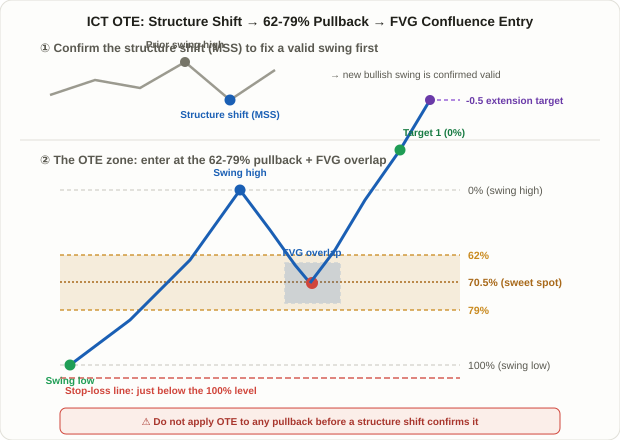

## What OTE Actually Narrows Down

**OTE (Optimal Trade Entry)** is an ICT (Inner Circle Trader) term that takes the general-purpose retracement tool from Lesson 30's [Fibonacci Retracement & Extension](/en/strategies/fibonacci-retracement-extension/) and narrows it to a much more specific question: exactly where, within a pullback, is an entry actually worth considering? Classic Fibonacci treats the whole 23.6%–78.6% band as a valid retracement zone. OTE singles out just the **62%–79% slice** of that band as the zone worth watching, with **70.5% (0.705)** marked as the midpoint "sweet spot."

There's a prerequisite that matters more than the percentages themselves: OTE isn't meant to be drawn on just any pullback. It's only meaningful once Lesson 48's [BOS and CHoCH](/en/strategies/market-structure-bos-choch/) has already confirmed a structure shift. In other words, OTE is a two-step tool — first you establish, structurally, that a given swing is a *valid* swing; only then do you look inside its retracement for a re-entry. Draw a Fibonacci grid between two arbitrary points without that structural confirmation first, and the OTE zone you get is measuring a swing that was never confirmed as real in the first place.

## Why 62%–79%, Specifically

OTE's 62%–79% band overlaps with the classic golden zone (38.2%–61.8%) but isn't identical to it, and a few explanations are commonly offered for why OTE pushes deeper:

- **A shallow pullback looks more like a pause than a real re-entry.** If price only retraces to 38%–50% before resuming, that's often read as simple consolidation rather than a pullback deep enough to have shaken out the opposing side's stops and resting orders. The deeper the pullback goes, the more of that opposing liquidity it's assumed to have absorbed along the way.
- **Orders cluster just past 61.8%.** A commonly cited observation is that many retracement buyers and sellers park orders right around the golden-zone boundary at 61.8%. When price pushes slightly past that level, it tends to run through both the breakout-style entries sitting there and the stop-losses of traders who entered earlier inside the golden zone — and OTE is built to sit on the far side of exactly that cluster.
- **79% (0.786) sits right at the edge of structural invalidation.** Once a retracement pushes past 79% and starts approaching 100% — the swing's own starting point — that stops looking like a healthy pullback and starts looking like the trend itself failing. The 62%–79% band is aimed at a narrow window: deep enough to have absorbed meaningful liquidity, but not so deep that the structure is already broken.

All three explanations are shared assumptions within the ICT/SMC community rather than claims with independent statistical backing. What is consistent is that "a deeper retracement absorbs more of the opposing side's liquidity" fits the same logic covered in Lesson 5's [ICT Smart Money Concepts Basics](/en/strategies/ict-smart-money-basics/).

<figure class="diagram">
  
  <figcaption>A structure shift fixes the valid swing first; the entry comes where the 62%-79% OTE zone overlaps an FVG, with the stop just beyond the swing's starting point.</figcaption>
</figure>

## Classic Fibonacci Retracement vs. ICT OTE: What Actually Differs

Both tools use the same underlying math, but they're applied differently and aimed at different questions.

| | Classic Fibonacci Retracement | ICT OTE |
|---|---|---|
| Precondition | None in particular — applied directly to a visible swing | A structure shift (MSS/CHoCH) must confirm the swing first |
| Zone of interest | The full 23.6%–78.6% band | Narrowed to 62%–79% (sweet spot at 70.5%) |
| Highest-confidence level | 38.2%–61.8% (the golden zone) | Between 61.8% and 78.6% (the OTE zone) |
| Extra confirmation | Optional — candle patterns, trendlines, etc. | Actively required — FVG or order block confluence |
| Invalidation point | A break of the 100% level (swing origin) | A clear push past 79%, or structure breaking again |

In practice the two aren't rivals. When price doesn't react inside the golden zone and keeps pushing deeper, the OTE zone functions as a second filter — a re-check of "is this trend still structurally alive" before giving up on the pullback entirely. The simplest way to hold both concepts at once is to treat OTE as a stricter subset of the golden zone, not a competing tool.

## The Entry Logic: Structure Shift → Fix the Swing → OTE Pullback → Confluence Check

Turning OTE into an actual trade follows this sequence.

1. **Confirm the structure shift first.** On the timeframe you're trading (or a higher one), a BOS or CHoCH needs to have already established the new directional bias. Drawing OTE on an arbitrary pullback without this step first is not the intended use of the tool.
2. **Fix the valid swing.** Mark the exact start (swing low or high) and end (the most recent opposite swing point) of the move that produced the structure shift. In an uptrend, the swing low becomes 100% and the swing high becomes 0%.
3. **Draw the OTE band.** Mark 62%, 70.5%, and 79%, then wait for price to retrace into that band. A pullback that stalls before 62% hasn't reached the OTE condition yet; one that pushes past 79% is a warning sign that the structure itself may be failing.
4. **Check for confluence.** Look for whether a Fair Value Gap — covered in Lesson 8's [IFVG and PO3](/en/strategies/ifvg-po3-three-tiers/) — or an order block from Lesson 39's [Order Blocks](/en/strategies/order-blocks/) sits inside the 62%–79% band. This is the step that separates a strong OTE setup from a weak one; entering purely because price is sitting inside the percentage range, with no confluence at all, is generally treated as a low-conviction approach.
5. **Entry trigger and stop.** Once a reaction candle shows up at the confluence point — a long wick, a close back in the trend's direction — that's the trigger. The stop goes just beyond the 100% level (the swing's starting point). If the retracement pushes past 79% and nears 100%, the setup is considered invalidated.
6. **Set targets.** The first target is the 0% level (the prior swing extreme); in a strong trend, targets extend further to the negative extensions at -0.5, -1, and -1.618 — the same mechanical extension logic used beyond the 0% level in classic Fibonacci extensions.

## A Worked Example: MSFT Pullback Entry

Assume MSFT rallies from a swing low of $405 to a swing high of $452 (a $47 swing), lower-timeframe price shows a brief bearish structure shift, and then a CHoCH flips that back to bullish — confirming the upward swing as valid.

1. **Fix the swing:** mark $405 as 100% (swing low) and $452 as 0% (swing high).
2. **Calculate the OTE levels:** 62% = $452 − $47 × 0.62 = $422.90; the sweet spot at 70.5% = $452 − $47 × 0.705 = $418.90; 79% = $452 − $47 × 0.79 = $414.90.
3. **Watch the pullback:** price drifts down from $429 to $423, slips just past the 62% level ($422.90), and settles near $419.50 — close to the $418.90 sweet spot.
4. **Check confluence:** a Fair Value Gap left over from an earlier bounce spans roughly $419–$421, overlapping the sweet spot directly.
5. **Entry and stop:** a reaction candle with a long lower wick forms at $420, triggering a long entry at $419.80. The stop goes just below the 100% level ($405), at $403 — an $16.80 risk.
6. **Targets:** the first target is the 0% level at $452 ($32.20 gain, roughly 1.9:1), with an extended target at the -0.5 extension ($452 + $47 × 0.5 = $475.50, roughly 3.3:1).

If step 3 had instead shown price breaking straight through the 79% level ($414.90) and running all the way down to the $405 swing low, that would signal the upward swing itself failing rather than a normal OTE pullback — and the long entry should have been skipped.

## FAQ

### Should I check the golden zone or the OTE zone first?
There's no fixed order. Many traders watch the 38.2%–61.8% golden zone for a reaction first, and only shift their attention to the deeper 62%–79% OTE zone if that reaction doesn't materialize and the pullback keeps extending. Neither order has been shown to be statistically superior — consistency in whichever approach you pick matters more than which one you start with.

### If the pullback pushes slightly past 79%, is the setup automatically dead?
Sources disagree here. Some treat 79% as a hard ceiling; others still consider the retracement valid right up until it approaches the full 100% level. What matters is recognizing that every percent past 79% shifts the balance away from "healthy pullback" and toward "trend failure," and having a clear invalidation rule in place before that happens.

### Is there a verified win rate for OTE setups?
No independent, credible backtest has verified a specific win rate for this pattern. Win-rate and risk-reward figures that circulate online for OTE mostly originate from marketing material produced by vendors selling indicators or courses, and shouldn't be taken at face value. The numbers in the worked example above are illustrative only, not a performance guarantee.

## Limitations and Caveats

- **Swing selection is subjective.** Where exactly to mark the swing high and low varies between traders, which means the same chart can produce two different OTE bands depending on who's drawing it. Anchoring to higher-timeframe structure first reduces, but doesn't eliminate, this variability.
- **An OTE zone without confluence is weak evidence on its own.** Entering purely because price has reached the 62%–79% range, with no FVG or order block backing it up, leaves plenty of room for price to simply pass through the zone and keep going past 79%.
- **An unvalidated, observation-based framework.** Like the rest of the ICT/SMC toolkit, OTE rests on community observation rather than any peer-reviewed statistical edge.
- **Pullback depth depends on trend strength.** In a strong trend, retracements often stall at 38%–50% and never reach the OTE band at all. Waiting specifically for the OTE zone can mean missing moves that reverse from a shallower pullback.
- **Scheduled news can distort the retracement.** Ahead of major data releases or earnings, pullback depth and direction can behave unusually, which makes an OTE-zone reaction less reliable than it would be in calmer conditions.

## Summary

- OTE (Optimal Trade Entry) narrows the classic Fibonacci retracement down to a specific **62%–79% band (sweet spot at 70.5%)**, treated as the zone worth watching for a re-entry.
- It only applies once a structure shift (BOS/CHoCH) has confirmed a valid swing — drawing it on an arbitrary pullback without that confirmation isn't the intended use.
- Entry confidence depends heavily on whether an FVG or order block sits inside the OTE band; entering on the percentage range alone, without that confluence, is considered a weaker approach.
- The stop typically sits just beyond the swing's starting point (the 100% level), with targets at the prior swing extreme (0%) and the negative extensions beyond it.
- No verified win-rate or risk-reward statistic exists for this pattern, so treat every number in this lesson as illustrative, and pair it with independent position-sizing and risk rules rather than trading the zone in isolation.
