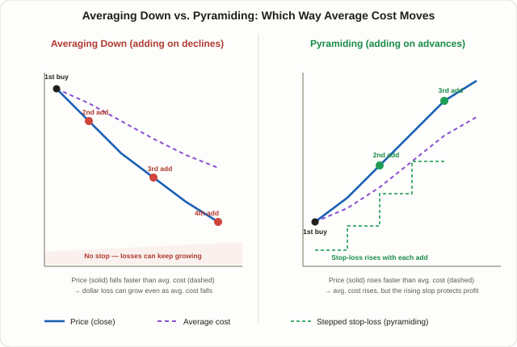

## Two Opposite Moves That Look the Same on the Surface

Ask any two traders what "adding to a position" means and you'll usually get two very different pictures. **Averaging down** means buying more of a stock after its price has fallen, which pulls your average cost lower. **Pyramiding** (also called averaging up or adding to winners) means buying more after the price has risen, which pushes your average cost higher. Both are the same physical action — placing another buy order on something you already own — but because they happen in opposite price directions, they change your risk in opposite ways.

Treating them as one topic and asking "which one is correct" misses the point. They rest on different assumptions and carry different failure modes. [Lesson 6 on risk/reward and money management](/en/strategies/risk-reward-money-management/) covered setting a stop and target before you enter. This lesson is about what happens to that plan once you start adding to the position after the fact.

## The Math First: What Actually Happens to Your Average Cost

The formula for average cost is simple:

```
Average cost = (cost of buy 1 + cost of buy 2 + ...) / (shares in buy 1 + shares in buy 2 + ...)
```

Buy 10 shares at $100 and then 20 more at $90, and your average cost becomes (1,000 + 1,800) / 30 = $93.33. That basic arithmetic is where the psychology of the two techniques diverges. Averaging down always pulls the average cost below the previous price, because you're buying at a discount to it. Pyramiding always pushes the average cost above the previous price, because you're buying at a premium to it.

Here's the part that gets misunderstood most often: **a lower average cost does not mean a smaller loss.** It only lowers the price you need to see again to break even — the actual dollar amount at risk, and the capital tied up in the position, generally goes up. On the flip side, a rising average cost from pyramiding sounds like a worse number, but if each add is paired with raising the stop, the position's downside can actually be more contained than a single large entry would have been. Looking only at the average-cost figure, without asking what happened to total capital at risk, misses the real risk picture in both directions.

<figure class="diagram">
  
  <figcaption>Averaging down lowers average cost more slowly than price falls, with no built-in floor on losses unless one is planned separately. Pyramiding raises average cost as price rises, but a stop that rises with each add protects a growing share of the open profit.</figcaption>
</figure>

## Why Traders Do This: Loss Aversion and the Disposition Effect

Neither behavior usually starts from a spreadsheet — it starts from psychology. **Loss aversion**, a well-documented finding in behavioral economics, describes how a loss of a given size tends to feel considerably worse than a gain of the same size feels good. Rather than realize a loss by selling, averaging down lets a trader make the position "look" closer to breakeven again without ever admitting the loss outright. That connects directly to the **disposition effect** — the documented tendency to sell winners too early and hold losers too long. Averaging down can be read as taking that tendency one step further: instead of just holding a loser, you actively add to it.

Pyramiding's psychological root is different. A rising price feels like confirmation that the original call was right, and that feeling of being "proven correct" is what pulls a trader into adding more. The hard part is telling apart two things that look identical from the outside: adding because a specific, pre-defined technical condition was met (a new high, a volume-confirmed breakout) versus adding simply because the price is going up and that feels exciting. Trading educators consistently flag this exact distinction — a planned add and an impulsive add can look identical on the order ticket while being completely different decisions underneath.

## Averaging Down vs. Pyramiding, Side by Side

| | Averaging Down | Pyramiding (Averaging Up) |
|---|---|---|
| When you add | After the price falls | After the price rises (usually past a confirmed signal, like a new high) |
| Average cost | Moves lower | Moves higher |
| Total position risk | Grows as more capital goes in | Grows during the move, but the realized downside is usually more contained |
| Classic failure mode | Throwing good money after bad into a falling stock | Chasing strength impulsively with no technical trigger |
| Stop-loss design | Must be fixed before the first add, independent of price | Typically raised with every new add |
| Commonly paired with | Valuation-based scaling-in, long-term conviction buying | Trend-following breakout systems like [Donchian/Turtle trading](/en/strategies/breakout-donchian-orb/) or the [Darvas Box](/en/strategies/darvas-box-strategy/) |
| Relationship to sizing rules | Easy to blow through a [Kelly-sized](/en/strategies/kelly-criterion-position-sizing/) risk cap without noticing | Easier to keep under control if each add is resized explicitly |

The most important row is "commonly paired with." Pyramiding tends to show up inside systematic rule sets that only allow an add once a trend has already been confirmed — Turtle trading and the Darvas Box are two classic examples. Averaging down, by contrast, often happens as a simple emotional reflex ("it's cheaper now, so I'll buy more") with no independent justification. Turning it into an actual strategy requires something more — a valuation thesis, or a pre-committed scaling plan decided before the first trade.

## Two Worked Scenarios

These are simplified, illustrative numbers meant to show the mechanics — not a real, verified trading record.

### Scenario A: Averaging Down — Lower Average Cost, Bigger Dollar Loss

| Step | Price | Shares | Capital in | Average cost |
|---|---|---|---|---|
| 1st buy | $100 | 10 | $1,000 | $100 |
| 2nd buy (averaging down) | $80 | 10 | $800 | $90 |
| 3rd buy (averaging down) | $65 | 15 | $975 | $78.57 |

If the price is now $65, the position's loss against the $78.57 average cost is about -17.3%. Had the trader never averaged down and just held the original 10 shares at $100, the loss at the same $65 price would be -35%. **The percentage loss looks far better after averaging down** — but the actual dollar loss tells a different story: -$135 for the single entry versus -$482.78 across the full averaged position. Capital at risk nearly tripled, from $1,000 to $2,775, which is exactly why a smaller percentage loss can still sit on top of a larger dollar loss.

### Scenario B: Pyramiding — Higher Average Cost, a Stop That Rises With It

| Step | Price | Shares | Capital in | Average cost | Stop-loss |
|---|---|---|---|---|---|
| 1st buy | $100 | 20 | $2,000 | $100 | $92 (prior swing low) |
| 2nd buy (pyramiding) | $115 | 10 | $1,150 | $105 | $108 (new swing low) |
| 3rd buy (pyramiding) | $130 | 10 | $1,300 | $111.25 | $122 (new swing low) |

If the price runs to $135, the open gain against the $111.25 average cost is roughly +21.3%. The key detail is that the stop moved from $92 to $108 to $122 as each add went in. Even if the trend reverses and the whole position gets stopped out at $122, that's still roughly +9.7% above the $111.25 average cost. A disciplined pyramid — where every add comes with a tighter stop — can be built so that adding to the position locks in more of the open gain rather than putting more of it back at risk. This is the same structure covered in [Lesson 74 on the Darvas Box](/en/strategies/darvas-box-strategy/), where each new box raises the stop to the floor of that box.

## When Averaging Down Is a Plan — and When It's Just Denial

Averaging down isn't automatically a mistake. Veteran options strategist Lawrence McMillan has made a specific distinction worth repeating: adding to a stock that's pulling back within an otherwise bullish pattern is a different act from adding to a stock that is simply falling, for no better reason than that it got cheaper. For averaging down to function as a real strategy, a few things generally need to be true:

- **A scaling plan exists before the first buy.** Something like "commit 30% of the intended capital on the first buy, and reserve the rest for specific lower price levels" needs to be decided in advance — not improvised each time the price drops further.
- **The reason for the decline is understood.** A broad market selloff dragging a fundamentally sound name down is a different situation from company-specific bad news (an earnings miss, a broken thesis). In the second case, the original reason for owning the stock may no longer hold, which removes the justification for adding at all.
- **A hard cap on total capital exists.** Deciding in advance how many adds are allowed and what the maximum total position size will be is what prevents "just one more add to fix the average" from turning into an oversized position in a single name.

Without those three things, averaging down tends to function less like a strategy and more like a way to postpone the decision to realize a loss. Multiple reports on real cases show the same pattern: the percentage loss narrows after averaging down, but the absolute dollar loss grows, precisely because more capital went in while the price kept falling.

## When Pyramiding Is a Plan — and When It's Just Chasing

Pyramiding has its own version of the same trap: adding simply because the price is rising and that feels good, with no technical trigger behind the decision. A systematic approach to pyramiding usually requires:

- **Adds only after a confirmed signal.** A system like [Donchian/Turtle trading](/en/strategies/breakout-donchian-orb/) or the Darvas Box only allows an add after a specific, objective condition is met — a new high, or a breakout above resistance accompanied by rising volume.
- **The stop moves up with every add, without exception.** Skip this step and pyramiding just becomes "a bigger position bought at a worse price" — all the extra exposure of chasing strength with none of the downside protection that makes it worth doing.
- **Each successive add gets smaller.** Standard practice is to make the first add smaller than the initial entry, and each subsequent add smaller still — since the move has already run further, each new tranche is taking on more risk per dollar than the one before it.

Turtle traders didn't just buy more on every new Donchian breakout — they recalculated the stop every single day as part of the same mechanical process. That pairing of "confirmed signal" with "stop moves up automatically" is what separates disciplined pyramiding from simply chasing a rally.

## A Practical Framework: Plan the Tranches Before You Need Them

Both techniques point to the same conclusion: neither should be decided trade by trade, in the moment. A usable checklist:

1. **Quantify the entire plan before the first buy.** Decide in writing how many adds are allowed, at what price levels (or confirmation signals), and what percentage of capital each one gets.
2. **Set a total risk cap that doesn't care which direction you're adding in.** Using [Kelly-based sizing](/en/strategies/kelly-criterion-position-sizing/) or the R-multiple framework from [Lesson 6](/en/strategies/risk-reward-money-management/), cap the total risk any single name can carry. Every tranche — up or down — pushes you closer to that ceiling.
3. **Only average down if you can answer "why did this fall?" with something other than "it got cheaper."** If that's the only answer, the safer move is to stop there.
4. **Only pyramid if the stop actually moves with every add.** A pyramid with a stop that never rises isn't protecting anything — it's just a larger bet made at a worse price.
5. **Write down the reasoning at the moment you decide to add.** A record made in the moment is the only reliable way to later tell a planned add apart from an emotional one.

## FAQ

### Is averaging down always a bad idea?
Not always — but averaging down based purely on "it's cheaper now" is genuinely risky. It's worth considering only when there's a pre-committed scaling plan, a hard cap on total capital, and a reasonable case that the decline isn't driven by a broken thesis in the underlying business.

### Is pyramiding the same thing as dollar-cost averaging (DCA)?
No. Dollar-cost averaging buys a fixed amount on a fixed schedule, regardless of price — it's rule-based and doesn't care about the trend. Pyramiding only adds when the price has risen and a specific trend-confirmation condition has been met — it's signal-based. That's the core difference.

### Which one is safer?
It's not really a question with a universal answer. Structurally, though, pyramiding is easier to keep safe because trend confirmation and a rising stop are usually built into the method from the start. Averaging down tends to need those same safeguards added on separately — without them, losses and capital at risk can grow together as the price keeps falling.

## Summary

- Averaging down adds to a position after a price decline and pulls average cost lower; pyramiding adds after a price rise and pushes average cost higher — the two move in opposite directions by definition.
- A lower average cost doesn't mean a smaller loss: more capital goes in, so the dollar loss can grow even as the percentage loss shrinks. A higher average cost from pyramiding isn't automatically worse either, if the stop rises along with it.
- Both behaviors are frequently driven by loss aversion and the disposition effect rather than a specific plan, and turning either one into a real strategy requires a pre-committed tranche plan and a stop-loss rule decided in advance.
- Disciplined pyramiding is usually paired with confirmed-trend rules and a rising stop (Turtle trading, the Darvas Box); averaging down without a valuation thesis and a hard capital cap tends to become throwing good money after bad.
- In practice, the common thread is the same regardless of direction: quantify the full tranche plan and the total risk cap before the first trade, and keep a written record of why each add was made.
