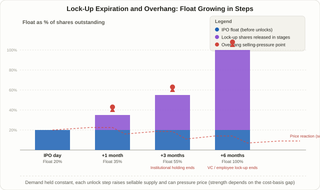

## What "Overhang" Actually Means

Trade enough recent IPOs and you'll run into the word "overhang" constantly. It doesn't refer to shares already trading — it refers to **shares that someone is legally free to sell the moment a restriction lifts**. Figuring out when those restrictions lift, and how much supply they release, is what this lesson is about.

The restriction itself is the **lock-up**: a contract between the underwriters and pre-IPO shareholders (founders, employees, VCs, private-equity investors) that bars them from selling for a set period after the listing, almost always written into the IPO prospectus itself. In the US it's a private contractual term, not an SEC rule, and 180 days is the most common length, though 90-day lock-ups and lock-ups that release in stages (partial release at 90 days, the rest at 180) both show up regularly. Many agreements also include an early-release trigger — if the stock trades well above the IPO price for a specified number of days, the lead underwriter can let the lock-up expire ahead of schedule. Korea runs essentially the same idea through a different label: institutional investors who receive IPO allocations sign voluntary **mandatory holding commitments** (의무보유확약), typically some mix of 15 days, 1 month, 3 months, and 6 months staggered across the allocation, and breaking that commitment can bar a firm from participating in any IPO book-building for six months to a year.

Worth separating this from Lesson 108's [buyback blackout window](/en/strategies/buyback-blackout-window/): that lesson was about a buyer disappearing from the market. This one is the mirror image — a lock-up expiration is about the number of potential sellers suddenly increasing. Both are undisclosed-date events you have to estimate rather than read off a public calendar, but they pull in opposite directions.

## Why Selling Pressure Builds: A Float Shock Plus a Cost-Basis Gap

Two separate mechanics drive the logic behind this trade.

The first is a **sudden jump in float** — the number of shares actually free to trade. Right after an IPO, only the shares sold to public investors in the offering are tradeable; everything held by VCs, employees, and allocation-committed institutions technically exists but can't be sold. When the lock-up lifts, either all at once or in stages, the absolute supply of sellable shares increases in a single step. Basic supply-and-demand logic applies directly here: with demand held constant, a sudden jump in available supply pushes the market-clearing price down.

The second is a **gap in cost basis**. Most locked-up shares were bought by VCs and early investors at prices far below the IPO price, or by allocated institutions at the IPO price itself. If the stock has rallied well above that price by the time the lock-up lifts, those holders are sitting on a large embedded gain and have every incentive to realize it. If the stock has instead fallen below the IPO price, that selling incentive weakens considerably. In other words, the real size of overhang risk isn't just "is a lock-up expiring" — it's **how far the current price sits above the specific holder's cost basis**, which can vary enormously between an early VC round and the IPO allocation itself.

<figure class="diagram">
  
  <figcaption>Float starts out limited to the IPO allocation, then expands in steps as 1-month, 3-month, and 6-month lock-ups and holding commitments release — each step is a point where overhang selling pressure can resurface.</figcaption>
</figure>

## Does the Price Actually Drop? What the Research and Real Cases Show

Before accepting "lock-ups always tank the stock" as fact, it's worth laying out what the actual evidence says — because it disagrees more than the popular narrative suggests.

| Source | What it found |
|---|---|
| Ofek & Richardson (early study, cited widely in later literature) | Roughly a 3% price drop around expiration, alongside a 40% jump in trading volume |
| Nordic IPO study, 141 deals, 2009–2017 | Average cumulative abnormal return of about -1.1% around the expiration window |
| US study, IPOs from 2000–2020 | No statistically significant drop on the expiration day itself, but a -0.94% cumulative abnormal return in the days leading up to it — and the effect weakens as bid-ask spreads narrow, meaning it's hard to profitably trade |
| Efficient-market counterargument (raised in the same literature) | The expiration date is public knowledge from the day of the IPO, so in theory the price impact should already be priced in before it happens |
| At least one study on lock-ups longer than 180 days | Found a positive, not negative, abnormal return around expiration — directly contradicting the simple "unlock equals selloff" story |

The real takeaway isn't that researchers disagree on direction — most lean toward a modestly negative effect. What they disagree on is **whether the drop happens on the day itself or before it, and how large and persistent it actually is**. The efficient-market objection deserves real weight too: if everyone already knows the exact unlock date from the prospectus, a rational market should have priced that in well in advance. Treat this entire topic as **a reasoned hypothesis about direction, not a validated statistical edge**.

Real-world cases cut both ways. Rivian's stock fell roughly 21% around its 2022 lock-up expiration. Shake Shack, by contrast, rose after its lock-up lifted, and traders who shorted into the expiration lost money. Ahead of Twitter's (now X) May 2014 lock-up expiration, the cost to borrow shares for shorting reportedly spiked to as much as 30% annualized — a sign the market was already pricing in heavy anticipated supply. Ahead of Alibaba's lock-up, options-flow data showed open interest building faster in puts than in calls, a bearish tilt in positioning rather than price itself.

Korea's 2025 IPO cycle gives a concrete, current illustration of the same mechanism. Dalba Global listed in May 2025 at a KRW 66,300 offering price, rallied to a 52-week high near KRW 241,000 — up more than 263% from the IPO price — and then, once its mandatory holding commitments expired, reportedly saw institutional holders sell into strength, pressuring the stock. Algenomics released roughly 24% of its shares from lock-up, prompting local coverage to flag an "overhang warning." Daejin Advanced Materials saw about 1.59 million shares held by pre-IPO financial investors (FIs) come off lock-up in April 2025, with more than 20 separate FIs collectively holding around 49% of the company — a large base of potential sellers by any measure. And a January 2026 report on Leaves Med noted that only 17.12% of its institutional allocation carried a mandatory holding commitment, reportedly the lowest ratio since Korea introduced the system. In July 2025, Korean regulators revised IPO allocation rules to prioritize institutions that commit to holding periods, which raised commitment ratios across new listings and, by some accounts, contributed to sharper initial price pops once reduced float met the usual early demand — a reminder that higher commitment ratios can calm the first few weeks of trading while leaving the same absolute volume of shares waiting to unlock later.

## Technique A — Calendar-Based Exposure Management

This approach doesn't try to call direction. It simply reduces exposure during the window where overhang risk is elevated, and it's the more realistic default for most retail traders.

1. **Look up the actual unlock schedule.** US filings disclose lock-up terms in the S-1 or 424B4 prospectus (length, early-release triggers, staged releases). Korean disclosures on DART list mandatory holding commitment ratios and release dates in the listing-performance report.
2. **Calculate what percentage of total shares outstanding the unlocking tranche represents.** Under 10% is usually a minor event; a case like Daejin Advanced Materials, where FI holdings alone ran to roughly half the company, calls for a much more conservative stance.
3. **Compare the current price to the unlocking holders' cost basis, not just the IPO price.** A price far above where VCs or allocated institutions bought in signals a strong incentive to sell; a price near or below that basis signals a weaker one.
4. **Trim size ahead of a known unlock, in line with Lesson 6's [risk-reward and money management](/en/strategies/risk-reward-money-management/) principle, or hold off on new entries for a few sessions after it.** The same logic Lesson 103's [spin-off forced-selling window](/en/strategies/spin-off-investing-forced-selling/) applies here too: managing exposure through the event matters more than trying to predict its exact size.

## Technique B — Hedging an Existing Position With Puts or a Collar

This is for traders who already hold the stock and don't want to sell ahead of the unlock. The goal is to cap downside risk while keeping the position intact.

1. **Buy puts expiring after the unlock date.** This caps losses below a chosen strike in exchange for a premium — effectively buying insurance. Ahead of Alibaba's lock-up expiration, put open interest reportedly built up faster than call open interest, which is consistent with traders doing exactly this.
2. **If the premium feels too expensive, consider Lesson 82's [collar strategy](/en/strategies/collar-strategy-protective-hedge/)** — selling a call against the put purchase to offset the cost, at the price of giving up upside above the call's strike.
3. **Recognize that this technique only works where a liquid options market exists.** Most small- and mid-cap Korean IPOs simply don't have one, which leaves reducing position size as the only realistic option in those names.
4. **Watch whether short-borrow costs spike as the unlock approaches.** A sharp rise suggests other market participants are pricing in the same risk — but it also makes a fresh short position more expensive to carry, cutting into the potential payoff of betting on a drop directly.

## Technique A vs. Technique B

| | Technique A: Reduce Exposure | Technique B: Options Hedge |
|---|---|---|
| Goal | Avoid the risk window itself | Keep the position while removing downside risk |
| Requires | Unlock date, float percentage unlocking | A liquid options market on the name |
| Cost | Opportunity cost if the stock keeps rising | Explicit, upfront option premium |
| Best suited for | Most retail and swing traders | Longer-term holders who need to stay invested |
| Works on small/mid-cap Korean IPOs? | Yes | Rarely — most lack listed options |
| Requires calling direction? | No | No — it's structured as insurance |

Both techniques share the same premise: the size of any price impact at expiration isn't statistically settled, but the underlying mechanism — more sellable shares, a gap between cost basis and current price — is real. Technique A manages that uncertainty by stepping back from it. Technique B manages it by paying to insure against it while staying invested.

## A Worked Example (Simplified, for Illustration Only)

This isn't data from a real listing — it's a simplified, hypothetical case meant to make the two variables concrete.

Suppose hypothetical IPO stock XYZ priced at $10 and now trades at $30, up 200% from the offering. At listing, float was 20% of shares outstanding (2 million shares). A further 30% (3 million shares) is held by allocated institutions under a 3-month holding commitment, and the remaining 50% is held by VCs and employees under a 6-month lock-up. When the 3-month tranche unlocks, float jumps from 2 million to 5 million shares — a 150% increase in sellable supply in a single step. If those institutional holders bought in at the $10 offering price, their embedded gain at a $30 market price is 3x, which is a meaningful incentive to sell. If the VC tranche unlocking at 6 months was acquired in an earlier funding round at $3 a share, their embedded gain is roughly 10x — a far stronger incentive. The numbers here are invented purely to show why you need to calculate the float-increase percentage and the cost-basis gap separately for each unlock tranche, rather than treating "a lock-up expires" as a single, uniform event.

## Limits and Traps

- **An expiration doesn't guarantee a drop.** Shake Shack rose after its unlock; Rivian fell sharply after its own. Don't treat direction as settled.
- **Don't dismiss the efficient-market objection.** The unlock date is public from the day of the IPO, so a rational market argument says the effect should already be priced in before it happens.
- **The effect, where it exists, may show up before the expiration date rather than on it.** At least one large US study found no significant move on the day itself, only in the days leading up to it.
- **Korea's staggered commitments blur the signal further.** Splitting holding commitments across 15 days, 1 month, 3 months, and 6 months spreads overhang out rather than removing it — which is exactly the criticism Korean market commentary has raised about the practice.
- **Options hedging isn't available everywhere.** Most small- and mid-cap Korean listings have no listed options market at all, which removes Technique B as a practical option for a large share of names.

## FAQ

### Where can I find a stock's lock-up expiration date?
For Korean listings, check DART (the Financial Supervisory Service's electronic disclosure system) for the listing-performance report, which lists mandatory holding commitment ratios and release dates. For US listings, check the lock-up provisions in the S-1 or 424B4 registration statement filed at the IPO; many brokerage research notes also track major upcoming unlock dates.

### Is overhang the same thing as short selling?
No. Short selling is a specific trading technique — borrowing shares to sell now and buy back later. Overhang describes the pool of shares that *could* be sold once a restriction lifts. Heightened overhang concern can push up demand to borrow shares for shorting, which raises borrow costs, but the two concepts sit at different levels.

### Should I sell before the lock-up expires?
There's no single right answer. The efficient-market argument says the effect may already be priced in; the cost-basis logic says the incentive to sell is real and depends on how far the price has run above the unlocking holders' purchase price. This lesson doesn't take a side — it gives you the two numbers (float increase, cost-basis gap) to calculate for yourself before deciding.

## Summary

- Overhang refers to shares that aren't trading yet but become sellable once a lock-up or mandatory holding commitment expires; the core mechanism is a sudden increase in float meeting unchanged demand.
- Academic event studies mostly find a modest negative abnormal return around expiration, but disagree on whether it appears before or on the expiration date, on its size, and face a real efficient-market counterargument.
- The strength of the selling incentive depends on both the percentage of float unlocking and the gap between the current price and the unlocking holders' specific cost basis — not on the lock-up date alone.
- Technique A (reducing exposure) is the realistic default for most retail traders; Technique B (hedging with puts or a collar) suits holders who need to stay invested but requires a liquid options market that most small- and mid-cap IPOs don't have.
- Korea's staggered holding-commitment structure spreads overhang across multiple dates rather than concentrating it in one event, and real cases on both sides — Rivian's drop, Shake Shack's rally — show the direction is a hypothesis, not a guarantee.
