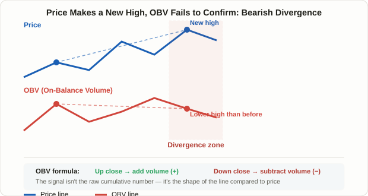

## The Idea Behind OBV: Volume Talks Before Price Does

On-Balance Volume (OBV) is one of the oldest volume indicators still in common use, developed by Joe Granville back in 1963 around a simple but durable premise: volume tends to move before price confirms a move. The theory is that when large or informed participants start accumulating or distributing a position, that activity shows up in volume well before it's obvious on the price chart itself. The tape can look quiet while the underlying balance of buying and selling pressure is already shifting underneath it.

OBV's construction is deliberately crude. If today's close is higher than yesterday's, add today's entire volume to a running total. If it's lower, subtract it. If it's unchanged, leave the running total alone. That's the whole formula — no smoothing, no bounded scale. Unlike RSI or a stochastic oscillator, OBV isn't capped between 0 and 100; it's an open-ended cumulative line that starts from an arbitrary zero point and just keeps climbing or falling. Because of that, the actual number OBV lands on means nothing by itself. **What matters is the shape of the line — specifically, how that shape compares to the shape of the price chart next to it.**

## Working Through the Math With Real Numbers

Formulas read more clearly with numbers attached, so here's six trading days of hypothetical data for Stock B. OBV starts at an arbitrary zero.

| Day | Close | vs. Prior Close | Volume | OBV Change | Running OBV |
|---|---|---|---|---|---|
| 1 | $100.00 | — | 500,000 | — | 0 |
| 2 | $102.00 | Up | 800,000 | +800,000 | 800,000 |
| 3 | $101.50 | Down | 400,000 | −400,000 | 400,000 |
| 4 | $104.00 | Up | 1,200,000 | +1,200,000 | 1,600,000 |
| 5 | $103.80 | Down | 300,000 | −300,000 | 1,300,000 |
| 6 | $104.50 | Up | 600,000 | +600,000 | 1,900,000 |

Look closely at Days 3 and 5. Price pulled back on both days, but the volume behind those pullbacks (400,000 and 300,000 shares) was much lighter than the volume on the up days (800,000 and 1,200,000 shares). The net effect is that OBV kept climbing steadily even through the down days, because the pullbacks simply didn't attract much selling volume. That pattern reads as healthy: the rally is backed by real participation, and the dips look more like pauses than distribution. If those down-day volumes had instead been the larger numbers, OBV would have fallen even as price kept printing new highs — a warning that selling pressure was quietly building underneath an apparently strong tape.

## Divergence: When OBV Disagrees With the Price Chart

The most common way OBV actually gets traded isn't by watching its raw level — it's by comparing the pattern of OBV's highs and lows against the pattern of price's highs and lows. That comparison is called divergence.

- **Bearish divergence**: price prints a new high above its prior swing high, but OBV prints a lower high than its own prior peak. Price went up, but the volume backing that move actually weakened — a sign the rally may be getting carried by a thinner, less broadly participated advance than it looks.
- **Bullish divergence**: price makes a new low below its prior swing low, but OBV holds above (or even rises past) its own prior low. Price fell, but the selling volume behind that decline didn't keep pace — read as a sign that sellers may be running out of conviction.

<figure class="diagram">
  
  <figcaption>Top: price sets a new high while OBV fails to confirm it with its own new high — bearish divergence, signaling that the volume behind the advance is fading. Bottom: OBV's basic construction — add volume on an up close, subtract it on a down close.</figcaption>
</figure>

That said, this interpretation needs a caveat attached every time. Divergence is a warning that momentum is losing fuel — not a guarantee that a reversal happens now. Price regularly keeps running in the same direction for weeks after a divergence first appears. In practice, most traders treat an OBV divergence as a reason to pay closer attention rather than a standalone entry trigger, waiting for a separate confirmation — a broken support/resistance level, a moving-average break — before actually acting on it. The same caveat applies to [MACD divergence in Lesson 47](/en/strategies/macd-signal-divergence/): divergence describes a matter of degree, not a clean on/off switch.

## Drawing Trendlines on OBV Itself

A second common way to use OBV is to draw a trendline on the OBV line, the same way you'd draw one on a price chart. If price's own uptrend line is still intact but OBV's trendline breaks first, that's read as an early warning that buying pressure — measured in volume, not price — has already started to crack before price shows it. The reverse also gets used: if OBV breaks above its own prior peak before price does, some traders treat that as volume confirming accumulation ahead of a price breakout. Granville originally described OBV's higher lows this way — as "springs" coiling ahead of a move, with a break above a prior OBV high serving as evidence that accumulation had already been underway.

## OBV vs. CVD: Two Cumulative Volume Lines, Built From Different Raw Material

This course already covered a cumulative volume indicator in [Lesson 16's order flow and footprint chart trading](/en/strategies/order-flow-footprint-cvd/), built around Cumulative Volume Delta (CVD). OBV and CVD look similar on the surface — both are running lines that stack up volume to read buying versus selling pressure — but they classify that volume using completely different inputs.

| | OBV | CVD (Cumulative Volume Delta) |
|---|---|---|
| Classifies by | Whether the whole bar's close was higher or lower than the prior close | Whether each individual trade inside a bar hit the bid or hit the ask |
| Data needed | Just close price and volume | Tick-level trade data with aggressor side tagged |
| Time resolution | One direction assigned to an entire bar | Buy and sell volume separated even within a single bar |
| Accessibility | Available on virtually any free charting platform | Usually requires a specialized platform or paid data feed |
| Strength | Easy read on the broad swing/trend picture | Sensitive to micro-shifts in aggression inside a single candle |

In plain terms, OBV is the blunt version: it looks at who "won" the day overall and dumps the entire day's volume onto that side. CVD is the sharp version: it looks inside the same candle and separates exactly how much volume was bought aggressively versus sold aggressively, trade by trade. CVD's precision comes at the cost of needing tick-level, aggressor-tagged data that most retail charting tools don't provide for free. OBV trades that precision away in exchange for something practical — it works on decades of historical daily data using nothing but price and volume, the two numbers every chart already has. A swing trader checking the broad health of a trend is usually better served by OBV; a scalper who needs to know who's winning inside the current candle is better served by CVD.

## Limitations and Practical Caveats

- **It assigns the entire day's volume to one side.** A 0.1% up close gets the exact same full-volume credit as a 3% up close — OBV has no concept of magnitude, only direction.
- **Thinly traded names distort it easily.** A single unusual volume spike on a low-liquidity stock can reshape the whole OBV line, which weakens the reliability of any divergence read on it.
- **Divergence isn't a timing tool.** As noted above, price can keep trending for a long stretch after a divergence first shows up. Most practitioners treat OBV divergence as one input to confirm alongside support/resistance, moving averages, or RSI rather than a standalone signal to trade on its own.
- **The starting point is arbitrary, so absolute levels are meaningless.** Whether OBV sits at 1,000,000 or -500,000 says nothing on its own — only the shape of the line, and how that shape compares across the same chart, carries information. Comparing OBV values across different date ranges or different charting tools isn't meaningful.

## FAQ

### Should I buy or sell the moment I spot OBV divergence?
No. Divergence is a warning that the volume supporting the current trend is weakening — it doesn't pinpoint the exact moment a reversal happens. Most traders wait for the price chart itself to confirm, through a broken support/resistance level or a trendline break, before acting on a divergence signal.

### How is OBV different from a plain volume bar indicator?
A standard volume indicator just shows the size of each day's volume as a bar, with no sense of direction. OBV takes that same volume, assigns it a sign based on whether price closed up or down, and accumulates it into one continuous running line — turning raw volume into something that can be read for trend and divergence the way a price chart is.

### What kinds of markets is OBV best suited for?
It tends to produce a more reliable, readable shape on liquid large-cap stocks, major indices, and actively traded large-cap crypto, where volume flows steadily enough that a single session's spike doesn't dominate the whole picture. On thinly traded small-caps or illiquid names, one unusual volume day can distort the line enough to make divergence signals unreliable.

## Summary

- OBV is built on the idea that volume leads price: it adds a day's volume when the close is up and subtracts it when the close is down, accumulating the result into a single running line.
- The raw OBV number is meaningless on its own; the real signal comes from comparing OBV's highs and lows against price's highs and lows — bearish and bullish divergence.
- Drawing a trendline directly on OBV, and watching whether it breaks before or after price's own trendline, is a second common way traders use the indicator.
- OBV and CVD are both cumulative volume indicators, but OBV classifies an entire bar at once based on its close, while CVD classifies individual trades inside the bar based on which side was the aggressor — a blunt tool versus a precise one.
- Divergence is a warning sign, not a timing signal, and it's especially prone to distortion on illiquid names — treat it as one confirming input alongside price action and other indicators, not a standalone trigger.
