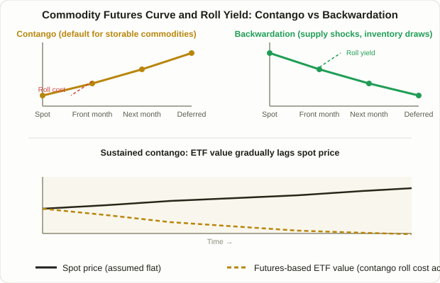

## Oil Doubled. Your Oil ETF Didn't. Here's Why.

Anyone who has held an oil or natural gas ETF through a big commodity move has probably asked some version of this question: crude oil is up sharply, so why did my ETF only capture a fraction of that gain? The answer, more often than not, is **roll yield**. Funds like USO don't sit on barrels of physical crude; they hold futures contracts that expire, and every month, before expiration, the fund sells the contract it's holding and buys the next one out — a process called **rolling**. Depending on the shape of the futures curve at that moment, this roll can quietly erode the fund's value or, just as easily, add to it, independent of whatever spot prices are doing.

This isn't just theory. Through 2026, several financial outlets reported that crude oil futures had shifted into backwardation, and that this curve shape was actually helping funds like USO and BNO outperform the simple spot-price return — a tailwind commentators repeatedly described as "fragile," since it depends on a supply picture that could flip at any time. On the natural gas side, a trade publication reported that when the November 2026 contract expired this month and December took over as the front month, the new front-month contract was trading roughly 10% above the expiring one — a contango premium that, if it persists, works directly against anyone rolling a long position (treat that single-source figure as illustrative, not a locked-in number; always check exchange settlement prices directly). This lesson extends the contango/backwardation framework from [Lesson 28's VIX term structure](/en/strategies/vix-term-structure-contango-backwardation/) to physical commodities, where storage costs, seasonal demand and real supply shocks — not just market psychology — shape the curve.

## What Rolling Actually Is, and Why It Has to Happen

Every futures contract expires. Investors who don't want physical delivery — which includes almost every ETF and most financial traders — have to keep selling the contract closest to expiration (the front month) and buying a later-dated contract (the next month out) to maintain continuous exposure. That swap is the **roll**. The catch is that the front-month price and the next-month price are rarely identical, and that gap is exactly what turns into roll yield — a gain or a cost, depending on which way the curve slopes.

## Contango and Backwardation: The Curve's Two Shapes

- **Contango**: Later-dated contracts cost more than nearer-dated ones, so the curve slopes upward. Every roll means selling the cheaper front month and buying the pricier next month, which quietly drags on returns over time even if the spot price never moves.
- **Backwardation**: The front month costs more than later-dated contracts, so the curve slopes downward. Every roll means selling the pricier front month and buying the cheaper next month — and as that cheaper contract becomes the new front month and converges upward toward spot, the position can pick up extra return along the way.

<figure class="diagram">
  
  <figcaption>In contango (left), rolling from a cheap front month into a pricier next month bleeds value over time. In backwardation (right), the opposite roll adds to it. The bottom panel shows how a long-held futures-based ETF can drift below spot during a sustained contango stretch.</figcaption>
</figure>

## Why the Curve Takes Either Shape: Storage Costs vs. Scarcity

Contango tends to be the "default" state for storable commodities like crude oil and metals because of the **cost-of-carry model**: buying a barrel today and promising to deliver it later means paying for storage, insurance and financing in the meantime, and that cost gets baked into the price of the later-dated contract. The further out the delivery date, the more carrying cost accumulates, which naturally tilts the curve upward.

Backwardation shows up when **immediate scarcity** outweighs future scarcity in the market's mind — a sudden supply disruption (war, sanctions, a refinery outage) or a sharp drawdown in inventories makes securing the commodity right now more valuable than locking in a price for delivery months from now, pushing front-month demand above deferred-month demand. Economist John Maynard Keynes's **theory of normal backwardation** offers one explanation for why this can be more than a temporary scarcity signal: commodity producers, as hedgers, tend to sell futures to offload price risk, and the speculators absorbing that selling demand a risk premium for doing so — which can structurally push futures prices below what speculators actually expect the future spot price to be. That said, this theory doesn't hold uniformly across every commodity or every period; in practice, most commodities swing between contango and backwardation depending on the prevailing supply-and-demand picture, rather than sitting permanently in one state.

Natural gas, which is far harder and more expensive to store than oil and has sharply seasonal demand, behaves a bit differently. Winter-delivery contracts often trade structurally above summer-delivery contracts, reflecting predictable heating-season demand rather than any current scarcity. The result is a curve that spends much of the year looking less like simple contango or backwardation and more like a repeating "winter peak, summer valley" seasonal pattern.

## A Worked Example of Roll Yield (Hypothetical Figures Only)

The following numbers are a **hypothetical, illustrative example**, not a live market quote.

**Contango scenario**: Suppose the front-month contract trades at $62 a barrel and the next-month contract trades at $63. Rolling means selling at $62 and buying at $63 — a roll cost of roughly 1.6% ($1 ÷ $62) on that single roll. If a similar-sized contango persisted and rolled over month after month (a simplification, since real contango widths shift constantly), the cumulative drag could approach something in the neighborhood of 20% a year, purely from rolling — which is how a fund can lose meaningful ground even while the spot price goes nowhere.

**Backwardation scenario**: Now suppose the front month trades at $70 and the next month at $68. Rolling means selling at $70 and buying at $68, pocketing that $2 gap (about 2.9%) upfront. If that $68 contract later becomes the new front month and converges back up toward $70 as expiration approaches, that 2.9% becomes realized return.

| | Contango ($62 front / $63 next) | Backwardation ($70 front / $68 next) |
|---|---|---|
| Action on roll | Sell cheap front month, buy pricier next month | Sell pricier front month, buy cheap next month |
| Return from one roll | About -1.6% (roll cost) | About +2.9% (roll yield) |
| Long-term result if spot is flat | ETF value gradually lags spot | ETF value gradually beats spot |
| Markets where this is common | Natural gas, grains — high storage cost or strong seasonality | Crude oil during supply disruptions or sharp inventory draws |

Treat these numbers as a simplified teaching example — real ETFs face a contango or backwardation width that shifts every month, plus management fees and trading costs that widen the gap between the textbook math and actual fund returns.

## Two Ways to Roll: Front-Month vs. Optimum-Yield Strategies

Not every commodity ETF rolls the same way. The simplest approach, **front-month rolling**, holds only the nearest contract and swaps into the next nearest one right before expiration every single month. USO ran on this model for years — it's simple and tracks the nearest-month price intuitively, but it absorbs the full roll cost whenever the curve is steeply in contango, with no mechanism to avoid it.

The alternative, used by funds like DBO, is **optimum-yield rolling**: instead of automatically moving to the next calendar month, the fund scans the entire curve (often a full year of contract months) and rolls into whichever contract currently shows the smallest contango gap or the largest backwardation gap. That means the specific contract month the fund holds can change from one roll to the next, which makes the strategy more complex and somewhat less intuitive to track — but it creates room, at least in theory, to reduce roll drag within the same underlying market.

| | Front-month rolling | Optimum-yield rolling |
|---|---|---|
| Approach | Always holds the nearest contract | Scans the full curve, picks the contract with the least roll drag |
| Upside | Simple, intuitive tracking of near-term prices | Can soften roll costs during steep contango |
| Downside | Absorbs the full contango cost with no filter | More complex; the held contract month can shift, making tracking less intuitive |
| Typical products | Traditional single-month trackers like USO | Index-based funds like DBO |

Neither approach makes contango disappear. If the whole curve is steeply upward-sloping, optimum-yield rolling can only soften the drag — it can't eliminate it. That distinction matters more than the marketing copy around either fund type usually lets on.

## What to Check Before You Trade

- **Read the prospectus for the fund's roll methodology.** Two ETFs that both call themselves "oil funds" can produce meaningfully different returns in the same market if one rolls front-month and the other rolls optimum-yield.
- **Look at the actual futures curve before buying.** Most brokers and exchanges let you pull up front-month, next-month, and further-dated prices side by side — a quick way to see whether the market is in contango, backwardation, or a seasonal pattern, and how wide the gap is.
- **If you're holding long-term, assume roll costs compound.** The mechanism is different from the daily-rebalancing decay covered in [Lesson 72's leveraged ETF volatility decay](/en/strategies/leveraged-etf-volatility-decay/), but the conclusion is similar: these products are often structurally worse suited to long holding periods than their name suggests.
- **Backwardation isn't permanent.** Once a supply disruption eases or inventories rebuild, the curve can flip back to contango, so betting that today's roll yield continues indefinitely is a real risk, not a minor footnote.
- **Curve shape doesn't predict price direction.** Backwardation doesn't guarantee spot prices will rise, and contango doesn't guarantee they'll fall. The curve tells you about the expected gap between the ETF's return and the spot return — nothing more.

## FAQ

### Should I just avoid oil ETFs whenever they're in contango?
For short-term trading, rolling happens infrequently enough that the impact is usually limited. For anything held more than a few months, checking the contango width matters — a steep, sustained contango can mean the ETF trails the spot price noticeably even in a rising oil market.

### Is this the same concept as the VIX term structure covered in Lesson 28?
The underlying mechanic — a price gap between near and far contracts that produces roll yield — is the same. But [Lesson 28's VIX futures](/en/strategies/vix-term-structure-contango-backwardation/) track an abstract volatility measure driven mostly by market fear and calm, while oil and natural gas futures are physical commodities whose curve shape is shaped directly by storage costs, seasonal demand and real supply disruptions — a different set of underlying forces producing a visually similar curve.

### Do I need to roll futures myself as a retail trader?
Most retail investors get commodity exposure through an ETF, so the fund handles the actual rolling. But "the fund does it for you" doesn't mean the cost disappears — it just means that cost shows up inside the fund's tracking performance rather than in a trade confirmation you'd see yourself. Checking how a fund's historical return compares to the spot commodity's return is the practical way to see that cost after the fact.

## Summary

- Commodity ETFs track futures contracts, not physical holdings, and have to roll from the expiring contract into the next one on a regular schedule.
- In contango, where later contracts cost more than nearer ones, every roll bleeds a little value; in backwardation, where nearer contracts cost more, every roll can add a little.
- Contango tends to be the default for storable commodities because of carrying costs, while backwardation tends to show up when immediate scarcity — supply shocks, inventory drawdowns — outweighs future scarcity in the market's pricing.
- Seasonal commodities like natural gas are better understood through a "winter peak, summer valley" seasonal curve than through simple contango-versus-backwardation labels.
- Front-month and optimum-yield rolling methodologies handle the same curve differently, but neither one makes a steep contango disappear entirely.
- For anyone planning to hold a commodity ETF for more than a short stretch, checking the futures curve shape and the fund's roll methodology before buying is the most practical way to avoid being surprised by the gap between spot returns and fund returns.
