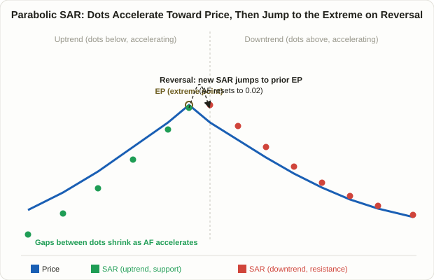

## One Dot, Two Jobs: Direction and a Trailing Stop

If you've ever seen a chart with a trail of small dots sitting above or below price, then watched that trail suddenly flip to the other side, you were looking at **Parabolic SAR (Stop And Reversal)**. The [Supertrend lesson](/en/strategies/supertrend-indicator/) already noted that Supertrend "conceptually sits in the same family as Wilder's own Parabolic SAR" — and in fact, Parabolic SAR came first. J. Welles Wilder Jr. introduced it in his 1978 book *New Concepts in Technical Trading Systems*, in the same pages where he introduced RSI, [ADX/DMI](/en/strategies/adx-dmi-trend-strength/), and [ATR](/en/strategies/risk-filters-atr-cmf/). That all four came from the same author in the same book isn't a coincidence — it's commonly explained in technical-analysis writing that Wilder designed SAR as the trend-following tool and ADX as its companion gauge for whether that trend-following approach was even worth trusting in the current market.

The name tells you exactly what it does. "Stop And Reversal" means the dot is simultaneously your trailing stop and your reversal signal. When the dot sits below price, you're in an uptrend and that dot is your stop level; the moment the dot flips above price, the trend has reversed and your stop has jumped to the other side too. That's the same core idea as Supertrend — one overlay doing the job of direction and stop-loss at once — but the way the dot closes the distance to price is built completely differently.

## Why It Accelerates: Tightening the Leash as a Trend Ages

The word "Parabolic" describes the shape of that acceleration, and understanding it is the whole point of the indicator. Early in a trend, the dot sits far from price, giving the position room to breathe. The longer the trend runs, the faster the dot creeps toward price. That design encodes a specific piece of trading psychology:

- **Early in a trend**: a freshly started move still gets knocked around by ordinary pullbacks. A tight stop here would get a genuinely good trend stopped out almost immediately, so the dot starts out moving slowly.
- **Later in a trend**: the longer a move runs, the more reasonable it is to assume it's statistically closer to exhaustion, and the more profit there is sitting on the table that's worth protecting. So every time price prints a fresh high (or low), the dot accelerates a little more.
- **The net effect**: give it room early, tighten the leash later — a habit most discretionary traders try to practice manually anyway, turned into a mechanical formula.

Critically, this acceleration has nothing to do with how volatile the asset actually is (no ATR anywhere in the formula) — it's purely a function of how many new extremes have printed since the trend began. That single fact is the real dividing line between Parabolic SAR and Supertrend, covered in detail below.

## The Formula: SAR, EP, and the Acceleration Factor (AF)

The core formula is simple:

**Next SAR = Current SAR + AF × (EP − Current SAR)**

- **SAR**: today's calculated value — both your current trailing stop and tomorrow's dot.
- **EP (Extreme Point)**: the highest high (in an uptrend) or lowest low (in a downtrend) recorded since the current trend began.
- **AF (Acceleration Factor)**: conventionally starts at 0.02, increases by 0.02 every time a new EP prints, and caps out at 0.20. That 0.02 / 0.02 / 0.20 set of numbers is Wilder's original example turned industry convention — it's not a law of physics, just a widely adopted default.

There's one additional technical guardrail: in an uptrend, SAR can never be set above the low of the current or prior bar (the mirror rule applies in a downtrend). That stops the acceleration from running away and placing the dot somewhere structurally unrealistic, inside the candles themselves.

### A Numeric Walkthrough

Say a stock starts an uptrend at $480.00, with AF beginning at 0.02.

| Day | High of Day | EP (updated?) | AF | SAR Calculation | Next SAR |
|---|---|---|---|---|---|
| Day 1 | $500.00 (trend's opening high) | EP = $500.00 | 0.02 | 480.00 + 0.02×(500.00−480.00) | **$480.40** |
| Day 2 | $505.00 (new high) | EP → $505.00 | 0.04 | 480.40 + 0.04×(505.00−480.40) | **$481.38** |
| Day 3 | $512.00 (new high) | EP → $512.00 | 0.06 | 481.38 + 0.06×(512.00−481.38) | **$483.22** |
| Day 4 | $510.00 (not a new high) | EP holds at $512.00 | 0.06 (holds) | 483.22 + 0.06×(512.00−483.22) | **$484.95** |

Day 4 is the detail worth sitting with: because no new high printed, both EP and AF stay frozen — but the SAR still inches upward toward the EP. In other words, even while the trend is resting, the stop keeps tightening.

Now suppose Day 5 is a down candle: the low prints at $482.00 and the close comes in at $481.00. Since the low ($482.00) traded through the SAR value ($484.95), the trend has reversed. What happens next is the single most distinctive mechanic in the whole indicator:

- **New SAR = the prior trend's EP.** The instant the trend flips, the new SAR doesn't ease into place — it jumps straight to $512.00, the extreme point of the uptrend that just ended. The dot goes from sitting below price at $484.95 to sitting above price at $512.00 in one step.
- **AF resets to 0.02.** A new trend means the acceleration clock starts over from scratch.
- **A new EP starts tracking.** The downtrend's EP begins fresh from the reversal low (around $481.00 here) and will keep ratcheting lower as new lows print.

Why that jump matters is worth unpacking on its own.

<figure class="diagram">
  
  <figcaption>During the uptrend (left), the dot sits below price and accelerates closer with every new high. The moment price closes below the dot (the reversal), it jumps straight to the prior trend's extreme high and switches to a downtrend resistance dot (right).</figcaption>
</figure>

## Trading Rules: A Standalone Reversal System vs. a Trailing-Stop Add-On

Wilder's original design was meant to be an always-in-the-market system: when the dot flips above price, you close your long and immediately go short, and vice versa — no flat periods, ever. In practice, traders split into two very different uses of the same tool.

1. **Standalone stop-and-reverse system**: trading every flip as both an exit and a new entry, exactly as Wilder designed it. This performs well in a clean, sustained trend, but runs into the limitations covered below the moment the market goes sideways.
2. **A trailing-stop add-on (the more common real-world use)**: enter using a separate signal — a moving average alignment, or a [structure break like BOS](/en/strategies/market-structure-bos-choch/) — and use the Parabolic SAR dot purely as your stop-loss level. Because the dot only ever moves in your favor while the trend holds, it trails automatically with no manual adjustment.
3. **Pairing it with a regime filter**: Parabolic SAR has no built-in way to tell whether the market is even trending right now. It's commonly noted that Wilder's own inclusion of ADX in the same book was meant to answer exactly that question for trend-following tools like SAR. A practical adjustment many traders use: only trust SAR flips when [ADX](/en/strategies/adx-dmi-trend-strength/) is above its 25 threshold, and ignore or downsize signals below it.

## Acceleration Factor Settings: What Changes What

There are three dials — the starting AF, the step increment, and the maximum AF — and most platforms ship with 0.02 / 0.02 / 0.20 as the default.

| Settings | Behavior | Best Suited For |
|---|---|---|
| Slow (e.g. start 0.01, step 0.01, max 0.10) | Dot stays farther from price; later reversals but fewer premature exits | Swing and position trading |
| Default (0.02 / 0.02 / 0.20) | The most widely used out-of-the-box setting | Day trading to short-swing trading |
| Fast (e.g. start 0.03, step 0.02, max 0.20) | Dot closes in on price quickly; faster reversals but more whipsaw | Catching and exiting short-lived trends quickly |

The 0.02/0.02/0.20 default gets cited constantly, but it's really Wilder's original worked example that calcified into a convention rather than a value proven optimal everywhere. On volatile assets like crypto or small caps, traders commonly report that the default accelerates too fast, triggering premature reversals even in the middle of a genuinely intact trend.

## Parabolic SAR vs. Supertrend: Same Family, Different Engine

Parabolic SAR and the [Supertrend indicator](/en/strategies/supertrend-indicator/) share an identical goal — one overlay providing direction and a stop — and the same Wilder lineage underneath the acceleration logic. But what decides how far the line sits from price is fundamentally different.

| | Parabolic SAR | Supertrend |
|---|---|---|
| What sets the distance | Time elapsed, measured in how many new highs/lows have printed — AF accumulates regardless of volatility | ATR × multiplier — the asset's actual, current volatility in absolute terms |
| Volatility awareness | None built in — acceleration runs at the same pace whether the asset is calm or wild | Direct — the band itself widens automatically when volatility rises |
| Behavior on reversal | New SAR jumps straight to the prior trend's extreme point (EP) | Flips to the opposite band's value (a comparatively smaller jump, scaled by the ATR multiplier) |
| Tunable inputs | Three (starting AF, step, max AF) | Two (ATR period, multiplier) |
| Visual signal | A string of dots, where the shrinking gaps visibly show acceleration | A continuous line/band |
| Weak spot in long trends | As AF maxes out at 0.20, the dot can hug price so tightly that a completely normal pullback triggers a premature exit | Because it's volatility-scaled, the band tends to hold a steadier distance for as long as volatility itself stays consistent |

The practical distinction traders often draw: Parabolic SAR tends to feel intuitive on assets with fairly stable volatility and a clean directional trend, while the ATR-based Supertrend tends to hold up better on assets whose volatility regime shifts a lot (crypto, high-beta growth names). It's also common to see both plotted on the same chart, with signals only trusted when the two agree on direction.

## Limitations Worth Knowing

- **Repeated losses in a range-bound market.** When price chops sideways with no clear direction, the dot flips back and forth every few bars, and every flip burns spread, commission, and slippage. This "chop tax" is a weakness shared by every stop-and-reverse indicator, not unique to SAR.
- **Over-tightening late in a long trend.** Once AF caps out at 0.20, the dot can sit so close to price that an entirely ordinary pullback is enough to trigger a reversal signal well before the actual trend is over.
- **No volatility adjustment.** Running the same settings on a low-volatility large cap and a high-volatility small cap or crypto asset produces very different signal character. Checking ATR for the asset's typical behavior first is a sensible precaution.
- **Vulnerable to gaps.** An overnight gap that jumps clean through the SAR dot means your actual fill can land well past the calculated stop level.
- **It's a lagging indicator.** Direction only confirms after the trend has already covered some ground — it isn't built to call exact tops or bottoms.

## FAQ

### Can I trade using Parabolic SAR alone?

That's generally not recommended. Because it has no built-in way to recognize a range-bound market, pairing it with a regime filter like [ADX](/en/strategies/adx-dmi-trend-strength/), or confirming with a moving-average trend filter, is standard practice.

### Which is better: Parabolic SAR or Supertrend?

Neither is objectively superior. The core difference is that SAR scales its distance by time (the acceleration factor), while Supertrend scales it by actual volatility (ATR). SAR is often described as more intuitive on steadily-volatile assets, while Supertrend tends to hold up better when volatility itself shifts a lot. Plotting both and only trusting agreement is a common compromise.

### Does this work the same way on crypto or international stocks?

The calculation itself is asset-agnostic. The practical adjustment traders commonly make for 24-hour, high-volatility assets like crypto is lowering the acceleration factor or checking signals on a longer timeframe, since the default 0.02/0.02/0.20 settings tend to flip far too often at that level of volatility.

## Summary

- Parabolic SAR, introduced by Wilder alongside ADX, ATR, and RSI in 1978, plots a dot above or below price that simultaneously marks trend direction and a trailing stop-loss.
- The formula — Next SAR = Current SAR + AF × (EP − Current SAR) — accelerates the dot toward price every time a new high or low prints, typically by 0.02 up to a cap of 0.20.
- On a reversal, the new SAR jumps immediately to the prior trend's extreme point and AF resets to 0.02 — a distinctive mechanic that sets SAR apart from most other trailing indicators.
- It shares its exact purpose with [Supertrend](/en/strategies/supertrend-indicator/), but where SAR accelerates by time, Supertrend scales by ATR — a difference that shows up most clearly in long trends and shifting-volatility assets.
- Because it's exposed to repeated losses in range-bound markets, pairing it with a regime filter such as [ADX/DMI](/en/strategies/adx-dmi-trend-strength/) — and leaning on it as a trailing stop rather than a standalone reversal signal — is the more commonly recommended way to use it.
