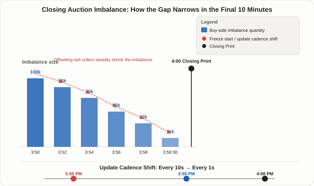

## A Number the Chart Never Shows You

Ten minutes before the regular session ends, exchanges start broadcasting a number that never shows up on a price chart: the **MOC imbalance** (Market-on-Close imbalance) — the quantity of buy or sell orders that must be filled at the closing price but currently have no matching order on the other side. That published quantity, and how it changes minute by minute until the bell, is what **MOC imbalance trading** is built around. Everything a candlestick shows you is already-settled history; the imbalance feed is the opposite — it's forward-looking information about order flow that is guaranteed to hit the tape before the day is over.

This isn't a side effect of market plumbing — exchanges publish it on purpose. Both NYSE and Nasdaq run auctions where index and passive funds need to execute huge blocks at a single closing price, so the exchanges disclose the imbalance ahead of time specifically to attract offsetting liquidity and soften the price impact of that block. The side effect is that the published number itself becomes something short-term traders watch and react to in the closing minutes.

## Why the Close Keeps Getting More Important

The closing print used to be just the last trade of the day. Its weight in the market has grown. Research by Bogousslavsky and Muravyev found that roughly 7.5% of total US equity volume executed in the closing auction as of 2018. That figure is a dated academic estimate, not a live statistic you should assume holds exactly today — but given how steadily money has kept flowing into index funds and ETFs since then, the directional claim that the close carries more weight than it used to is a reasonable one to work from.

The mechanics behind that growth are simple. An index fund tracking the S&P 500 needs to minimize tracking error against a benchmark that is itself priced at the close, so rebalancing flows have to clear at that exact closing price. The forced buying described in the [Index Inclusion Effect lesson](/en/strategies/index-inclusion-effect/) mostly settles through this same closing auction. That flow repeats every month and every quarter, and on days where index rebalancing overlaps with options and futures expiration — covered in [Triple Witching Day](/en/strategies/triple-witching-day/) — the published imbalance tends to run far larger than on an ordinary session.

## Reading the Numbers: Imbalance Quantity vs. Paired Quantity

To actually use the published feed, you need to separate two numbers the exchanges report:

- **Paired quantity**: the volume that, at the current indicative price, already has a matching order on the other side and would execute.
- **Imbalance quantity**: whatever is left over with no match. A buy-side imbalance means there isn't enough sell volume at that price; a sell-side imbalance means the opposite.

A study of NYSE and Nasdaq feed data from 2011–2018 found that the imbalance quantity runs at roughly 51% of paired quantity on NYSE on average, versus only about 1% on Nasdaq measured five minutes before the close. The exact figures matter less than the lesson behind them: the word "imbalance" doesn't mean the same scale of thing on every exchange, and treating all closing imbalances as equally reliable signals is a mistake.

## The Timeline: From the 3:50 Freeze to the 4:00 Print

The whole strategy hinges on understanding how this number gets updated during the last ten minutes. (All times are US Eastern; exact rules and cutoffs can vary by exchange, order type, and broker policy.)

| Time (ET) | NYSE | Nasdaq |
|---|---|---|
| 3:50 PM | Closing freeze begins — only offsetting MOC/LOC orders are accepted from here, and cancellations are generally rejected | Closing Cross imbalance data first published, updating every 10 seconds |
| 3:50–3:55 PM | Imbalance quantity and indicative price are published; floor brokers look for offsetting flow | 10-second update cadence continues |
| 3:55 PM | If the imbalance is large enough to count as a "significant imbalance," late entry is allowed only on the opposite side | Update frequency jumps from every 10 seconds to every 1 second — information starts moving much faster |
| 3:55–4:00 PM | Imbalance quantity keeps shifting as offsetting orders arrive | 1-second updates; imbalance narrows quickly or holds steady depending on flow |
| 4:00 PM | Closing print — final execution price and volume are locked in | Closing Cross executes, setting the official close |

<figure class="diagram">
  
  <figcaption>A buy-side imbalance published at 3:50 PM (blue bars) narrows as offsetting sell orders arrive; the update cadence speeds up from 10-second to 1-second intervals at 3:55, giving traders faster-refreshing information in the final five minutes.</figcaption>
</figure>

The key practical point in that table: the number is never frozen. A 100,000-share buy imbalance published at 3:50 PM is very unlikely to still read exactly 100,000 shares at 3:58 PM. It shrinks as offsetting sell orders stack up, or it can grow if more buy orders pile on. In other words, the trajectory over those ten minutes is the real information, not the single snapshot at the open of the window.

## Offsetting Orders vs. Joining Orders

Fresh orders that arrive after the imbalance is published fall into two categories with opposite effects:

- **Offsetting orders**: orders placed on the opposite side of the published imbalance. If a 100,000-share buy imbalance is showing, a matching 100,000-share sell MOC order completely cancels it out. This is also, as noted above, essentially the only type of new order most exchanges will accept after the closing freeze begins.
- **Joining orders**: orders placed on the same side as the published imbalance, which make it larger rather than smaller.

The practical skill is telling which type of flow you're watching. A persistent stream of offsetting orders that steadily shrinks the imbalance usually points to a closing print that settles more calmly than the early number suggested. A stream of joining orders that keeps the imbalance flat or growing raises the odds of a sharp move at the exact moment of the print.

## Two Opposing Approaches: Fading the Imbalance vs. Following It

Once you're watching the published feed, there are two genuinely different ways to trade it, and they rest on opposite assumptions — worth laying side by side.

| | Following the imbalance | Fading the imbalance |
|---|---|---|
| Core assumption | The published imbalance won't fully resolve before the close, and the leftover volume pushes the print in that direction | A large, well-publicized imbalance attracts its own offsetting flow quickly, so price tends to mean-revert after the print |
| Typical entry window | Right after the 3:50–3:55 PM publication, sizing small in the direction of the imbalance | Near 3:58–4:00 PM, if the imbalance is still running large, positioned against it |
| Underlying logic | Passive flow has to clear at the close regardless of price, so the sheer size of the order pushes the print | Information this visible gets arbitraged away fast by floor brokers and HFT, so chasing the same direction after everyone else has seen it is a weak edge |
| Supporting research | — | Frei and Yan's optimal-execution model for Nasdaq closes found it's generally better to execute part of an order *before* the imbalance announcement than to trade in response to it afterward |
| Main risk | A single large offsetting order near the bell can erase the imbalance and whip price the other way | The imbalance never fully resolves and gets priced straight into the close, moving against the fade |

Neither approach has a guaranteed edge. If anything, the research cited above leans toward a specific warning: naively following a published imbalance direction after everyone else has already seen it is a weaker trade than it looks. In practice, what matters is the imbalance's size relative to normal daily volume, whether it's shrinking or growing over the ten-minute window, and whether the day itself is an unusual one — triple witching, a quarterly index rebalance, or an inclusion/exclusion effective date.

## Data Access and Flagging Unusual Days

MOC imbalance data doesn't show up on a typical free charting app. It's distributed through professional, often paid feeds — NYSE OpenBook, Nasdaq TotalView, and similar Level 2-grade data products — or through trading platforms that license and display them. Without access to one of those, this isn't a strategy you can actually execute; that's worth being honest about before going further.

Even with access, knowing which days carry an unusually large imbalance matters more than watching an ordinary Tuesday. [Triple Witching Day](/en/strategies/triple-witching-day/), quarterly index rebalances, and inclusion/exclusion effective dates discussed in [Index Inclusion Effect](/en/strategies/index-inclusion-effect/) are the sessions where published imbalances tend to run several multiples larger than normal. On an ordinary day, the imbalance is often too small relative to typical volume to build a trade around at all.

## Limits and Caveats

- **Data access is itself a barrier**: real-time imbalance feeds generally require a paid data subscription, so not every trader is watching the same information at the same time.
- **Watch the trend, not a single snapshot**: betting purely on the 3:50 PM opening number misses everything the next ten minutes of offsetting flow tells you.
- **Don't trust a flashy backtest at face value**: some online posts claim strategies like "trading the closing imbalance for 80% annualized returns," but a naive backtest that assumes a fill at a historical candle's close rarely accounts for the real auction mechanics, slippage, and fees involved. This is the exact overfitting trap covered in [Walk-Forward Analysis](/en/strategies/walk-forward-analysis-overfitting/) — scrutinize the assumptions behind an impressive number before the number itself.
- **Exchange rules can change**: freeze start times, update cadences, and late-order exceptions are all subject to exchange notices, so check current official rules before relying on any of the specifics above.
- **MOC orders don't guarantee a price**: by design, a Market-on-Close order fills at whatever the closing price turns out to be, which carries real execution risk if the print lands somewhere unexpected.

## FAQ

### Where can I actually see MOC imbalance data in real time?

It's generally not available on free retail charting tools. You'll typically need a Level 2-grade paid data feed such as NYSE OpenBook or Nasdaq TotalView, or a trading platform/broker that licenses and displays that data. Without access to a feed like this, the strategy isn't practically executable.

### Should I just trade in the direction of a large published imbalance?

Simply following the published direction is riskier than it looks. That information is visible to everyone, and offsetting flow tends to arrive quickly once a large imbalance is public — research on Nasdaq closing-auction execution has found that trading part of an order before the imbalance is announced tends to outperform chasing it afterward. Watching whether the imbalance is shrinking or growing, and whether the day itself is unusual (triple witching, a rebalance date), matters more than the direction alone.

### Does this matter for an everyday retail investor who isn't day trading the close?

Not for routine trading. Where it's genuinely useful is as background knowledge for understanding why a stock you hold can move sharply in the final minutes on triple witching days or index rebalance dates — days when the closing auction imbalance runs far larger than usual.

## Summary

- The MOC imbalance is the unmatched portion of must-execute buy or sell orders at the close; NYSE begins publishing it at 3:50 PM ET, and Nasdaq's Closing Cross does too, moving from 10-second to 1-second updates after 3:55 PM.
- Separate imbalance quantity (unmatched volume) from paired quantity (matched volume) — and remember the typical scale of "imbalance" differs sharply between exchanges.
- New orders either offset the imbalance (shrinking it) or join it (growing it); the trajectory over the ten-minute window carries more information than the opening snapshot alone.
- Following and fading the imbalance rest on opposite assumptions, and research suggests naively chasing a published direction after the fact is a weaker approach than executing part of an order before the imbalance is even announced.
- Flag unusual sessions — [Triple Witching Day](/en/strategies/triple-witching-day/) and index rebalance dates — where imbalances run far larger than normal, and scrutinize the assumptions behind any eye-catching backtest before trusting the headline number.
