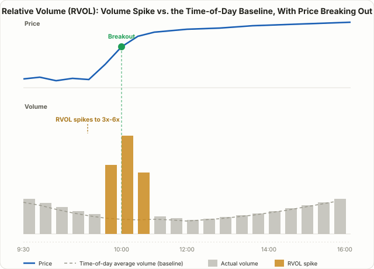

## Is 1 Million Shares a Lot, or Not?

A headline that a stock traded 1 million shares today tells you almost nothing by itself. For a stock that normally trades 500,000 shares a day, that's double its usual volume — a real signal that something unusual is happening. For a stock that normally trades 5 million shares a day, the same 1 million is actually a quiet day. **Relative volume (RVOL)** compresses exactly this comparison into a single number: today's volume divided by that stock's own historical average, telling you at a glance how many times more (or less) interest is showing up right now versus normal.

RVOL isn't a new invention. Volume-reading frameworks like [Volume Spread Analysis](/en/strategies/volume-spread-analysis-vsa/) and [On-Balance Volume](/en/strategies/on-balance-volume-obv/) have existed for decades. What makes RVOL worth a lesson of its own is narrower and more practical: those other tools ask whether volume on a given bar is rising or falling, while RVOL produces a **standardized number you can run across hundreds of tickers at once** to filter a universe down to the handful worth looking at closer. For a trader scanning a scrolling list of tickers in real time, that standardization is the entire point.

## Why "Times the Time-of-Day Average" Matters More Than Raw Volume

Volume isn't distributed evenly across a trading day. In US equities, there's a near-universal **U-shaped pattern**: volume is heaviest right after the 9:30 AM open, thins out around the lunchtime lull near midday, then picks back up heading into the close. Markets outside the US — including Korea's KOSPI and KOSDAQ — show the same basic shape, just with different magnitudes.

Ignore that shape and a naive comparison breaks down fast. If you compare "cumulative volume by 10 AM" against "the stock's full daily average," you'll always look unusually high at 10 AM, every single day, simply because the open is naturally the heaviest part of the session — not because anything abnormal happened. The fix is to compare **against the historical average at that same clock time**, not the full-day average. Some data providers label this time-adjusted version RVOL-TOD (time of day), and it's the version that actually matters for intraday decisions.

## The Formula, and a Worked Example

The simplest version of the formula is:

```
RVOL = Today's Volume ÷ Historical Average Volume Over the Same Period
```

The version actually used for day trading swaps in a time-matched average:

```
Time-of-Day RVOL = Today's Cumulative Volume From the Open to Now
                  ÷ Average Cumulative Volume at That Same Clock Time Over the Past N Days (commonly 10–20)
```

The table below is a simplified hypothetical walkthrough meant to illustrate the math, not a verified record from any real ticker.

| Time (minutes after open) | 20-day average cumulative volume | Today's cumulative volume | RVOL |
|---|---|---|---|
| 9:30 AM (0 min) | 180,000 shares | 200,000 shares | 1.1x |
| 9:45 AM (15 min) | 420,000 shares | 950,000 shares | 2.3x |
| 10:00 AM (30 min) | 580,000 shares | 2,100,000 shares | 3.6x |
| 10:30 AM (60 min) | 850,000 shares | 3,400,000 shares | 4.0x |

The point of this hypothetical isn't the exact numbers — it's the **trajectory**. RVOL opens at an unremarkable 1.1x, then accelerates to 2.3x within 15 minutes and keeps climbing to 3.6x. If price was moving in a clear direction alongside that acceleration, many traders would read it as evidence that real, unusual order flow is showing up — not just noise from a handful of small trades. If RVOL instead sits near 1.0x all morning, any price movement you're watching is more likely being produced by thin volume that can reverse easily.

## Full-Day Average RVOL vs. Time-of-Day RVOL

There are two genuinely different ways to build this ratio, and they serve different purposes.

| | Full-day average RVOL | Time-of-day RVOL (RVOL-TOD) |
|---|---|---|
| What's compared | Today's volume (full day, or to-date) ÷ the average full daily volume over the past N days | Today's cumulative volume to-date ÷ the average cumulative volume at the same clock time over the past N days |
| Intraday distortion | Large — anything compared this way is automatically inflated near the open, every day | Small — comparing matched clock times cancels out the U-shaped pattern |
| Typical use case | End-of-day or swing scanning, comparing attention across days | Real-time intraday scanners, confirming whether an intraday breakout has real volume behind it |
| Data requirement | Only daily volume history is needed | Requires minute-by-minute cumulative volume history over the past N days — not something every free charting tool provides |

Using the full-day average method while actively day trading produces a systematic bias: the number always reads high near the open and always reads low around midday, regardless of what's actually happening. Flip that around, and full-day averages work fine for multi-day swing scanning, where you're not trying to resolve anything down to the minute. Neither version is universally "correct" — pick the one that matches your holding period.

## Common Screening Thresholds (Rules of Thumb, Not Laws)

The numbers below are conventions repeated across scanner vendors and trading-education content, not a universally validated standard. Treat them as a starting point to adjust and backtest against your own market and style.

| RVOL range | Common interpretation |
|---|---|
| Around 1.0x | Normal day, nothing unusual drawing attention |
| 2.0x and above | Noticeably elevated interest — many scanners use this as the cutoff for a "watch list" alert |
| 5.0x and above | Very unusual — though some traders treat this range as a warning that the move may already be exhausted rather than just starting |

In practice, RVOL is almost always paired with price and liquidity filters — something like "price above $5, average volume above 1 million shares, RVOL above 2x" to avoid flagging illiquid names where the math is noisy. The float rotation concept from the [Gap and Go lesson](/en/strategies/gap-and-go-float-rotation/) is a close cousin of RVOL: both measure "unusually fast turnover," but float rotation uses shares outstanding (a supply-side number) as its denominator, while RVOL uses the stock's own historical volume.

## Pairing It With Direction: RVOL Tells You "Attention," Price Tells You "Which Way"

The most frequently cited limitation of RVOL is that the number itself has no opinion about whether buyers or sellers are responsible for it. A stock showing 5x RVOL could be ripping higher or collapsing. That's why RVOL is almost never read on its own.

- **Rising RVOL + rising price**: commonly read as fresh buying pressure pushing the stock, and frequently used as a confirming filter for setups like [Opening Range Breakout](/en/strategies/breakout-donchian-orb/) or Gap and Go, separating a breakout with real flow behind it from one that's likely to fail.
- **Rising RVOL + falling price**: often read as distribution, forced selling, or a wave of profit-taking from existing holders.
- **Rising RVOL + flat price**: can indicate buyers and sellers are absorbing roughly equal size against each other — some traders treat this as a sign that a larger directional move may be building.

RVOL on its own is not a signal to act on. It only becomes useful once it's layered against price action, support/resistance, or candle structure.

## Two Opposing Reads: Following the Breakout vs. Fading the Climax

The exact same observation — "RVOL just spiked far above normal" — leads traders toward two opposite plays.

| | Following the volume breakout | Fading the volume climax |
|---|---|---|
| Core assumption | A multiple-times-normal surge in volume means genuinely new information or order flow arrived, and that flow is likely to keep pushing price the same direction for the rest of the session | An extreme RVOL spike (say, 5–10x or more) often marks the point where most of the available buying (or selling) power has already been used up — a climax, not a start |
| Entry timing | Early in the spike, right as RVOL crosses a threshold (e.g., 2x) and price starts moving the same direction | After the spike has already run far, once the pace of the price move visibly slows — positioned against the move |
| Supporting logic | New participants entering a name tend not to disappear within the same session | Extreme volume concentration also concentrates offsetting flow (profit-taking, stop-loss covering), which tends to push volatility in both directions, not just one |
| Main risk | Chasing a false breakout late and getting caught in the reversal | The move runs much further than expected, turning a counter-trend bet into a loss |

Neither read is reliably "correct" on its own. What matters more than the raw RVOL number is **whether it's still climbing or has already peaked and started rolling over**. An RVOL reading that's still accelerating lends more weight to the breakout-following case; one that peaks and then fades alongside a slowing price move leans toward the climax-fade case.

<figure class="diagram">
  
  <figcaption>Against the dashed U-shaped average volume baseline, the actual volume (bars) spikes sharply around 10 AM, pushing relative volume above 3x right as price breaks out. Comparing against the same clock time — not the full-day average — is what separates this from the volume increase that happens near every open anyway.</figcaption>
</figure>

## Limits and Caveats

- **It has no directional information**: as covered above, RVOL only measures the size of attention, not which side is driving it — it must be read alongside price.
- **Calculation methods differ by platform**: some use a 10-day average, others 20 or 30 days; some offer time-of-day adjustment, others only full-day averages. "RVOL of 2x" can mean different things depending on where you're looking.
- **Distortion gets worse in illiquid names**: for a stock that barely trades to begin with, a handful of small orders can send RVOL to an absurd reading. It's safer to only apply RVOL scanning to names with a reasonable baseline average volume.
- **No single validated win rate exists**: you'll find content claiming specific win rates for "RVOL above 2x breakout" strategies, but no broadly validated, published figure backs a universal number like that. Keep the overfitting trap covered in [Walk-Forward Analysis](/en/strategies/walk-forward-analysis-overfitting/) in mind, and validate any threshold against your own instruments and timeframe before trusting it.
- **Check for a real catalyst**: an RVOL spike with no identifiable news, filing, or rumor behind it is sometimes just a data glitch or confusion with another ticker — always cross-check headlines before acting on volume alone.

## FAQ

### Should I buy any stock that shows high RVOL?

No. High RVOL only tells you that attention is unusually elevated — not whether that attention is coming from buyers or sellers, which you can only judge by looking at price action alongside it. Extremely high RVOL readings can also mark an already-exhausted climax rather than the start of a move, so chasing a name purely because RVOL is high is risky.

### Where can I actually see RVOL?

Most real-time quote platforms and dedicated day-trading scanners provide RVOL or an equivalently named metric out of the box. Whether that tool adjusts for time of day (RVOL-TOD) varies by platform — if you're only getting a full-day-average version, remember that it will read artificially high near the open and artificially low around midday, and read it with that bias in mind.

### How is RVOL different from volume indicators like OBV or VSA?

[On-Balance Volume](/en/strategies/on-balance-volume-obv/) and [Volume Spread Analysis](/en/strategies/volume-spread-analysis-vsa/) focus on interpreting the relationship between volume and price to judge trend quality or spot accumulation and distribution. RVOL is built for a different job: **scanning and comparison** — quickly filtering which handful of tickers, out of hundreds, are showing abnormal volume right now. In practice, traders often use RVOL as the first-pass filter and then apply tools like OBV or VSA to the names it surfaces.

## Summary

- Relative volume (RVOL) standardizes "how unusual is today's volume" by dividing current volume by the stock's own historical average, making it comparable across completely different tickers.
- Because volume follows a U-shaped pattern across the trading day, time-of-day RVOL (comparing against the same clock time historically) removes a distortion that a full-day average can't.
- An RVOL threshold around 2x is a commonly cited watch-list trigger, but it's a convention repeated across trading content, not a validated universal rule.
- RVOL carries no directional information by itself, so it must be read with price action — and the exact same "RVOL spike" observation can justify either following a breakout or fading an exhaustion climax.
- Watch out for illiquid-name distortion, platform-to-platform calculation differences, and unverified win-rate claims, and pair RVOL with other confirming tools like [Gap and Go](/en/strategies/gap-and-go-float-rotation/) or [Opening Range Breakout](/en/strategies/breakout-donchian-orb/) rather than trading it alone.
