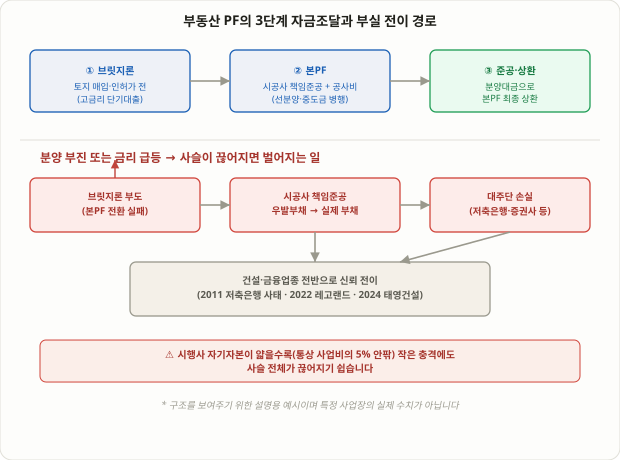

## "PF"라는 단어 하나에 건설사·저축은행 주가가 함께 흔들리는 이유

2024년 초, 태영건설이 채권단에 워크아웃(기업구조조정촉진법에 따른 자율협약)을 신청했다는 소식이 알려지자 건설업종뿐 아니라 저축은행·캐피털·증권사 주가까지 동시에 흔들렸습니다. 태영건설은 직접 돈을 빌린 당사자가 아닌 사업장에도 "책임준공"을 약속하며 보증을 서 왔는데, 부동산 경기가 꺾이면서 그 보증이 실제 빚으로 돌아왔기 때문입니다. 이보다 앞선 2022년에는 강원중도개발공사가 발행한 PF 기초 [ABCP](/basics/commercial-paper-abcp-explained/)의 지급보증 거부 선언 하나로 전체 회사채 시장이 몇 주 만에 얼어붙은 레고랜드 사태도 있었습니다. 두 사건 모두 출발점은 같습니다. 바로 부동산 프로젝트 파이낸싱(PF, Project Financing)이라는, 겉으로는 건설업계만의 일처럼 보이지만 실제로는 저축은행·증권사·건설사 주주 모두에게 손실을 떠넘기는 구조입니다. 이번 강의에서는 PF가 정확히 무엇이고, 왜 유독 한국에서 이렇게 자주 부실의 진원지가 되는지를 살펴봅니다.

## 부동산 PF란 — 담보가 아니라 "이 사업이 돈이 될 것"을 보고 빌려주는 대출

일반적인 기업 대출은 차주의 신용등급이나 보유 자산을 담보로 돈을 빌려줍니다. 반면 부동산 PF는 아직 짓지도 않은 건물, 즉 미래에 완성될 사업 자체의 수익성과 현금흐름을 상환 재원으로 보고 돈을 빌려주는 방식입니다. 이 구조에는 역할이 분명히 나뉜 두 주체가 등장합니다. **시행사**는 땅을 매입하고 인허가를 받아 사업을 기획하는 쪽이고, **시공사**는 실제로 건물을 짓는 건설사입니다. 시행사가 사업의 '기획자'라면 시공사는 '실행자'인 셈입니다.

여기서 한국형 PF를 유독 위험하게 만드는 첫 번째 구조적 특징이 드러납니다. 선진국에서는 시행사(디벨로퍼)가 사업비의 30~40% 정도를 자기자본으로 넣고 나머지만 대출로 조달하는 것이 일반적인 관행으로 알려져 있습니다. 반면 한국의 시행사는 자기자본을 사업비의 5% 안팎, 심하면 그보다 더 적게만 넣고 나머지 대부분을 대출로 충당하는 경우가 많다는 지적이 꾸준히 나옵니다. 자기자본이 이렇게 적으면 분양이 조금만 부진해지거나 공사비가 예상보다 늘어나도 시행사가 그 충격을 스스로 흡수할 여력이 거의 없고, 결국 그 부담은 대출을 내준 금융기관과 보증을 선 시공사로 넘어갑니다.

## 브릿지론 → 본PF → 분양대금 상환 — 3단계로 이어지는 자금조달 흐름

PF는 사업이 진행되는 단계에 맞춰 성격이 다른 자금이 순서대로 투입되고 상환되는 구조로 짜여 있습니다.

<figure class="diagram">
  
  <figcaption>토지 매입(브릿지론) → 인허가·공사비(본PF) → 분양대금 상환으로 이어지는 PF의 자금 흐름</figcaption>
</figure>

**1단계: 브릿지론(bridge loan)**. 땅을 사들이고 건축 인허가를 받기까지, 아직 '사업'이라 부를 만한 실체가 갖춰지지 않은 단계에서 쓰는 단기 대출입니다. 담보로 잡을 만한 완성된 자산이 없다 보니 금리가 대체로 높고, 저축은행·캐피털사·증권사의 PF 대출 부서가 주된 공급자입니다.

**2단계: 본PF(main PF)**. 인허가를 받고 시공사가 책임준공을 확약하면, 이 대출로 브릿지론을 갚고 본격적인 공사비를 조달합니다. 본PF는 브릿지론보다 금리가 낮고 안정적인 금융기관(은행, 보험사 등)도 참여하는 경우가 많습니다. 공사가 진행되는 동안에는 선분양을 통해 받는 계약금·중도금이 공사비의 일부를 메워줍니다.

**3단계: 분양대금 상환**. 건물이 준공되면 수분양자로부터 받는 잔금과 분양대금으로 본PF 대출을 최종 상환합니다. 이 마지막 단계까지 무사히 도달해야 사업이 '성공'한 것으로 간주됩니다.

문제는 이 세 단계가 하나의 사슬처럼 연결돼 있다는 점입니다. 분양이 흥행하지 못하거나 금리가 올라 본PF로 넘어가지 못하면, 브릿지론을 빌린 쪽은 연 15%를 넘는 고금리 이자를 버텨야 하는 처지에 놓이고, 결국 사슬의 첫 고리인 브릿지론 단계에서부터 부도가 시작되는 경우가 많습니다. 실제로 2022년 하반기 금리 급등과 분양 경기 둔화가 겹치면서, 다수의 사업장이 바로 이 브릿지론에서 본PF로 넘어가는 다리를 건너지 못하고 멈춰 섰습니다.

## 숫자로 보는 "자기자본 5%"의 의미

왜 자기자본 비율이 이렇게 중요한 변수로 꼽히는지는 단순한 숫자로도 체감할 수 있습니다. 사업비 1,000억 원짜리 개발 사업을 가정해보겠습니다. 시행사가 자기자본을 35억 원(3.5%)만 넣고 나머지 965억 원을 대출로 조달했다면, 분양가가 예상보다 5%만 낮아지거나 공사비가 5%만 초과해도 그 손실 규모(약 50억 원)는 이미 시행사가 가진 자기자본 전체를 넘어섭니다. 시행사는 그 순간 자본잠식 상태에 빠지고, 남은 손실은 고스란히 대출을 내준 금융기관과 책임준공을 약속한 시공사가 나눠서 떠안아야 합니다. 반대로 자기자본을 사업비의 30% 이상 넣는 구조였다면, 같은 5%의 분양가·공사비 충격은 시행사가 자기자본 안에서 흡수할 수 있는 범위에 머뭅니다. 결국 자기자본비율은 "사업이 조금 삐끗했을 때, 그 충격을 누가 가장 먼저 떠안는가"를 정하는 완충장치 역할을 합니다. 이 완충장치가 얇을수록 작은 경기 변동에도 부도로 이어지는 사업장이 늘어나고, 그 부담이 대출기관을 거쳐 금융시장 전체로 번질 가능성도 함께 커집니다.

## 시공사의 "책임준공" 약속이 우발부채로 돌아오는 원리

금융기관이 시행사에게만 돈을 빌려주고 끝나는 경우는 드뭅니다. 시행사의 자기자본이 워낙 적다 보니, 대출을 내주는 조건으로 시공사에게 "공사를 끝까지 책임지고 완공하겠다"는 책임준공 확약이나 채무를 인수하겠다는 약정을 요구하는 것이 관행처럼 자리 잡았습니다. 이 약정은 평소에는 재무제표 본문이 아니라 주석에 적히는 우발부채(contingent liability)로만 존재합니다. 당장 돈이 나가는 것이 아니라, '특정 조건이 벌어지면 책임져야 하는 약속'이기 때문입니다.

그런데 부동산 경기가 꺾여 시행사가 분양에 실패하거나 본PF 전환에 실패하면, 이 우발부채는 그 순간 현실의 빚으로 바뀝니다. 시공사가 공사를 끝까지 책임지거나, 대출을 대신 갚아야 하는 상황이 벌어지는 것입니다. 태영건설이 워크아웃을 신청한 핵심 배경도 바로 이 구조였습니다. 직접 빌린 돈이 아니라 여러 PF 사업장에 걸어둔 책임준공·지급보증이 한꺼번에 현실화되면서, 멀쩡해 보이던 건설사의 재무 상태가 순식간에 무너질 수 있다는 것을 이 사례가 보여줍니다.

## 부실이 퍼지는 경로 — 2011년 저축은행 사태부터 2024년 태영건설까지

부동산 PF 부실이 금융시장 전체를 흔든 것은 이번이 처음이 아닙니다. 2011년에도 저축은행들이 PF 대출을 과도하게 늘렸다가 부동산 경기 침체로 부실이 쌓이면서, 약 30개 저축은행이 영업정지 처분을 받는 사태로 이어졌습니다. 당시 예금자들이 돈을 못 돌려받을까 봐 서둘러 예금을 빼내는 '뱅크런'까지 벌어졌을 정도로 충격이 컸습니다.

2022년 레고랜드 사태는 PF 대출을 기초자산으로 한 [ABCP](/basics/commercial-paper-abcp-explained/)의 지급보증 거부가 회사채·기업어음 시장 전체로 신뢰 위기를 번지게 한 사례였고, 2024년 태영건설 워크아웃은 시공사의 책임준공 약정이 우발부채에서 실제 부채로 전환되며 건설사 자체의 생존을 흔든 사례였습니다. 금융권 자료에 따르면 2025년대 들어 저축은행의 건설·PF 관련 익스포저는 자기자본의 100%를 웃도는 수준으로 보도된 바 있고, 특히 저신용 차주의 PF 대출 비중이 금융권에서 가장 높은 업권으로 꼽히기도 했습니다. 다만 금융당국의 PF 사업성 평가 재분류와 재구조화가 이어지면서 전체 PF 연체율은 점차 낮아지는 추세라는 보도도 함께 나오고 있어, 상황은 시점마다 달라질 수 있습니다.

## 증시에 미치는 영향 — 건설사·저축은행·증권사 주가가 함께 흔들리는 이유

PF 부실이 주가에 영향을 주는 경로는 크게 세 갈래로 나눌 수 있습니다.

**첫째, 건설사의 우발부채 현실화**입니다. 책임준공 확약이 실제 빚으로 바뀌면 재무건전성이 급격히 나빠지고, 신용등급 하향과 자금조달 비용 상승이 뒤따르면서 주가에 직접 타격을 줍니다.

**둘째, 대주단의 손실입니다.** 저축은행·캐피털사·증권사는 PF 대출을 직접 내주거나 PF-ABCP를 인수하는 주된 공급자입니다. 시행사가 부도나면 이들은 대출채권을 떼일 위험에 노출되고, 손실에 대비해 쌓아야 하는 대손충당금이 늘어나면서 실적이 악화됩니다. 특히 저축은행처럼 PF 익스포저 비중이 높은 업권일수록 이 충격이 주가에 더 직접적으로 반영됩니다.

**셋째, 심리적 전이입니다.** [기업어음·ABCP](/basics/commercial-paper-abcp-explained/) 강의에서 다뤘듯, 한 PF 사업장의 부실이 알려지면 투자자들은 "다른 사업장도 비슷한 위험을 안고 있는 것 아니냐"는 의심을 건설·금융업종 전반으로 확대하는 경향을 보입니다. 이 때문에 특정 건설사 하나의 위기가 업종 전체, 나아가 위험자산 전반에 대한 투자심리로까지 번지는 경우가 많습니다. 반대로 정부가 PF 정상화 지원이나 사업성 평가 기준 완화 같은 대책을 내놓으면, 부담이 컸던 업종의 주가가 함께 회복되는 흐름도 자주 관찰됩니다.

## 정책 대응과 남은 변수 — 자기자본비율 규제, 어디까지 왔나

이런 위기가 되풀이되는 구조적 원인이 '사업비 대비 지나치게 적은 자기자본'에 있다고 본 금융당국은, 사업비 대비 자기자본비율 하한을 단계적으로 끌어올리는 규제를 추진하고 있습니다. 2025년 말 기준으로 논의되는 안에 따르면 비주거용(상업시설 등) PF 신규 사업장에는 2027년부터 5%, 이후 매년 상향해 2030년까지 20% 수준으로 끌어올리는 방식이 검토되고 있고, 상대적으로 공급이 급한 주거용 PF는 일정 기간 유예하는 방향으로 조정이 이뤄지고 있다는 보도가 이어지고 있습니다. 이런 규제는 시행사의 '밑천'을 늘려 분양이 조금 삐끗해도 스스로 버틸 체력을 갖추게 하자는 취지이지만, 동시에 자기자본 확보 부담이 커진 중소형 시행사의 신규 사업 착수가 줄어들 수 있다는 우려도 함께 제기됩니다. 구체적인 시행 시점과 비율은 계속 조정되고 있으므로, 투자 판단 시에는 금융위원회의 최신 발표를 직접 확인해야 합니다.

## 정리

- 부동산 PF는 담보가 아니라 사업 자체의 미래 수익성을 보고 빌려주는 대출로, 시행사(기획)와 시공사(시공)가 역할을 나눠 맡습니다.
- 자금은 토지 매입 단계의 브릿지론 → 공사비를 조달하는 본PF → 분양대금으로 최종 상환하는 3단계로 이어지며, 앞 단계가 막히면 사업 전체가 멈추기 쉽습니다.
- 한국형 PF는 시행사의 자기자본이 유독 낮고, 이를 보완하기 위한 시공사의 책임준공 확약이 평소엔 우발부채로 숨어 있다가 부동산 경기가 꺾이면 실제 빚으로 돌아옵니다.
- 2011년 저축은행 사태, 2022년 레고랜드 ABCP 사태, 2024년 태영건설 워크아웃은 같은 구조적 약점이 다른 모습으로 반복된 사례입니다.
- PF 부실은 건설사의 우발부채 현실화, 대주단(저축은행·증권사 등)의 손실 확대, 업종 전반으로 번지는 심리적 전이라는 세 경로를 통해 주가에 영향을 줍니다.

## 자주 묻는 질문

### 브릿지론과 본PF, 둘 중 어느 쪽이 더 위험한가요?
일반적으로 브릿지론이 더 위험한 단계로 꼽힙니다. 아직 인허가도 받지 못한, 담보로 잡을 완성된 자산이 없는 초기 단계에서 쓰이기 때문에 금리가 높고, 분양이나 본PF 전환이 지연되면 이자 부담을 감당하지 못해 부도로 이어지는 경우가 많습니다.

### 개인 투자자가 PF 대출에 직접 투자할 수 있나요?
개인이 PF 대출 자체에 직접 투자하는 경우는 드뭅니다. 다만 저축은행 후순위채나 일부 공모 리츠, PF 관련 익스포저가 큰 금융사·건설사의 주식을 보유하고 있다면 간접적으로 PF 리스크에 노출될 수 있습니다. 투자 전에는 해당 회사의 PF 익스포저 비중과 책임준공 확약 규모를 공시자료에서 확인해보는 것이 좋습니다.

### PF 부실과 미분양은 같은 의미인가요?
미분양은 PF 부실을 키우는 대표적인 원인 중 하나이지만 같은 말은 아닙니다. 분양이 잘 되더라도 공사비가 예상보다 크게 늘거나 금리가 급등해 본PF 전환에 실패하면 PF 부실이 발생할 수 있습니다. 미분양은 PF 사슬이 끊어지는 여러 경로 중 하나일 뿐입니다.

> ⚠️ 이 글은 정보 제공 및 교육 목적이며 특정 기업이나 금융상품에 대한 투자 권유가 아닙니다. 본문에 언급된 자기자본비율, 익스포저 규모, 규제 시행 시점 등은 작성 시점의 보도를 바탕으로 단순화한 설명이며, 실제 수치와 제도는 금융위원회·금융감독원의 최신 공시를 통해 확인해야 합니다.
