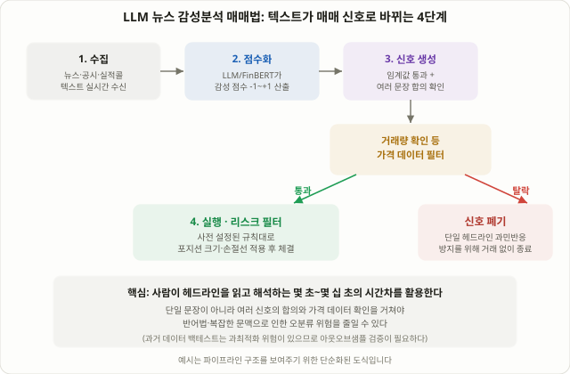

## 사람이 헤드라인을 다 읽기 전에 기계는 이미 포지션을 잡는다

어떤 종목에 "실적 서프라이즈" 헤드라인이 뜨면, 사람은 그 문장을 읽고 의미를 해석하고 손가락을 움직이는 데 몇 초에서 몇 십 초가 걸립니다. 반면 **LLM(대형언어모델) 뉴스 감성분석 매매법**은 헤드라인이 뜨는 순간 문장 자체를 숫자(감성 점수)로 바꿔 그 몇 초를 놓고 경쟁합니다. 이 강좌 69강 [FOMC·CPI 발표 매매법](/strategies/fomc-cpi-news-trading/)이 "미리 정해진 시각에 숫자가 발표되는" 이벤트를 다룬다면, LLM 뉴스 감성분석은 시각을 예측할 수 없는 연속적인 뉴스·공시·실적 콜 텍스트 흐름 전체를 대상으로, 그 의미를 실시간으로 읽어내는 접근입니다.

## LLM 감성분석 매매법이란: 파이프라인으로 이해하기

이 기법은 보통 네 단계로 이뤄진 파이프라인으로 작동합니다.

1. **수집**: 뉴스 와이어, 거래소 공시, 보도자료, 실적 발표 콜 스크립트 등 비정형 텍스트를 실시간으로 받아옵니다.
2. **점수화**: FinBERT처럼 금융 텍스트로 추가 학습된 모델이나 범용 LLM이 문장을 읽고 긍정·부정·중립 중 하나로 분류하거나 -1~+1 사이의 감성 점수를 매깁니다. 동시에 어느 종목·어떤 사건(실적, 소송, 계약, 경영진 교체 등)에 대한 문장인지 개체(entity)도 함께 추출합니다.
3. **신호 생성**: 점수가 일정 임계값을 넘고, 같은 사건에 대한 여러 문장의 점수가 같은 방향을 가리킬 때만 신호로 인정합니다. 단일 헤드라인 하나로 바로 베팅하지 않고 확인을 거치는 구조가 많습니다.
4. **실행과 리스크 필터**: 거래량 급증 같은 가격 데이터 쪽 확인을 더하고, 포지션 크기와 손절선을 미리 정한 규칙에 따라 자동으로 체결합니다.

이 네 단계를 이해하면 "AI가 알아서 사고판다"는 느낌보다는, "텍스트 데이터를 숫자 신호로 바꾸는 전처리 단계가 하나 더 추가된 규칙 기반 전략"이라는 쪽에 더 가깝다는 점이 분명해집니다.

## 왜 작동한다고 주장되는가: 실제 연구가 보여주는 것

이 기법의 근거는 추측이 아니라 다음과 같은 구체적인 연구들에서 나옵니다. 다만 아래 수치는 특정 기간·특정 데이터셋에서 나온 결과이며, 미래에도 그대로 재현된다는 보장은 없다는 점을 먼저 짚어둡니다.

- 2025년 9월 S&P 글로벌의 실적 발표 콜 분석 연구는, LLM 기반 감성 신호로 구성한 롱숏 전략이 연 8.4%의 수익을 냈다고 보고했습니다. 이는 전통적인 단어목록(렉시콘) 기반 감성 신호의 연 4.2%보다 두 배 가까이 높은 수치였고, 연구진은 렉시콘 방식의 설명력이 최근 들어 약해지고 있다고 지적했습니다.
- 커르타치(Kirtac)와 제르마노(Germano)의 2024~2025년 연구는 BERT·FinBERT·LLaMA 계열 모델을 기업별 뉴스로 추가 학습시킨 뒤, 그 감성 신호를 강화학습 기반 포트폴리오 운용에 결합했을 때 위험조정수익률(샤프비율 등)이 일반 모델 대비 개선됐다고 보고했습니다.
- 서강대학교의 한 학위논문은 챗GPT로 네이버 금융 뉴스를 감성분석해 국내 KODEX ETF에 적용한 결과, 감성 기반 전략이 시장 평균을 웃도는 수익률을 보였다고 밝혔습니다. 다만 같은 논문은 감성 점수와 실제 지수 움직임 사이의 상관관계 자체는 약한 편이었다고도 함께 언급했습니다.

이 연구들을 묶는 공통된 논리는, 전통적인 단어목록 방식이 "좋다/나쁘다"로 분류된 단어의 등장 횟수만 세는 데 비해, LLM은 문맥을 함께 읽기 때문에 "예상보다 낮은 손실", "기대에 못 미친 가이던스 상향" 같은 부정+긍정이 뒤섞인 문장, 반어법, 부정어(negation)가 들어간 문장을 더 정확히 분류할 수 있다는 데 있습니다.

## 렉시콘(단어목록) 방식 vs LLM 방식 비교

| 구분 | 전통적 렉시콘 방식 | LLM/트랜스포머 방식 |
|---|---|---|
| 작동 원리 | 미리 정해진 긍정·부정 단어 목록(예: Loughran-McDonald 사전)의 등장 횟수를 셈 | 문장 전체의 맥락을 학습한 모델이 의미를 추론 |
| 반어법·부정어 처리 | 약함 ("손실이 예상보다 작았다"를 '손실'이라는 단어만 보고 부정으로 분류하기 쉬움) | 상대적으로 강함 (맥락 전체를 반영해 분류) |
| 연산 비용 | 매우 낮음, 거의 실시간 | LLM 모델일수록 비용·지연이 커짐 |
| 설명 가능성 | 높음 (어떤 단어 때문인지 바로 확인 가능) | 낮음 (왜 그렇게 판단했는지 추적이 어려운 블랙박스에 가까움) |
| 금융 도메인 특화 | 사전 자체가 금융 텍스트 기준으로 만들어짐 | FinBERT처럼 금융 텍스트로 추가 학습해야 성능이 올라감 |

표에서 보듯 LLM 방식이 맥락 이해력에서는 우위에 있지만, 그 대가로 속도·비용·설명 가능성을 일정 부분 내줘야 합니다. 그래서 실전에서는 가벼운 렉시콘 방식으로 1차 필터링을 하고, 통과한 문장만 더 무거운 LLM 모델로 재확인하는 2단계 구조를 쓰는 경우도 흔히 거론됩니다.

<figure class="diagram">
  
  <figcaption>LLM 뉴스 감성분석 매매법의 기본 파이프라인: 텍스트가 감성 점수로 바뀐 뒤, 임계값과 추가 확인을 통과해야만 실제 매매 신호가 됩니다.</figcaption>
</figure>

## 숫자로 보는 가상의 신호 생성 예시

실제 모델 출력이 아니라 원리를 보여주기 위한 단순화한 가상 예시입니다. 어느 종목에 대해 30분 사이 다음 세 개의 헤드라인이 떴다고 가정합니다.

| 헤드라인(요지) | LLM 감성 점수(-1~+1) | 비고 |
|---|---|---|
| "3분기 매출 컨센서스 상회, 가이던스 상향" | +0.78 | 강한 긍정 |
| "최대주주, 지분 일부 블록딜로 매각" | -0.25 | 약한 부정 |
| "신규 공장 가동률 예상보다 빠르게 정상화" | +0.52 | 긍정 |

세 점수의 단순 평균은 (+0.78 − 0.25 + 0.52) / 3 ≈ +0.35입니다. 만약 매매 규칙이 "평균 점수가 +0.3 이상이고, 같은 시간대 거래량이 평소보다 뚜렷하게 늘어난 경우에만 진입"이라면, 거래량 확인까지 통과한다는 가정 아래 이번 사례는 롱 신호로 분류됩니다. 반대로 블록딜 매각 헤드라인 하나만 따로 떼어 보면 음수 점수이므로, 단일 헤드라인만 보고 판단했다면 정반대의 결론에 도달했을 수도 있습니다. 이 예시가 보여주는 핵심은, 여러 문장을 종합해서 판단하는 구조 자체가 단일 헤드라인에 과민반응하는 것을 막아주는 안전장치 역할을 한다는 점입니다.

## 반드시 알아야 할 한계

- **2020년대 중반 한 연구에서는 LLM 기반 전략 다수가 20년 장기 백테스트에서 단순 매수 후 보유(buy-and-hold)를 넘지 못했다는 보고도 있습니다.** 같은 연구는 AI가 새로운 신호를 찾아내기보다 기존 추세를 뒤늦게 확인하는 경향이 있었다고 지적했습니다. 앞서 소개한 긍정적인 연구 결과들과 이 결과가 상충되는 것처럼 보이지만, 이는 데이터 기간·모델·검증 방식이 연구마다 전혀 다르기 때문입니다. "LLM 감성분석은 작동한다/작동하지 않는다"라고 한 문장으로 단정할 수 없다는 뜻입니다.
- **반어법·복잡한 부정문에서는 지금도 오분류가 발생합니다.** "손실이 예상보다 작아 다행"처럼 부정적 단어와 긍정적 맥락이 섞인 문장, 혹은 경영진의 신중한 어조 속에 숨은 함의는 사람도 해석이 갈리는 경우가 있어 모델이 틀릴 여지가 늘 남습니다.
- **속도 경쟁에는 상한이 있습니다.** 기관들은 거래소·뉴스사와 직접 연결된 전용선, 마이크로초 단위로 응답하는 전용 하드웨어에 투자합니다. 개인 투자자가 일반 API로 접근하는 뉴스 피드는 이런 초고속 인프라와 같은 속도로 경쟁할 수 없으므로, 현실적인 시간 단위는 초 단위 스캘핑이 아니라 몇 분~몇 시간 단위의 포지션 트레이딩에 가깝습니다.
- **백테스트 과최적화 위험이 큽니다.** 특정 기간의 뉴스 코퍼스에 모델 파라미터를 맞추면 그 구간에서는 성과가 좋아 보이지만, 새로운 사건·새로운 어휘가 등장하면 그대로 재현되지 않을 수 있습니다. 85강 [워크포워드 분석](/strategies/walk-forward-analysis-overfitting/)에서 다룬 인샘플·아웃오브샘플 검증 원칙이 이 기법에도 똑같이, 오히려 더 엄격하게 적용돼야 합니다.
- **데이터·API 비용이 생각보다 큽니다.** 기계가 읽기 좋은 형태로 가공된 실시간 뉴스 피드, 상업용 LLM API 호출 비용은 누적되면 작은 계좌 규모에서는 전략 자체의 수익을 갉아먹을 수 있습니다.

## 다른 뉴스·심리 기반 기법과 어떻게 다른가

36강 [PEAD(포스트 어닝 드리프트)](/strategies/pead-earnings-drift/)는 실적 발표의 숫자(EPS 서프라이즈)를 기준으로 몇 주~몇 달에 걸친 느린 가격 반영을 다루는 기법입니다. 94강 [소셜미디어 센티먼트 매매법](/strategies/social-sentiment-mention-velocity/)은 레딧·스톡트윗에서 특정 종목이 "얼마나 많이, 얼마나 빠르게" 언급되는지 양(volume)을 셉니다. LLM 뉴스 감성분석은 이 둘과 다른 축에 있습니다 — 숫자가 아니라 텍스트의 의미 자체를 읽고, 언급 빈도가 아니라 문장이 담은 긍정·부정의 방향과 강도를 점수화합니다. 셋을 함께 쓰면 "얼마나 많이 언급되는가(소셜 센티먼트) + 그 내용이 긍정인가 부정인가(LLM 감성분석) + 숫자 자체가 기대를 넘었는가(PEAD)"라는 서로 다른 세 겹의 확인을 거칠 수 있습니다.

## 자주 묻는 질문

### 개인 투자자도 이 기법을 실제로 쓸 수 있나요?
가능합니다. FinBERT처럼 공개된 금융 특화 모델이나 상업용 LLM API, 뉴스 API를 조합하면 개인 수준에서도 파이프라인을 구성할 수 있습니다. 다만 기관 수준의 초저지연 인프라와 경쟁하는 초단기 스캘핑보다는, 몇 분~몇 시간 단위로 신호를 확인하고 체결하는 느린 시간대에 적용하는 것이 현실적입니다.

### LLM 감성분석이 꾸준한 초과수익을 보장하나요?
아닙니다. 본문에서 소개한 연구들도 특정 기간·특정 데이터에서의 결과이고, 다른 연구에서는 장기적으로 buy-and-hold를 넘지 못했다는 정반대 결과도 보고됐습니다. 리서치 보조 도구로 신호 후보를 빠르게 좁히는 데는 유용할 수 있지만, 최종 판단과 리스크 관리는 사람이 맡아야 한다는 의견이 여러 자료에서 공통으로 나옵니다.

### 실적 발표 콜(어닝 콜) 음성·스크립트에도 적용되나요?
네. 오히려 실적 발표 콜처럼 길고 복잡한 텍스트에서 LLM 방식과 전통적 렉시콘 방식의 성능 차이가 더 크게 벌어진다는 연구 결과가 있습니다. 경영진의 신중한 어조, 질의응답에서의 모호한 답변처럼 단순 단어 세기로는 잡아내기 어려운 뉘앙스가 많기 때문입니다.

### 뉴스가 뜬 직후 바로 진입해야 하나요?
본문의 가상 예시에서 보듯, 단일 헤드라인 하나로 즉시 진입하면 반어법이나 복잡한 맥락 때문에 오분류된 신호에 걸릴 위험이 커집니다. 여러 문장의 점수를 종합하고 거래량 같은 가격 데이터 확인을 더하는 구조가 실전에서 더 널리 거론됩니다.

## 정리

- LLM 뉴스 감성분석 매매법은 뉴스·공시·실적 콜 같은 비정형 텍스트를 AI 모델로 실시간 점수화해, 사람이 읽고 판단하는 데 걸리는 시간차를 활용하려는 접근입니다.
- 수집 → 점수화 → 신호 생성 → 실행·리스크 필터의 4단계 파이프라인으로 작동하며, 단일 헤드라인이 아니라 여러 신호의 합의를 요구하는 구조가 흔히 쓰입니다.
- 전통적 렉시콘(단어목록) 방식보다 맥락 이해력이 높다는 연구 결과가 있지만, 그 대가로 연산 비용과 설명 가능성을 일부 내줘야 합니다.
- S&P 글로벌, 커르타치·제르마노, 서강대 연구 등 긍정적인 결과가 여럿 보고됐지만, 20년 장기 백테스트에서 다수의 LLM 전략이 buy-and-hold를 넘지 못했다는 상반된 연구도 있어 "작동한다"고 단정할 수 없습니다.
- 반어법·복잡한 부정문에서의 오분류, 기관 대비 속도 열위, 백테스트 과최적화, 데이터·API 비용은 실전 적용 전에 반드시 감안해야 하는 구조적 한계입니다.
