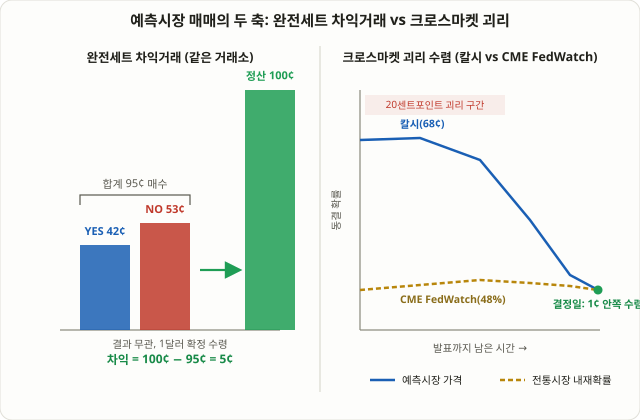

## 예측시장, 왜 지금 트레이더들이 주목하는가

몇 년 전까지만 해도 "예측시장(Prediction Market)"은 선거철에만 화제가 되는 신기한 베팅 사이트 정도로 취급됐습니다. 하지만 2024~2026년 사이 상황이 달라졌습니다. 칼시(Kalshi)는 미국 상품선물거래위원회(CFTC)에 정식 등록된 거래소로서 달러 현금으로 정산되는 "이벤트 계약(Event Contract)"을 취급하고, 폴리마켓(Polymarket)은 스테이블코인 기반으로 운영되며 뉴욕증권거래소의 모회사인 ICE가 최대 20억 달러를 투자했다고 보도될 만큼 제도권 자금이 흘러들고 있습니다. 두 플랫폼 모두 선거·스포츠뿐 아니라 FOMC 금리 결정, 비농업고용지표(NFP), 심지어 "이번 주 S&P500이 신고가를 찍을까" 같은 순수 매크로·금융 이벤트까지 계약 범위를 넓혔습니다.

이번 강의에서 다루는 "예측시장 매매법"은 69강 [FOMC·CPI 발표 매매법](/strategies/fomc-cpi-news-trading/)에서 다룬 "발표 순간의 변동성을 가격 행동으로 공략하는 법"과는 완전히 다른 층위의 이야기입니다. 여기서는 발표 결과 자체에 베팅하는 바이너리(이항) 계약 구조를 이용해, 계약 가격이 수학적으로 어긋나 있는 순간이나 같은 이벤트를 다루는 두 거래소·두 시장 사이에 가격 괴리가 생기는 순간을 찾아내는 구조적 접근을 다룹니다.

## 예측시장 가격은 곧 "시장이 매긴 확률"이다

예측시장의 계약은 기본적으로 "예(YES)"와 "아니오(NO)" 두 가지 결과로 정산되는 바이너리 옵션과 비슷한 구조입니다. 계약 가격은 1달러(또는 100센트) 기준으로 표시되며, 이 가격 자체가 시장이 그 사건이 일어날 확률로 추정한 값과 같습니다. 예를 들어 "12월 FOMC에서 금리를 동결한다"는 계약이 62센트에 거래되고 있다면, 시장 참여자들은 이 사건이 일어날 확률을 약 62%로 보고 있다는 뜻입니다.

이 구조에서 나오는 가장 중요한 수학적 성질 두 가지가 있습니다.

1. **같은 사건의 상호배타적인 결과를 모두 더하면 이론상 1달러(100센트)가 되어야 한다.** "동결" 계약과 "0.25%p 인하" 계약, "0.25%p 인상" 계약처럼 서로 배타적인 결과를 모두 합쳐 사면, 어느 결과가 나오든 반드시 1달러를 돌려받습니다. 그런데 이 계약들을 전부 합한 매수 비용이 1달러보다 싸거나 비싸게 거래되는 순간이 실제로 발생합니다.
2. **같은 사건이 복수의 플랫폼에서 동시에 거래된다면, 두 플랫폼의 가격은 원칙적으로 같아야 한다.** 칼시와 폴리마켓이 똑같은 "12월 FOMC 동결" 계약을 각자 운영한다면, 두 가격이 서로 다르게 움직이는 구간이 생길 수 있습니다.

이 두 성질이 바로 이번 강의가 다루는 두 가지 핵심 기법 — **완전세트 차익거래**와 **크로스마켓 괴리 매매**의 출발점입니다.

<figure class="diagram">
  
  <figcaption>왼쪽: 완전세트 차익거래 — YES·NO 가격의 합이 1달러보다 낮을 때 둘 다 매수해 두면, 결과와 무관하게 1달러를 돌려받아 차액만큼 확정 수익이 남는다. 오른쪽: 크로스마켓 괴리 — 발표 몇 주 전에는 예측시장과 전통 금리선물(CME FedWatch) 가격이 크게 벌어져 있다가, 결정일이 가까워질수록 간격이 좁혀지며 수렴한다.</figcaption>
</figure>

## 기법 A — 완전세트 차익거래: 수학적으로 어긋난 가격을 잡는다

**완전세트 차익거래(Complete-Set Arbitrage, 리밸런싱 차익거래라고도 부릅니다)**는 같은 거래소, 같은 이벤트 안에서 상호배타적인 결과들의 가격 합이 1달러에서 벗어나는 순간을 공략합니다.

- **합이 1달러보다 낮을 때(언더프라이스)**: 모든 결과에 해당하는 계약을 전부 매수합니다. 어떤 결과가 나오든 그 결과에 해당하는 계약이 1달러로 정산되므로, 매수에 쓴 총비용과 1달러의 차액이 그대로 확정 수익이 됩니다.
- **합이 1달러보다 높을 때(오버프라이스)**: 반대로 모든 결과를 전부 매도(숏)합니다. 결과와 무관하게 정산 시점에 1달러만 지불하면 되므로, 미리 받은 매도 대금과 1달러의 차액이 수익이 됩니다.

이 구조가 가능한 이유는 단순합니다. 개별 계약은 "이 사건이 일어날 확률이 몇 %인가"라는 각기 다른 참여자들의 판단에 따라 독립적으로 거래되지만, 상호배타적인 결과를 모두 모으면 수학적으로는 하나의 "확정된 결과"를 사는 것과 같아지기 때문입니다. 호가창이 얇거나 특정 결과에 베팅이 몰려 일시적으로 수급이 꼬이면, 개별 계약 가격들의 합이 이 수학적 제약을 벗어나는 순간이 생깁니다.

### 숫자로 보는 완전세트 차익거래

가상의 FOMC 계약 세 개가 다음과 같이 거래되고 있다고 가정하겠습니다.

| 결과 | 가격 | 설명 |
|---|---|---|
| 동결 | 58센트 | "금리 동결" YES |
| 0.25%p 인하 | 32센트 | "0.25%p 인하" YES |
| 0.25%p 인상 | 5센트 | "0.25%p 인상" YES |
| **합계** | **95센트** | 세 결과를 모두 더한 값 |

이 세 결과는 상호배타적이면서 전체를 포괄하므로(둘 다 아닌 제3의 결과가 없다고 가정), 셋을 전부 1계약씩 사는 데 95센트가 들어갑니다. FOMC 결정이 나오면 셋 중 정확히 하나만 1달러로 정산되고 나머지 둘은 0원이 되므로, 어느 결과가 나오든 1달러를 돌려받습니다. **투입한 95센트 대비 5센트, 수량 기준으로는 약 5.3%의 차익**이 거래 수수료를 제외하기 전 기준으로 확정됩니다.

이 5.3%라는 수치가 매력적으로 보이지만, 실제로는 각 플랫폼의 메이커·테이커 수수료, 주문 체결까지의 슬리피지, 그리고 세 계약을 동시에 체결해야 하는 실행 리스크를 제하고 나면 실현 가능한 순이익은 이보다 훨씬 작아지거나 사라지는 경우가 흔합니다. 분석 업체들이 공개하는 "차익거래 기회" 스캐너 중 상당수가 이런 수수료·슬리피지를 반영하지 않은 표면적 숫자만 보여준다는 점은 실전에 적용하기 전에 반드시 감안해야 할 함정입니다.

## 기법 B — 크로스마켓 괴리 매매: 두 시장이 다른 확률을 말할 때

**크로스마켓 괴리 매매**는 같은 사건을 서로 다른 두 시장이 다르게 가격 매김할 때의 간극을 노립니다. 가장 자주 비교되는 조합은 ①칼시와 폴리마켓 사이의 괴리, ②예측시장과 CME FedWatch(연방기금선물 가격에서 역산한 금리 변경 확률)처럼 전통 금융시장이 암묵적으로 매긴 확률 사이의 괴리입니다.

이 괴리가 생기는 이유는 두 시장의 **참여자 구성과 가격 형성 메커니즘이 근본적으로 다르기** 때문입니다. CME 연방기금선물 가격은 기관 트레이더들이 실제 금리 포지션을 걸고 거래하며 형성되는 반면, 예측시장의 바이너리 계약 가격은 상대적으로 소액 개인 참여자의 베팅 비중이 크고, 유동성이 얕아 소수의 큰 주문에도 가격이 쉽게 쏠립니다. 여기에 더해 두 시장이 "정확히 같은 질문"을 다루고 있는지 확인하는 과정에서 정산 규정(resolution rules)의 미묘한 차이가 숨어 있는 경우도 많습니다.

실제로 분석 업체들이 2025~2026년 FOMC 회의를 추적한 결과, 특정 회의를 앞두고 칼시·폴리마켓이 "동결" 결과에 CME FedWatch보다 약 20센트 더 비싸게 가격을 매긴 채 몇 주간 그 간극이 유지되다가, 결정일 하루 전에는 세 지표 모두 1센트 안쪽으로 수렴한 사례가 보고된 바 있습니다. 칼시와 폴리마켓 사이의 괴리 자체는 대체로 평균 1센트 수준으로 작고 부호가 자주 바뀌는 것으로 관찰되는데, 이는 두 플랫폼이 서로를 참고하며 빠르게 가격을 맞춰가는 경쟁 관계에 있다는 뜻으로 해석할 수 있습니다. 다만 이런 수치는 특정 시점의 관찰값이며, 모든 이벤트·모든 시점에 똑같은 간격으로 반복된다고 볼 근거는 없다는 점을 분명히 해두어야 합니다.

### 크로스마켓 괴리를 다루는 두 가지 자세

| 구분 | 수렴을 노리는 포지션 매매 | 단순 관찰·보조지표 활용 |
|---|---|---|
| 접근 방식 | 괴리가 큰 쪽에서 작은 쪽 방향으로 포지션을 잡고 수렴을 기다림 | 포지션 없이 괴리 자체를 다른 전략의 보조 신호로만 활용 |
| 필요 조건 | 두 시장 모두에 계좌와 유동성 확보, 정산 규정 완전 일치 확인 | 계좌 불필요, 공개된 가격만 모니터링 |
| 핵심 리스크 | 괴리가 수렴하지 않고 더 벌어질 수 있음, 정산 규정 불일치 시 양쪽 모두 손실 가능 | 신호의 선행성이 보장되지 않음 |
| 51강 COT 리포트와의 공통점 | 시장 참여자 구성 차이로 생기는 가격 괴리를 읽는다는 점에서 유사 | — |

후자, 즉 포지션 없이 "지금 예측시장이 전통 금융시장보다 비둘기파적인가 매파적인가"를 51강 [COT 리포트](/strategies/cot-report-commitment-of-traders/)의 포지셔닝 데이터나 60강 [풋콜비율](/strategies/put-call-ratio-sentiment/)처럼 하나의 보조 심리 지표로만 참고하는 접근이, 직접 양쪽 시장에 자금을 넣고 수렴을 기다리는 포지션 매매보다 리스크가 훨씬 낮습니다. 포지션 매매는 결과적으로 "지금 벌어진 간극이 반드시 좁혀질 것"이라는 가정에 베팅하는 셈인데, 이 가정이 항상 맞는다는 보장은 없습니다.

## 실전 예시: 괴리를 발견했을 때 실제로 벌어지는 일

칼시에서 "12월 FOMC 동결" 계약이 68센트, 같은 시점 CME 연방기금선물이 시사하는 동결 확률이 48%라고 가정하겠습니다. 20센트포인트라는 큰 괴리를 보고 "칼시 쪽이 과대평가됐다"고 판단해 동결 계약을 매도(또는 반대 결과인 인하 계약을 매수)한다고 해봅시다.

이 트레이드가 기대대로 작동하려면 결정일까지 칼시 가격이 CME 쪽으로 수렴해야 합니다. 그런데 실제로는 다음과 같은 일이 벌어질 수 있습니다.

- **괴리가 오히려 더 벌어진다.** 결정일이 다가오면서 새로운 경제지표가 발표되어 시장 전체가 동결 쪽으로 더 쏠리면, 칼시 가격은 80센트로 더 올라갈 수 있습니다. 이 경우 포지션은 청산 전까지 미실현 손실 상태로 버텨야 합니다.
- **두 시장이 묻는 질문이 실제로 다르다.** CME FedWatch는 "FOMC 성명서 발표 시점"의 금리 변경만 반영하지만, 칼시 계약의 정산 규정에 따라 "해당 회의 이후 특정 기한까지"로 조건이 조금 다르게 정의돼 있다면, 두 숫자는 애초에 완전히 같은 사건을 가리키지 않는 것일 수 있습니다. 괴리처럼 보이는 숫자 중 상당수가 이런 **정산 규정 불일치**에서 나온다는 점이 분석가들 사이에서 거듭 지적되는 함정입니다.
- **결정일에 정확히 수렴한다.** 실제로 분석된 사례들에서 가장 흔하게 관찰되는 패턴은 결정일이 가까워질수록 간극이 1센트 안쪽으로 줄어드는 모습이었습니다. 이 경우 처음 포지션을 잡은 방향이 맞았다면 괴리만큼의 차익을 얻습니다.

이 예시가 보여주는 핵심은, 크로스마켓 괴리 매매에서 수익은 "괴리가 좁혀지는 방향을 맞혔을 때"만 발생하며, 괴리 자체의 존재가 곧 수익을 보장하지는 않는다는 점입니다.

## 리스크와 함정: "차익거래"라는 이름값을 조심해야 하는 이유

- **"차익거래"라는 표현이 과장되는 경우가 많다.** 일부 스캐너·분석 서비스는 수수료와 슬리피지를 반영하기 전의 표면적 가격 차이를 "무위험 차익거래 기회"로 홍보합니다. 실제 분석에서는 체결 수수료, 호가 스프레드, 정산 규정 차이, 유동성 제약, 타이밍 오차를 모두 반영하면 겉보기 괴리가 실행 가능한 수익으로 이어지지 않는 경우가 흔하다는 지적이 거듭 나옵니다.
- **정산 규정(resolution rules)을 반드시 직접 읽어야 한다.** 같은 헤드라인의 계약이라도 두 플랫폼의 세부 정산 조건, 기준 시점, 데이터 출처가 미묘하게 다를 수 있습니다. 이 차이를 확인하지 않고 "같은 사건"이라고 가정한 채 포지션을 잡으면, 괴리가 수렴해도 손실을 볼 수 있습니다.
- **유동성이 얕다.** 전통 금리선물·주요 지수 옵션과 비교하면 예측시장 계약의 거래량과 깊이는 훨씬 작습니다. 큰 포지션을 잡으려 하면 그 자체로 가격을 밀어 올려 기대했던 가격에 체결되지 않을 수 있습니다.
- **플랫폼 구조가 다르다.** 칼시는 CFTC 규제를 받는 거래소로 달러 현금 정산 구조이고, 폴리마켓은 스테이블코인 기반으로 운영됩니다. 두 플랫폼에 동시에 자금을 넣고 크로스마켓 포지션을 운용하려면 환전·전송 지연, 플랫폼별 자금 이동 제약까지 고려해야 합니다.
- **법적·지역적 이용 제한을 직접 확인해야 한다.** 예측시장 플랫폼의 이용 가능 여부와 규제 상태는 국가·지역에 따라 다르고 계속 변화하고 있습니다. 실제 자금을 투입하기 전에 자신이 거주하는 지역에서 해당 플랫폼 이용이 허용되는지, 어떤 신원 확인·세금 신고 의무가 따르는지를 직접 확인하는 책임은 트레이더 본인에게 있습니다.

## 자주 묻는 질문

### 완전세트 차익거래는 정말 "무위험"인가요?
가격 괴리만 놓고 보면 수학적으로는 결과와 무관하게 수익이 확정되는 구조이지만, 실전에서는 무위험이라고 말하기 어렵습니다. 세 개 이상의 계약을 동시에 원하는 가격에 체결해야 하는데, 그중 하나라도 체결이 늦어지거나 가격이 밀리면 애초에 계산했던 차익이 사라지거나 오히려 손실로 바뀔 수 있습니다. 수수료도 반드시 사전에 계산에 포함해야 합니다.

### 칼시와 폴리마켓 중 어느 쪽이 더 안전한가요?
구조가 다릅니다. 칼시는 CFTC에 등록된 거래소로 달러 현금 정산을 하고, 폴리마켓은 스테이블코인 기반의 탈중앙화 구조로 운영됩니다. 어느 쪽이 "더 안전하다"고 일괄적으로 말하기보다는, 규제 투명성을 중시한다면 칼시 쪽 구조가 익숙하고, 암호화폐 생태계에 이미 익숙하다면 폴리마켓 쪽 진입장벽이 낮다는 정도로 구분하는 것이 정확합니다. 둘 다 투자금 손실 위험이 있는 플랫폼이라는 점은 동일합니다.

### 예측시장 가격과 CME FedWatch 중 어느 쪽을 더 믿어야 하나요?
한쪽이 항상 더 정확하다고 단정할 근거는 없습니다. CME FedWatch는 실제 금리 포지션을 건 기관 자금이 만드는 가격이라는 점에서 전통적으로 더 신뢰받아 왔지만, 예측시장 역시 참여자가 늘고 유동성이 쌓이면서 일부 분석에서는 특정 이벤트에 대해 전통시장보다 빠르게 반응한 사례가 보고되기도 했습니다. 두 지표를 상호 검증용 보조 데이터로 함께 보는 접근이 한쪽만 신뢰하는 것보다 안전합니다.

## 정리

- 칼시·폴리마켓 같은 예측시장은 사건의 결과에 바이너리 계약으로 베팅하며, 계약 가격이 그대로 시장이 매긴 확률을 의미합니다.
- 완전세트 차익거래는 상호배타적인 결과들의 가격 합이 1달러에서 벗어나는 순간을 공략하지만, 수수료·슬리피지·동시 체결 리스크를 빼면 실현 가능한 차익이 크게 줄어드는 경우가 흔합니다.
- 크로스마켓 괴리 매매는 칼시·폴리마켓 사이, 또는 예측시장과 CME FedWatch 같은 전통 금융시장 사이의 가격 차이를 노리지만, 괴리가 수렴하지 않고 더 벌어지거나 두 시장이 애초에 다른 질문을 묻고 있을 위험을 안고 있습니다.
- "차익거래"라는 이름이 붙은 기회의 상당수는 수수료·유동성·정산 규정을 반영하면 사라지거나 크게 줄어들며, 이 점이 실전에서 가장 자주 간과되는 함정입니다.
- 포지션 없이 예측시장 가격을 다른 전략의 보조 심리 지표로만 활용하는 접근이, 직접 자금을 걸고 수렴을 기다리는 포지션 매매보다 훨씬 낮은 리스크로 비슷한 정보를 얻는 방법입니다.
- 실제 자금 투입 전에는 플랫폼별 정산 규정, 수수료 구조, 그리고 자신이 거주하는 지역에서의 이용 가능 여부와 법적 책임을 반드시 직접 확인해야 합니다.
