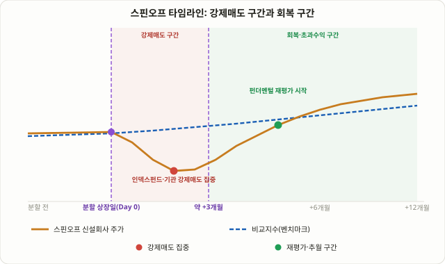

## 스핀오프란 무엇인가: 모회사가 몸집을 줄이는 게 왜 투자 기회가 되는가

스핀오프(Spin-off)는 한 회사가 특정 사업부를 떼어내 별도의 독립 법인으로 만들고, 그 신설회사 주식을 기존 주주들에게 보유 비율대로 나눠주는 구조조정 방식입니다. 한국에서는 이 방식을 인적분할이라고 부릅니다. 예를 들어 모회사 A의 주식 100주를 가진 주주라면, 분할 비율에 따라 분할 후에는 A주식 70주와 신설회사 B주식 30주를 함께 받는 식입니다. 돈을 추가로 내지도, 서류에 서명하지도 않았는데 어느 날 갑자기 계좌에 낯선 종목이 하나 더 들어와 있는 셈입니다.

이 구조가 흥미로운 이유는 신규상장(IPO)과 전혀 다른 방식으로 주식이 시장에 나온다는 점입니다. IPO는 투자자들이 주식을 "사겠다"고 적극적으로 베팅해 수요를 확인하고 공모가를 매기는 과정을 거칩니다. 반면 스핀오프 주식은 아무도 사겠다고 주문을 넣지 않았는데 일단 배분부터 됩니다. 이 차이 하나가 이번 강의에서 다루는 전략의 출발점입니다.

최근 몇 년은 유독 스핀오프가 많았던 시기로 꼽힙니다. GE는 2023년 1월 GE헬스케어를, 2024년 4월 GE버노바를 각각 분리해 GE에어로스페이스만 남겼고, 존슨앤드존슨은 2023년 소비자건강 부문을 켄뷰(Kenvue)로, 3M은 2024년 솔벤텀(Solventum)을 분사했습니다. 여기에 더해 크래프트하인즈가 2025년 9월 사업을 두 회사로 쪼개겠다고 발표하면서(종결은 2026년 하반기 예정) 대형 스핀오프 흐름이 다시 한번 이어졌습니다. 업계에서는 이 몇 년을 두고 "기업 분할의 시대"라고 평가하는 보도가 이어졌는데, 이는 단순한 유행이 아니라 복합기업 할인(conglomerate discount)을 해소하려는 경영 전략이 다시 주목받고 있다는 신호로 읽힙니다. 이런 흐름 속에서 "스핀오프 종목을 어떻게 다뤄야 하는가"는 다시 한번 살펴볼 가치가 있는 주제입니다.

## 왜 작동하는가: 원하지 않는데 떠안은 주식은 팔리게 마련이다

이 전략의 핵심 논리는 단순합니다. 신설회사 주식을 받은 기존 주주 중 상당수는 애초에 그 회사를 원해서 산 게 아닙니다. 모회사 A를 보고 투자했을 뿐인데, 어느 날 전혀 다른 업종의 B주식을 떠안게 된 것입니다. 이런 주주들의 매도 결정은 "이 회사의 펀더멘털이 어떤가"가 아니라 "내 포트폴리오 규정상 이 종목을 들고 있을 수 없다"는 전혀 다른 기준으로 이루어집니다.

이 강제매도를 만드는 주체는 크게 세 부류입니다.

1. **인덱스펀드와 패시브 자금**: 모회사가 특정 지수에 속해 있었더라도, 신설회사는 시가총액이 작아 같은 지수에 편입되지 않는 경우가 많습니다. 지수를 그대로 추종하는 펀드는 지수에 없는 종목을 계속 들고 있을 명분이 없으므로, 가격과 무관하게 기계적으로 매도합니다. 이는 [75강 지수 편입 효과](/strategies/index-inclusion-effect/)에서 다룬 "지수 추종 자금에는 대체재가 없다"는 하방경사 수요곡선 논리를 거꾸로 뒤집은 경우입니다 — 그쪽은 강제매수였다면, 스핀오프는 강제매도입니다.
2. **펀드 매니데이트(투자규정)에 걸리는 기관**: 대형주 펀드가 소형주를, 또는 특정 업종에 집중된 펀드가 전혀 다른 업종의 신설회사를 떠안으면 투자규정 위반이 됩니다. 분석이 끝나기도 전에 "규정상 못 들고 있다"는 이유만으로 매도 주문이 나옵니다.
3. **신설회사를 모르는 개인주주**: 익숙한 모회사만 보고 투자했던 개인주주 입장에서는, 낯선 신설회사 주식을 분석할 시간도 의지도 없는 경우가 많습니다. "일단 팔고 본다"는 선택이 합리적인 행동처럼 느껴지는 환경이 만들어집니다.

이 세 가지 매도가 짧은 기간에 한꺼번에 몰리면, 신설회사의 주가는 실제 사업 가치와 무관하게 일시적으로 짓눌립니다. 조엘 그린블라트는 저서 『You Can Be a Stock Market Genius』에서 이 현상을 스핀오프 투자의 핵심 근거로 제시했습니다 — 가치 판단이 아니라 규정과 무관심이 만드는 매도이기 때문에, 그 매도가 끝나는 지점에서 가격과 가치 사이의 간극이 가장 크게 열려 있을 가능성이 높다는 논리입니다.

여기에 한 가지가 더 있습니다. 신설회사 경영진은 분할 당시 종종 신설회사 주식이나 스톡옵션 형태의 보상을 받습니다. 대기업 산하 사업부의 임원으로 있을 때보다, 독립 회사의 CEO로서 자기 지분의 가치를 직접 책임져야 하는 입장이 되면 인센티브 구조 자체가 달라집니다. 그린블라트는 이 경영진 지분 보유 여부를 스핀오프를 평가할 때 가장 먼저 확인하는 항목으로 꼽았습니다.

<figure class="diagram">
  
  <figcaption>분할 상장일 직후의 강제매도 구간(빨간 음영)에서는 신설회사 주가가 비교지수보다 먼저 가라앉고, 매도 물량이 소화된 이후의 회복 구간(초록 음영)에서는 펀더멘털 재평가를 받으며 비교지수를 추월하는 전형적인 흐름.</figcaption>
</figure>

## 인적분할 vs 물적분할: 한국 시장에서 절대 헷갈리면 안 되는 구분

이 전략을 한국 시장에 적용하려면 반드시 짚어야 할 구분이 있습니다. 한국의 회사분할 제도는 인적분할과 물적분할, 두 가지로 나뉘는데, 이 전략의 논리는 둘 중 하나에만 온전히 적용됩니다.

| 구분 | 인적분할 | 물적분할 |
|---|---|---|
| 신설회사 주식을 받는 주체 | 기존 주주가 보유 비율대로 직접 받음 | 모회사가 100% 보유 (기존 주주는 받지 못함) |
| 기존 주주 입장 | 모회사·신설회사 두 종목을 각각 보유 | 모회사 지분 1주만 그대로 보유 |
| 이 강의가 다루는 "강제매도" 논리 적용 여부 | 적용됨 — 원치 않는 신설회사 주식을 떠안은 주주들이 매도 | 적용되지 않음 — 받은 주식이 없으므로 매도할 대상 자체가 없음 |
| 대표적 논쟁 | 미국식 스핀오프와 구조가 동일 | LG화학-LG에너지솔루션(2022년 물적분할 후 재상장) 논란 |
| 핵심 이슈 | 분할 후 신설회사 주가의 저평가 여부 | 신설회사 재상장(쪼개기 상장) 시 모회사 주주의 가치 희석 여부 |

영문권에서 말하는 "스핀오프"는 구조상 한국의 인적분할과 같습니다. 반면 물적분할은 완전히 다른 문제를 만듭니다. LG화학이 배터리 사업부를 물적분할해 LG에너지솔루션으로 재상장시켰을 때, 기존 LG화학 주주는 LG에너지솔루션 주식을 한 주도 받지 못했습니다. 모회사가 우량 자회사의 지분을 떼어내 시장에서 새로 자금을 모으는 구조이므로, 문제의 핵심은 "신설회사 주식이 저평가됐는가"가 아니라 "모회사 주주가 쥐고 있던 가치가 신규 투자자에게 희석되어 넘어가지 않았는가"입니다. 이 강의에서 다루는 강제매도 기반 매수 기회는 인적분할 사례에만 적용되고, 물적분할·재상장 종목에는 전혀 다른 분석 틀(모회사 할인율, 희석 비율)이 필요하다는 점을 분명히 해두어야 합니다.

## 타임라인: 며칠이 아니라 몇 달 단위로 생각해야 하는 이유

스핀오프 전략에서 가장 흔한 실수는 분할 상장 당일에 바로 뛰어드는 것입니다. 강제매도는 하루 이틀에 끝나지 않습니다. 기관들의 포트폴리오 재조정과 지수 미편입에 따른 패시브 매도는 몇 주에서 몇 달에 걸쳐 분산되어 나오는 경우가 많습니다.

일부 학술 연구에서는 스핀오프 상장 초기 약 27거래일 동안 비교지수보다 부진한 성과를 보이는 경향이 관찰됐다고 보고합니다. 이후 몇 달에서 길게는 몇 년에 걸쳐 비교군보다 나은 성과를 냈다는 연구 결과도 다수 있습니다. 이런 흐름을 근거로, 스핀오프 전문 투자자들 사이에서는 "분할 상장 직후 즉시 매수하지 않고, 강제매도 물량이 어느 정도 소화될 시간을 준 뒤 — 흔히 3개월에서 6개월 정도 — 진입을 검토한다"는 방식이 하나의 관행처럼 통용됩니다.

다만 이 숫자들을 고정된 법칙으로 받아들이면 안 됩니다. 27거래일이라는 수치나 "3~6개월 후 진입"이라는 관행은 특정 연구·특정 시기의 관찰에 기반한 경험적 어림산이며, 모든 스핀오프에 똑같이 적용된다는 보장은 없습니다. 어떤 종목은 매도 압력이 2~3주 만에 끝나기도 하고, 어떤 종목은 몇 달이 지나도 계속 짓눌리기도 합니다. 핵심은 "상장 당일 가격은 매도 압력이 반영되지 않은 출발점일 뿐"이라는 점을 인지하고, 거래량과 가격이 함께 안정되는 신호를 직접 확인하는 것입니다.

## 체크리스트: 어떤 스핀오프를 봐야 하는가

모든 스핀오프가 같은 기회를 주지는 않습니다. 그린블라트식 접근을 포함해 실전에서 자주 쓰이는 체크 항목은 다음과 같습니다.

| 체크 항목 | 확인할 내용 |
|---|---|
| 경영진 인센티브 | 신설회사 CEO·임원이 주식·스톡옵션을 보유하는가. 보유 비중이 클수록 가치 제고 동기가 강하다고 해석됩니다. |
| 부채 구조 | 모회사가 신설회사에 과도한 부채를 떠넘기고 깨끗한 쪽만 남겼는지 확인해야 합니다. 분할 재무제표상 신설회사의 레버리지가 지나치게 높다면 주의 신호입니다. |
| 지수 미편입 가능성 | 신설회사의 예상 시가총액이 모회사가 속한 지수의 편입 기준에 한참 못 미치면, 강제매도 규모 자체가 더 커질 수 있습니다. |
| 사업 성격의 차이 | 모회사와 신설회사의 업종·밸류에이션 성격이 크게 다를수록, 분할 전에는 하나의 밸류에이션으로 묶여 저평가됐을 가능성이 있습니다. |
| 공시·분할계획서 확인 | 분할 비율, 상장 예정일, 분할 후 각 회사의 재무제표를 담은 공시(DART 주요사항보고서 등)를 직접 읽어야 합니다. |

## 숫자로 보는 예시 (교육용 단순화 사례)

실제 사례가 아닌, 메커니즘을 이해하기 위한 가상의 단순화 사례입니다.

| 항목 | 값 | 설명 |
|---|---|---|
| 모회사가 속한 지수 내 비중 | 1.2% | 분할 전 모회사의 지수 비중 |
| 신설회사의 예상 시가총액 | 모회사의 약 15% 수준 | 분할 비율과 사업부 가치 추정 기준 |
| 신설회사의 지수 편입 가능성 | 낮음(시가총액 기준 미달) | 지수 추종 패시브 자금은 보유 명분이 없어짐 |
| 모회사 지수 추종 자금 중 신설회사를 떠안은 추정 비율 | 약 8~10% | 대형 인덱스펀드들의 평균 보유 비중 추정 |
| 신설회사의 평균 일일 거래량(ADV) 대비 예상 매도 규모 | 약 4~6배 | 강제매도 물량이 짧은 기간에 집중될 경우의 추정 배수 |

이 표에서 가장 눈여겨볼 항목은 마지막 줄입니다. 강제매도 규모가 신설회사의 평균 거래량에 비해 클수록, 상장 초기 가격이 더 크게 짓눌릴 가능성이 높다는 것이 이 전략의 전제입니다. 반대로 신설회사가 이미 거래량이 충분한 대형주로 분할되어 나온다면, 같은 비중의 강제매도라도 가격에 남기는 흔적은 훨씬 희미할 수 있습니다. 이 숫자들은 어느 스핀오프가 "더 흔들릴 가능성이 큰가"를 가늠하는 참고용 어림산일 뿐, 정확한 수익률을 예측하는 공식이 아닙니다.

## 리스크와 한계: 모든 연구가 같은 결론을 내리지는 않는다

- **장기 성과에 대한 연구 결과가 엇갈립니다.** 일부 연구와 그린블라트의 책은 스핀오프가 평균적으로 비교군을 앞선다고 주장하지만, 다른 분석에서는 "결론이 명확하지 않다"거나 오히려 "스핀오프가 장기적으로 저조한 성과를 냈다"는 반대 결과도 제시됩니다. 특정 수치를 암기하기보다, 연구마다 기간·표본이 다르다는 점을 감안해 방향성 참고용으로만 다뤄야 합니다.
- **모회사가 쓰레기를 떠넘기는 경우가 있습니다.** 분할 과정에서 모회사가 부채나 저성장 사업을 신설회사에 몰아넣고, 우량 사업만 남기는 구조조정이 드물지 않습니다. 재무제표를 직접 확인하지 않고 "스핀오프니까 기회"라고 가정하면 함정에 빠질 수 있습니다.
- **엣지가 알려질수록 줄어듭니다.** 그린블라트의 책이 널리 알려진 뒤로, 스핀오프 전문 펀드와 분석 리포트가 늘어나면서 초기 저평가 구간을 노리는 자금 자체도 늘었습니다. [75강](/strategies/index-inclusion-effect/)에서 다룬 "알려진 이례현상의 소멸" 패턴과 같은 논리가 여기에도 적용될 수 있습니다.
- **소형주 특유의 리스크가 있습니다.** 신설회사는 초기에 애널리스트 커버리지가 거의 없고, 거래량도 얕아 큰 포지션을 잡기 어렵고, 정보 비대칭이 큽니다. [6강 손익비와 자금관리](/strategies/risk-reward-money-management/)에서 다룬 원칙대로, 불확실성이 큰 포지션일수록 리스크 사이징을 보수적으로 잡아야 합니다.
- **물적분할·재상장과 혼동하면 안 됩니다.** 앞서 설명했듯, 물적분할 후 재상장된 종목(예: 자회사 쪼개기 상장)에는 이 강의의 강제매도 논리가 그대로 적용되지 않습니다.

## 자주 묻는 질문

### 분할 상장 당일 공시만 보고 바로 매수해도 되나요?
가능하지만 가장 리스크가 큰 진입 방식입니다. 상장 당일에는 아직 강제매도 물량이 소화되지 않은 경우가 많아, 이후 몇 주~몇 달간 추가 하락이 이어질 수 있습니다. 거래량과 가격이 함께 안정되는 신호를 확인한 뒤 진입하는 쪽이 일반적으로 더 보수적인 접근입니다.

### 합병 차익거래와 무엇이 다른가요?
[44강 합병 차익거래](/strategies/merger-arbitrage-deal-spread/)는 M&A 발표 후 인수가와 시장가 사이의 확정된 스프레드를 노리는 비교적 계산 가능한 거래이고, 스핀오프 투자는 "강제매도가 만드는 저평가"라는 방향성 있는 가치투자 논리에 가깝습니다. 둘 다 그린블라트가 책에서 "특수상황 투자(Special Situations)"로 함께 묶어 설명한 분야입니다.

### 물적분할 재상장 종목에는 완전히 다른 전략이 필요한가요?
네. 물적분할 재상장에서는 기존 주주가 신설회사 주식을 받지 못하므로, 이 강의의 강제매도 논리 대신 모회사의 지분 가치 희석률과 지주회사 할인율을 분석하는 전혀 다른 접근이 필요합니다.

## 정리

- 스핀오프(인적분할)는 모회사가 사업부를 떼어내 기존 주주에게 신설회사 주식을 보유 비율대로 나눠주는 구조이며, 2023~2025년 GE·켄뷰·솔벤텀·크래프트하인즈 등 대형 스핀오프가 이어지며 다시 주목받고 있습니다.
- 핵심 원리는 "가치 판단이 아니라 지수 미편입·펀드 규정·무관심 때문에 떠안은 주식을 파는" 강제매도가 일시적으로 신설회사 주가를 저평가시킨다는 것이며, 조엘 그린블라트는 이를 스핀오프 투자의 핵심 근거로 제시했습니다.
- 한국 시장에서는 인적분할(강제매도 논리 적용)과 물적분할(쪼개기 상장, 가치 희석 논리 적용)을 반드시 구분해야 하며, 둘은 전혀 다른 분석이 필요합니다.
- 강제매도 물량은 몇 주에서 몇 달에 걸쳐 분산되어 나오는 경우가 많아, 상장 당일 즉시 매수보다는 거래량·가격 안정 신호를 확인한 뒤 진입을 검토하는 접근이 흔히 쓰입니다.
- 장기 성과에 대한 연구 결과는 엇갈리고, 모회사가 부실 사업을 떠넘기는 경우도 있으므로, 경영진 인센티브와 재무제표를 직접 확인하고 리스크를 보수적으로 관리해야 합니다.
