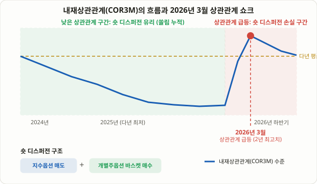

## 지수는 왜 구성종목보다 "조용하게" 움직일까

S&P500을 구성하는 500개 종목 하나하나는 저마다 실적, 가이던스, 업종 뉴스에 따라 하루에도 몇 퍼센트씩 요동칩니다. 그런데 지수 자체는 대개 그보다 훨씬 덜 흔들립니다. 종목들이 서로 다른 방향으로 움직이면서 개별 변동성의 상당 부분이 서로 상쇄되기 때문입니다. 이 "상쇄되는 정도"를 가격으로 거래하는 것이 바로 이번 강의에서 다루는 **디스퍼전 트레이딩(Dispersion Trading, 분산 트레이딩)**입니다. 쉽게 말하면 지수옵션을 팔고 그 지수를 구성하는 개별종목들의 옵션을 사는, 상관관계 자체에 베팅하는 전략입니다.

이 전략은 2025년을 거치며 헤지펀드 사이에서 가장 널리 퍼진 변동성 트레이드 중 하나로 꼽혔습니다. S&P500의 실현 상관관계가 수십 년 만에 최저 수준까지 떨어지면서 "숏 디스퍼전(상관관계가 낮게 유지된다는 쪽에 베팅)" 포지션이 꾸준히 수익을 냈기 때문입니다. 그런데 2026년 3월, 이 쏠림 현상이 보여줄 수 있는 반대쪽 얼굴이 그대로 드러났습니다. 시장 전반의 상관관계가 급격히 튀어오르면서 디스퍼전 트레이드를 추종하는 한 대형 투자은행 지수가 한 달 만에 약 4.9% 하락했고, 이후 S&P500의 내재상관관계는 2년 만에 최고치까지 치솟았습니다. 이 사건은 "왜 이 전략이 수익을 내는가"와 "왜 갑자기 무너질 수 있는가"를 한꺼번에 보여주는 생생한 사례입니다.

## 핵심 메커니즘: 지수 변동성은 개별 변동성의 가중평균이 아니다

디스퍼전 트레이딩을 이해하려면 지수 변동성과 개별종목 변동성의 수학적 관계를 먼저 짚어야 합니다. 두 종목으로만 구성된 가상의 지수를 생각해봅시다. 각각 비중이 w₁, w₂이고 내재변동성이 σ₁, σ₂라면, 지수의 분산(변동성의 제곱)은 다음과 같은 근사식으로 표현됩니다.

```
지수 분산 ≈ w₁²σ₁² + w₂²σ₂² + 2w₁w₂σ₁σ₂ρ
```

여기서 ρ(로)가 바로 두 종목 사이의 **상관계수**입니다. 두 종목 비중과 개별 변동성이 고정돼 있다고 가정하면, 이 식에서 지수 변동성을 끌어올리거나 끌어내리는 유일한 변수는 바로 ρ입니다. ρ가 1에 가까울수록(두 종목이 완벽하게 같은 방향으로 움직일수록) 지수 변동성은 개별 변동성의 가중평균에 가까워지고, ρ가 0에 가까울수록(서로 다른 방향으로 움직일수록) 지수 변동성은 개별 변동성보다 훨씬 낮아집니다. 종목이 500개로 늘어나도 원리는 같습니다 — 결국 지수 옵션 가격에는 시장이 예상하는 평균적인 상관관계가, 눈에 보이지 않는 형태로 녹아 들어가 있습니다.

이 녹아 있는 상관관계를 거꾸로 계산해서 숫자로 뽑아낸 것이 바로 **내재상관관계(Implied Correlation)**입니다. 지수 옵션의 내재변동성과 구성종목 옵션들의 가중 내재변동성을 비교해 역산하면, "지금 지수 옵션 가격이 전제하고 있는 평균 상관관계는 몇 퍼센트인가"를 구할 수 있습니다. CBOE는 이를 공식 지수로 발표하는데, 1개월물 COR1M, 3개월물 COR3M 등이 대표적이고, 2023년에는 디스퍼전 전략 자체의 수익 구조를 추적하는 **CBOE S&P500 디스퍼전 지수(DSPX)**도 따로 출시됐습니다.

## 거래 구조: 지수를 팔고 구성종목 바스켓을 산다

전형적인 "숏 디스퍼전(Short Dispersion)" 포지션은 다음과 같이 구성합니다.

1. **지수 옵션(또는 지수 분산)을 매도**합니다. 스트래들 매도나 분산 스왑(Variance Swap) 매도 형태가 흔히 쓰이며, 이는 지수 변동성이 비싸게(즉 높은 상관관계를 전제로) 책정돼 있다는 데 베팅하는 쪽입니다.
2. **구성종목 개별주 옵션을 비중에 맞춰 바스켓으로 매수**합니다. 시가총액 비중이나 베가(Vega) 기준으로 가중치를 맞춰, 초기 포지션의 전체 베가가 양쪽에서 거의 상쇄되도록(베가 중립, Vega-Neutral) 설계하는 것이 교과서적인 방식입니다.

이렇게 베가를 중립으로 맞추면 "변동성이 전반적으로 오르느냐 내리느냐"에 대한 노출은 최소화되고, 남는 노출은 거의 순수하게 "구성종목들이 서로 얼마나 같은 방향으로 움직이느냐"에만 집중됩니다. 즉 방향성 베팅이 아니라, [18강 페어 트레이딩](/strategies/pairs-trading-stat-arb/)처럼 "관계"에 베팅하는 구조입니다. 다만 페어 트레이딩이 두 종목 사이의 가격 스프레드를 보는 것과 달리, 디스퍼전 트레이딩은 지수 전체와 그 구성종목 바스켓 사이의 변동성 스프레드를 봅니다.

<figure class="diagram">
  
  <figcaption>내재상관관계가 다년 최저치까지 내려가며 숏 디스퍼전 쏠림이 누적된 뒤, 2026년 3월 상관관계가 급등하며 해당 포지션들이 손실을 입은 구간을 보여준다.</figcaption>
</figure>

## 왜 이 구조가 구조적으로 수익을 내는 경향이 있었나

디스퍼전 트레이드가 오랫동안 매력적이었던 이유는 단순한 우연이 아니라, 옵션 시장의 수급 구조에서 비롯된 설명이 뒤따릅니다. 지수 옵션, 특히 지수 풋옵션에는 포트폴리오 전체를 헤지하려는 연금펀드·자산운용사의 꾸준한 매수 수요가 몰립니다. 이 하방 보험 수요는 방향이 거의 한쪽으로만 고정돼 있어서, 지수 옵션의 내재변동성(그리고 거기에 내재된 상관관계)을 구조적으로 밀어올리는 경향이 있습니다. 반면 개별종목 옵션의 수급은 실적 발표, 인수합병 추측, 특정 테마 베팅처럼 종목마다 제각각인 이유로 움직이기 때문에, 지수 옵션만큼 한쪽으로 쏠리는 지속적인 매수 압력이 상대적으로 약합니다.

그 결과 지수 옵션에 내재된 상관관계(내재상관관계)는 실제로 나중에 실현되는 상관관계(실현상관관계)보다 평균적으로 높게 책정되는 경향이 있다는 것이 업계에서 흔히 설명되는 논리입니다. 이 차이를 **상관관계 리스크 프리미엄**이라고 부르며, [38강 IV 크러시](/strategies/iv-crush-earnings-options/)와 마찬가지로 "옵션 매도자가 구조적인 보험료를 받는" 또 다른 형태로 이해할 수 있습니다. 숏 디스퍼전은 이 프리미엄을 반복적으로 수취하려는 시도입니다.

## 가상의 숫자로 보는 예시

아래는 메커니즘을 보여주기 위한 가상의 예시일 뿐, 실제 백테스트 결과가 아닙니다. 지수가 비중이 똑같은 두 종목 A, B로만 구성돼 있고, 둘 다 옵션 시장에서 내재변동성이 30%로 책정돼 있다고 가정합니다. 지수 옵션 시장이 두 종목의 상관관계를 0.70으로 가정하고 있다면, 앞의 근사식에 따라 지수의 내재변동성은 다음과 같이 계산됩니다.

```
분산 = 0.5²×0.30² + 0.5²×0.30² + 2×0.5×0.5×0.30×0.30×0.70 = 0.045 × (1 + 0.70) = 0.0765
내재변동성 = √0.0765 ≈ 27.7%
```

이 가격에서 지수 옵션을 매도하고, A·B 각각의 옵션을 30% 내재변동성 수준에서 매수했다고 합시다. 시간이 지나 실제로 A와 B가 각자의 실적 이슈로 서로 다른 방향으로 움직여, 실현된 상관관계가 0.30까지 낮아졌다고 가정해봅시다. 같은 식에 ρ=0.30을 넣으면,

```
분산 = 0.045 × (1 + 0.30) = 0.0585
실현 지수변동성 = √0.0585 ≈ 24.2%
```

즉 A와 B는 각자 거의 가정했던 수준(약 30%)만큼 실제로 움직였지만, 둘이 서로 다른 방향으로 움직였기 때문에 지수 자체의 실현변동성은 24.2%로, 애초에 지수 옵션이 팔렸던 수준(27.7%)보다 훨씬 낮게 나타났습니다. 지수 옵션을 판 쪽은 비싸게 판 것보다 적게 움직인 셈이라 이익을 보고, 개별주 옵션을 산 쪽은 거의 가정했던 수준만큼 변동성을 챙겼으니 손해가 크지 않습니다. 두 다리를 합치면 순수하게 "상관관계가 예상보다 낮게 실현됐다"는 차이에서 수익이 나옵니다.

## 숏 디스퍼전 vs 롱 디스퍼전

| | 숏 디스퍼전 (Short Dispersion) | 롱 디스퍼전 (Long Dispersion) |
|---|---|---|
| 구조 | 지수옵션 매도 + 개별주옵션 매수 | 지수옵션 매수 + 개별주옵션 매도 |
| 베팅 방향 | 상관관계가 낮게 유지되거나 더 낮아진다 | 상관관계가 높아진다(위기·쏠림장) |
| 유리한 장세 | 종목별 고유 이슈(실적, 개별 테마)로 움직이는 "종목 선택형" 장세 | 매크로 쇼크, 패닉 셀링처럼 모든 종목이 한 방향으로 쏠리는 장세 |
| 대표 리스크 | 상관관계 급등 시 큰 손실(2026년 3월 사례) | 평상시 꾸준한 프리미엄을 반납해야 함(보험료 지불과 유사) |
| 성격 | 반복적인 소액 수익을 쌓는 "캐리형" 전략에 가까움 | 꼬리 위험에 대한 헤지에 가까움 |

이 표에서 보듯 두 포지션은 거울처럼 반대입니다. 숏 디스퍼전은 [28강 VIX 선물 기간구조](/strategies/vix-term-structure-contango-backwardation/)에서 다룬 콘탱고 롤 수익처럼 평상시에는 꾸준히 프리미엄을 걷지만 체제가 바뀌는 순간 한꺼번에 반납할 수 있는 구조이고, 롱 디스퍼전은 반대로 보험을 사는 쪽에 가깝습니다.

## 실전에서 상관관계 지수를 참고하는 법

| 내재상관관계(COR3M 등)의 상태 | 흔히 통용되는 해석 |
|---|---|
| 역사적 평균보다 눈에 띄게 높은 수준 | 지수 옵션이 상대적으로 비싸게(높은 상관관계를 전제로) 책정됐을 가능성 — 숏 디스퍼전 진입을 검토하는 신호로 참고됨 |
| 다년 최저치 근방까지 떨어진 상태 | 이미 많은 참여자가 숏 디스퍼전에 몰려 있다는 "쏠림(crowding)" 경고로 해석되는 경우가 많음 — 신규 진입보다 리스크 관리에 집중할 시점 |
| 매크로 이벤트(FOMC, 관세, 지정학 리스크) 직전 급등 | 시장이 상관관계 급등(모든 종목이 함께 빠지는 장세)을 미리 가격에 반영하는 신호로 참고됨 |

여기서 두 번째 행이 2026년 3월 사례와 정확히 맞아떨어집니다. 상관관계가 역대 최저 수준까지 내려가며 숏 디스퍼전이 "크라우디드 트레이드"로 불리던 바로 그 구간에서, 시장 전반의 유동성 경색과 맞물려 상관관계가 급격히 튀어올랐고 해당 전략을 추종하던 지수가 한 달 새 수 퍼센트 손실을 기록했습니다.

## 한계와 유의점

- **개인 투자자가 그대로 복제하기는 현실적으로 어렵다**: 베가 중립 바스켓을 구성하려면 수십~수백 개 개별주 옵션을 동시에 운용하며 지속적으로 재조정해야 하므로, 이 전략은 주로 대형 헤지펀드와 투자은행 데스크의 영역입니다. 개인 투자자는 CBOE의 상관관계·디스퍼전 지수를 시장 체제를 읽는 참고 지표로 활용하는 수준이 현실적입니다.
- **꼬리 위험이 구조적으로 비대칭적이다**: 평소에는 작은 수익이 꾸준히 쌓이지만, 위기 국면에서 상관관계가 급등하면 손실이 한꺼번에 몰려서 발생할 수 있습니다. 이는 [97강 제이드 리자드](/strategies/jade-lizard-options-strategy/)·[98강 아이언 버터플라이](/strategies/iron-butterfly-options-strategy/)에서 다룬 옵션 매도 전략들과 비슷한 "느린 수익, 빠른 손실" 리스크 프로파일입니다.
- **거래 비용과 체결 난이도가 지수 옵션보다 훨씬 높다**: 개별주 옵션 다수를 동시에 매매해야 하므로 슬리피지와 스프레드 비용이 누적되기 쉽습니다.
- **인기 자체가 리스크가 된다**: 2024~2025년의 낮은 상관관계 환경이 역설적으로 더 많은 자금을 숏 디스퍼전으로 끌어들였고, 이 쏠림이 2026년 3월 되돌림의 배경 중 하나로 지목됩니다. 어떤 전략이든 "이미 모두가 하고 있다"는 사실 자체가 추가적인 리스크 요인이 될 수 있습니다.

## 자주 묻는 질문

### 디스퍼전 트레이딩은 18강의 페어 트레이딩과 어떻게 다른가요?
둘 다 개별 가격이 아니라 "관계"에 베팅한다는 점은 같습니다. 다만 페어 트레이딩은 두 종목의 가격 스프레드가 평균으로 되돌아온다는 데 베팅하고, 디스퍼전 트레이딩은 지수와 구성종목 바스켓 사이의 변동성(상관관계) 스프레드에 베팅합니다. 전자는 현물·선물로도 할 수 있지만 후자는 본질적으로 옵션 구조가 필요합니다.

### 개인 투자자도 디스퍼전 트레이딩에 접근할 방법이 있나요?
정교한 베가 중립 바스켓을 직접 구성하기는 현실적으로 어렵습니다. 다만 CBOE가 공개하는 내재상관관계 지수(COR1M·COR3M)와 디스퍼전 지수(DSPX)를 통해 "지금 시장이 상관관계를 어떻게 가격에 반영하고 있는지"를 참고 지표로 확인할 수 있고, 이는 지수 옵션 전반의 밸류에이션을 판단하는 데 도움이 됩니다.

### 상관관계가 낮다는 것은 항상 좋은 신호인가요?
아닙니다. 낮은 상관관계는 보통 "종목별로 각자의 이유로 움직이는" 건강한 장세를 뜻하지만, 동시에 숏 디스퍼전 같은 전략이 과도하게 몰려 있다는 신호일 수도 있습니다. 2026년 3월처럼 낮은 상관관계가 오래 지속된 뒤에는 급격한 반전 위험이 함께 커진다는 점을 염두에 둬야 합니다.

## 정리

- 디스퍼전 트레이딩은 지수옵션을 팔고 구성종목 개별주옵션을 사서, 지수 변동성에 내재된 상관관계(내재상관관계)와 나중에 실제로 실현되는 상관관계(실현상관관계) 사이의 차이를 수익으로 바꾸는 전략입니다.
- 지수 분산은 개별 변동성의 가중평균이 아니라 상관계수(ρ)에 따라 달라지며, 이 관계를 거꾸로 풀면 CBOE의 COR1M·COR3M 같은 내재상관관계 지수를 얻을 수 있습니다.
- 지수 옵션 수요(특히 하방 헤지)가 구조적으로 더 꾸준하기 때문에 내재상관관계가 실현상관관계보다 평균적으로 높게 책정되는 경향이 있고, 이 차이가 "상관관계 리스크 프리미엄"입니다.
- 숏 디스퍼전(지수 매도+개별주 매수)은 낮은 상관관계 장세에서 유리하지만, 2026년 3월처럼 상관관계가 급등하는 순간 큰 손실에 노출될 수 있는 비대칭적 리스크 구조를 가집니다.
- 베가 중립 바스켓을 직접 구성하는 것은 기관 투자자의 영역에 가깝고, 개인 투자자에게는 내재상관관계·디스퍼전 지수를 시장 체제 판단과 리스크 신호로 참고하는 접근이 더 현실적입니다.
