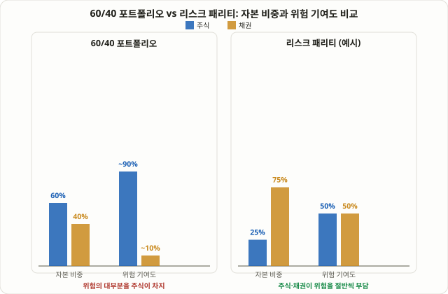

## 리스크 패리티란: "얼마를 담을까" 대신 "위험을 얼마나 지울까"

주식 60%, 채권 40%로 포트폴리오를 짜는 방식은 오랫동안 "균형 잡힌 배분"의 대표 격으로 불려 왔습니다. 하지만 **리스크 패리티(Risk Parity)** 전략은 이 상식에 정면으로 질문을 던집니다. "금액을 60:40으로 나눴다고 해서, 위험도 60:40으로 나뉘었다고 할 수 있는가?" 답은 "아니다"입니다. 주식은 채권보다 훨씬 변동성이 크기 때문에, 금액 기준 비중과 무관하게 포트폴리오 전체의 가격 흔들림은 거의 전부 주식 쪽에서 나옵니다.

리스크 패리티는 이 문제를 뒤집어서 접근합니다. 자산마다 투입할 **금액**을 먼저 정하지 않고, 각 자산이 포트폴리오 전체 위험에 기여하는 몫을 먼저 정한 뒤, 그 몫이 똑같아지도록 금액 비중을 거꾸로 계산하는 방식입니다. 이 접근을 제도권 자산운용에 처음 체계적으로 들여온 곳은 레이 달리오(Ray Dalio)가 이끈 브리지워터(Bridgewater Associates)로, 1996년 올웨더(All Weather) 펀드를 통해 선보였다고 알려져 있습니다. 지금까지 이 강좌에서 다룬 42강 [켈리 공식](/strategies/kelly-criterion-position-sizing/)이 "한 거래에 얼마를 걸 것인가"를 다뤘다면, 리스크 패리티는 그 질문을 포트폴리오 전체 단위로 확장한 자산배분 프레임워크라고 볼 수 있습니다.

## 왜 60/40은 사실상 "주식 90% 포트폴리오"인가

리스크 패리티가 바꾸려는 문제를 구체적인 숫자로 보겠습니다. 주식의 연 변동성(표준편차)을 약 15%, 채권의 연 변동성을 약 5%라고 가정합니다. 이는 실제로 자주 인용되는 근사치이며, 시장 상황에 따라 달라질 수 있는 참고값입니다. 두 자산이 서로 완전히 독립적으로 움직인다고 단순화하면, 60/40 포트폴리오 전체의 변동성은 다음과 같이 근사할 수 있습니다.

```
포트폴리오 변동성 ≈ √[(0.6×15%)² + (0.4×5%)²] ≈ √(81 + 4) ≈ 9.2%
```

여기서 중요한 것은 전체 변동성 9.2%포인트 중 주식이 기여하는 몫입니다. 분산 기여도로 환산하면, 주식 쪽 항(81)이 채권 쪽 항(4)보다 약 20배 크다는 것을 알 수 있습니다. 즉 금액으로는 60%만 담았지만, 포트폴리오가 흔들리는 이유의 대부분, 흔히 90% 안팎이라고 거론되는 비중이 주식 한 곳에서 나옵니다. 채권 40%는 숫자상으로는 꽤 큰 비중처럼 보이지만, 실제로 포트폴리오가 왜 오르고 내리는지를 설명하는 힘은 미미합니다. "분산투자를 했다"는 느낌은 금액 비중이 주는 착시일 뿐, 위험의 관점에서는 사실상 레버리지 없는 주식 포트폴리오에 가깝다는 것이 리스크 패리티 지지자들의 핵심 비판입니다.

## 작동 방식: 변동성 역가중과 레버리지

리스크 패리티가 위험 기여도를 맞추는 방법은 두 단계로 나눌 수 있습니다.

**1단계 — 변동성 역가중(inverse-volatility weighting).** 변동성이 낮은 자산일수록 금액 비중을 더 높게, 변동성이 높은 자산일수록 금액 비중을 더 낮게 배분합니다. 위 예시처럼 주식 변동성이 채권의 3배라면, 위험 기여도를 50:50으로 맞추기 위해 채권 금액 비중을 주식의 3배로 늘려야 합니다. 계산하면 주식 25%, 채권 75%가 되고, 이때 두 자산의 위험 기여도는 각각 50%로 같아집니다(0.25×15% = 0.75×5% = 3.75%포인트씩).

**2단계 — 목표 변동성까지 레버리지로 끌어올리기.** 그런데 문제가 하나 생깁니다. 주식 비중을 25%까지 낮춘 포트폴리오는 안전해진 대신 기대수익률도 함께 낮아집니다. 실제로 위 25/75 배분의 포트폴리오 변동성을 같은 방식으로 계산하면 약 5.3%포인트로, 원래 60/40(9.2%포인트)보다 훨씬 낮습니다. 그래서 브리지워터식 리스크 패리티는 여기서 멈추지 않고, 채권처럼 변동성이 낮은 쪽의 비중을 선물·레버리지를 이용해 더 끌어올려 포트폴리오 전체의 변동성을 원하는 목표치(예: 10%)까지 다시 높입니다. 쉽게 말하면 "위험을 고르게 나눈 저위험 포트폴리오"를 먼저 만들고, 그다음 레버리지로 전체 크기를 키워 기대수익을 주식 비중 포트폴리오와 경쟁할 수 있는 수준까지 되돌리는 2단계 구조입니다.

<figure class="diagram">
  
  <figcaption>60/40 포트폴리오는 자본 비중(60/40)과 위험 기여도(약 90/10)가 크게 어긋나지만, 리스크 패리티는 자본 비중(25/75)을 조정해 위험 기여도를 50/50으로 맞춥니다.</figcaption>
</figure>

## 왜 작동하는가: 상관관계가 낮은 위험을 동시에 쌓는 것

리스크 패리티가 노리는 핵심 효과는 단순히 "채권을 더 사는 것"이 아니라, **서로 상관관계가 낮은 여러 위험을 동시에, 비슷한 크기로 쌓아서 포트폴리오 전체의 변동성 대비 기대수익(샤프비율)을 개선하는 것**입니다. 주식·채권·원자재·금처럼 경기 국면에 따라 서로 다르게 반응하는 자산을 비슷한 위험 크기로 섞으면, 한 자산이 부진한 국면에서 다른 자산이 버텨주는 구조가 만들어집니다. 흔히 "주식은 성장 국면에, 채권은 침체·디플레이션 국면에, 원자재는 인플레이션 국면에 상대적으로 강하다"는 식으로 경기 국면을 나눠 각 국면에 대응하는 자산을 고르게 섞는다는 설명이 자주 인용됩니다. 전통적인 60/40처럼 한 자산(주식)이 위험을 지배하면, 사실상 "주식이 잘 풀리는 국면에만 강한 포트폴리오"가 되어버리고, 금액상으로 들고 있는 채권 40%는 위험 분산 효과를 거의 내지 못합니다.

## 숫자로 보는 60/40 vs 리스크 패리티

| 구분 | 60/40 포트폴리오 | 리스크 패리티(예시) |
|---|---|---|
| 자본 비중 (주식:채권) | 60% : 40% | 25% : 75% |
| 가정한 연 변동성 | 주식 15%, 채권 5% | 주식 15%, 채권 5% |
| 위험 기여도 (주식:채권) | 약 90% : 10% | 50% : 50% |
| 레버리지 레버리지 사용 여부 | 보통 사용 안 함 | 목표 변동성까지 끌어올리기 위해 흔히 사용 |
| 핵심 가정 | 금액 비중 = 적절한 분산 | 위험 기여도를 맞춰야 진짜 분산 |
| 가장 약한 국면 | 주식·채권이 동시에 하락할 때(2022년형) | 레버리지를 쓴 자산이 동반 하락할 때 손실이 증폭 |

이 표에서 눈여겨볼 지점은 두 전략이 "가장 취약한 상황"조차 비슷하다는 사실입니다. 리스크 패리티가 60/40의 약점(주식 편중)을 고치는 대신, 레버리지라는 새로운 리스크를 받아들인다는 것이 이 전략을 평가할 때 반드시 함께 봐야 하는 균형점입니다.

## 2022년: 레버리지가 양날의 검이 된 해

리스크 패리티의 논리는 "주식과 채권이 대체로 반대 또는 독립적으로 움직인다"는 전제에 크게 의존합니다. 그런데 2022년은 이 전제가 흔들린 해로 자주 거론됩니다. 그해 미국 연준의 급격한 금리 인상 국면에서 주식과 채권이 보기 드물게 동시에 두 자릿수대로 하락했고, 여러 매체에서 1969년 이후 처음으로 주식·채권이 동시에 10% 넘게 빠진 해로 소개되었습니다. 평소라면 채권이 주식의 손실을 상쇄해주는 역할을 했어야 하는데, 그 상쇄 효과가 사라진 상태에서 레버리지까지 걸려 있었던 리스크 패리티형 포트폴리오들은 레버리지가 없는 전통적 배분보다 더 큰 손실을 본 사례가 다수 보고되었습니다. 이는 리스크 패리티가 틀렸다는 증거라기보다, **레버리지는 상관관계 가정이 깨지는 순간 손실 쪽으로도 똑같이 증폭된다**는, 레버리지 전략 일반에 적용되는 당연한 원리를 다시 확인해준 사례로 받아들여집니다.

## 실전에서 흔히 거론되는 접근법

개인 투자자가 직접 선물·레버리지를 운용해 교과서적인 리스크 패리티를 완전히 복제하는 것은 현실적으로 어렵습니다. 그래서 실전에서는 주로 다음 중 하나가 거론됩니다.

- **레버리지 없는 단순화 버전**: 위 25/75 예시처럼 변동성 역가중만 적용하고 레버리지는 쓰지 않는 방식입니다. 위험은 고르게 분산되지만, 기대수익률도 함께 낮아진다는 점을 받아들여야 합니다.
- **올웨더형 ETF 활용**: RPAR, ALLW처럼 운용사가 리밸런싱과 레버리지 비중을 대신 관리해주는 상장 상품을 활용하는 방식입니다. 다만 이런 상품은 운용 방식·보수·레버리지 비중이 운용사마다 다르고 시간이 지나며 바뀔 수 있으므로, 매수 전 실제 운용설명서를 직접 확인해야 합니다.
- **부분 혼합**: 전체 자산을 리스크 패리티로 전부 교체하는 대신, 기존 60/40 포트폴리오의 일부(예: 10~20%)만 리스크 패리티형 배분으로 떼어내 섞는 방식도 자주 거론됩니다.

리스크 패리티는 [80강 듀얼 모멘텀(GEM) 전략](/strategies/dual-momentum-gem-strategy/)과 자주 비교됩니다. 듀얼 모멘텀은 "지금 주식에 있을지, 현금으로 피할지"를 추세 신호로 매달 판단하는 전술적 전환 전략인 반면, 리스크 패리티는 시장 방향을 예측하지 않고 항상 모든 자산군을 동시에, 위험 기준으로 고르게 들고 가는 구조적 배분 전략입니다. 전자는 "언제 들어갈지"를 묻고, 후자는 "얼마나 들고 있을지"를 묻는다는 점에서 질문의 성격 자체가 다릅니다.

## 한계와 유의점

- **레버리지는 손실도 그대로 키운다**: 2022년 사례처럼 상관관계 가정이 깨지면 레버리지가 손실 증폭기로 작동합니다. 레버리지를 쓰는 순간 운용 중 변동성 재추정, 마진콜, 롤오버 비용 같은 추가 리스크가 함께 따라옵니다.
- **변동성·상관관계는 과거 데이터일 뿐**: 역가중 계산에 쓰는 변동성·상관관계 추정치는 모두 과거 데이터에서 나옵니다. 미래에도 그 값이 유지된다는 보장은 없으며, 이 강좌 13강 [ATR 기반 리스크 필터](/strategies/risk-filters-atr-cmf/)에서 다룬 "변동성은 변한다"는 전제가 여기서도 똑같이 적용됩니다.
- **금리 환경에 따라 성과가 크게 갈린다**: 채권 비중을 키우고 레버리지로 보완하는 구조이기 때문에, 저금리·금리 하락 국면에서는 유리했지만 금리가 빠르게 오르는 국면에서는 불리해지는 경향이 자주 지적됩니다.
- **운용 복잡도와 비용**: 정기적인 변동성 재계산, 레버리지 비중 조정, 롤오버 같은 작업이 필요해 개인이 직접 운용하기에는 상당한 수고와 비용이 들어갑니다.

## 자주 묻는 질문

### 리스크 패리티는 항상 60/40보다 안전한가요?
아닙니다. 레버리지를 쓰지 않는 단순화 버전은 변동성이 낮아지는 대신 기대수익률도 낮아지고, 레버리지를 쓰는 정식 버전은 2022년처럼 상관관계가 깨지는 국면에서 오히려 60/40보다 더 큰 손실을 낼 수 있습니다. "위험이 고르게 분산됐다"는 것과 "항상 손실이 작다"는 것은 서로 다른 이야기입니다.

### 개인 투자자도 리스크 패리티를 따라 할 수 있나요?
직접 선물로 레버리지를 운용하는 정식 버전은 전문적인 운용 인프라가 필요해 현실적으로 어렵습니다. 대신 레버리지 없는 변동성 역가중 배분을 스스로 짜거나, 올웨더형 상장 상품을 활용하는 방식이 더 접근하기 쉬운 대안으로 거론됩니다.

### 듀얼 모멘텀이나 켈리 공식과는 어떻게 다른가요?
듀얼 모멘텀([80강](/strategies/dual-momentum-gem-strategy/))은 추세를 보고 매달 "주식에 있을지 현금으로 피할지"를 판단하는 전술적 전환 전략이고, 켈리 공식([42강](/strategies/kelly-criterion-position-sizing/))은 승률·손익비를 알고 있는 한 거래에 얼마를 걸지 정하는 베팅 사이징 공식입니다. 리스크 패리티는 이 둘과 달리 시장 방향을 예측하지 않고, 여러 자산군을 항상 동시에 보유하면서 그 비중만 위험 기준으로 조정하는 구조적 배분 전략입니다.

## 정리

- 리스크 패리티는 자산을 금액이 아니라 위험 기여도 기준으로 배분하는 전략으로, 레이 달리오의 브리지워터가 올웨더 펀드를 통해 체계화했습니다.
- 60/40 포트폴리오는 금액 비중은 균형 잡혀 보이지만, 변동성 차이로 인해 위험의 대부분(흔히 90% 안팎)이 주식 한 곳에서 나오는 구조입니다.
- 리스크 패리티는 변동성 역가중으로 위험 기여도를 50:50에 가깝게 맞춘 뒤, 낮아진 기대수익률을 레버리지로 다시 끌어올리는 2단계 구조로 작동합니다.
- 2022년처럼 주식·채권이 동시에 하락하는 국면에서는 레버리지가 손실을 증폭시켜, 레버리지 없는 전통적 배분보다 더 큰 손실을 낼 수 있다는 점이 핵심 한계입니다.
- 변동성·상관관계 추정치는 과거 데이터에 불과하며, 미래에도 그대로 유지된다는 보장이 없다는 점을 항상 함께 고려해야 합니다.
