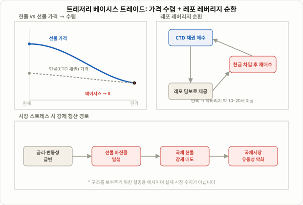

## 연준이 계속 경고하는 그 거래

최근 몇 년간 연준(Fed)과 금융안정 보고서에 꾸준히 등장하는 표현이 하나 있습니다. "헤지펀드의 레버리지가 쌓이고 있다"는 경고인데, 그 중심에 있는 거래가 바로 **트레저리 베이시스 트레이드(Treasury Basis Trade)**입니다. 미국 국채 현물을 사고 같은 만기의 국채선물을 동시에 파는, 이름만 보면 평범한 차익거래처럼 보이는 이 전략은 실제로는 수천억 달러 규모의 포지션이 레포(Repo) 시장의 단기 차입에 의존해 쌓여 있는 구조입니다. 미국 금융연구청(OFR)이 2026년 발표한 자료에서는 이 거래의 규모가 2025년 9월 기준 약 8,300억 달러로 추정됐고, 대형 헤지펀드가 보유한 국채 롱 포지션의 약 35%를 차지한다고 밝혔습니다. 같은 시기 모건스탠리 추정으로는 2026년 초 약 1조 2,600억 달러에 달했던 레버리지 투자자의 베이시스 포지션 규모가 이후 약 9,000억 달러 수준으로 줄었다는 보고도 나왔습니다. 추정 기관마다 집계 방식과 시점이 달라 정확한 숫자는 엇갈리지만, 공통적으로 확인되는 것은 이 거래가 "수천억 달러 단위로 쌓여 있고, 그 규모가 꾸준히 모니터링 대상이 되고 있다"는 점입니다.

이 강의에서는 베이시스 트레이드가 정확히 무엇을 거래하는 것인지, 왜 레버리지가 그토록 커지는지, 그리고 2020년 3월 국채시장 혼란의 원인으로 지목된 이 거래의 청산 리스크가 지금도 왜 반복해서 경고의 대상이 되는지를 실전 관점에서 풀어봅니다. 금리 포지셔닝을 다루는 강의라는 점에서 [100강 수익률 곡선 스티프너·플래트너](/strategies/yield-curve-steepener-flattener/), [93강 캐리 트레이드](/strategies/carry-trade-yen-unwind/)와 같은 계열이지만, 거래 대상이 금리 방향이나 커브 모양이 아니라 **같은 채권의 현물가와 선물가 사이의 좁은 틈**이라는 점에서 완전히 다른 전략입니다. 개인 투자자가 이 거래를 그대로 복제할 일은 거의 없지만, 국채시장의 유동성과 변동성에 직접 영향을 주는 큰손들의 포지션이 어떻게 쌓이고 풀리는지를 이해해 두면, 왜 어떤 시기에는 국채 금리가 뉴스 하나에 과도하게 출렁이는지를 읽는 데 도움이 됩니다.

## 베이시스란 무엇이고 왜 0으로 수렴하는가

베이시스(Basis)는 간단히 정의하면 "선물 가격에서 현물 가격을 뺀 값"입니다. 국채선물은 만기 시점에 실제 국채 현물로 결제(인도)되도록 설계돼 있기 때문에, 만기가 다가올수록 선물 가격과 현물 가격은 서로 수렴할 수밖에 없습니다. 만기일에 선물과 현물이 서로 다른 가격이라면, 둘 중 싼 쪽을 사서 비싼 쪽을 파는 차익거래자들이 그 차이가 사라질 때까지 매매에 나설 것이기 때문입니다.

국채선물은 특정 채권 하나가 아니라 미리 정해진 조건(만기·쿠폰)을 만족하는 여러 채권 중 어떤 것으로든 인도할 수 있도록 설계돼 있는데, 이 바스켓 안에서 매도자가 인도하기에 가장 유리한(=가장 싼) 채권을 **최저인도가능채권(CTD, Cheapest-to-Deliver)**이라고 부릅니다. 베이시스 트레이드는 실무적으로는 이 CTD 채권을 현물로 매수하고, 그 채권을 기초로 한 선물을 매도하는 방식으로 짜여집니다. 선물이 CTD 현물보다 고평가돼 있다면(양(+)의 베이시스), 현물을 사고 선물을 팔아둔 뒤 만기까지 들고 가서 그 차이를 수익으로 확정하는 구조입니다.

## 왜 작동하는가: 캐리와 수렴이라는 두 개의 수익원

베이시스 트레이드의 수익은 크게 두 갈래로 나뉩니다.

첫째는 **캐리(Carry)**입니다. 국채를 보유하면 쿠폰 이자가 들어오고, 그 국채를 레포로 빌려서 산 돈에는 레포 금리를 내야 합니다. 쿠폰 수익에서 레포 조달비용을 뺀 값이 매일매일 쌓이는 캐리이며, 이 캐리가 양(+)인 구간에서는 가격이 전혀 움직이지 않아도 시간이 지날수록 수익이 쌓입니다.

둘째는 **수렴(Convergence)**입니다. 앞서 설명했듯 선물과 현물의 가격차는 만기로 갈수록 반드시 좁아지므로, 애초에 선물이 고평가돼 있었다면 그 괴리가 줄어드는 과정 자체가 수익이 됩니다.

문제는 이 두 수익원이 모두 **매우 작다**는 점입니다. 통상 베이시스는 몇 bp(1bp=0.01%p) 수준에 불과합니다. 그래서 의미 있는 수익을 만들려면 거래 규모를 극단적으로 키워야 하는데, 이를 가능하게 하는 것이 바로 레포 차입입니다. 매수한 국채 자체를 담보로 다시 레포 시장에서 자금을 빌려 더 많은 국채를 사는 구조를 반복하면, 적은 자기자본으로도 막대한 명목가치를 통제할 수 있습니다. 위키피디아를 비롯한 여러 자료에서는 최근 몇 년간 이 거래의 통상적인 레버리지 수준을 10~20배 정도로 언급하고 있으며, 국제결제은행(BIS) 추정으로는 일부 구간에서 그보다 훨씬 높은 수준까지 치솟았다는 보고도 나온 바 있습니다. 다만 레버리지 수치는 시점과 포지션 구성에 따라 크게 달라지므로, 특정 숫자를 고정된 사실로 받아들이기보다는 "작은 가격차를 레버리지로 증폭시키는 구조"라는 원리 자체를 이해하는 것이 더 중요합니다.

이 구조가 다른 차익거래와 다른 점은, 레버리지를 공급하는 쪽(레포 대출자인 은행·딜러)과 레버리지를 쓰는 쪽(헤지펀드)이 분리돼 있다는 것입니다. 은행 입장에서는 국채를 담보로 하는 레포 대출이 상당히 안전한 자산으로 취급되기 때문에 자본 규제 부담이 적고, 그래서 낮은 금리로 자금을 공급할 수 있습니다. 헤지펀드 입장에서는 이 값싼 자금을 최대한 끌어다 쓸수록 자기자본 대비 수익률이 올라가므로, 레버리지를 줄일 동기 자체가 구조적으로 약합니다. 바로 이 "양쪽 모두에게 레버리지를 늘릴 유인이 있다"는 지점이 규제당국이 지켜보는 핵심입니다.

<figure class="diagram">
  
  <figcaption>현물 매수·선물 매도로 베이시스를 확보하되, 레포로 반복 차입해 레버리지를 쌓는 구조. 시장 스트레스 시 마진콜이 강제매도로 이어지며 청산 리스크가 커진다.</figcaption>
</figure>

## 실전 구성: 레포 조달이 핵심 변수

베이시스 트레이드를 실행하는 순서는 대략 다음과 같습니다.

1. 인도 바스켓 안에서 CTD 채권을 찾아낸다 (조달 비용이 가장 낮고 수익률이 가장 유리한 채권).
2. CTD 현물 채권을 매수하면서, 매수 자금을 그 채권 자체를 담보로 하는 **레포(RP, Repurchase Agreement)**로 조달한다. 즉 채권을 사고, 그 채권을 다시 담보로 맡겨 현금을 빌리는 구조를 반복해 레버리지를 쌓는다.
3. 동일 수량에 맞춰 해당 채권이 속한 선물 계약을 매도한다.
4. 포지션을 만기(또는 목표 베이시스 도달 시점)까지 유지하며, 매일 레포를 롤오버(재조달)한다.

여기서 가장 중요한 변수는 **레포 금리**입니다. 레포는 보통 하루 단위로 빌리는 초단기 자금이기 때문에 금리가 낮고 조달이 원활할 때는 이 구조가 안정적으로 캐리를 쌓아줍니다. 그런데 특정 채권에 대한 수요가 몰려 그 채권을 담보로 빌리는 쪽의 레포 금리가 시장 평균보다 눈에 띄게 낮아지는 현상을 **스페셜(Special)**이라고 부르는데, 이 경우 그 채권을 보유한 트레이더가 오히려 유리해지지만, 반대로 자금 경색(Repo squeeze)이 발생해 레포 금리가 급등하면 조달비용이 캐리 수익을 집어삼키고 거래 자체가 손실로 돌아설 수 있습니다.

| 구분 | 안정적인 구간 | 레포 경색(스트레스) 구간 |
|---|---|---|
| 레포 금리 | 낮고 안정적, 캐리를 꾸준히 쌓아줌 | 급등, 조달비용이 캐리를 역전 |
| 선물-현물 베이시스 | 작은 폭에서 서서히 수렴 | 급격히 벌어지거나 뒤틀림 |
| 마진 요구 | 완만하게 변동 | 선물 거래소 마진콜이 급증 |
| 포지션 대응 | 캐리를 받으며 보유 지속 | 강제 청산·매도 압력 발생 |

## 숫자로 보는 예시 (설명을 위한 가상 수치)

다음은 구조를 이해하기 위한 **가상의 설명용 예시**이며 실제 시장 수치가 아닙니다. CTD 채권의 베이시스가 4bp(0.04%)이고, 쿠폰 수익률이 레포 조달비용보다 연 0.3%p 높은 양(+)의 캐리 구간이라고 가정합니다. 자기자본 100만 달러로 레포를 반복 차입해 15배 레버리지(명목가치 1,500만 달러)를 만들었다면, 연간 캐리 수익은 1,500만 달러 × 0.3% ≈ 4만 5,000달러로, 자기자본 대비 약 4.5%의 수익률이 됩니다. 레버리지가 없었다면 같은 0.3%p 캐리는 100만 달러 기준 3,000달러, 즉 0.3%에 불과했을 것입니다. 이처럼 레버리지는 작은 베이시스를 의미 있는 수익률로 바꿔주지만, 똑같은 배율로 손실도 증폭시킵니다.

레버리지 배수를 달리하면 같은 시장 충격에도 결과가 얼마나 달라지는지 비교해 보면 다음과 같습니다(역시 설명용 가상 수치입니다).

| 레버리지 | 명목가치(자기자본 100만 달러 기준) | 연 0.3%p 양(+) 캐리 시 자기자본 수익률 | 레포 경색으로 조달비용 +0.5%p 발생 시 자기자본 손실률 |
|---|---|---|---|
| 5배 | 500만 달러 | +1.5% | -2.5% |
| 15배 | 1,500만 달러 | +4.5% | -7.5% |
| 30배 | 3,000만 달러 | +9.0% | -15.0% |

표에서 보듯, 레버리지를 두 배로 늘리면 평상시 캐리 수익률도 두 배가 되지만, 레포 경색 국면의 손실률도 정확히 같은 비율로 두 배가 됩니다. 베이시스 트레이드가 "꾸준하지만 작은 수익"과 "가끔 발생하지만 치명적인 손실"이라는 비대칭 구조를 갖는다고 평가받는 이유가 바로 이 지점입니다. 평상시 손익은 완만하게 쌓이지만, 레포 금리가 급등하는 흔치 않은 구간에서는 레버리지 배수만큼 손실이 압축적으로 몰려옵니다.

## 왜 규제당국이 이 거래를 반복해서 경고하는가

2020년 3월, 코로나19 충격으로 시장이 급변하자 베이시스 트레이드를 쌓아뒀던 헤지펀드들이 마진콜에 쫓겨 국채를 한꺼번에 매도했고, 이는 가장 안전하다고 여겨지던 미국 국채시장의 유동성을 순식간에 마비시킨 원인 중 하나로 지목됐습니다. 당시 상황을 단계별로 보면, ① 주식·신용시장이 급락하며 투자자들이 현금을 확보하려 자산을 팔기 시작했고, ② 국채선물 가격이 현물보다 더 가파르게 흔들리면서 베이시스 포지션에 불리한 쪽으로 가격이 움직였고, ③ 거래소들이 변동성 증가에 대응해 마진 요구치를 높였고, ④ 레버리지를 쓴 펀드들이 마진콜에 응하기 위해 보유 중인 국채 현물을 서둘러 팔아야 했습니다. 문제는 이 매도가 "가장 안전한 자산을 팔아 현금을 만드는" 통상적인 위기 대응과는 정반대로, 안전자산인 국채 가격 자체를 떨어뜨리고 국채시장 유동성을 더 악화시키는 쪽으로 작용했다는 점입니다. 결국 연준이 수천억 달러 규모의 국채를 직접 매입하며 시장을 안정시켜야 했고, 이 사건은 이후 금융안정 보고서에서 베이시스 트레이드의 청산 리스크를 설명하는 대표 사례로 반복해서 인용되고 있습니다. 이 사건 이후 이 거래는 "작동할 때는 시장에 유동성과 선물-현물 가격 정합성을 제공하지만, 급변 장세에서 한꺼번에 풀리면 오히려 그 유동성을 빨아들이는" 양면적인 존재로 평가받게 됐습니다.

- **마진콜이 레버리지를 되돌리는 속도는 비선형적이다.** 선물 가격이 불리하게 움직이면 거래소는 추가 마진을 요구하고, 이를 맞추기 위해 현물 채권을 매도해야 하는데, 여러 펀드가 동시에 비슷한 포지션을 풀면 매도 압력이 겹쳐 가격이 더 불리하게 움직이는 악순환이 생길 수 있습니다.
- **레포 조달은 매일 갱신해야 하는 단기 자금이다.** 레포 시장 자체가 경색되면(담보 부족, 딜러의 대차대조표 한도 축소 등) 포지션을 유지할 자금 자체를 구하기 어려워질 수 있습니다.
- **포지션 규모가 꾸준히 보고되고 있다.** 모건스탠리 추정으로 2026년 초 약 1조 2,600억 달러에 달했던 레버리지 투자자의 베이시스 포지션 규모가 이후 약 9,000억 달러 수준으로 줄었다는 보고가 나왔는데, 이는 차익거래 기회 자체가 좁아진 결과로 해석되는 경우가 많지만, 포지션 규모의 변화 추이 자체를 꾸준히 모니터링해야 하는 이유를 보여줍니다.
- **개인 투자자가 직접 이 거래를 복제하기는 현실적으로 어렵다.** 레포 시장 접근, CTD 산정, 선물 계좌와 마진 요건은 모두 기관급 인프라를 전제로 하므로, 이 강의의 목적은 실행 안내가 아니라 "국채시장 안정성에 영향을 주는 큰 손들의 포지션이 어떻게 쌓이는지"를 이해하는 데 있습니다.

## 자주 묻는 질문

### 베이시스 트레이드와 62강에서 다룬 펀딩비 차익거래는 같은 원리인가요?
기본 발상은 비슷합니다. 둘 다 현물과 파생상품(선물 또는 무기한선물) 사이의 가격차를 레버리지로 증폭시켜 수익을 내는 "캐시 앤 캐리" 계열 전략입니다. 다만 [62강 펀딩비 차익거래](/strategies/funding-rate-arbitrage/)는 암호화폐 거래소의 펀딩비가 조달비용 역할을 하고 거래소 청산 리스크가 핵심 변수인 반면, 트레저리 베이시스 트레이드는 레포 시장의 단기 금리가 조달비용이고 거래소 청산보다는 레포 경색과 국채선물 마진콜이 핵심 리스크라는 점에서 시장 구조와 리스크의 성격이 다릅니다.

### 베이시스가 항상 양(+)인가요?
아닙니다. 선물이 현물보다 저평가되면 베이시스가 음(-)이 될 수도 있으며, 이 경우 트레이더는 반대 방향(현물 매도·선물 매수)으로 포지션을 짜야 합니다. 다만 국채선물 시장에서는 구조적으로 양의 베이시스가 더 흔하게 관찰된다고 알려져 있습니다.

### 이 거래가 지금도 위험한 수준인가요?
보도된 추정치마다 차이가 있고 시점에 따라 포지션 규모도 달라집니다. 일부 투자은행 분석은 최근 포지션 축소를 "차익거래 기회가 줄어든 자연스러운 결과"로 해석하는 반면, 연준·OFR 등 규제기관은 레버리지가 쌓인 구조 자체가 시장 스트레스 상황에서 되돌아오는 속도와 폭을 키울 수 있다는 점을 꾸준히 경고하고 있습니다. 둘 다 일부 진실을 담고 있는 해석이므로, 어느 한쪽 주장을 확정된 사실로 받아들이기보다는 포지션 규모 추이를 계속 지켜볼 필요가 있습니다.

### 일반 투자자가 간접적으로라도 영향을 받을 수 있나요?
직접 베이시스 트레이드를 하지 않더라도, 이 거래의 급격한 청산은 국채 금리와 국채시장 유동성을 통해 모기지 금리, 회사채 스프레드, 심지어 주식시장의 변동성에도 간접적으로 영향을 줄 수 있습니다. 2020년 3월처럼 안전자산으로 여겨지는 국채시장 자체가 흔들리면, 그 영향은 국채를 직접 보유하지 않은 투자자에게도 금리 변동과 신용시장 경색이라는 형태로 전달될 수 있습니다.

## 정리

- 트레저리 베이시스 트레이드는 국채 현물을 사고 같은 만기의 국채선물을 파는 구조로, 선물·현물 가격차(베이시스)가 만기로 갈수록 0에 수렴하는 성질과 쿠폰 이자에서 레포 조달비용을 뺀 캐리를 동시에 수익원으로 삼습니다.
- 베이시스 자체는 보통 몇 bp에 불과할 정도로 작기 때문에, 레포 시장에서 반복적으로 차입해 레버리지를 크게 키우는 것이 이 전략의 핵심 구조이며, 그만큼 손익도 같은 배율로 증폭됩니다.
- 핵심 리스크는 레포 금리 급등(자금 경색)과 선물 마진콜이며, 둘 다 가격이 불리하게 움직일 때 포지션의 강제 청산을 부르고, 여러 펀드가 동시에 풀면 국채시장 전체의 유동성을 흔들 수 있다는 점이 2020년 3월 사례로 반복해서 인용됩니다.
- 보고 기관마다 수치는 다르지만 수천억 달러 규모로 꾸준히 보고되고 있으며, 정확한 숫자보다는 "작은 가격차를 대형 레버리지로 증폭시키는 구조가 계속 쌓이고 있다"는 흐름 자체를 이해하는 것이 실전적으로 더 중요합니다.
- 레포 접근성과 선물 계좌 인프라 때문에 개인 투자자가 직접 복제하기는 어려우며, 이 강의는 실행 가이드가 아니라 시장 안정성에 영향을 주는 기관 포지셔닝을 읽는 법을 다룹니다.
