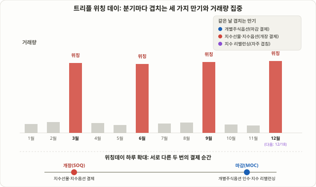

## 트리플 위칭 데이란: 세 가지 만기가 한날 겹치는 이유

매년 3월, 6월, 9월, 12월 셋째 금요일이 되면 미국 증시의 거래량이 평소보다 눈에 띄게 불어나는 날이 있습니다. **트리플 위칭 데이(Triple Witching Day)**입니다. 이름이 주는 느낌과 달리 미신이나 음모론과는 아무 상관이 없습니다. 이 날은 세 가지 서로 다른 파생상품 — 개별주식옵션(stock options), 주가지수선물(index futures), 주가지수옵션(index options) — 의 만기가 동시에 돌아오는 날이라는 뜻에서 붙은 이름입니다. 여기에 한때 거래되던 개별주식선물(single stock futures)까지 더하면 네 가지 만기가 겹치는 **쿼드러플 위칭(Quadruple Witching)**이라는 표현도 쓰이는데, 미국에서는 개별주식선물 거래가 사실상 사라졌기 때문에 지금은 두 용어가 거의 같은 의미로 혼용되는 경우가 많습니다.

이 강의가 다루는 대상은 05강 [ICT 스마트머니 컨셉](/strategies/ict-smart-money-basics/)이나 39강 [오더블록](/strategies/order-blocks/)처럼 차트 패턴이나 기관의 발자국을 읽는 기법이 아닙니다. 트리플 위칭은 애초에 "해석"이 필요 없는, 거래소 캘린더에 날짜가 고정된 **기계적 이벤트**입니다. 날짜가 정해져 있다는 점에서는 69강 [FOMC·CPI 발표 매매법](/strategies/fomc-cpi-news-trading/)과 비슷하지만, FOMC·CPI는 새로운 정보가 시장에 유입되며 가격이 재조정되는 이벤트인 반면, 트리플 위칭은 새로운 정보가 전혀 없어도 포지션 정리·청산·헤지 되돌림이라는 구조적인 이유만으로 거래량과 단기 변동성이 몰리는 이벤트라는 점이 근본적으로 다릅니다. 2026년 기준으로 가장 가까운 트리플 위칭 데이는 **2026년 12월 18일(금)**이며, 이미 지나간 날짜로는 3월 20일과 9월 18일이 있었습니다.

## 왜 하루에 몰리는가: 세 가지 만기의 결제 구조

변동성이 집중되는 이유를 이해하려면 세 가지 상품이 같은 날 각기 다른 방식으로 결제된다는 점을 알아야 합니다.

- **주가지수선물(ES, NQ, RTY 등)**: 금요일 장 시작 시점의 특별시가(SOQ, Special Opening Quotation)를 기준으로 현금 결제됩니다. 즉 금요일 개장가가 결제가를 확정짓는 역할을 합니다.
- **주가지수옵션(SPX, NDX, RUT 등)**: 대부분 AM 세틀먼트 방식으로, 같은 SOQ를 기준으로 현금 결제됩니다. 지수선물과 지수옵션이 같은 기준가로 묶여 있다 보니, 개장 전후 구간에 두 시장의 포지션 정리가 동시에 몰립니다.
- **개별주식옵션**: 지수와 달리 실물 인수 방식입니다. 외가격(OTM)으로 소멸하는 물량도 있지만, 내가격(ITM) 옵션은 금요일 마감 동시호가(MOC, Market-on-Close) 가격을 기준으로 실제 주식 100주 단위 인수·인도가 발생합니다. 옵션 매도자(주로 마켓메이커)는 이 인수·인도 리스크를 관리하기 위해 마감 직전까지 기초주식 물량을 사고파는 델타 헤지를 조정해야 합니다.

정리하면 지수 쪽은 **금요일 개장**이, 개별주식 쪽은 **금요일 마감**이 각각 결제 기준점이 됩니다. 하루 안에 시가와 종가라는 두 개의 "확정 순간"이 걸려 있고, 그 각각의 순간을 향해 포지션 정리 물량이 몰린다는 것이 트리플 위칭 변동성의 뼈대입니다.

## 메커니즘을 완성하는 두 가지 추가 요인

위의 결제 구조만으로도 거래량이 늘어나는 이유는 충분히 설명되지만, 실제 변동성이 커지는 데는 두 가지 요인이 더 겹칩니다.

첫째는 **딜러 감마 헤징의 급격한 해소**입니다. 15강 [감마 익스포저(GEX)](/strategies/gamma-exposure-gex/)에서 다뤘듯, 마켓메이커는 팔아놓은 옵션의 델타를 중립으로 맞추기 위해 기초자산을 사고파는 헤지 포지션을 유지합니다. 만기가 돌아오면 이 헤지 포지션 전체가 한 번에 사라지거나 다음 만기로 롤오버되어야 합니다. 특정 가격대에 미결제약정(OI)이 몰려 있었다면, 그 가격대 근처에서 작동하던 "핀 리스크(가격을 특정 레벨에 고정시키는 효과)"가 만기와 동시에 꺼지면서, 억눌려 있던 변동성이 만기 직후 오히려 더 커지는 경우가 자주 관찰됩니다. 57강 [맥스페인(Max Pain) 이론](/strategies/max-pain-theory/)과 59강 [바나·참(Vanna·Charm) 익스포저](/strategies/vanna-charm-dealer-flow/)에서 다룬 "만기를 향해 갈수록 좁아지는 가격대"와 "만기 당일 그 구속이 풀리는 순간"을 함께 떠올리면 이 구조가 더 선명해집니다.

둘째는 **지수 정기변경(리밸런싱)과의 시기적 중첩**입니다. S&P500을 비롯한 주요 지수의 분기 정기변경은 트리플 위칭과 같은 금요일 장마감에 맞춰 발효되는 경우가 많습니다. 75강 [지수 편입 효과](/strategies/index-inclusion-effect/)에서 설명한, 패시브 펀드의 기계적 매수·매도가 마감 동시호가에 집중되는 수급이 트리플 위칭의 옵션 관련 수급과 같은 시간, 같은 호가창 위에서 겹칩니다. 두 가지 서로 다른 메커니즘(옵션 결제 vs 지수 리밸런싱)이 같은 순간에 동시에 작동한다는 점이, 트리플 위칭 데이의 마감 동시호가 거래량이 유독 두드러지는 이유 중 하나로 꾸준히 언급됩니다.

<figure class="diagram">
  
  <figcaption>1년 중 네 번, 3·6·9·12월 셋째 금요일에만 거래량이 평소 대비 크게 튀어 오른다. 그날 하루에 개별주식옵션·지수선물·지수옵션의 만기와 지수 정기변경(리밸런싱)이 동시에 겹치며, 마감 동시호가(MOC) 구간에 수급이 집중된다.</figcaption>
</figure>

## 실제로 얼마나 흔들리는가: 서로 다른 결론들을 있는 그대로 보기

이 지점에서 반드시 짚어야 할 것이 있습니다. "트리플 위칭 데이는 항상 크게 흔들린다"는 식의 단정은 근거가 약합니다. 실제로 이 날의 변동성·수익률을 다룬 여러 리서치의 결론은 서로 꽤 다릅니다. 아래는 각 기관이 공개적으로 밝힌 분석의 요지를 그대로 정리한 것으로, 서로 다른 조사 기간·방법론을 썼기 때문에 어느 한쪽을 "정답"으로 받아들여서는 안 됩니다.

| 분석 주체 | 주요 결론 |
|---|---|
| Citi | 거래량은 많지만 변동성은 오히려 낮은 날이 역사적으로 많았다 — 일중 변동폭이 다른 월간 만기일보다 작았다 |
| Robinhood | 2020년 이후 거래량이 평소의 3배 이상, VIX 중앙값도 소폭 높음(20.76 vs 18.94) — "조금 더 뜨겁지만 극단적이지는 않다" |
| Dow Jones Market Data | 2020년 이후 트리플 위칭 데이의 S&P500 평균 수익률이 약 −0.5%로 하락 쪽에 쏠려 있었다 |
| eToro | 당일 하락이라는 증거는 약하지만, 다음 한 주 동안 약세가 이어지는 경향이 더 뚜렷하게 관찰됐다 |
| Seasonax | 이벤트를 향해 가격이 살짝 내려갔다가 이후 되돌리는 패턴, 다만 12월은 계절적으로 강세 편향이 있다 |

이 표가 보여주는 가장 중요한 사실은 "거래량이 늘어난다"는 점에는 이견이 거의 없지만, "그래서 가격이 어느 방향으로 움직이는가"에는 조사마다 결론이 다르다는 것입니다. 표본 기간이 짧고(연 4회이니 5년치 자료도 20개 사례에 불과합니다), 조사마다 기준 지수·기간이 다르다는 점을 고려하면 이는 당연한 결과입니다. **따라서 트리플 위칭 데이의 방향성 베팅은 통계적으로 검증된 엣지가 아니라, 참고 수준의 경향으로만 다뤄야 합니다.** 반면 거래량·단기 변동성이 평소보다 커진다는 점은 비교적 일관되게 관찰되는 사실에 가까우므로, 전략의 초점은 "방향을 맞히는 것"이 아니라 "집중되는 수급 구간을 어떻게 다루는가"에 둬야 합니다.

## 기법 A — 회피 전략: 변동성 구간 자체를 피해간다

가장 보수적이고, 동시에 가장 많은 트레이더에게 권장되는 접근입니다.

1. **그 주 금요일에는 신규 옵션 포지션의 만기를 그날로 잡지 않습니다.** 특히 내가격 근처에서 소멸하거나 인수·인도가 발생할 수 있는 개별주식옵션은, 의도치 않은 주식 보유로 이어질 수 있다는 점을 미리 인지해야 합니다.
2. **장 마감 30~60분 전, 이른바 "위칭 아워" 구간에는 신규 진입을 자제합니다.** 이 구간은 마감 동시호가를 향한 주문이 집중되며 스프레드와 슬리피지가 커지기 쉬운 시간대입니다.
3. **보유 중인 스윙 포지션의 손절 폭을 13강 [ATR 손절](/strategies/risk-filters-atr-cmf/) 기준으로 재확인합니다.** 평소보다 일중 변동폭이 커질 가능성이 있는 날에 평소와 같은 손절 폭을 그대로 쓰면, 정상적인 노이즈에도 손절이 먼저 체결될 위험이 커집니다.
4. **레버리지와 포지션 크기를 평소보다 줄입니다.** 06강 [손익비와 자금관리](/strategies/risk-reward-money-management/)의 원칙대로, 변동성이 커지는 구간에서는 같은 금액 손절이라도 실제 리스크는 더 크다는 점을 먼저 반영해야 합니다.

## 기법 B — 활용 전략: 집중되는 수급을 관찰 대상으로 삼는다

회피 전략과 반대로, 트리플 위칭 데이의 특수성 자체를 관찰·매매 대상으로 활용하는 접근도 있습니다. 다만 이 기법은 방향을 예측하는 것이 아니라, 구조적으로 몰리는 수급의 흔적을 읽는 데 집중한다는 점이 중요합니다.

1. **MOC 임밸런스 지표를 확인합니다.** 뉴욕증권거래소와 나스닥은 마감 전 일정 시각부터 예상 매수·매도 임밸런스 규모를 실시간으로 공개합니다. 이 지표가 평소보다 훨씬 큰 종목은 마감 동시호가 쪽으로 수급이 몰릴 가능성이 높다는 신호로 쓰입니다.
2. **미결제약정(OI)이 몰린 가격대를 미리 확인합니다.** 57강 맥스페인 이론이나 15강 GEX에서 다룬 방식으로 특정 지수·종목의 OI 집중 구간을 파악해두면, 만기 당일 가격이 그 구간 근처에서 핀처럼 고정되거나, 혹은 반대로 그 구속이 풀리며 더 크게 움직이는 패턴을 관찰 대상으로 삼을 수 있습니다.
3. **지수 리밸런싱 대상 종목을 별도로 체크합니다.** 75강에서 다룬 지수 편입·편출 종목이 같은 금요일에 걸려 있다면, 그 종목은 옵션 수급과 패시브 수급이 겹치는 가장 변동성이 큰 후보가 됩니다.
4. **당일 방향성 매매 대신, 다음 주 되돌림 가능성을 염두에 둡니다.** 위 표의 eToro·Seasonax 분석처럼, 트리플 위칭 당일보다 그 다음 한 주 동안의 흐름에 더 뚜렷한 경향이 관찰됐다는 연구들이 있습니다. 당일 급변동에 쫓아가기보다, 다음 주 초 되돌림 구간에서 평균회귀 관점으로 접근하는 트레이더도 있습니다.

## 회피 전략 vs 활용 전략 비교

| 구분 | 회피 전략 | 활용 전략 |
|---|---|---|
| 목적 | 변동성·슬리피지 노출 최소화 | 집중되는 수급의 흔적을 포착 |
| 필요한 도구 | 특별히 없음 (포지션 축소만으로 충분) | MOC 임밸런스 피드, OI 데이터, 지수 리밸런싱 공시 |
| 난이도 | 낮음 | 높음 (실시간 데이터 해석 필요) |
| 적합한 투자자 | 대부분의 개인·스윙 투자자 | 데이터 피드 접근이 가능한 단기 트레이더 |
| 핵심 리스크 | 기회비용(변동성 구간의 수익 기회를 포기) | 신호 오독 시 평소보다 큰 변동성 구간에서 손실 확대 |
| 방향성 예측 필요 여부 | 불필요 | 불필요 (수급 구조만 읽음, 방향은 베팅하지 않음) |

두 전략 모두 "방향을 맞히려 하지 않는다"는 공통점이 있습니다. 회피 전략은 변동성이 커지는 구간 자체에서 빠져나오는 쪽을, 활용 전략은 그 구간에서 드러나는 수급의 흔적을 읽는 쪽을 택할 뿐입니다. 개인 투자자 대다수에게는 회피 전략이 합리적인 기본값이며, 활용 전략은 실시간 임밸런스·OI 데이터에 접근할 수 있는 트레이더에게 더 적합합니다.

## 숫자로 보는 예시 (교육용 단순화 사례)

실제 특정 종목의 데이터가 아니라, 메커니즘을 숫자로 이해하기 위한 가상의 단순화 사례입니다.

가상의 종목 XYZ가 12월 트리플 위칭 데이에 S&P500 신규 편입이 확정되어 있고, 동시에 해당 종목의 옵션 OI가 100달러 행사가에 집중되어 있다고 가정합니다. 금요일 현재가는 98달러입니다.

- **지수 리밸런싱 수급**: 패시브 펀드의 예상 매수 규모가 해당 종목 ADV(평균 일일 거래량)의 약 6배로 추정된다면, 마감 동시호가를 향해 매수 쪽으로 호가 임밸런스가 쌓일 가능성이 큽니다.
- **옵션 핀 리스크**: 동시에 100달러 행사가 근처에 OI가 몰려 있다면, 마켓메이커의 델타 헤지 물량이 그 가격대 근처에서 가격을 끌어당기는 힘으로 작동할 수 있습니다.
- **두 힘의 충돌**: 리밸런싱 매수는 가격을 100달러 위로 밀어 올리려 하고, 옵션 핀은 가격을 100달러 근처에 붙잡아 두려 합니다. 이 경우 마감 직전 호가창에서 두 힘이 부딪히며 평소보다 훨씬 큰 호가 변동이 나타날 수 있습니다.
- **리스크 관리 적용**: 이 종목을 스윙으로 보유하고 있었다면, 평소 ATR 기준 손절 폭을 그대로 쓰기보다 당일만 한시적으로 포지션 크기를 줄이거나, 마감 동시호가 이전에 미리 일부를 청산하는 방식이 보수적인 대응이 됩니다.

이 예시는 실제 수치가 아니라 "서로 다른 두 메커니즘이 같은 호가창에서 동시에 작동할 수 있다"는 구조를 보여주기 위한 가상의 교육용 사례임을 다시 한 번 밝힙니다.

## 한국 시장은 어떨까

위에서 다룬 통계와 사례는 대부분 미국 시장(S&P500, 지수선물·옵션) 기준입니다. 한국 코스피200 선물·옵션은 매월 둘째 목요일에 동시 만기가 돌아오지만, 분기마다 세 가지 상품이 겹치는 미국식 트리플 위칭과는 규모와 빈도가 다릅니다. 코스피200은 월별로 만기가 돌아오는 대신 그 충격이 분산되는 경향이 있고, 외국인·기관의 프로그램 매매 비중이 큰 장 마감 동시호가 구간에서 수급이 몰리는 현상은 유사하게 관찰되지만, 공개적으로 검증된 국내 통계는 이 강의가 다룬 미국 사례보다 제한적입니다. 국내 시장에 이 개념을 적용하려는 투자자는 한국거래소의 공식 만기 일정과 최근 몇 차례의 실제 사례를 직접 확인하는 과정을 거치는 것이 안전합니다.

## 한계와 함정

- **방향성 엣지는 약하다**: 앞서 표로 정리했듯, 당일 수익률 방향에 대한 연구 결론이 기관마다 다릅니다. "트리플 위칭에는 무조건 하락한다" 같은 단정은 근거가 부족합니다.
- **표본이 작다**: 연 4회뿐인 이벤트라 10년 치 데이터를 모아도 40개 사례에 불과합니다. 통계적으로 신뢰할 만한 결론을 내리기에는 표본이 충분하지 않은 경우가 많습니다.
- **다른 이벤트와의 중첩**: 트리플 위칭이 FOMC나 주요 경제지표 발표 주간과 겹치면, 변동성의 원인이 위칭 때문인지 다른 이벤트 때문인지 구분하기가 어려워집니다.
- **거래비용이 작은 엣지를 삼킨다**: 임밸런스나 핀 리스크를 노리는 단기 매매는 스프레드·슬리피지 비용이 상대적으로 크게 작용하는 전략입니다. 기대 수익이 크지 않다면 거래비용만으로 엣지가 사라질 수 있습니다.
- **국내 데이터의 한계**: 앞서 밝혔듯 한국 시장에 대한 공개 통계는 미국 시장보다 제한적이므로, 미국 사례를 그대로 국내 시장에 적용하는 것은 주의가 필요합니다.

## 자주 묻는 질문

### 트리플 위칭과 쿼드러플 위칭은 어떻게 다른가요?
원래는 개별주식선물까지 포함해 네 가지 만기가 겹치는 날을 쿼드러플 위칭이라 불렀습니다. 하지만 미국에서 개별주식선물 거래가 사실상 사라지면서, 지금은 실질적으로 세 가지 만기(개별주식옵션·지수선물·지수옵션)만 남아 두 용어가 같은 날을 가리키는 경우가 많습니다. 매체나 자료에 따라 아직도 "쿼드러플 위칭"이라는 표현을 그대로 쓰는 경우가 있으니, 맥락상 트리플 위칭과 같은 의미로 이해하면 됩니다.

### 트리플 위칭 데이에는 무조건 신규 포지션을 피해야 하나요?
반드시 그런 것은 아닙니다. 본문에서 다룬 것처럼 거래량 증가는 비교적 일관되게 관찰되지만, 가격 방향에 대한 증거는 혼재돼 있습니다. 대부분의 개인·스윙 투자자에게는 포지션 크기를 줄이고 위칭 아워 신규 진입을 자제하는 보수적 접근이 합리적이지만, 실시간 임밸런스·OI 데이터를 다룰 수 있는 트레이더라면 그 구간을 관찰·매매 대상으로 삼는 선택도 가능합니다.

### 지수 편입 효과와 트리플 위칭은 같은 현상인가요?
메커니즘은 다르지만 날짜가 자주 겹칩니다. 75강에서 다룬 지수 편입 효과는 "패시브 펀드가 정해진 비중만큼 반드시 사야 하는" 지수 리밸런싱 수급이고, 트리플 위칭은 "옵션·선물의 만기 결제와 딜러 헤지 되돌림"이라는 전혀 다른 구조입니다. 다만 주요 지수의 분기 정기변경이 트리플 위칭 금요일에 자주 함께 발효되기 때문에, 두 메커니즘이 같은 날 같은 호가창에서 동시에 작동하는 경우가 많습니다.

## 정리

- 트리플 위칭 데이는 3·6·9·12월 셋째 금요일에 개별주식옵션·지수선물·지수옵션의 만기가 동시에 겹치는 분기 이벤트로, 2026년 가장 가까운 날짜는 12월 18일입니다.
- 변동성이 몰리는 이유는 지수 쪽은 개장 특별시가, 개별주식 쪽은 마감 동시호가라는 서로 다른 결제 기준점이 같은 날에 걸려 있고, 여기에 딜러 감마 헤징 해소와 지수 리밸런싱이 겹치기 때문입니다.
- 거래량 증가는 비교적 일관되게 관찰되지만, 당일 가격 방향에 대한 연구 결론은 기관마다 다르므로 방향성 베팅의 근거로 쓰기는 어렵습니다.
- 회피 전략(변동성 구간 자체를 피함)과 활용 전략(임밸런스·OI 데이터로 수급 흔적을 읽음) 모두 방향을 맞히려 하지 않는다는 공통점이 있으며, 대부분의 개인 투자자에게는 전자가 더 현실적인 기본값입니다.
- 한국 시장에 대한 공개 통계는 미국 시장보다 제한적이므로, 국내 적용 시에는 한국거래소 공식 일정과 실제 사례를 별도로 확인해야 합니다.
