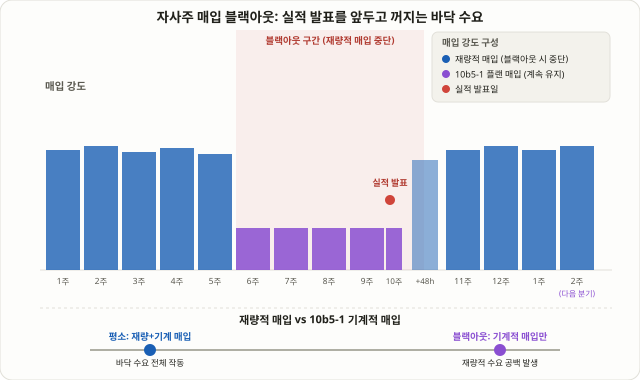

## 자사주 매입 블랙아웃이란: 법으로 정해진 규칙이 아니다

상장기업은 1년 내내 자사주를 매입할 수 있는 것이 아닙니다. 실적 발표를 앞둔 일정 기간, 그리고 발표 직후 며칠 동안은 스스로 매입을 멈추는 관행이 있는데, 이를 **바이백 블랙아웃(Buyback Blackout)** 또는 **자사주 매입 블랙아웃 기간**이라 부릅니다. 여기서 반드시 짚어야 할 점이 있습니다. 이 블랙아웃은 미국 SEC나 한국 금융당국이 "이 날부터 이 날까지 매입을 멈춰라"라고 법으로 강제한 제도가 아닙니다. 연방 차원에서 의무화된 블랙아웃 기간은 존재하지 않으며, 각 회사가 자체 내부자거래 정책으로 정해놓은 **자발적 관행**입니다.

왜 회사가 스스로 이런 제약을 두는 걸까요? 이유는 명확합니다. 임직원은 다음 실적이 좋을지 나쁠지를 시장보다 먼저 압니다. 이 상태에서 회사가 자기 주식을 사들이면, 외부에서는 "회사 내부자가 비공개 정보를 이용해 매매한 것 아니냐"는 의심을 피하기 어렵습니다. 그래서 대부분의 기업은 실적 발표를 앞두고 일정 기간 매입을 자발적으로 중단해, 내부자거래 리스크 자체를 원천적으로 차단하는 쪽을 택합니다.

문제는 이 기간이 회사마다 다르고, 대부분 공개되지 않는다는 점입니다. 업계에서 가장 흔히 언급되는 정의는 두 가지입니다. 첫째는 **분기 말 약 2주 전부터 실적 발표 48시간 후까지**라는 실무 관행이고, 둘째는 골드만삭스 리서치가 쓰는 더 넓은 정의인 **실적 발표 약 5주 전부터 발표 후 2영업일까지**입니다. 어느 쪽이 "정확한" 기준인지에 대한 통일된 답은 없습니다. 이 자체가 이 주제를 다룰 때 가장 먼저 인정해야 할 한계입니다 — 블랙아웃은 거래소 캘린더에 날짜가 박혀 있는 07강 [트리플 위칭 데이](/strategies/triple-witching-day/)와 달리, 추정에 추정을 더해야 하는 비공개 이벤트입니다.

## 왜 수급에 공백이 생기는가: "꾸준한 매수자"가 사라지는 구조

자사주 매입이 왜 수급에 영향을 주는지 이해하려면, 자사주 매입이 시장에서 어떤 역할을 하는지부터 봐야 합니다. 실적이나 뉴스와 무관하게, 회사는 정해진 예산 안에서 자기 주식을 꾸준히 사들입니다. 이는 가격에 구애받지 않는 비(非)가격 민감적 매수 주문이며, 결과적으로 시장에 항상 존재하는 하나의 "바닥 수요"로 작동합니다. 골드만삭스 전략팀은 이를 두고, 자사주 매입이 사라지면 수요곡선 자체가 아래로 이동하면서 다른 투자자군이 그 공백을 메우지 못할 경우 밸류에이션이 눌리고 변동성이 커질 수 있다고 경고한 바 있습니다.

블랙아웃 기간에는 바로 이 바닥 수요가 일시적으로 꺼집니다. 회사가 사라진 자리를 다른 매수자가 정확히 같은 규모로 채워주지 않는다면, 평소 같은 매도 물량에도 가격이 더 쉽게 흔들릴 수 있다는 것이 이 전략의 핵심 논리입니다. 여기에 더해 실적 발표 자체가 가져오는 정보 충격(가이던스 변화, 서프라이즈)이 겹치는 구간이기 때문에, 변동성이 커지는 원인이 "수급 공백"인지 "실적 그 자체"인지 깔끔하게 분리하기 어렵다는 점도 미리 짚어둘 필요가 있습니다.

<figure class="diagram">
  
  <figcaption>평소에는 꾸준한 매입 강도가 유지되지만, 실적 발표를 앞둔 블랙아웃 구간에서는 재량적 매입이 멈추고 사전에 정해둔 10b5-1 플랜에 따른 최소 매입만 남는다. 발표 후 약 48시간이 지나면 재량적 매입이 재개된다.</figcaption>
</figure>

## 블랙아웃 구간에서 실제로 변동성이 커지는가: 서로 다른 결론들

"블랙아웃 구간에서는 무조건 더 흔든다"는 단정적인 결론을 내리기 전에, 실제로 이 주제를 분석한 자료들이 서로 얼마나 다른 이야기를 하는지부터 봐야 합니다.

| 분석 주체 | 주요 결론 |
|---|---|
| 골드만삭스 (25년 데이터) | 블랙아웃 구간의 수익률 분산(dispersion)이 16%p로 비블랙아웃 구간의 14%p보다 높고, 변동성도 16.4%p 대 15.8%p로 소폭 더 높았다 |
| 골드만삭스 트레이더 (과거 추정) | 블랙아웃 진입 시 매입 플로우가 약 35% 줄어들 수 있다는 추정 |
| CNBC(2018) 인용 트레이더 | 같은 구간의 플로우 감소를 30% 이하로 더 낮게 추정 |
| LuxAlgo 등 비판적 시각 | 블랙아웃이 수익률·변동성에 미치는 영향의 근거는 "일화적(anecdotal)" 수준에 가깝고, 단일 분기의 변동성은 실적·매크로 뉴스가 블랙아웃 캘린더보다 더 크게 좌우한다 |
| S&P 다우존스 인디시즈 (2025년 실제 데이터) | S&P500 자사주 매입이 1분기 2935억 달러로 기록을 세운 뒤, 블랙아웃이 몰린 2분기에는 2346억 달러로 줄었고, 3분기에는 2490억 달러로 소폭 반등했지만 1분기 기록에는 여전히 못 미쳤다 |

이 표에서 가장 중요하게 봐야 할 것은, "변동성이 조금 더 커진다"는 방향 자체에는 대체로 의견이 모이지만 **그 크기가 통계적으로 얼마나 유의미한지에 대해서는 연구마다 결론이 다르다**는 사실입니다. 골드만삭스의 16%p 대 14%p라는 숫자도 "상당한 차이"로 읽을 수도, "비슷한 수준의 약한 차이"로 읽을 수도 있습니다. 2025년 실제 자사주 매입 집계(1분기 기록 → 2분기 둔화 → 3분기 소폭 반등하되 기록에는 못 미침)는 블랙아웃 계절성이 실제 매입 플로우에 반영된다는 정황 증거이지만, 이것이 주가 수익률이나 변동성에 얼마나 직접적으로 전이됐는지를 증명하는 자료는 아닙니다. **따라서 이 주제는 "검증된 엣지"가 아니라, 근거가 있는 가설로 다뤄야 합니다.**

## 완충 장치: 10b5-1 플랜이 블랙아웃의 효과를 흐리는 이유

블랙아웃 효과가 연구마다 다르게 나오는 이유 중 하나는, 실제로는 블랙아웃 기간에도 매입이 완전히 멈추지 않는 경우가 많기 때문입니다. 미국 SEC Rule 10b5-1은 임직원·기업이 비공개 정보를 갖고 있지 않은 시점에 미리 "앞으로 이런 규칙으로 매입하겠다"는 계획을 세워두면, 그 계획에 따른 매입은 나중에 블랙아웃 기간이 와도 중단 없이 계속할 수 있도록 허용하는 **세이프 하버(safe harbor)** 규정입니다. 즉 재량적 매입(그날그날 담당자가 판단해서 사는 것)은 블랙아웃 동안 멈추지만, 미리 짜둔 10b5-1 플랜에 따른 기계적 매입은 그대로 돌아갈 수 있습니다.

이 때문에 블랙아웃이 "수요가 0이 되는 구간"이 아니라 "재량적 수요만 줄어들고, 기계적 수요는 남는 구간"에 가깝다는 점을 이해해야 합니다. 10b5-1 플랜을 적극적으로 쓰는 회사일수록 블랙아웃 효과가 약하게 나타날 가능성이 높고, 재량적 매입 비중이 큰 회사일수록 효과가 더 뚜렷하게 나타날 가능성이 있습니다. 다만 개별 기업이 10b5-1 플랜을 얼마나 쓰는지는 외부에서 실시간으로 확인하기 어려운 정보이기 때문에, 이 역시 "회사마다 다르다"는 전제를 깔고 접근해야 합니다.

## 기법 A — 리스크 관리: 블랙아웃 구간에서 포지션을 다루는 법

방향을 맞히려 하지 않고, 변동성이 커질 수 있는 구간 자체에 대응하는 접근입니다. 대부분의 개인 투자자에게 더 현실적인 기본값입니다.

1. **실적 발표를 앞둔 2~5주 구간을 "변동성 확장 가능 구간"으로 미리 표시해둡니다.** 정확한 블랙아웃 날짜를 알 수 없더라도, 다음 실적 발표일만 알면 이 구간을 역산할 수 있습니다.
2. **13강 [ATR 손절](/strategies/risk-filters-atr-cmf/) 기준을 평소보다 더 보수적으로 재점검합니다.** 재량적 매입이라는 바닥 수요가 빠진 구간에서는 같은 폭의 손절도 평소보다 쉽게 체결될 수 있습니다.
3. **재량적 매입 비중이 높은 종목을 특히 주의합니다.** 소형주·중형주는 패시브 수급이나 다른 매수 기반이 상대적으로 얕아, 자사주 매입이라는 바닥 수요 하나가 빠졌을 때 체감되는 영향이 대형주보다 클 수 있습니다.
4. **06강 [손익비와 자금관리](/strategies/risk-reward-money-management/) 원칙에 맞춰 포지션 크기를 줄입니다.** 변동성이 커질 가능성이 있는 구간에서는 같은 금액 기준 손절이라도 실질 리스크가 커진다는 점을 먼저 반영해야 합니다.

## 기법 B — 재개 시점 관찰: 블랙아웃 해제 이후의 경향

블랙아웃 자체보다, 블랙아웃이 풀리고 재량적 매입이 다시 돌아오는 시점을 관찰 대상으로 삼는 접근입니다. 다만 이 기법은 앞으로 설명할 샘플 크기 문제 때문에 훨씬 더 신중하게 다뤄야 합니다.

1. **실적 발표 후 48시간이 지나는 시점을 표시해둡니다.** 이 시점을 지나면 재량적 매입이 통상적으로 재개되는 것으로 간주됩니다.
2. **2000년 이후 데이터를 인용한 한 과거 분석은, 블랙아웃 해제 후 한 달간 보유했을 때 유틸리티 업종이 71%, 금융 업종이 63% 확률로 상승했다고 보고한 바 있습니다.** 다만 이 숫자는 출처가 하나뿐이고, 표본 크기와 방법론이 명확히 공개되지 않은 과거 분석이라는 점을 반드시 함께 기억해야 합니다. 통계적으로 검증된 규칙이 아니라, 참고할 만한 과거의 관찰 정도로 다뤄야 합니다.
3. **재개 시점에 거래량과 가격 흐름을 함께 확인합니다.** 재량적 매입이 돌아오면서 거래량이 함께 늘어나는지, 가격이 블랙아웃 구간에서 눌려 있던 방향으로 되돌림이 나타나는지를 관찰 대상으로 삼을 수 있습니다.
4. **이 기법을 단독 신호로 쓰지 않습니다.** 47강 [MACD 다이버전스](/strategies/macd-signal-divergence/)나 09강 [추세 눌림목 재진입](/strategies/trend-pullback-ma/) 같은 독립적인 기술적 신호와 겹칠 때만 보조 근거로 참고하는 것이 합리적입니다.

## 두 기법 비교

| 구분 | 기법 A: 리스크 관리 | 기법 B: 재개 시점 관찰 |
|---|---|---|
| 목적 | 변동성 확대 가능 구간에서 손실 노출 축소 | 재량적 매입 재개 시점의 되돌림 경향 관찰 |
| 필요한 정보 | 다음 실적 발표일 (공개 정보) | 실적 발표일 + 과거 업종별 통계(신뢰도 낮음) |
| 난이도 | 낮음 | 중간 — 통계의 한계를 함께 다뤄야 함 |
| 적합한 투자자 | 대부분의 개인·스윙 투자자 | 다른 기술적 신호와 결합해 보조적으로 쓰려는 트레이더 |
| 핵심 리스크 | 기회비용 | 작은 표본에 기반한 패턴을 과신할 위험 |
| 방향성 예측 필요 여부 | 불필요 | 부분적으로 필요하지만 단독 신호로는 부족 |

두 기법 모두 "블랙아웃은 법적 의무가 아니라 관행이며, 효과의 크기는 아직 통계적으로 확정되지 않았다"는 전제를 공유합니다. 기법 A는 그 불확실성 자체를 리스크로 보고 노출을 줄이는 쪽이고, 기법 B는 그 불확실성 속에서도 관찰 가능한 패턴을 참고 지표로만 쓰는 쪽입니다.

## 숫자로 보는 예시 (교육용 단순화 사례)

실제 특정 종목의 데이터가 아니라, 메커니즘을 숫자로 이해하기 위한 가상의 단순화 사례입니다.

가상의 중형주 ABC가 다음 실적 발표를 3주 앞두고 있고, 과거 3년간 자사주 매입 중 재량적 매입 비중이 약 70%, 10b5-1 플랜에 따른 기계적 매입이 약 30%라고 가정합니다. 평소 ABC의 일일 평균 매입 규모가 ADV(평균 일일 거래량)의 약 8%였다면, 블랙아웃 구간에서는 이 중 재량적 비중(약 5.6%p)이 빠지고 기계적 비중(약 2.4%p)만 남는다고 단순화할 수 있습니다. 이 종목을 스윙으로 보유하고 있었다면, 평소 ATR 기준 손절 폭을 그대로 쓰는 대신, 블랙아웃 구간에 한시적으로 포지션 크기를 줄이거나 손절 폭을 소폭 넓히는 식으로 대응하는 것이 보수적인 방법입니다. 이 예시는 실제 수치가 아니라 "재량적 매입과 기계적 매입의 비중이 갈린다"는 구조를 보여주기 위한 가상의 교육용 사례임을 다시 한 번 밝힙니다.

## 한국 시장은 어떨까

이 강의가 인용한 통계(골드만삭스 25년 분석, 2025년 S&P500 집계)는 모두 미국 시장 기준입니다. 한국에도 연방 차원의 블랙아웃 의무는 미국처럼 존재하지 않고, 자사주 매입과 관련한 내부자거래 규제는 자본시장법의 미공개중요정보 이용 금지 조항을 통해 다뤄집니다. 국내에서는 오히려 최대주주·오너가 직접 자사주를 매입하는 경우가 자주 보도되는데, 이 매입이 주가 급등락과 맞물려 변동성을 키운다는 지적이 나오는 경우도 있습니다. 다만 이는 "회사의 블랙아웃"이 아니라 "개인(오너)의 매수"라는 점에서 이 강의가 다룬 미국식 바이백 블랙아웃과는 메커니즘이 다릅니다. 국내 자사주 매입과 내부자 매매 행태를 함께 다룬 학술 연구도 존재하지만, 블랙아웃 구간의 효과만을 따로 검증한 공개 통계는 미국 시장보다 제한적입니다. 국내 종목에 이 개념을 적용하려는 투자자는 해당 기업의 공시(자사주 매입 결정·종료 공시)를 직접 확인하는 것이 더 신뢰할 수 있는 접근입니다.

## 한계와 함정

- **블랙아웃 날짜는 대부분 비공개다**: 정확한 시작·종료일을 외부에서 확인할 방법이 거의 없고, 실적 발표일만으로 역산한 추정치일 뿐입니다.
- **효과의 크기는 확정되지 않았다**: 골드만삭스의 연구조차 "상당한 차이"라고 부르기엔 조심스러운 수준의 격차(16%p 대 14%p)를 보고했고, 다른 분석들은 이보다도 효과를 더 낮게 평가합니다.
- **10b5-1 플랜이 효과를 흐린다**: 회사별로 기계적 매입 비중이 다르기 때문에, 같은 블랙아웃이라도 종목마다 체감 효과가 다를 수 있습니다.
- **원인이 섞인다**: 블랙아웃 구간은 실적 발표와 시기가 겹치기 때문에, 변동성 확대의 원인이 수급 공백인지 실적 자체의 정보 충격인지 분리하기 어렵습니다.
- **재개 후 되돌림 통계는 표본이 작다**: 업종별 71%·63% 같은 숫자는 출처가 제한적이고 방법론이 불명확하므로, 독립적인 매매 신호로 쓰기에는 근거가 약합니다.

## 자주 묻는 질문

### 블랙아웃 기간은 어디서 확인할 수 있나요?
대부분의 경우 정확한 시작·종료일은 공개되지 않습니다. 가장 실용적인 방법은 다음 실적 발표 예정일을 기준으로, 발표 약 2~5주 전부터 발표 후 48시간까지를 "가능성이 있는 구간"으로 역산해두는 것입니다. 정확한 날짜가 아니라 대략적인 구간이라는 점을 항상 염두에 둬야 합니다.

### 블랙아웃 기간에는 회사가 자사주를 전혀 매입하지 않나요?
아닙니다. 10b5-1 플랜에 따라 미리 정해둔 규칙대로 돌아가는 기계적 매입은 블랙아웃 동안에도 계속될 수 있습니다. 블랙아웃이 멈추는 것은 그날그날 담당자가 판단해서 사는 재량적 매입입니다.

### 이 전략은 통계적으로 검증된 엣지인가요?
아닙니다. 본문에서 다뤘듯 효과의 방향(변동성이 약간 커질 수 있다)에는 어느 정도 공감대가 있지만, 그 크기와 통계적 유의성에 대해서는 연구마다 결론이 다릅니다. 방향성 베팅의 근거가 아니라, 리스크 관리를 보수적으로 조정하는 참고 지표로 다루는 것이 안전합니다.

## 정리

- 자사주 매입 블랙아웃은 법으로 의무화된 제도가 아니라, 내부자거래 리스크를 피하기 위해 기업이 자발적으로 실적 발표 전후 일정 기간 매입을 멈추는 관행입니다.
- 자사주 매입은 가격과 무관한 꾸준한 매수 수요로 작동하기 때문에, 블랙아웃 구간에는 이 바닥 수요가 일시적으로 빠지면서 수급 공백과 변동성 확대 가능성이 생긴다는 것이 핵심 논리입니다.
- 골드만삭스 연구는 블랙아웃 구간의 수익률 분산·변동성이 소폭 더 높다고 보고했지만, 다른 분석들은 효과가 일화적 수준이라고 평가하는 등 결론이 엇갈립니다.
- 10b5-1 플랜에 따른 기계적 매입은 블랙아웃 동안에도 계속되기 때문에, 효과의 크기는 회사마다 재량적 매입 비중에 따라 다르게 나타날 수 있습니다.
- 가장 현실적인 활용법은 방향성 베팅이 아니라, 실적 발표를 앞둔 구간에서 손절 폭과 포지션 크기를 보수적으로 재조정하는 리스크 관리 도구로 쓰는 것입니다.
