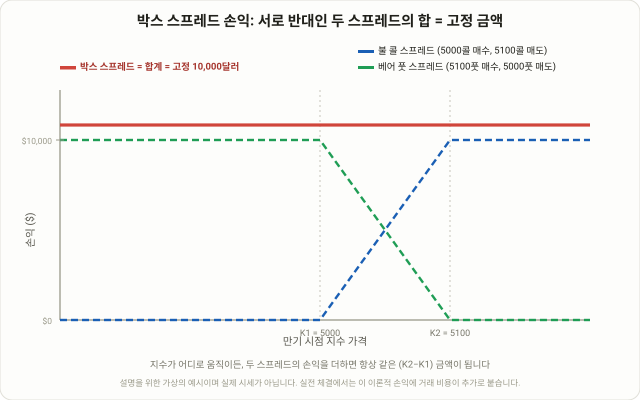

## 옵션 네 개로 "무위험" 지급액을 만든다

최근 미국에서 **BOXX ETF**가 몇 년 사이 수십억 달러 규모로 성장하며 리테일 투자자 사이에서 다시 주목받고 있는 전략이 있습니다. **박스 스프레드(Box Spread)**입니다. 이름만 보면 생소하지만 구조는 단순합니다. 같은 기초자산, 같은 만기에서 행사가가 다른 콜옵션과 풋옵션 네 개를 조합해, 만기 시점에 주가가 어디에 있든 **정확히 같은 금액**이 지급되도록 만드는 포지션입니다. 주가 방향에 대한 베팅이 전혀 아니라는 점에서 이번 강좌의 다른 옵션 전략들과 성격이 다릅니다 — 58강 [아이언콘도르와 크레딧 스프레드](/strategies/iron-condor-credit-spread/)가 "이 범위 안에 머물 것"에 거는 베팅이었다면, 박스 스프레드는 애초에 베팅 자체를 하지 않습니다. 대신 콜옵션 두 개와 풋옵션 두 개가 서로를 정확히 상쇄하도록 짜 맞춰, 만기 지급액 자체를 고정된 숫자로 만들어 버립니다.

왜 이게 중요할까요. 지급액이 고정돼 있다는 것은, 이 포지션을 지금 얼마에 살 수 있는지와 만기에 얼마를 받는지만 비교하면 **내재된 이자율**을 계산해낼 수 있다는 뜻입니다. 이 내재 이자율이 시중 금리보다 낮으면 "옵션으로 돈을 빌리는" 효과가 나고, 반대로 지금 더 싼 가격에 살 수 있다면 "옵션으로 무위험에 가까운 수익을 받는" 효과가 납니다. 바로 이 두 가지 쓰임이 박스 스프레드를 헤지펀드와 마켓메이커들이 수십 년간 자금 조달 도구로 써온 이유이자, 최근 리테일 자금이 BOXX 같은 ETF를 통해 몰리는 이유입니다.

## 구조: 불 콜 스프레드 + 베어 풋 스프레드

박스 스프레드는 사실 새로운 발명이 아니라, 이미 알고 있는 두 개의 스프레드를 합친 것입니다.

**다리 1~2 — 불 콜 스프레드**: 낮은 행사가(K1) 콜옵션을 매수하고, 높은 행사가(K2) 콜옵션을 매도합니다. 주가가 K2 이상으로 오르면 이 다리만으로 (K2−K1)만큼 이익을 내고, 그 아래에서는 이익이 줄어들거나 0이 됩니다.

**다리 3~4 — 베어 풋 스프레드**: 같은 높은 행사가(K2) 풋옵션을 매수하고, 같은 낮은 행사가(K1) 풋옵션을 매도합니다. 주가가 K1 이하로 떨어지면 이 다리만으로 (K2−K1)만큼 이익을 내고, 그 위에서는 이익이 줄어들거나 0이 됩니다.

네 다리를 동시에 들고 있으면, 만기 시점 주가가 K1보다 낮든, K2보다 높든, 혹은 그 사이 어디든 상관없이 두 스프레드의 손익을 더하면 항상 정확히 (K2−K1)이 나옵니다. 콜 스프레드가 가격이 오를수록 이익이 커지는 구간과, 풋 스프레드가 가격이 내릴수록 이익이 커지는 구간이 정확히 서로의 빈자리를 채우기 때문입니다.

<figure class="diagram">
  
  <figcaption>불 콜 스프레드(파란 점선)와 베어 풋 스프레드(초록 점선)는 주가 구간별로 서로 반대로 움직이지만, 두 손익을 더한 박스 스프레드(빨간 실선)는 주가와 무관하게 항상 같은 금액으로 고정됩니다.</figcaption>
</figure>

## 왜 작동하는가: 풋-콜 패리티가 지급액을 고정시킨다

이 구조가 "우연히 비슷하게 움직이는" 수준이 아니라 **수학적으로 정확히 고정**되는 이유는 풋-콜 패리티(Put-Call Parity)에 있습니다. 같은 행사가·만기의 콜과 풋 가격 사이에는 (콜 가격 − 풋 가격) = (현재가 − 행사가의 현재가치)라는 관계가 성립합니다. 이 관계를 K1과 K2 두 행사가에 각각 적용하고 서로 빼면, 현재가 항이 정확히 상쇄되어 사라지고 남는 것은 (K2−K1)의 현재가치뿐입니다. 즉 주가 항목 자체가 계산에서 완전히 지워지기 때문에, 주가가 어디로 움직이든 포지션 가치에 전혀 영향을 주지 못합니다.

이 성질 때문에 박스 스프레드는 사실상 **합성 제로쿠폰본드(Synthetic Zero-Coupon Bond)**와 동일합니다. 지금 일정 금액을 내고, 만기에 (K2−K1)이라는 고정된 금액을 받는 구조이기 때문입니다. CME와 Cboe 같은 거래소들도 박스 스프레드를 "만기 현금흐름이 고정된 정기예금에 가까운 구조"로 설명합니다. 다만 이 모든 논리는 "가격이 정확하게 매겨져 있다"는 전제 위에서만 성립하며, 실제 시장에서는 호가 스프레드와 체결 비용이 이 이론적 정밀함을 조금씩 갉아먹습니다 — 이 내용은 아래에서 다시 다루겠습니다.

## 실전 예시로 보는 숫자

아래 숫자는 설명을 위한 가상의 예시이며, 실제 시세가 아닙니다. 지수가 5000포인트에 거래되고 있고, 행사가 5000과 5100 사이에 만기 12개월짜리 박스 스프레드를 만든다고 가정하겠습니다.

- **불 콜 스프레드**: 5000 콜 매수, 5100 콜 매도 → 순 비용 약 6,200달러(계약 단위 100 기준으로 환산한 금액)
- **베어 풋 스프레드**: 5100 풋 매수, 5000 풋 매도 → 순 비용 약 3,500달러
- **박스 스프레드 총 순 비용**: 6,200 + 3,500 = **9,700달러**
- **만기 시 고정 지급액**: (5100−5000) × 100 = **10,000달러**, 지수가 3000이든 8000이든 무관하게 동일

9,700달러를 내고 12개월 뒤 10,000달러를 받으므로, 내재 이자율은 (10,000−9,700)/9,700 ≈ **연 3.1%**입니다. 이 숫자를 혼자 떼어놓고 보면 의미가 없고, 반드시 비교 대상이 있어야 합니다. 같은 시점 1년 만기 국채 수익률이 연 4%대라면, 이 박스 스프레드를 사는 것은 국채보다 못한 수익률로 "돈을 빌려주는" 셈이라 매력이 없습니다. 반대로 같은 포지션을 **매도**해서 지금 9,700달러를 받고 만기에 10,000달러를 갚는 구조로 뒤집으면, 연 3.1%짜리 대출을 받는 셈이 됩니다. 리테일 증권사의 일반 마진 대출 금리가 보통 7~10%대인 것과 비교하면, 이 숫자는 꽤 매력적인 조달 비용입니다.

## 롱 박스 vs 숏 박스: 빌려주기와 빌리기

같은 구조를 사고파는 방향만 바꾸면 완전히 다른 용도가 됩니다. 아래 표로 비교합니다.

| 구분 | 롱 박스 (매수) | 숏 박스 (매도) |
|---|---|---|
| 오늘 현금흐름 | 순 비용 지불 (예: −9,700달러) | 순 크레딧 수령 (예: +9,700달러) |
| 만기 현금흐름 | 고정 금액 수령 (+10,000달러) | 고정 금액 지불 (−10,000달러) |
| 경제적 효과 | 돈을 빌려주는 것과 동일 | 돈을 빌리는 것과 동일 |
| 주로 쓰는 주체 | 수익률을 국채·현금과 비교하는 투자자, BOXX류 ETF | 마진 대출보다 싼 조달을 원하는 트레이더, 레버리지 확보 목적 |
| 매력적인 조건 | 내재 이자율이 국채 수익률보다 높을 때 | 내재 이자율이 마진 대출 금리보다 낮을 때 |
| 핵심 리스크 | 체결 비용이 이자율 우위를 갚아먹음 | 조기 배정·마진콜로 포지션이 강제로 풀릴 위험 |

이 표에서 눈여겨볼 부분은, 롱 박스와 숏 박스 둘 다 "박스 스프레드가 싸다·비싸다"를 판단할 절대적인 기준이 없다는 점입니다. 항상 **대안과 비교**해야 의미가 생깁니다. 롱 박스는 국채나 예금과 비교하고, 숏 박스는 마진 대출이나 증권담보대출과 비교합니다. 둘 중 어느 쪽이든 비교 대상보다 조건이 나을 때만 실행할 이유가 생기지, 박스 스프레드 자체에 고유한 "공짜 수익"이 있는 것은 아닙니다.

## 왜 "완벽한" 무위험이 아닌가: 비용과 리스크

이론상 박스 스프레드는 주가 리스크가 없습니다. 하지만 실전에서 완전한 무위험이라고 말하면 틀린 설명입니다.

- **체결 비용이 작은 이자율 차이를 쉽게 삼켜 버립니다.** 네 개 다리를 동시에 체결해야 하고, 각 다리마다 매수·매도 호가 스프레드가 존재합니다. 이론적으로 계산한 3.1%짜리 이점이, 실제 체결가 기준으로는 거래 비용만으로 상당 부분 사라질 수 있습니다.
- **미국식 옵션은 조기 배정 위험이 있습니다.** 개별 종목 옵션은 대부분 미국식이라 만기 전에 언제든 배정될 수 있고, 배정이 일어나면 네 다리의 균형이 깨지면서 고정 지급액이라는 전제 자체가 무너집니다. 이 때문에 박스 스프레드는 보통 SPX 같은 **현금 정산, 유럽식(European-style)** 지수 옵션으로 만듭니다 — 조기 배정이 구조적으로 불가능하기 때문입니다.
- **포지션을 중간에 청산하기가 쉽지 않습니다.** 네 다리를 한 번에 체결하는 것보다 한 번에 되돌리는 것이 더 어려운 경우가 많고, 만기 전 자금이 필요해지면 불리한 가격에 풀어야 할 수 있습니다.
- **증권사의 마진 처리 방식에 따라 결과가 크게 달라집니다.** 숏 박스를 "저비용 대출"로 쓰려는 경우, 증권사가 이 포지션을 정의된 리스크 조합으로 인정해 적절한 마진만 요구하는지, 아니면 각 다리를 개별적으로 취급해 훨씬 많은 담보를 요구하는지에 따라 실제로 쓸 수 있는 전략인지가 갈립니다.
- **거래소·감독기관의 관심 대상이기도 합니다.** 박스 스프레드는 원래 기관과 마켓메이커들이 주로 쓰던 구조이며, 레버리지 확보 목적으로 과도하게 쓰일 경우 규제 당국의 점검 대상이 되어 온 사례도 있습니다. 평범한 리테일 계좌에서는 접근 자체가 제한적인 증권사도 많습니다.

이 리스크들을 종합하면, 박스 스프레드는 "이론적으로는 고정, 실무적으로는 거의 고정"에 가깝습니다. 이론과 실전 사이의 그 작은 틈이 바로 거래 비용과 체결 리스크이며, 이 틈을 과소평가하면 생각보다 매력이 떨어지는 거래가 됩니다.

## BOXX ETF와 리테일 접근법

개별 투자자가 박스 스프레드를 직접 네 다리로 체결하는 것은 번거롭고, 호가 스프레드 때문에 소액으로는 비효율적입니다. 이 틈을 파고든 것이 **BOXX**(Alpha Architect 1-3 Month Box ETF) 같은 상품입니다. 실제 국채나 채권을 보유하는 대신, SPX 옵션 중심으로 박스 스프레드를 지속적으로 굴려 만기가 짧은 국채와 비슷한 수익률을 복제하는 구조입니다. 리테일 투자자 입장에서 매력적인 이유는 수익률 자체보다 **세금 처리**에 있다는 설명이 많습니다 — 국채 ETF나 머니마켓 펀드는 매년 이자 소득을 배당으로 지급해 그해 과세되지만, BOXX는 매도 전까지 과세를 미루는 가격 상승 형태로 수익이 쌓이는 구조이기 때문입니다. 다만 세금 처리는 투자자의 계좌 종류와 거주 국가, 법 개정에 따라 달라질 수 있는 영역이므로, 이 글의 설명을 일반적인 원리 설명으로만 받아들이고 실제 적용 전에는 세무 전문가와 상담하는 편이 안전합니다.

BOXX 같은 ETF는 또한 국채 ETF보다 보수(운용 비용)가 더 높은 경우가 많고, 수익률이 실제 국채 수익률이 아니라 **옵션 시장에서 형성되는 내재 이자율**을 따라간다는 점도 기억해야 합니다. 평소에는 두 수익률이 비슷하게 움직이지만, 옵션 시장의 유동성이 일시적으로 얇아지는 구간에서는 차이가 벌어질 수 있습니다. 106강 [트레저리 베이시스 트레이드](/strategies/treasury-basis-trade-repo-arbitrage/)에서 다룬 것처럼, 아주 작은 가격 차이를 레버리지로 증폭시켜 수익을 만드는 구조들은 평소에는 조용히 작동하다가, 시장이 흔들리는 특정 구간에서 그 밑바탕이 되는 시장 자체의 유동성 조건에 묶여 갑자기 삐걱거릴 수 있다는 공통된 교훈을 기억해 둘 필요가 있습니다.

## 자주 묻는 질문

### 박스 스프레드는 정말 100% 무위험인가요?
이론적인 지급액 자체는 주가와 무관하게 고정되지만, 실제 거래에서는 체결 비용과 호가 스프레드, 조기 배정 가능성(개별 종목 옵션일 경우) 때문에 완벽한 무위험이라고 말하기는 어렵습니다. "거의 고정"에 가깝다고 보는 편이 정확합니다.

### 왜 SPX 같은 지수 옵션으로 만드는 게 좋은가요?
SPX, XSP 같은 지수 옵션은 유럽식(만기에만 행사 가능)이고 현금으로 정산되기 때문에 조기 배정 위험이 원천적으로 없습니다. 개별 종목 옵션은 미국식이라 만기 전 언제든 배정될 수 있어, 박스 스프레드의 핵심 전제인 "고정 지급액"이 깨질 수 있습니다.

### 리테일 투자자가 직접 박스 스프레드를 체결해도 되나요?
가능하지만 네 다리를 동시에 좋은 가격에 체결해야 하고, 증권사의 마진 처리 방식도 확인해야 합니다. 계좌 규모가 작을수록 호가 스프레드 비용이 이론적 이점을 크게 깎아먹기 때문에, BOXX 같은 ETF로 간접적으로 접근하는 편이 현실적인 경우가 많습니다.

## 정리

- 박스 스프레드는 불 콜 스프레드와 베어 풋 스프레드를 같은 행사가·만기로 합쳐, 만기 지급액을 주가와 무관하게 (K2−K1)으로 고정시키는 옵션 구조입니다.
- 이 고정은 풋-콜 패리티에서 수학적으로 도출되며, 사실상 합성 제로쿠폰본드와 같은 역할을 합니다 — 지금 돈을 내고 만기에 정해진 금액을 받는 구조입니다.
- 매수(롱 박스)는 국채·예금과 비교할 대상이 되는 "빌려주기" 거래이고, 매도(숏 박스)는 마진 대출과 비교할 "빌리기" 거래입니다. 어느 쪽도 절대적으로 유리하지 않으며 항상 대안과 비교해서 판단해야 합니다.
- 완벽한 무위험은 아닙니다. 체결 비용, 조기 배정 위험(개별 종목 옵션의 경우), 청산 난이도, 증권사 마진 처리 방식이 모두 이론적인 이점을 깎아먹을 수 있는 변수입니다.
- BOXX 같은 ETF는 이 구조를 SPX 옵션으로 지속적으로 굴려 리테일 투자자가 간접적으로 접근할 수 있게 해주지만, 운용 비용과 옵션 시장 유동성 조건에 여전히 노출돼 있다는 점은 그대로입니다.
