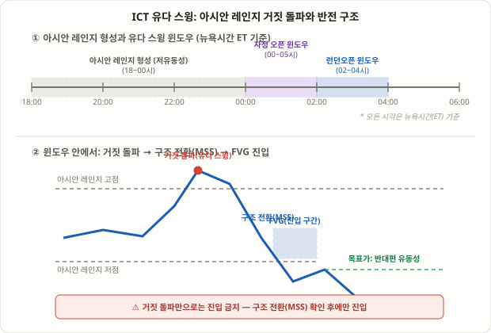

## 유다 스윙이란: 세션 오픈의 "가짜 신호"를 역이용하는 법

**유다 스윙(Judas Swing)**은 ICT(Inner Circle Trader) 계열에서 쓰는 이름으로, 성경에서 배신자 유다가 신뢰를 얻은 뒤 등을 돌린 일화에서 따온 용어입니다. 트레이딩에서는 주요 세션이 열리는 순간 가격이 먼저 한쪽 방향으로 뚜렷하게 움직여 "이게 오늘의 추세다"라는 확신을 심어준 뒤, 그 확신이 퍼지는 순간 정반대 방향으로 돌아서는 현상을 가리킵니다. 5강 [ICT 스마트머니 컨셉 기초](/strategies/ict-smart-money-basics/)에서 배운 유동성 스윕의 한 형태이지만, 유다 스윙은 "언제·어디서" 그 스윕이 나오는지를 세션 오픈이라는 구체적인 시점과 아시안 레인지라는 구체적인 기준선에 묶어놓은 이름 붙은 패턴이라는 점이 다릅니다.

7강 [PO3와 Confirm DOL](/strategies/po3-confirm-dol/)에서 다룬 축적-조작-분산(AMD) 사이클을 떠올려보면, 유다 스윙은 정확히 그 가운데 단계인 "조작(Manipulation)"을 확대해서 들여다보는 렌즈에 해당합니다. PO3가 하루 전체의 구조를 설명하는 큰 그림이라면, 유다 스윙은 그 조작 구간에서 실제로 어떤 레벨이 깨지고, 어떤 캔들로 반전이 확인되는지를 훨씬 구체적인 규칙으로 정의합니다.

## 왜 이런 거짓 움직임이 반복해서 나타나는가

이 현상이 커뮤니티에서 반복적으로 관찰되는 데에는 두 가지 구조적 이유가 거론됩니다. 첫째, 아시안 세션(도쿄·시드니 시간대)은 거래량이 상대적으로 얇아 좁은 박스권(레인지)을 만드는 경우가 많습니다. 이 레인지의 고점과 저점 바로 바깥에는 레인지 안에서 물린 트레이더들의 손절 주문과, 돌파를 노리는 브레이크아웃 트레이더들의 신규 진입 주문이 쌓이기 쉽습니다. 둘째, 런던이나 뉴욕처럼 거래량이 많은 시장이 열리는 순간, 이 얇은 레인지를 살짝 뚫는 정도의 움직임만으로도 쌓여 있던 주문들을 연쇄적으로 체결시킬 수 있습니다. 즉 "진짜 추세"가 시작되기 전에, 상대적으로 적은 자금으로도 레인지 바깥의 유동성을 흡수할 수 있는 구조적 틈이 생기는 것입니다.

이 설명이 전제하는 것은 대형 참가자가 이 틈을 의도적으로 노린다는 가정이며, 이는 ICT/SMC 계열 전체가 공유하는 전제이지 학계에서 검증된 사실이 아닙니다. 다만 결과로 나타나는 패턴 자체—세션 오픈 직후의 거짓 돌파와 급격한 반전—는 여러 트레이더 커뮤니티에서 반복적으로 보고되는 관찰이라는 점은 분명히 해둘 필요가 있습니다.

## 세 가지 시간 변형: 자정 오픈·런던 오픈·뉴욕 오픈

유다 스윙을 언제로 정의하느냐는 자료마다 다릅니다. 가장 흔히 언급되는 세 가지 변형은 다음과 같습니다.

| 변형 | 시간대(ET, 뉴욕시간) | 기준 레인지 |
|---|---|---|
| 자정 오픈(Midnight Open) | 00:00~05:00 | 자정 시가 또는 아시안 레인지 고/저점 |
| 런던 오픈 | 02:00~04:00 (일부는 03:00~05:00) | 아시안 세션 고/저점 |
| 뉴욕 오픈 | 09:30 전후 | 전일 종가 또는 프리마켓 레인지 |

<figure class="diagram">
  
  <figcaption>아시안 레인지의 고점 또는 저점을 거짓 돌파하는 움직임이 유다 스윙이며, 구조 전환(MSS) 확인 후 되돌림 구간(FVG)에서 반대 방향으로 진입합니다.</figcaption>
</figure>

세 변형 모두 "앞선 저유동성 구간에서 만들어진 레인지"와 "거래량이 몰리는 세션의 오픈"이라는 두 요소를 짝지어 쓴다는 공통점이 있습니다. 어느 변형을 쓰든, 반드시 기준이 되는 레인지(아시안 레인지, 자정 시가, 전일 종가 등)를 먼저 명확히 정의해야 "거짓 돌파"라고 판단할 기준점이 생긴다는 점이 핵심입니다.

## 실전 진입 로직: 레퍼런스 레인지 → 거짓 돌파 → 구조 전환 → FVG 진입

유다 스윙을 실제 매매로 옮기는 과정은 다음 네 단계로 정리됩니다.

1. **레퍼런스 레인지 확정**: 세션이 시작되기 전, 아시안 레인지의 고점·저점(또는 자정 시가)을 명확한 숫자로 표시해둡니다. 이 레벨이 없으면 "거짓 돌파"를 판단할 기준 자체가 없습니다.
2. **거짓 돌파 대기**: 윈도우가 열리면, 가격이 이 레벨을 살짝 뚫고 올라가거나(또는 내려가서) 그 안에 쌓여 있던 주문을 체결시키는 움직임을 기다립니다. 이 단계만으로는 아직 "유다 스윙"이라고 확정할 수 없습니다 — 진짜 돌파일 가능성도 있기 때문입니다.
3. **구조 전환(MSS/CHoCH) 확인**: 거짓 돌파 이후, 저시간대(1분~15분봉)에서 직전 스윙 구조가 반대 방향으로 깨지는 모습이 나와야 합니다. 48강 [BOS와 CHoCH](/strategies/market-structure-bos-choch/)에서 다룬 개념 그대로, 이 구조 전환이 나와야 비로소 "방금 그 돌파는 가짜였고 진짜 방향은 반대"라는 확인이 됩니다. 구조 전환 없이 돌파 직후 바로 반대 방향에 진입하는 것은 권장되지 않습니다.
4. **FVG·오더블록 되돌림 진입**: 구조 전환을 만든 캔들이 남긴 FVG 또는 오더블록으로 가격이 되돌아올 때 진입합니다. 손절은 거짓 돌파가 찍은 극단(고점 또는 저점) 바로 바깥에 둡니다. 목표가는 레퍼런스 레인지의 반대쪽 끝, 즉 거짓 돌파가 노린 유동성의 반대편 유동성입니다.

이 네 단계 중 2번과 3번의 순서를 지키는 것이 특히 중요합니다. 거짓 돌파가 나왔다는 사실 하나만으로 진입하면, 그 돌파가 정말 반전으로 이어질지 아니면 그대로 추세가 이어질지 구분할 수 없는 상태에서 베팅하는 셈이 됩니다.

## 숫자로 보는 실전 예시: EURUSD 자정 오픈 윈도우

전일 일봉이 하락 구조(저점·고점이 계속 낮아지는 패턴)를 보여 매도 편향이 우세한 상황을 가정합니다.

1. **아시안 세션(18:00~00:00 ET)**: EURUSD가 1.0820(저점)~1.0845(고점) 사이에서 좁게 횡보 — 아시안 레인지 확정.
2. **00:15**: 자정 오픈 윈도우가 열리자 가격이 1.0855까지 치솟아 아시안 레인지 고점을 돌파 — 돌파 추종 매수와 레인지 안 숏 포지션의 손절 주문이 동시에 체결.
3. **00:22**: 5분봉에서 직전 스윙로우를 하방으로 깨는 구조 전환(MSS)이 발생 — "방금 돌파는 거짓이었고 실제 방향은 하락"이라는 확인.
4. **00:31**: 반전 캔들이 남긴 FVG(1.0838~1.0843) 구간으로 되돌림 — 1.0840에서 숏 진입, 손절은 거짓 돌파 극단 바로 위인 1.0858(18핍 리스크).
5. **목표가**: 1차 목표는 아시안 레인지 저점 1.0820(20핍, 손익비 약 1.1:1), 확장 목표는 전일 저점 1.0795(45핍, 손익비 약 2.5:1).
6. **01:40**: 가격이 1.0797까지 하락해 확장 목표 부근에서 잔여 물량 청산.

만약 2번 단계의 거짓 돌파 이후 3번의 구조 전환이 나오지 않고 가격이 1.0855 위에서 계속 신고가를 이어갔다면, 이는 유다 스윙이 아니라 그냥 진짜 상승 돌파였을 가능성이 크므로 숏 진입은 보류해야 합니다.

## 유다 스윙 vs 실버불릿: 무엇이 다른가

54강에서 다룬 [ICT 실버불릿](/strategies/ict-silver-bullet-strategy/)과 유다 스윙은 둘 다 ICT 계열의 시간 기반 프레임워크지만 묻는 질문이 다릅니다.

| 구분 | 유다 스윙 | 실버불릿 |
|---|---|---|
| 핵심 질문 | "이 돌파가 진짜인가, 가짜인가?" | "지금이 진입을 검토해도 되는 시간인가?" |
| 기준선 | 아시안 레인지 고/저점, 자정 시가 | 없음(시간 창 자체가 필터) |
| 필수 확인 | 거짓 돌파 + 구조 전환(MSS/CHoCH) | 유동성 스윕 + 디스플레이스먼트 캔들 |
| 진입 방향 | 거짓 돌파의 반대 방향 | HTF 바이어스와 같은 방향 |
| 주로 쓰는 시간 | 자정 오픈·런던 오픈(00~05시) | 런던오픈·AM·PM 3개 고정 창 |

실전에서는 두 개가 상호 배타적이지 않습니다. 유다 스윙으로 "이 시점의 돌파가 가짜였다"는 방향성 확인을 얻은 뒤, 그 반전이 이어지는 후속 구간에서 실버불릿의 스윕+FVG 로직으로 재진입을 노리는 식으로 이어붙이는 경우도 흔합니다. 또한 77강 [터틀 수프](/strategies/turtle-soup-false-breakout-fade/)와도 "거짓 돌파를 역이용한다"는 발상을 공유하지만, 터틀 수프는 20일 고점·저점이라는 일봉 기준 레벨을 쓰고 특정 시간대에 묶여 있지 않다는 점에서 유다 스윙과 구분됩니다.

## 자주 묻는 질문

### 유다 스윙은 매일 나타나나요?
아닙니다. 세션이 열릴 때 레인지를 살짝 건드리는 정도로 끝나거나, 아예 거짓 돌파 없이 한 방향으로 곧게 움직이는 날도 많습니다. 조건(레퍼런스 레인지 돌파 + 구조 전환)이 갖춰지지 않으면 그날은 거래하지 않는 것이 원칙입니다.

### 손절은 정확히 어디에 둬야 하나요?
거짓 돌파가 찍은 극단값(스윕의 고점 또는 저점) 바로 바깥입니다. 스윕의 심지(wick) 안쪽에 너무 가깝게 두면, 가격이 재차 그 구간을 건드리는 2차 변동에 쉽게 걸릴 수 있습니다.

### 검증된 승률이나 손익비 통계가 있나요?
공신력 있는 기관이 발표한 백테스트 통계는 없습니다. 인터넷에서 돌아다니는 특정 승률 수치는 대부분 지표·강의를 판매하는 업체의 자체 마케팅 자료에서 나온 것으로, 독립적으로 검증되지 않았습니다. 이 강의에서 제시한 핍·손익비 수치도 개념 설명을 위한 예시일 뿐, 보장된 결과가 아닙니다.

## 한계와 유의점

- **학계 검증이 없는 경험칙**: 유다 스윙 역시 ICT/SMC 계열 전반과 마찬가지로 관찰과 커뮤니티 경험에 기반한 프레임워크이며, 통계적으로 입증된 우위라는 근거는 없습니다.
- **"가짜의 가짜" 위험**: 거짓 돌파처럼 보였던 움직임이 구조 전환 없이 그대로 진짜 추세로 이어지는 경우가 있습니다. 2번 단계만 보고 3번 구조 전환을 건너뛰면 역추세 함정에 빠질 수 있습니다.
- **손절이 재차 걸리는 변동성**: 커뮤니티에서는 목표가 근처까지 갔다가 다시 손절로 돌아오는 경우가 드물지 않다고 보고합니다. 이는 유다 스윙 특유의 급격한 변동성 구간이라는 성격과 맞닿아 있습니다.
- **뉴스 발표와의 충돌**: 특히 뉴욕 오픈 변형은 미국 경제지표 발표 시간대와 겹칠 수 있어, 거짓 돌파와 뉴스 변동성을 구분하기 어려워집니다.
- **표준화 부재**: 시간대 정의(00~05시 vs 02~04시 vs 09:30 전후)가 자료마다 다릅니다. 자신이 쓰는 기준을 명확히 정하고 일관되게 적용해야 합니다.

## 정리

- 유다 스윙은 세션 오픈 직후 가격이 아시안 레인지(또는 자정 시가) 바깥을 거짓으로 돌파해 손절·추격매수 물량을 흡수한 뒤 반대 방향으로 반전하는 패턴입니다.
- 가장 흔한 시간 변형은 자정 오픈(00~05시 ET)과 런던 오픈(02~04시 ET)이며, 두 경우 모두 "앞선 아시안 레인지"와 "거래량이 몰리는 세션 오픈"을 짝지어 씁니다.
- 실전 진입은 **레퍼런스 레인지 확정 → 거짓 돌파 대기 → 구조 전환(MSS/CHoCH) 확인 → FVG·오더블록 되돌림 진입**의 4단계를 따르며, 구조 전환 확인을 건너뛰지 않는 것이 핵심입니다.
- 실버불릿과는 "언제 진입을 검토할지"가 아니라 "이 돌파가 진짜인지 가짜인지"를 판단하는 데 초점이 있다는 점에서 역할이 다르며, 둘을 이어붙여 쓰는 경우도 흔합니다.
- 검증된 승률·손익비 통계는 존재하지 않으므로, 제시된 숫자는 모두 개념 설명용 예시로 받아들이고 독립적인 손절·자금관리 규칙을 반드시 함께 적용해야 합니다.
