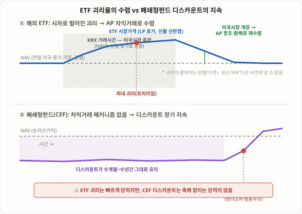

## ETF 괴리율이란: 시장가와 NAV는 왜 다른가

ETF를 매수할 때 화면에 찍히는 가격은 그 ETF가 들고 있는 자산의 '진짜 가치'와 항상 같지 않습니다. 이 둘의 차이를 **괴리율**이라고 부르며, 공식은 간단합니다.

```
괴리율(%) = (시장가격 − NAV) / NAV × 100
```

시장가격이 NAV보다 높으면 **프리미엄**(양수), 낮으면 **디스카운트**(음수)입니다. NAV(Net Asset Value, 순자산가치)는 ETF가 보유한 자산의 가치를 발행 주식 수로 나눈 값으로, 하루 한 번 장 마감 후 확정됩니다. 장중에는 거래소가 전일 자산 구성을 기반으로 추정한 **iNAV(실시간 추정 NAV)**를 몇 초 단위로 제공하는데, 투자자들이 흔히 "NAV랑 비교했다"고 말할 때 실제로는 확정 NAV가 아니라 이 iNAV와 비교하는 경우가 많습니다. 이 차이를 구분하지 않으면 괴리율을 잘못 해석하기 쉽습니다.

## 가격이 NAV로 되돌아오는 이유: AP 차익거래 메커니즘

일반 주식과 달리 ETF는 가격이 NAV에서 크게, 오래 벗어나기 어려운 구조를 갖고 있습니다. 그 핵심은 **지정참가회사(AP, Authorized Participant)**라는 특수한 참가자입니다. AP는 운용사와 직접 거래할 수 있는 대형 증권사로, 다음과 같은 방식으로 가격을 NAV 쪽으로 끌어당깁니다.

- **ETF가 NAV보다 비쌀 때(프리미엄)**: AP는 ETF가 추종하는 바스켓(개별 종목들)을 시장에서 사 모아 운용사에 납입하고, 그 대가로 새 ETF 주식(창조, creation)을 받아 시장에 비싼 값으로 팝니다. 이 매도 물량이 늘면서 ETF 가격은 다시 내려갑니다.
- **ETF가 NAV보다 쌀 때(디스카운트)**: AP는 싼 ETF 주식을 시장에서 사 모아 운용사에 돌려주고(환매, redemption), 그 대가로 바스켓 종목들을 받아 시장에 제값으로 팝니다. ETF를 사들이는 수요가 늘면서 가격은 다시 올라갑니다.

이 창조·환매 과정이 수수료를 제외하면 거의 무위험 차익거래이기 때문에, AP들은 괴리가 벌어질 때마다 이를 메우는 유인을 갖습니다. 이것이 ETF 가격이 액티브 펀드나 개별 종목보다 훨씬 자주 NAV에 수렴하는 근본적인 이유입니다. 다만 이 메커니즘이 모든 상황에서 똑같이 잘 작동하는 것은 아니라는 점이 이번 강의의 핵심입니다.

## 왜 해외·레버리지 ETF는 괴리율이 유독 크게 벌어지는가

국내 거래소(KRX)에 상장된 ETF라도 추종하는 기초자산이 해외 시장에 있다면 괴리율이 구조적으로 커지는 구간이 생깁니다. 이유는 세 가지입니다.

1. **시차로 인한 NAV 동결**: 국내 투자자가 미국 지수를 추종하는 ETF를 한국 장중(09:00~15:30)에 거래할 때, 미국 시장은 그 시각 닫혀 있습니다. 공식 NAV는 전일 미국 종가를 기준으로 고정되어 있는 반면, ETF의 실제 시장가격은 미국 지수선물이나 해외 ETF 호가 등 실시간 정보를 반영해 계속 움직입니다. 밤사이 미국 지수가 크게 움직였다면, 한국 장중 NAV는 그 사실을 아직 반영하지 못한 "어제 가격"이고, 시장가격은 이를 선반영하면서 괴리가 벌어집니다.
2. **유동성공급자(LP)의 헤지 수단 제약**: LP는 보통 해외 지수선물이나 상관자산으로 헤지하며 호가를 제시하는데, 그 헤지 수단의 거래시간이나 유동성이 기초자산과 정확히 일치하지 않으면 호가 스프레드가 넓어지고 괴리가 확대됩니다.
3. **레버리지·인버스 구조의 비선형성**: 2배 레버리지나 인버스 ETF는 일간 수익률을 복제하도록 설계되어 있어, 일중 변동성이 커질수록 괴리율도 함께 확대되는 경향이 있다고 거래소와 운용사들이 공통적으로 안내합니다. 이는 상품 설계 자체의 특성이지, 특정 투자자가 이용할 수 있는 예측 가능한 패턴은 아닙니다.

| ETF 유형 | 괴리율이 커지는 주된 이유 | 일반적 괴리율 변동성 |
|---|---|---|
| 국내 자산 추종 ETF | 장중 실시간 가격 반영, 상대적으로 작음 | 낮음 |
| 해외 자산 추종 ETF | 시차로 인한 NAV 동결, 환율 변동 | 중간~높음 |
| 레버리지·인버스 ETF | 일중 변동성 확대 시 비선형적으로 커짐 | 높음 |
| 원자재·선물 기반 ETF | 롤오버 시점 괴리, 현지 시장과의 시차 | 중간~높음 |

<figure class="diagram">
  
  <figcaption>해외 ETF의 야간 괴리는 미국 시장이 다시 열리면 AP 차익거래로 좁혀지지만, 폐쇄형펀드의 디스카운트는 차익거래 메커니즘 자체가 없어 외부 촉매 없이는 오래 지속됩니다.</figcaption>
</figure>

## 숫자로 보는 예시: 코스피 상장 미국지수 추종 ETF

아래 수치는 메커니즘을 이해하기 위한 가상의 예시이며, 특정 종목의 실제 데이터가 아닙니다.

1. **전일 미국 장 마감**: 나스닥100 지수가 1.2% 상승 마감. 이를 추종하는 국내 상장 ETF의 확정 NAV는 이 종가를 기준으로 오늘 아침 10,000원으로 계산됩니다.
2. **간밤 미국 지수선물 추가 상승**: 아시아 시간대에 나스닥100 선물이 추가로 0.8% 올랐다는 정보가 시장에 반영됩니다.
3. **한국 장 개장(09:00)**: ETF의 공식 NAV는 여전히 전일 종가 기준 10,000원(아직 동결)이지만, LP는 선물 상승분을 반영해 10,080원 근처에서 호가를 제시합니다. 괴리율은 약 +0.8%.
4. **장중 변동성 확대**: 오전 중 환율이 급변동하며 호가 스프레드가 넓어지고, 일부 구간에서 괴리율이 +1.3%까지 확대됩니다.
5. **미국 시장 개장(밤 23:30)**: 나스닥100이 실제로 전일 선물 움직임과 비슷하게 시작하면서 다음 날 확정 NAV가 이를 반영해 재계산됩니다. 괴리는 해소되지만, 방향은 "ETF 가격이 내려가서" 좁혀질 수도 있고 "NAV가 올라와서" 좁혀질 수도 있습니다 — 괴리가 줄어든다는 사실 자체가 수익의 방향을 보장하지는 않습니다.

이 예시에서 중요한 것은 +0.8%라는 숫자가 아니라, **괴리가 "틀린 가격"이 아니라 "아직 업데이트되지 않은 기준값과 이미 반영된 새 정보 사이의 시차"에서 나온다**는 구조입니다.

## ETF 괴리율 아비트라지 vs 폐쇄형펀드(CEF) 디스카운트: 무엇이 다른가

ETF의 프리미엄·디스카운트와 자주 혼동되는 개념이 **폐쇄형펀드(Closed-End Fund, CEF)의 디스카운트**입니다. 둘 다 "시장가와 순자산가치가 다르다"는 현상이지만, 왜 그 차이가 생기고 얼마나 오래 유지되는지는 완전히 다릅니다.

| 구분 | ETF 괴리율 | 폐쇄형펀드(CEF) 디스카운트 |
|---|---|---|
| 차익거래 메커니즘 | AP 창조·환매로 상시 작동 | 공식 메커니즘 없음 |
| 괴리 지속 기간 | 보통 몇 시간~며칠 내 수렴 | 수개월~수년간 지속 가능 |
| 괴리가 좁혀지는 조건 | 기초시장 재개장, 정상적 차익거래 | 탠더오퍼, 행동주의 캠페인, 청산·개방형 전환 |
| 주된 원인 | 시차, 유동성, 상품 구조(레버리지) | 투자자 수급, 운용사 신뢰도, 세금·배당 이슈 |
| 개인 투자자 활용 여지 | 제한적(괴리가 빨리 닫혀서 수익 기회가 짧음) | 상대적으로 큼(디스카운트가 오래 유지돼 분석 시간 확보) |

이 비교가 주는 실전 시사점은 분명합니다. ETF의 일시적 괴리를 "저가 매수 기회"로 접근하는 전략은, AP 차익거래가 이미 그 틈을 빠르게 메우고 있다는 사실과 경쟁해야 합니다. 반면 CEF의 디스카운트는 이를 강제로 좁힐 메커니즘이 원천적으로 없기 때문에, 디스카운트의 '이유'(운용 성과 저조, 배당 삭감 우려, 단순 수급 불균형)를 분석하고 좁혀질 촉매(탠더오퍼 압박, 이사회 교체 요구 등)를 기다리는 것이 더 합리적인 접근으로 거론됩니다.

## 실전 체크포인트

- **어떤 NAV와 비교하는지 먼저 확인**: 장중 iNAV는 전일 데이터를 기반으로 한 추정치일 수 있습니다. 확정 NAV와 혼동하면 괴리율을 과대·과소 해석하게 됩니다.
- **괴리가 큰 구간에서는 거래를 피하거나 소량으로**: 특히 레버리지·인버스 상품은 괴리율 자체가 변동성이 커서, 괴리가 "비정상적으로 큰" 시점에 거래하면 가격 변동 리스크에 불필요하게 노출됩니다.
- **호가 스프레드와 거래량도 함께 확인**: 괴리율만 보고 판단하지 말고, LP가 제시하는 매수·매도 스프레드가 비정상적으로 넓어졌는지도 함께 봐야 합니다.
- **대량 주문은 별도로 문의**: 창조단위(creation unit) 규모에 가까운 대량 주문은 운용사나 지정참가회사에 직접 문의하는 것이 일반적인 권장 사항입니다.
- **91강과의 연결**: [싱글스톡 커버드콜 ETF 분배율의 함정](/strategies/single-stock-covered-call-etf-decay/)에서 다룬 NAV 디케이는 괴리율과는 다른 문제(상품 구조 자체의 가치 소모)이지만, "ETF 가격표가 보여주는 숫자와 실제 받는 가치가 다를 수 있다"는 공통된 경계심을 요구합니다.

## 자주 묻는 질문

### 괴리율이 몇 % 이상이면 위험한 신호인가요?
업계에 통일된 기준은 없습니다. 일부 블로그나 커뮤니티에서 "3~5% 이상이면 주의"라는 식의 수치가 돌아다니지만, 이는 검증된 기준이 아니라 개인의 경험적 판단입니다. 중요한 것은 특정 ETF의 평소 괴리율 범위를 스스로 관찰해두고, 그 범위를 벗어났을 때 원인(시차, 뉴스, 유동성 부족)을 먼저 확인하는 습관입니다.

### 괴리율이 줄어들면 무조건 수익이 나나요?
아닙니다. 괴리가 프리미엄에서 좁혀지는 경로는 두 가지입니다 — ETF 가격이 NAV 쪽으로 내려오거나, NAV가 ETF 가격 쪽으로 올라오거나. 전자라면 프리미엄에 산 투자자는 오히려 손실을 봅니다. 괴리율 축소와 수익 방향은 별개의 문제입니다.

### 국내 자산만 담은 ETF도 괴리율이 생기나요?
네, 다만 보통 훨씬 작습니다. 기초자산이 같은 거래소에서 실시간으로 거래되기 때문에 NAV와 시장가가 거의 동시에 움직이고, AP 차익거래도 더 즉각적으로 작동하는 경향이 있습니다.

## 한계와 유의점

- **차익거래가 항상 작동한다는 보장은 없음**: 채권형 ETF처럼 기초자산 자체의 유동성이 낮은 경우, 학술 연구에서도 창조·환매가 ETF 보유 자산의 일부에만 이뤄져 괴리가 더 느리게 좁혀질 수 있다고 지적합니다.
- **스프레드 비용이 차익거래를 막을 수 있음**: 호가 스프레드가 넓은 ETF는 AP가 차익거래에 나설 유인이 줄어들어, 괴리가 눈에 보이는데도 쉽게 좁혀지지 않는 경우가 보고됩니다.
- **괴리율 매매는 검증된 '전략'이 아니라 '점검 습관'에 더 가까움**: 이 강의에서 다룬 체크포인트들은 괴리를 이용해 초과수익을 낸다고 보장하는 백테스트 결과가 아니라, 불리한 가격에 거래하지 않기 위한 방어적 점검 절차로 받아들여야 합니다.
- **환율·세금 이슈와 혼동 주의**: 해외자산 ETF의 괴리는 환헤지 여부, 환율 변동과도 얽혀 있어, 순수한 괴리율만 분리해서 보기 어려운 경우가 많습니다.

## 정리

- **괴리율** = (시장가격 − NAV) / NAV × 100이며, 양수면 프리미엄, 음수면 디스카운트입니다.
- ETF 가격이 NAV에 수렴하는 것은 **AP(지정참가회사)의 창조·환매 차익거래** 때문이며, 이 메커니즘이 ETF를 일반 펀드보다 가격 효율적으로 만드는 핵심 구조입니다.
- 해외 자산을 추종하는 국내 ETF는 **시차로 인한 NAV 동결**, 레버리지·인버스 상품은 **일중 변동성의 비선형적 영향**으로 괴리율이 더 크고 자주 벌어집니다.
- **폐쇄형펀드(CEF)의 디스카운트**는 ETF와 달리 공식 차익거래 메커니즘이 없어 수개월~수년간 지속될 수 있으며, 외부 촉매(탠더오퍼, 행동주의) 없이는 좁혀지지 않는다는 점에서 ETF 괴리율과 본질적으로 다른 현상입니다.
- 괴리율이 줄어든다는 사실 자체가 수익 방향을 보장하지 않으므로, 어떤 NAV와 비교 중인지, 호가 스프레드가 정상인지를 먼저 확인하는 방어적 체크 습관으로 접근하는 것이 바람직합니다.
