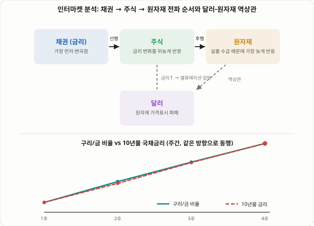

## 종목 하나만 보지 말고, 자산군 네 개를 함께 본다

이 강좌에서 다룬 전략들은 대부분 하나의 차트, 하나의 종목, 하나의 지표에서 출발합니다. 하지만 실제로 주식 가격을 움직이는 힘은 주식시장 안에만 있지 않습니다. 금리가 오르면 주식의 밸류에이션이 눌리고, 달러가 강해지면 원자재 가격이 무너지고, 원자재가 오르면 인플레이션 기대가 바뀌어 다시 금리에 영향을 줍니다. 이렇게 **채권·주식·원자재·통화(주로 달러)** 네 자산군이 서로 주고받는 관계를 함께 읽는 분석법을 **인터마켓 분석(Intermarket Analysis)**이라고 부릅니다.

이 틀을 체계적으로 정리한 사람은 기술적 분석가 존 머피(John J. Murphy)로, 1991년 저서 『Intermarket Technical Analysis』와 2004년 개정판에서 네 자산군의 전형적인 선행-후행 순서와 상관관계 패턴을 정리했습니다. 2026년 현재도 이 틀은 여전히 유효한 참고선으로 쓰이고 있습니다. 올해 들어 장기채 수익률이 쉽게 꺾이지 않는 가운데 원자재 가격은 사이클 고점을 계속 경신했고, 채권시장 해설가들 사이에서는 "채권이 먼저 방향을 바꾸는지"를 주식·원자재보다 먼저 확인해야 한다는 논의가 꾸준히 나왔습니다. 이번 강의는 [100강 수익률 곡선 스티프너·플래트너](/strategies/yield-curve-steepener-flattener/)처럼 금리 자체를 거래하는 전략이 아니라, 그 금리 변화가 다른 자산군에 어떤 순서로 전파되는지를 '맥락'으로 읽는 방법을 다룹니다. 여러 섹터를 한 화면에서 비교하는 [26강 RRG 섹터 로테이션](/strategies/rrg-sector-rotation/)과 비슷한 발상이지만, 비교 대상이 섹터가 아니라 자산군 전체라는 점이 다릅니다.

## 네 가지 핵심 관계: 무엇이 무엇을 끌어당기는가

인터마켓 분석을 처음 접할 때 가장 유용한 출발점은 아래 네 가지 관계를 암기하듯 익히는 것입니다. 다만 모두 **자주 관찰되는 경향**이며, 물리 법칙처럼 항상 성립하는 것은 아니라는 점을 먼저 짚어둡니다.

| 관계 | 전형적인 패턴 | 왜 그런가 |
|---|---|---|
| 달러 ↔ 원자재 | 역상관 (달러 약세 → 원자재 강세) | 금·원유 등 주요 원자재가 달러로 표시되므로, 달러가 약해지면 다른 통화 보유자에게 원자재가 상대적으로 싸져 수요가 늘어나는 경향 |
| 채권(금리) ↔ 주식 | 보통은 역상관 (금리 상승 → 주식 밸류에이션 압박) | 금리는 미래 현금흐름을 할인하는 기준이므로, 할인율이 오르면 같은 미래 이익도 현재가치가 낮아짐 |
| 구리/금 비율 ↔ 장기 국채금리 | 보통 같은 방향 (비율 상승 → 금리 상승 경향) | 구리는 산업 수요(경기 낙관), 금은 안전자산 수요를 반영하므로 비율이 성장·인플레이션 기대의 대리 지표 역할 |
| 순서(Sequencing) | 채권 → 주식 → 원자재 순으로 변곡점 발생 | 채권시장이 가장 크고 빠르게 거래되어 새 정보를 먼저 반영하고, 원자재는 실물 수급·재고 사이클 때문에 가장 느리게 반응 |

이 네 관계는 독립적이지 않습니다. 달러가 약해지면 원자재가 오르고, 원자재가 오르면 인플레이션 기대가 높아져 장기채 금리가 오르고, 그 금리 상승이 다시 주식 밸류에이션을 압박하는 식으로 서로 연쇄적으로 얽혀 있습니다. 존 머피는 이를 하나의 순환 체인으로 설명했는데, 보통 경기 둔화 국면에서는 채권이 먼저 바닥을 다지고(수익률 하락 종료), 그 뒤를 주식이 따라가고, 마지막으로 원자재가 가장 늦게 바닥을 확인하는 순서가 자주 관찰됩니다.

## 왜 작동하는가: 같은 변수에 속도가 다르게 반응한다

인터마켓 분석이 통하는 이유는 신비한 선행 지표가 있어서가 아니라, 네 자산군이 사실 **같은 매크로 변수**(성장 기대, 인플레이션 기대, 유동성 상황)에 반응하면서도 **반응 속도와 메커니즘이 서로 다르기** 때문입니다.

채권시장은 하루 거래 규모가 전 세계에서 가장 크고, 중앙은행의 발언 하나에도 즉각 가격이 재조정됩니다. 그래서 새로운 경제 정보에 가장 먼저, 가장 효율적으로 반응하는 시장으로 꼽힙니다. 주식시장은 그 금리(할인율)와 함께 기업 실적 전망까지 동시에 반영해야 하므로 한 박자 늦게 움직이는 경우가 많습니다. 원자재는 실물 재고와 생산·소비 사이클이라는 물리적 제약이 있어, 가격이 수급에 실제로 반영되기까지 시간이 걸립니다. 통화(달러)는 각국 간 금리차와 자본 흐름을 즉시 반영하는 동시에, 원자재의 가격 표시 화폐 역할 때문에 원자재와는 거의 기계적인 역상관을 만들어 냅니다.

이 때문에 "채권시장에서 먼저 변화가 보인다"는 말은 신비한 예지력이 아니라, 가장 빠르고 효율적인 시장이 가장 먼저 새 정보를 가격에 반영한다는 단순한 구조적 사실에 가깝습니다.

<figure class="diagram">
  
  <figcaption>채권이 가장 먼저 변곡점을 만들고, 주식과 원자재가 뒤따르는 전형적인 전파 순서(실선 화살표). 달러와 원자재는 점선으로 표시된 역상관 관계를 가지며, 하단 패널은 구리/금 비율이 국채금리와 같은 방향으로 움직이는 경향을 보여준다.</figcaption>
</figure>

## 실전 적용: 매매 신호가 아니라 '국면 필터'로 쓴다

인터마켓 분석에서 가장 자주 나오는 오해는 이것을 독립적인 매수·매도 신호로 쓰려는 시도입니다. 실전에서는 개별 종목의 진입·청산 타이밍을 정밀하게 잡아주는 도구가 아니라, 지금 어떤 매크로 국면에 있는지를 먼저 확인하는 **상위 레벨 필터**로 쓰는 것이 일반적입니다.

| 구분 | 단일 자산 기술적 분석 | 인터마켓 분석 |
|---|---|---|
| 분석 대상 | 하나의 종목·지수 차트 | 채권·주식·원자재·달러 네 자산군 동시 |
| 목적 | 구체적인 진입·청산 타이밍 | 지금이 어떤 매크로 국면인지 맥락 파악 |
| 시간 축 | 일봉·시간봉 등 단기 | 주봉·월봉 등 장기 흐름 |
| 쓰는 방식 | 독립적인 매매 신호로 사용 가능 | 다른 전략의 '필터'로 결합해 사용 |

실전에서 관찰하는 티커 예시는 다음과 같습니다. 달러는 달러인덱스(DXY)나 ETF인 UUP, 장기채는 TLT·IEF, 금은 GLD, 구리는 CPER나 구리 선물, 원자재 전반은 DBC 같은 ETF로 대략적인 흐름을 확인할 수 있습니다. 예를 들어 주가지수가 신고가를 경신하는 와중에 장기채 금리가 동시에 급등(채권 가격 급락)하고 있다면, 밸류에이션에 걸리는 압박이 아직 가격에 다 반영되지 않았을 가능성을 염두에 두고 신규 매수 비중을 보수적으로 조절하는 식의 활용이 흔합니다. 반대로 달러가 꺾이기 시작하는 동시에 구리/금 비율이 올라가고 있다면, 원자재·신흥국·경기민감 섹터에 상대적으로 유리한 국면일 가능성을 염두에 둘 수 있습니다.

## 숫자로 보는 예시 (설명을 위한 가상 수치)

다음은 구리/금 비율과 10년물 국채금리가 어떻게 같은 방향으로 움직이는 경향을 보이는지 보여주기 위한 **가상의 설명용 수치**이며, 실제 시장 데이터가 아닙니다.

| 주차 | 구리 선물(달러/파운드) | 금 선물(달러/온즈) | 구리/금 비율(×1000) | 10년물 국채금리 |
|---|---|---|---|---|
| 1주 | 4.20 | 2,650 | 1.585 | 4.10% |
| 2주 | 4.35 | 2,620 | 1.660 | 4.22% |
| 3주 | 4.48 | 2,590 | 1.730 | 4.35% |
| 4주 | 4.60 | 2,560 | 1.797 | 4.47% |

4주에 걸쳐 구리/금 비율이 1.585에서 1.797까지 꾸준히 올라가는 동안, 10년물 국채금리도 4.10%에서 4.47%까지 함께 올라가는 모습을 볼 수 있습니다. 두 수치가 거의 같은 방향으로 움직였다는 것은, 시장이 경기 낙관(구리 수요 증가)과 인플레이션 기대를 동시에 가격에 반영하고 있다는 해석과 들어맞습니다. 만약 이 구간에서 구리/금 비율은 계속 오르는데 금리는 오히려 떨어지는 괴리가 나타난다면, 두 지표 중 하나가 일시적인 수급 요인(예: 구리의 일시적 공급 차질)으로 왜곡되고 있을 가능성을 의심하고 다른 지표로 교차 확인하는 것이 안전합니다. 실전에서는 이런 비율 계산을 손으로 하지 않고, 대부분 TradingView 등에서 두 선물 가격을 나눈 비율 차트를 그대로 가져와 확인합니다.

## 반드시 알아야 할 한계와 리스크

- **상관관계는 정권(regime)에 따라 바뀐다.** 채권-주식 상관관계는 고정된 값이 아닙니다. 1970년대처럼 인플레이션이 지배적인 걱정거리였던 시기에는 채권과 주식이 같은 방향(양의 상관)으로 움직인 경우가 많았고, 2000~2010년대 디스인플레이션 국면에서는 반대로 음의 상관을 보인 경우가 많았습니다. 2022년에는 인플레이션 충격이라는 공통 요인 때문에 채권과 주식이 동시에 급락하며, "주식이 빠지면 채권이 안전자산 역할을 한다"는 통념이 한동안 무너진 사례로 자주 언급됩니다.
- **달러-원자재 역상관도 완벽하지 않다.** 전쟁, 공급 차질 같은 실물 충격이 겹치면 달러가 강한데도 특정 원자재가 함께 오르는 구간이 나타날 수 있습니다.
- **후행성과 괴리 구간이 존재한다.** 구리/금 비율이 금리의 선행지표처럼 보이는 구간도 있지만, 특정 분기에는 비율과 금리가 서로 다른 방향으로 벌어진 사례도 보고된 바 있습니다. 하나의 비율만 보고 결론을 내리기보다 여러 관계를 함께 확인해야 합니다.
- **단독 매매 신호가 아니다.** 인터마켓 분석은 매크로 국면에 대한 맥락을 제공할 뿐, 구체적인 진입가·손절가를 알려주지 않습니다. [6강 손익비와 자금관리](/strategies/risk-reward-money-management/)에서 다룬 리스크 관리 원칙은 인터마켓 분석을 활용할 때도 동일하게 적용해야 합니다.

## 자주 묻는 질문

### 인터마켓 분석만으로 매수·매도 타이밍을 잡을 수 있나요?
정밀한 타이밍 도구는 아닙니다. 지금이 어떤 매크로 국면(금리 상승기, 달러 약세기, 경기 확장 초반 등)인지 큰 그림을 잡는 용도로 쓰고, 실제 진입·청산은 개별 종목의 기술적 분석이나 다른 전략과 결합해서 결정하는 것이 일반적입니다.

### 달러가 강한데 원자재가 같이 오르는 경우도 있지 않나요?
있습니다. 전쟁이나 공급망 차질처럼 실물 수급을 직접 흔드는 충격이 발생하면, 역상관이라는 평소 경향을 일시적으로 무시하고 달러와 원자재가 같은 방향으로 움직이는 구간이 나타날 수 있습니다. 역상관은 자주 관찰되는 경향이지 고정된 법칙이 아니라는 점을 다시 강조할 필요가 있습니다.

### 구리/금 비율과 채권금리가 서로 다른 방향으로 벌어지면 어떻게 해석해야 하나요?
둘 중 하나가 일시적인 수급 요인(구리 광산 파업, 금 ETF 수급 변화 등)으로 왜곡되고 있을 가능성을 먼저 의심해야 합니다. 괴리가 오래 지속되는지, 아니면 금방 수렴하는지를 지켜보면서 다른 매크로 지표(예: [69강 FOMC·CPI 발표 매매법](/strategies/fomc-cpi-news-trading/)에서 다룬 경제지표 발표)와 함께 교차 확인하는 것이 안전합니다.

## 정리

- 인터마켓 분석은 채권·주식·원자재·달러 네 자산군이 서로 주고받는 선행-후행 관계를 함께 읽어, 개별 자산 차트만으로는 보이지 않는 매크로 맥락을 파악하는 분석법입니다.
- 네 가지 핵심 경향은 달러-원자재 역상관, 금리-주식 역상관, 구리/금 비율과 장기금리의 동행, 그리고 채권→주식→원자재 순서로 변곡점이 전파되는 시퀀싱입니다.
- 이 경향이 나타나는 이유는 네 자산군이 같은 매크로 변수에 반응하면서도 시장 크기·메커니즘에 따라 반응 속도가 다르기 때문이며, 채권시장이 가장 빠르게 새 정보를 반영하는 경향이 있습니다.
- 실전에서는 DXY·TLT·GLD·CPER 같은 대표 티커로 네 자산군의 흐름을 함께 관찰하며, 개별 매매의 독립 신호가 아니라 비중 조절·리스크 관리를 위한 상위 레벨 필터로 결합해 쓰는 것이 일반적입니다.
- 상관관계는 인플레이션·디스인플레이션 같은 거시 정권에 따라 바뀌고 때로 완전히 깨지기도 하므로(2022년 사례), 하나의 관계만 믿지 말고 여러 관계를 교차 확인하며 다른 전략의 리스크 관리 원칙과 함께 사용해야 합니다.
