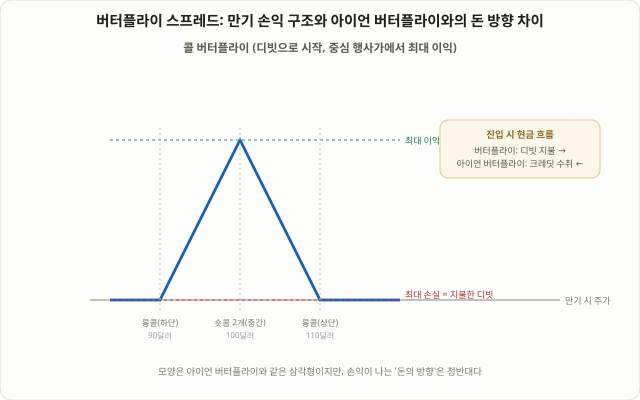

## 아이언 버터플라이의 '빚지지 않는' 사촌

98강에서 다룬 [아이언 버터플라이](/strategies/iron-butterfly-options-strategy/)는 콜과 풋을 섞어 네 다리로 크레딧(프리미엄 수취)을 받는 구조였습니다. 이번 강의에서 다루는 **버터플라이 스프레드(Butterfly Spread)** — 흔히 "롱 버터플라이" 또는 "콜 버터플라이/풋 버터플라이"라고도 부르는 구조 — 는 손익 그래프의 모양은 아이언 버터플라이와 거의 똑같은 뾰족한 삼각형이지만, 만드는 방식과 돈이 오가는 방향이 정반대입니다. 콜만(또는 풋만) 세 개의 행사가로 구성하고, 프리미엄을 받는 게 아니라 소액을 지불(디빗)하고 시작합니다.

최근 들어 이 구조가 다시 주목받는 이유는 0DTE(당일 만기) 옵션 거래량 급증과 관련이 깊습니다. 시카고옵션거래소(CBOE) 기준으로 SPX 옵션 거래량의 절반 이상이 당일 만기 물량이라는 통계가 여러 시장 데이터 서비스에서 공통적으로 언급되고 있으며(구체적인 비율은 집계 시점과 기관마다 다르게 보도됩니다), 그 가운데 '버터플라이'가 가장 비대칭적이고 효율적인 0DTE 구조로 자주 소개됩니다. 24강에서 다룬 [0DTE 옵션 매매법](/strategies/0dte-options-trading/)이 세타·감마의 극단적인 움직임을 다뤘다면, 이번 강의는 그 극단적인 감마를 "얼마를 잃을지 미리 정해 놓고" 활용하는 가장 기본적인 구조 중 하나를 다룹니다.

## 구조: 1-2-1 비율로 쌓는 세 개의 행사가

버터플라이 스프레드는 같은 만기, 같은 종류(콜 또는 풋)의 옵션 세 개를 1-2-1 비율로 겹쳐 만듭니다. 콜로 만드는 경우(콜 버터플라이) 기준으로 설명하면 다음과 같습니다.

- **낮은 행사가 콜 1개 매수**: 현재가보다 낮은(또는 같은) 행사가의 콜을 하나 삽니다.
- **중간 행사가 콜 2개 매도**: 목표로 하는 '핀 포인트' 가격에서 콜을 두 개 팝니다.
- **높은 행사가 콜 1개 매수**: 중간 행사가보다 높은 콜을 하나 삽니다.

세 행사가는 보통 등간격으로 배치합니다(예: 90/100/110달러). 매도한 두 개의 중간 콜에서 받는 프리미엄이 양쪽에서 사는 콜의 프리미엄 합보다 적기 때문에, 전체적으로는 돈을 내는(디빗) 거래가 됩니다. 이 구조를 쪼개서 보면 이해가 쉬워집니다. 낮은 행사가와 중간 행사가로 만든 **불콜 스프레드(매수 포지션)**와, 중간 행사가와 높은 행사가로 만든 **베어콜 스프레드(매도 포지션)**를 중간 행사가를 공유하도록 겹쳐 놓은 것과 정확히 같습니다. 즉 방향이 반대인 두 개의 수직 스프레드를 하나로 합친 구조입니다. 풋으로 만들면 '풋 버터플라이'가 되며, 콜 버터플라이와 수학적으로 동일한 손익 구조를 가집니다(풋-콜 패리티 때문입니다).

<figure class="diagram">
  
  <figcaption>버터플라이 스프레드는 중간 행사가에서 최대 이익이 나는 삼각형 모양이지만, 아이언 버터플라이와 달리 진입 시점에 돈을 내고(디빗) 시작한다.</figcaption>
</figure>

## 왜 작동하는가: 세타 수취를 지불한 디빗으로 상쇄시키는 구조

버터플라이 스프레드가 돈을 버는 핵심 원리는 98강에서 다룬 아이언 버터플라이와 같습니다. 등가격(ATM) 근처의 옵션이 시간가치가 가장 비싼데, 중간 행사가에서 두 개를 팔아 그 비싼 시간가치를 수취하는 구조이기 때문입니다. 다만 아이언 버터플라이는 콜과 풋을 섞어 순수하게 크레딧을 받고 시작하는 반면, 버터플라이 스프레드는 한 종류의 옵션만 쓰기 때문에 산 옵션들의 내재가치·시간가치가 판 옵션들의 시간가치를 완전히 상쇄하지 못하고, 그 차액이 '디빗'으로 남습니다.

시간이 지나면서(특히 만기에 가까워질수록) 중간 행사가에서 판 두 개의 옵션이 시간가치를 빠르게 잃는 반면, 양 끝의 산 옵션 중 내가격인 쪽은 내재가치를 유지합니다. 주가가 중간 행사가 근처에 머물수록 이 "세타 수취 - 디빗 상각" 구조가 유리하게 작동해 포지션 가치가 지불한 디빗보다 커지고, 만기에 주가가 정확히 중간 행사가라면 이론상 최대 이익에 도달합니다. 반대로 주가가 어느 한쪽 끝 행사가 밖으로 완전히 벗어나면, 포지션 전체가 지불한 디빗만큼만 잃고 끝납니다(손실이 디빗 금액으로 고정되는 이유입니다).

## 실전 예시: 숫자로 보는 한 사이클

가상의 종목이 현재 100달러에 거래되고 있고, 만기가 35일 남았다고 가정해 보겠습니다. 98강 아이언 버터플라이 예시와 같은 가격대를 그대로 가져와 두 구조를 나란히 비교해 보겠습니다.

**콜 버터플라이 구성 (등간격, 10달러 폭)**

| 다리 | 행사가 | 방향 | 프리미엄 |
|---|---|---|---|
| 롱콜(하단) | 90달러 | 매수 | 11.50달러 지불 |
| 숏콜(중간) 2개 | 100달러 | 매도 | 5.80달러 × 2 = 11.60달러 수취 |
| 롱콜(상단) | 110달러 | 매수 | 2.10달러 지불 |

- 순지불 디빗 = (11.50 + 2.10) − 11.60 = **2.00달러(계약당 200달러)**
- 최대 손실 = 지불한 디빗 = **200달러** (주가가 90달러 아래 또는 110달러 위로 완전히 벗어날 때)
- 최대 이익 = (중간 행사가 - 하단 행사가 - 디빗) × 100 = (10 − 2.00) × 100 = **800달러** (만기에 주가가 정확히 100달러일 때)
- 손익분기점: 하단 90 + 2.00 = **92달러**, 상단 110 − 2.00 = **108달러**

98강에서 구성한 아이언 버터플라이(순크레딧 470달러, 최대손실 530달러, 손익분기 95.30~104.70달러)와 나란히 놓으면 구조적 차이가 분명해집니다.

| 구분 | 아이언 버터플라이 (98강 예시) | 콜 버터플라이 (이번 예시) |
|---|---|---|
| 진입 시 현금 흐름 | 크레딧 470달러 수취 | 디빗 200달러 지불 |
| 최대 이익 | 470달러 | 800달러 |
| 최대 손실 | 530달러 | 200달러 |
| 최대 손실이 나는 조건 | 주가가 정확히 중심에 머묾 | 주가가 양 끝 밖으로 완전히 벗어남 |
| 손익분기 구간 | 95.30~104.70달러 | 92~108달러 |
| 거래 성격 | 크레딧(변동성 매도 관점) | 디빗(핀 포인트 매수 관점) |

표에서 보듯 두 구조는 손익 그래프 '모양'은 닮았지만, 돈이 들어오는 방향과 최대 손실·이익이 나는 조건이 정확히 반대입니다. 아이언 버터플라이는 "주가가 벗어나면 돈을 잃는" 구조이고, 버터플라이 스프레드는 "주가가 중심에 머물면 돈을 버는" 구조라는 점은 같지만, 전자는 크레딧을 깎아먹는 쪽으로, 후자는 디빗을 키우는 쪽으로 이익이 발생한다는 차이가 있습니다. 특히 최대 손실이 처음부터 지불한 돈으로 한정된다는 점은, 42강 [켈리 공식 포지션 사이징](/strategies/kelly-criterion-position-sizing/)에서 다룬 "최대 손실 금액을 먼저 정해두고 베팅 규모를 역산한다"는 원칙을 적용하기가 특히 쉬운 구조라는 뜻이기도 합니다.

## 0DTE에서 버터플라이가 자주 거론되는 이유

0DTE 거래에서 버터플라이가 특히 자주 언급되는 이유는 단순합니다. 하루짜리 옵션의 감마는 만기 시간이 가까워질수록 극단적으로 커지는데, 네이키드 콜이나 풋을 그냥 사면 방향이 조금만 틀려도 손실이 빠르게 커지고, 그냥 팔면 반대로 손실이 무제한으로 열립니다. 버터플라이는 매수·매도 다리를 섞어 이 극단적인 감마 노출을 양쪽 모두 제한하면서도, 지불하는 디빗 자체가 애초에 작기 때문에 "리스크 대비 보상"의 비대칭성이 다른 0DTE 구조보다 크다는 점이 자주 소개됩니다. 다만 이런 비대칭 구조는 가격이 추세적으로 한 방향으로 강하게 밀고 나가는 장에서는 거의 수익이 나지 않는다는 한계도 함께 거론되는 점을 놓치지 말아야 합니다. 중심에서 멀어질수록 이익이 선형으로 줄다가 0이 되고, 그 지점을 넘어서면 더 잃을 돈도 없는 구조이기 때문에, 추세가 강하게 나오는 날에는 처음부터 다른 전략이 더 적합할 수 있습니다.

## 행사가와 폭은 어떻게 고르는가

- **중간 행사가(목표 핀 포인트)**: 만기 시 주가가 머물 것으로 예상하는 지점을 고릅니다. 등가격(ATM) 근처로 잡으면 중립적인 베팅이 되고, 현재가보다 높거나 낮은 쪽으로 잡으면 약한 방향성 뷰를 담을 수 있습니다.
- **폭**: 양 끝 행사가와 중간 행사가 사이의 거리가 넓어질수록 지불하는 디빗과 최대 이익이 함께 커지지만, 손익분기 구간은 오히려 넓어집니다(맞히기는 쉬워지지만 비용이 커지는 트레이드오프입니다). 반대로 폭이 좁을수록 디빗이 작아 리스크 대비 보상 비율은 커지지만, 정확히 그 좁은 구간 안에 들어와야 합니다.
- **브로큰윙 버터플라이(Broken Wing Butterfly)**: 양쪽 폭을 다르게 만드는 변형도 실전에서 자주 쓰입니다. 한쪽 폭을 더 넓게 벌리면 그 방향으로의 리스크가 줄거나 심지어 디빗이 크레딧으로 바뀌는 경우도 있는데, 이는 97강 [제이드 리자드](/strategies/jade-lizard-options-strategy/)처럼 한쪽 방향의 리스크를 의도적으로 비대칭으로 설계하는 접근과 같은 선상에 있습니다.

## 관리 규칙과 함정

- **거래 비용이 세 다리(또는 네 번의 체결)만큼 쌓인다**: 중간 행사가에서 2개를 체결해야 하므로 실질적으로 네 번의 체결이 발생합니다. 13강 [ATR·CMF 리스크 필터](/strategies/risk-filters-atr-cmf/)에서 다룬 순이익 관점처럼, 작은 디빗 거래일수록 수수료와 슬리피지가 전체 수익률에서 차지하는 비중이 커진다는 점을 반드시 감안해야 합니다.
- **디빗 거래이므로 조기 청산 타이밍이 중요하다**: 아이언 버터플라이가 "크레딧을 지키는" 방식으로 관리된다면, 버터플라이 스프레드는 "디빗의 몇 배를 벌었을 때 이익을 실현할지"를 미리 정해두는 방식으로 관리하는 경우가 많습니다. 만기 직전까지 들고 가는 것이 이론상 최대 이익에 가장 가깝지만, 핀 포인트에서 살짝만 벗어나도 이익이 급격히 줄어드는 구간이기도 합니다.
- **미국식 옵션의 조기 배정 위험**: 산 다리(롱레그) 중 내가격으로 끝나는 쪽은 자동 행사되고, 판 다리(숏레그) 중 내가격인 쪽은 조기 배정될 수 있습니다. 특히 배당락일 근처의 숏콜은 조기 배정 가능성이 높아지므로 배당 일정을 미리 확인해야 합니다.
- **"평평해 보이는 날"이 다음 날에도 이어지지는 않는다**: 중심 행사가가 합리적인 핀 포인트처럼 보였더라도, 예상치 못한 뉴스나 갭이 발생하면 손익분기 구간을 쉽게 벗어납니다. 다만 이때의 손실은 처음부터 지불한 디빗으로 한정돼 있다는 점이 아이언 버터플라이와 가장 뚜렷하게 다른 안전판입니다.

## 자주 묻는 질문

### 콜 버터플라이와 풋 버터플라이는 뭐가 다른가요?
풋-콜 패리티에 의해 같은 행사가·같은 만기로 만든 콜 버터플라이와 풋 버터플라이는 이론적으로 거의 동일한 손익 구조를 가집니다. 실제로는 사용 가능한 자본, 콜과 풋의 미세한 가격 차이(스큐), 조기 배정 리스크에 따라 둘 중 하나가 약간 더 유리할 수 있습니다.

### 버터플라이 스프레드와 아이언 버터플라이 중 뭘 먼저 배워야 하나요?
둘 다 중심 행사가에서 최대 이익이 나는 같은 모양의 그래프를 공유하지만, 돈의 방향이 반대라는 점을 이해하는 것이 우선입니다. 초보자라면 최대 손실이 지불한 디빗으로 명확하게 고정되는 버터플라이 스프레드로 먼저 구조를 익히고, 이후 크레딧 구조인 아이언 버터플라이로 넘어가는 순서가 흔히 권장됩니다.

### 0DTE에서 버터플라이를 쓰면 승률이 높아지나요?
리스크 대비 보상의 비대칭성이 크다는 것과 승률이 높다는 것은 다른 이야기입니다. 중심에서 조금만 벗어나도 이익이 빠르게 줄어드는 구조이므로, 하루짜리 옵션 특유의 큰 변동성 속에서 승률 자체가 특별히 높다고 단정할 근거는 없습니다. 이는 일반적으로 알려진 경험적 특성이며, 검증된 통계치로 받아들여서는 안 됩니다.

## 정리

- 버터플라이 스프레드는 콜(또는 풋) 세 개를 1-2-1 비율로 겹친 디빗 거래로, 98강 아이언 버터플라이와 손익 그래프의 '모양'은 같지만 돈이 오가는 방향이 정반대입니다.
- 중간 행사가에서 두 개를 팔아 가장 비싼 시간가치를 수취하고, 양 끝에서 한 개씩 사서 손실을 지불한 디빗으로 고정시키는 구조입니다.
- 불콜 스프레드(매수)와 베어콜 스프레드(매도)를 중간 행사가에서 겹쳐 놓은 것과 수학적으로 동일하며, 풋으로 만들어도 풋-콜 패리티에 의해 거의 같은 손익 구조가 됩니다.
- 최대 손실이 처음부터 지불한 디빗으로 한정된다는 점이 아이언 버터플라이와의 가장 실질적인 차이이며, 이는 0DTE 거래에서 극단적인 감마 노출을 다루는 가장 기본적인 구조 중 하나로 자주 소개되는 이유이기도 합니다.
- 다만 추세가 강하게 나오는 날에는 거의 수익을 내지 못하는 구조이므로, 거래 비용과 조기 청산 기준을 미리 정해두고 '핀 포인트' 뷰가 실제로 타당한 상황인지 먼저 점검해야 온전한 그림이 됩니다.
