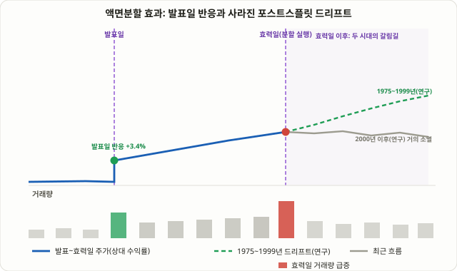

## 액면분할 효과란: 숫자만 바뀌는데 왜 주가가 움직이는가

**액면분할(Stock Split)**은 회사의 자본금이나 시가총액을 전혀 바꾸지 않습니다. 10 대 1로 분할하면 주식 수가 10배로 늘고 주당 가격은 정확히 10분의 1로 줄어들 뿐, 주주 한 명이 보유한 지분의 실질 가치는 분할 전후가 수학적으로 동일합니다. 피자를 8조각으로 자르던 것을 16조각으로 자른다고 피자 전체의 양이 늘어나지 않는 것과 같은 이치입니다. 그런데 실제 시장에서는 분할 발표 시점부터 주가가 눈에 띄게 움직이는 경우가 반복적으로 관찰됩니다. 이 모순 — 펀더멘털은 바뀌지 않았는데 가격은 움직인다 — 이 바로 **액면분할 효과(Stock Split Effect)**라는 주제의 출발점입니다.

이 강의에서 다루는 다른 "효과" 계열 기법들, 이를테면 75강 [지수 편입 효과](/strategies/index-inclusion-effect/)나 108강 [자사주 매입 블랙아웃](/strategies/buyback-blackout-window/)과 비교하면 메커니즘이 분명히 다릅니다. 지수 편입 효과는 패시브 펀드의 기계적 매수라는 "눈에 보이는 돈의 흐름"이 가격을 미는 구조이고, 액면분할 효과는 그런 강제적인 자금 유입이 전혀 없습니다. 오직 투자자들의 **심리와 해석**만으로 가격이 움직인다는 점에서, 이 기법은 순수하게 행동재무학적인 현상에 가깝습니다. 그만큼 근거가 더 미묘하고, 시대에 따라 효과의 크기가 크게 변해왔다는 점을 먼저 전제로 깔고 접근해야 합니다.

## 왜 작동하는가: 신호이론과 트레이딩 레인지 이론

액면분할이 왜 가격에 영향을 주는지를 설명하는 이론은 크게 두 갈래로 나뉩니다. 둘 다 "검증된 단일 정설"이 아니라 서로 보완하는 가설이라는 점을 분명히 해두어야 합니다.

**첫째, 신호이론(Signaling Theory)**입니다. 회사는 아무 때나 분할을 결정하지 않습니다. 거의 예외 없이 주가가 상당히 오른 뒤, 경영진이 "앞으로도 이 높은 가격대를 유지하거나 더 오를 것"이라는 확신이 있을 때 분할을 택합니다. 왜일까요? 분할 직후 주가가 꺾이면 "경영진이 잘못 판단했다"는 신호로 읽혀 신뢰에 타격을 주기 때문에, 애초에 자신 없는 회사는 분할이라는 선택 자체를 꺼립니다. 즉 분할 발표는 "우리 경영진은 앞으로의 실적과 주가를 낙관하고 있다"는 암묵적 메시지를 시장에 보내는 행위이고, 시장은 이 신호를 — 완전하진 않지만 일부 — 가격에 반영하며 반응합니다.

**둘째, 트레이딩 레인지 이론(Trading Range Theory) 또는 유동성 이론**입니다. 주당 가격이 지나치게 높아지면 최소 매매단위(라운드 랏) 기준으로 접근할 수 있는 투자자 풀이 줄어듭니다. 분할로 주당 가격을 낮추면 더 많은 개인투자자가 부담 없이 사들일 수 있게 되어 유동성이 늘고, 호가 스프레드가 상대적으로 좁아지는 효과가 생길 수 있다는 논리입니다. 여기에 행동재무학적인 요소도 더해집니다 — 분할 후 "주당 가격이 낮아 보인다"는 사실 자체가 일부 투자자에게는 "싸다"는 착시(화폐적 착각, money illusion)를 일으켜 매수 유인을 키운다는 해석도 있습니다. 지분율은 전혀 바뀌지 않았는데도 말입니다.

<figure class="diagram">
  
  <figcaption>발표일의 즉각적 반응, 효력일까지의 완만한 상승, 그리고 효력일 이후 두 갈래로 갈라지는 경로 — 1975~1999년 연구가 보고한 드리프트와 2000년 이후 거의 사라진 드리프트의 대비.</figcaption>
</figure>

## 타임라인: 발표일 → 효력일 → 효력일 이후의 3단계

액면분할 효과를 분석하는 연구들은 대체로 아래 세 구간으로 나눠서 데이터를 본다.

1. **발표일(Announcement Date)**: 회사가 이사회 결의를 통해 분할 비율과 효력일을 공시하는 시점입니다. 후속 연구들이 인용하는 수치 중 하나는, 분할 발표일 당일의 시장 조정 초과수익률이 평균 약 3.38%였다는 것입니다. 이 수치는 "시장이 분할이라는 신호를 즉시 완전히 반영하지 못하고 있다(언더리액션)"는 해석의 근거로 종종 제시됩니다.
2. **발표일부터 효력일까지의 런업(Run-up) 구간**: 보통 몇 주의 시차가 있는 이 구간 동안, 언론 보도와 개인투자자들의 관심이 집중되면서 가격이 계단식으로 추가 상승하는 경향이 자주 관찰됩니다. 한 업계 분석에서는 분할 효력일 한 달 전 시점부터 보면 해당 주식이 효력일까지 더 높은 가격으로 마감할 확률이 약 64%였다는 수치를 제시한 바 있는데, 이는 발표일 기준이 아니라 효력일 직전 한 달을 기준으로 삼은 독립적인 추정치이고 표본과 방법론이 공개되지 않았다는 한계가 있어, 발표일 기준의 학술 연구와 직접 비교하기는 어렵습니다.
3. **효력일 당일과 그 이후**: 효력일에는 실제로 주식 수가 늘고 주당 가격이 분할 비율대로 줄어들며, 심리적으로 "더 싸진" 주식에 신규 매수세가 몰리면서 거래량이 평소보다 크게 늘어나는 경우가 흔합니다. 바로 이 이후 구간에서 학술 연구가 가장 뜨겁게 다뤄온 **포스트스플릿 드리프트(Post-Split Drift)** 현상이 시작됩니다.

## 핵심 연구: 아이켄베리·랭킨·스타이스(1996)가 보여준 숫자

이 분야에서 가장 자주 인용되는 연구는 데이비드 아이켄베리(David Ikenberry), 그레이엄 랭킨(Graeme Rankine), 얼 스타이스(Earl Stice)가 1996년 발표한 "What Do Stock Splits Really Signal?"입니다. 이들은 2대1 분할 1,275건을 분석해 다음과 같은 결과를 보고했습니다.

| 측정 구간 | 보고된 초과수익률 | 의미 |
|---|---|---|
| 분할 발표일 당일 | 약 +3.38% | 분할 발표에 대한 시장의 즉각적 반응 |
| 효력일 이후 1년 | 약 +7.93% | 발표 이후에도 초과수익이 계속 쌓이는 "드리프트" |
| 효력일 이후 3년 | 약 +12.15% | 드리프트가 1년을 넘어 더 오래 이어진 것으로 보고된 수치 |

이 연구에서 특히 주목할 부분은, 분할 전 주가 런업(이미 많이 오른 정도)과 분할 후 초과수익률 사이에 **음(-)의 상관관계**가 나타났다는 점입니다. 저자들은 이를 두고 "단순히 분할하는 회사가 원래 모멘텀이 강한 회사이기 때문에 생기는 결과(선택 편향)는 아니다"라는 반박 근거로 제시했습니다. 즉 모멘텀 자체보다는, 분할이라는 신호를 시장이 즉시 완전히 가격에 반영하지 못하고 시간이 지나면서 서서히 반영한다는 **언더리액션 가설**이 이 드리프트의 더 설득력 있는 설명이라는 주장입니다. 이는 36강 [PEAD(포스트 어닝 드리프트)](/strategies/pead-earnings-drift/)에서 다룬 "시장이 좋은 뉴스를 한 번에 완전히 반영하지 않고 서서히 반영한다"는 논리와 같은 가족에 속하는 현상입니다.

## 사라진 효과: 2000년대 이후 연구는 다르게 말한다

여기서부터가 이 강의가 가장 솔직하게 다뤄야 할 부분입니다. 아이켄베리 연구의 표본 기간은 1975년부터 1990년대까지였습니다. 이후 가르고리아와 응우옌(Gharghoria & Nguyen, 2017)을 비롯한 후속 연구들은, **포스트스플릿 드리프트가 1975~1999년 구간에 집중돼 있고 2000~2011년 구간에서는 거의 사라졌다**는 결과를 보고했습니다. 게다가 이 효과가 남아 있다 해도 그 대부분은 **소형주·마이크로캡**에서만 관찰됐고, **대형주에서는 통계적으로 의미 있는 드리프트가 보이지 않았다**는 점도 함께 지적됐습니다.

왜 이렇게 효과가 옅어졌을까요. 복수의 구조적 변화가 동시에 겹친 결과로 보는 시각이 많습니다.

- **호가 단위의 소수점화(Decimalization)**: 2001년 미국 증시가 호가 단위를 분수(1/16달러 등)에서 센트 단위로 전환하면서, 가격 자체의 미세한 구조가 완전히 달라졌습니다. 분할 전후의 호가 스프레드 변화가 과거만큼 뚜렷한 유동성 개선으로 이어지지 않게 됐습니다.
- **무료 수수료·소수점 매수(Fractional Share)의 보편화**: 지금은 대부분의 온라인 증권사에서 1,000달러짜리 주식도 10달러어치만 살 수 있습니다. "주당 가격이 너무 높아서 개인투자자가 접근할 수 없다"는 트레이딩 레인지 이론의 전제 자체가 구조적으로 약해진 것입니다. 분할이 풀어주던 "문제"가 다른 방식으로 이미 해결돼 있다면, 분할 자체가 주는 추가적인 유동성 효과도 줄어드는 게 당연합니다.
- **차익거래 자금의 증가와 정보 효율성 향상**: 75강에서 다룬 "사라지는 지수 편입 효과"와 같은 논리입니다. 알려진 이상현상을 이용하려는 자금이 늘어날수록, 그 신호는 더 빠르게 가격에 선반영되고 남는 엣지는 줄어듭니다.

## 최근 사례로 보는 2024~2026년 포워드 스플릿 흐름

실제 사례로 확인해보면 이 구조적 변화가 더 분명해집니다. 2024년은 포워드 스플릿이 눈에 띄게 몰린 해였습니다. **월마트(WMT)**는 2024년 2월 3대1 분할을 단행하며 CEO가 "직원들이 온전한 한 주를 쉽게 살 수 있도록 하기 위한 것"이라고 설명했고, **엔비디아(NVDA)**는 2024년 6월 사상 최대 규모인 10대1 분할을 실행했으며, **치폴레(CMG)**는 같은 시기 50대1이라는 극단적인 비율로 분할해 주당 가격을 3,000달러대에서 두 자릿수 수준으로 낮췄습니다. 그런데 그 이후 포워드 분할의 건수 자체는 눈에 띄게 줄어드는 추세입니다 — 월스트리트 호라이즌 집계에 따르면 2024년 76건이던 포워드 스플릿이 2025년 62건으로, 2026년 상반기에는 37건으로 줄었습니다. 이는 "접근성 문제"가 소수점 매수의 보편화로 이미 많이 해결되면서, 회사들이 분할을 할 동기 자체가 줄어들고 있다는 해석과 맞아떨어지는 흐름입니다.

한국 시장 사례는 오히려 더 신중해야 할 이유를 보여줍니다. 국내 언론 분석에 따르면, 특정 시기 액면분할을 실시한 7개 기업 중 카카오·HD현대를 제외한 5곳 모두 분할 후 3개월간 주가가 하락한 것으로 집계된 바 있습니다. 삼성전자는 2018년 분할 상장 첫날 거래량이 크게 늘었지만 이후 주가는 하락세를 이어갔고, 반대로 카카오는 2021년 분할 후 약 2개월 만에 역사적 신고가를 경신했습니다. 결과가 이렇게 극단적으로 갈린다는 사실 자체가, "분할하면 오른다"는 단순한 공식으로 한국 시장에 접근해서는 안 된다는 것을 보여줍니다. 2026년 들어서는 SK하이닉스의 최태원 회장이 액면분할 가능성을 시사한 보도가 나오기도 했는데, 이는 아직 확정된 사안이 아니라 거론된 수준이라는 점을 분명히 해둘 필요가 있습니다.

## 포워드 스플릿 vs 리버스 스플릿: 정반대의 신호

액면분할을 제대로 이해하려면 반대 방향의 분할인 **리버스 스플릿(역분할, Reverse Split)**과 비교해보는 것이 가장 빠릅니다. 둘은 같은 "분할"이라는 단어를 쓰지만 시장이 읽는 의미는 정반대에 가깝습니다.

| | 포워드 스플릿(일반 액면분할) | 리버스 스플릿(역분할) |
|---|---|---|
| 실행 배경 | 주가가 많이 오른 뒤, 주당 가격을 낮추는 방향 | 주가가 지나치게 낮아진 뒤, 주당 가격을 끌어올리는 방향 |
| 전형적 동기 | 거래 접근성 확대, 자신감 신호, 임직원 스톡옵션·우리사주 매수 편의 | 나스닥 최소 호가 요건(보통 1달러) 미달로 인한 상장폐지 위험 회피, 기관투자자 진입 장벽(일부 펀드의 최소가 규정) 해소 |
| 시장이 읽는 신호 | "경영진이 앞으로도 좋을 것이라 본다"는 긍정적 신호(이론상) | "회사가 생존을 위해 조치를 취해야 하는 상황"이라는 경고 신호로 읽히는 경우가 많음 |
| 과거 연구상 가격 반응 | 발표일 양(+)의 초과수익, 1975~1999년 한정 완만한 드리프트 보고 | 평균적으로 중립~부정적 반응, 이후에도 추가 하락이 이어지는 경우가 드물지 않음 |
| 대표 사례 | 월마트, 엔비디아, 치폴레(2024년) | 상장폐지 위험에 놓인 소형주, 역합병(de-SPAC) 이후 저가주들 |

중요한 건 이 비대칭성이 완전히 고정된 법칙은 아니라는 점입니다. 리버스 스플릿이라고 무조건 나쁜 신호인 것도 아니고(구조조정을 마치고 재도약하는 회사가 쓰는 경우도 있습니다), 포워드 스플릿이라고 무조건 좋은 신호인 것도 아닙니다(앞서 본 삼성전자 사례처럼). 다만 평균적인 시장 심리의 방향성만큼은 뚜렷하게 갈린다는 점을 알아두는 것이 실전에서 유용합니다.

## 실전에서 어떻게 다뤄야 하나: 체크리스트

이 효과를 단독 매매 신호로 쓰는 것은 추천하지 않습니다. 현실적인 활용법은 다음과 같습니다.

1. **발표일 급등을 추격매수의 근거로 쓰지 않습니다.** 발표 당일 갭업은 이미 상당 부분 "소문"을 반영한 결과일 수 있고, 추격매수는 효력일 전후 되돌림 리스크를 그대로 떠안는 행위입니다.
2. **대형주라면 아이켄베리 연구의 과거 수치를 그대로 믿지 않습니다.** 후속 연구가 보여주듯, 지금은 대형주에서 통계적으로 의미 있는 드리프트가 사실상 관찰되지 않습니다. NVDA·WMT 같은 초대형주의 분할은 역사적 평균 통계가 적용되는 사례가 아니라는 점을 분명히 인식해야 합니다.
3. **분할을 "확인 신호"로만 씁니다.** 이미 추세추종이나 모멘텀(09강 [추세 눌림목 재진입](/strategies/trend-pullback-ma/) 등)으로 보유 중인 종목이 분할을 발표했다면, 이를 기존 매수 논리를 강화하는 보조 근거 정도로 삼는 것이 분할 자체를 새로운 매수 이유로 삼는 것보다 안전합니다.
4. **리버스 스플릿 종목은 반대로 경고 신호로 우선 다룹니다.** 역분할이 발표됐다는 사실 자체를, 추가 매수의 신호가 아니라 포지션을 재검토해야 하는 신호로 받아들이는 편이 통계적으로 더 안전한 기본값입니다.
5. **포지션 크기는 06강 [손익비와 자금관리](/strategies/risk-reward-money-management/) 원칙대로 보수적으로 잡습니다.** 엣지 자체가 작고 시대에 따라 변해왔다는 걸 인정한다면, 베팅 규모도 그 불확실성에 맞춰 줄여야 합니다.

## 숫자로 보는 예시 (교육용 단순화 사례)

실제 특정 종목의 데이터가 아니라, 분할 메커니즘과 통계 함정을 숫자로 보여주기 위한 가상의 단순화 사례입니다.

| 항목 | 분할 전 | 분할 후(10대1 가정) |
|---|---|---|
| 주당 가격 | 1,000달러 | 100달러 |
| 발행주식 수 | 5천만 주 | 5억 주 |
| 시가총액 | 500억 달러 | 500억 달러 (변화 없음) |
| 투자자 A의 보유 지분 (100주 보유 가정) | 100주 × 1,000달러 = 10만 달러, 지분율 0.0002% | 1,000주 × 100달러 = 10만 달러, 지분율 0.0002% (동일) |

이 표가 보여주는 핵심은 단순합니다. 분할 전후로 투자자 A가 실제로 보유한 가치와 지분율은 한 치도 바뀌지 않았습니다. 그런데 만약 이 가상의 초대형주가 분할 후 아이켄베리 연구의 "1년 +7.93%" 수치를 그대로 적용받을 것이라 기대하고 베팅한다면, 이는 후속 연구가 경고하는 정확히 그 함정에 빠지는 것입니다. 가르고리아·응우옌 연구가 보여준 것처럼, 2000년 이후 데이터에서는 이런 대형주급 종목에서 통계적으로 의미 있는 드리프트가 확인되지 않았습니다. 즉 "분할 비율 10대1, 역사적 평균 +7.93%"라는 식으로 숫자를 단순 대입하는 계산은, 이 기법이 가장 경계해야 할 바로 그 오류입니다.

## 한계와 함정

- **연구 결과가 시대별로 완전히 다르다**: 1975~1999년 구간과 2000~2011년 구간의 결과가 상반되므로, 어느 시기의 연구를 인용하느냐에 따라 결론이 뒤집힐 수 있습니다.
- **효과는 대형주가 아니라 소형주·마이크로캡에 집중돼 있다**: 최근 뉴스에 자주 등장하는 NVDA·WMT 같은 초대형주 분할에는 역사적 드리프트 통계를 그대로 적용하기 어렵습니다.
- **선택 편향 가능성**: 분할을 결정하는 회사는 애초에 실적과 주가가 좋았던 회사라는 점에서, 드리프트의 일부는 분할 자체가 아니라 그 회사의 원래 모멘텀 때문일 가능성을 완전히 배제할 수 없습니다.
- **한국 시장 데이터가 제한적이고 결과도 엇갈린다**: 소수 사례(삼성전자·카카오 등)만으로는 일반화된 결론을 내리기 어렵고, 공개된 국내 학술 통계도 미국 시장보다 제한적입니다.
- **이벤트 리스크가 겹친다**: 분할 발표가 실적 발표나 다른 호재·악재와 같은 시기에 나오면, 가격 움직임의 원인을 분할 효과만으로 깔끔하게 분리하기 어렵습니다.

## 자주 묻는 질문

### 액면분할을 하면 무조건 주가가 오르나요?
아닙니다. 1996년 아이켄베리 연구는 평균적인 양(+)의 드리프트를 보고했지만, 2000년 이후 연구는 그 효과가 거의 사라졌다고 보고했고, 한국 시장 사례에서는 분할 후 하락한 경우가 더 많았던 시기도 있었습니다. "분할 = 상승"이라는 단순 등식은 성립하지 않습니다.

### 리버스 스플릿(역분할)은 항상 나쁜 신호인가요?
대체로 경고 신호로 읽히는 경우가 많지만 절대적인 법칙은 아닙니다. 상장폐지 위험을 피하기 위한 역분할이라면 부정적인 맥락일 가능성이 높지만, 구조조정을 마친 회사가 재상장 요건을 맞추기 위해 하는 역분할이라면 맥락이 다를 수 있습니다. 역분할의 "이유"를 공시에서 직접 확인하는 것이 중요합니다.

### 소수점 매수(프랙셔널 쉐어)가 보편화된 지금도 액면분할이 의미가 있나요?
과거 트레이딩 레인지 이론이 내세운 "접근성 확대" 효과는 분명 약해졌습니다. 다만 신호이론 관점의 "경영진의 자신감 표현"이라는 의미, 옵션 계약 단위 조정, 임직원 스톡옵션·우리사주 매수 편의 같은 실무적 이유는 여전히 남아 있어, 효과는 작아졌지만 완전히 사라진 것은 아니라고 보는 것이 더 정확합니다.

## 정리

- 액면분할은 시가총액과 지분율을 전혀 바꾸지 않는 순수한 숫자상의 조정이지만, 신호이론과 트레이딩 레인지 이론에 근거해 시장이 실제로 가격을 움직이는 경우가 관찰됩니다.
- 아이켄베리·랭킨·스타이스(1996)의 연구는 2대1 분할 1,275건에서 발표일 +3.38%, 1년 +7.93%, 3년 +12.15%의 포스트스플릿 드리프트를 보고했습니다.
- 그러나 2000년대 이후 연구는 이 드리프트가 1975~1999년 구간에 집중됐고 2000년대 이후 거의 사라졌으며, 애초에 대형주보다 소형주·마이크로캡에서만 관찰됐다는 점을 밝혀냈습니다.
- 2024~2026년 NVDA·WMT·CMG 등 대형주 포워드 스플릿 열풍 속에서도 분할 건수 자체는 줄고 있으며, 이는 소수점 매수의 보편화로 분할의 전통적 동기가 약해지고 있다는 해석과 맞아떨어집니다.
- 실전에서는 분할을 단독 매수 신호로 쓰기보다, 기존 보유 논리를 보강하는 확인 신호로 다루고 대형주에는 과거 평균 통계를 그대로 대입하지 않는 것이 안전합니다.
