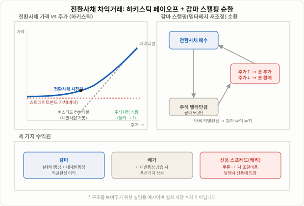

## 2025년, 헤지펀드 수익률 상위권에 다시 오른 전략

2025년 한 해 동안 가장 조용히, 그러나 가장 꾸준히 좋은 성과를 낸 헤지펀드 전략 중 하나로 **전환사채 차익거래(Convertible Bond Arbitrage, 컨버터블 아비트라지)**가 다시 꼽히고 있습니다. HFR 컨버터블 차익거래 지수는 2025년 7월까지 약 6% 상승했고, LMR파트너스 같은 일부 펀드는 같은 해 10월 말 기준 30% 안팎의 수익률을 기록했다고 보도됐습니다. 이 성과를 뒷받침한 배경에는 전환사채 발행 자체가 폭증했다는 사실이 있습니다. 2025년 글로벌 전환사채 발행액은 약 1,570억 달러로 2021년 이후 최대 규모였고, 그 중에는 AI·데이터센터 투자 자금을 조달하려는 기업들의 발행뿐 아니라, 비트코인을 매집하기 위해 전환사채를 찍어낸 이른바 "비트코인 트레저리 기업"들의 발행도 상당한 비중을 차지했습니다.

이 강의에서는 전환사채 차익거래가 정확히 무엇을 사고 무엇을 파는 전략인지, 왜 작동하는지, 그리고 2024~2025년 사이 가장 유명한 사례가 된 마이크로스트래티지(현 스트래티지)의 전환사채를 둘러싼 헤지펀드들의 포지셔닝을 통해 이 전략의 기회와 리스크를 함께 짚어봅니다. 구조적으로는 [73강 감마 스캘핑(롱 스트래들)](/strategies/gamma-scalping-long-straddle/)과 같은 "옵션성을 사서 변동성을 수익화한다"는 계열에 속하지만, 옵션 대신 전환사채라는 채권을 쓴다는 점에서 신용 리스크라는 완전히 다른 축이 하나 더 붙습니다. 또한 [44강 합병 차익거래](/strategies/merger-arbitrage-deal-spread/)처럼 특정 기업 이벤트(이 경우는 발행사의 신용 상태와 주가)에 수익 구조 전체가 묶여 있다는 점에서도 닮아 있습니다. 개인 투자자가 이 구조를 그대로 복제하기는 현실적으로 어렵지만, "채권에 숨겨진 옵션을 어떻게 가격 매기고, 어떻게 헤지하는가"라는 원리를 이해해두면 전환사채를 발행한 기업의 주가가 왜 유독 큰 변동성에 노출되는지, 그리고 왜 특정 구간에서 대차잔고(숏 포지션)가 늘어나는지를 읽는 데 도움이 됩니다.

## 전환사채란 무엇인가: 채권과 콜옵션의 결합

전환사채(CB, Convertible Bond)는 겉으로는 평범한 회사채처럼 보이지만, 보유자가 원하면 정해진 **전환가격(Conversion Price)**에 맞춰 발행사의 보통주로 바꿀 수 있는 권리가 붙어 있는 채권입니다. 이 권리 때문에 전환사채는 본질적으로 두 가지 요소의 결합으로 볼 수 있습니다.

- **스트레이트본드(Straight Bond) 가치**: 전환권이 전혀 없다고 가정했을 때 이 채권이 순수 신용물로서 가지는 가치. 쿠폰과 발행사 신용등급, 만기까지의 금리 환경으로 결정됩니다.
- **콜옵션 가치**: 주가가 전환가격을 넘어서면 보유자가 유리하게 주식으로 바꿀 수 있는 권리의 가치. 주가, 전환가격, 잔존만기, 내재변동성에 따라 움직입니다.

이 콜옵션 가치 때문에 전환사채는 같은 발행사의 일반 회사채보다 쿠폰이 낮습니다. 투자자가 "전환 가능성"이라는 옵션을 공짜로 얹어 받는 대가로 당장의 이자 수익 일부를 양보하는 구조인 셈입니다. 이때 핵심 용어 두 가지를 짚어두면 이후 설명이 쉬워집니다. **전환 프리미엄(Conversion Premium)**은 현재 주가 대비 전환가격이 얼마나 높게 설정돼 있는지를 나타내는 비율이고, **패리티(Parity)**는 지금 당장 전환했을 때 받는 주식의 가치(전환비율 × 현재 주가)를 뜻합니다. 전환사채의 시장가는 거의 항상 패리티와 스트레이트본드 가치 중 더 높은 쪽 이상에서 거래되는데, 그 "더 높은 쪽 위에 얹힌 여분"이 바로 옵션성 프리미엄입니다.

## 차익거래 구조: CB 매수 + 주식 매도로 만드는 델타중립

전환사채 차익거래의 뼈대는 비교적 단순합니다.

1. 전환사채를 시장에서 매수한다. (내재된 옵션성이 시장에서 "저평가"돼 있다고 판단되는 종목을 고른다.)
2. 그 전환사채의 **델타(Delta)**만큼 기초주식을 공매도한다. 델타는 주가가 1달러 움직일 때 전환사채 가격이 얼마나 함께 움직이는지를 나타내는 민감도로, 주가가 전환가격보다 한참 낮으면 델타가 0에 가깝고(채권처럼 움직임), 주가가 전환가격을 한참 넘으면 델타가 1에 가까워집니다(주식처럼 움직임).
3. 주가가 움직이면 델타도 함께 변하기 때문에, 주식 숏 포지션의 규모를 주기적으로 재조정(리밸런싱)한다.

이 3번 과정이 전략의 핵심입니다. 전환사채는 옵션을 품고 있으므로 포지션 전체가 **양(+)의 감마**를 갖습니다. 즉 주가가 오르면 델타가 커지므로 숏을 더 늘려야 하고, 주가가 내리면 델타가 작아지므로 숏을 일부 되사야 합니다. "오를 때 더 팔고, 내릴 때 되사는" 이 리밸런싱을 반복하면, 주가가 오르내리는 매 구간마다 조금씩 이익이 쌓입니다. 이것은 73강에서 다룬 롱 스트래들의 감마 스캘핑과 정확히 같은 메커니즘이며, 차이는 단지 옵션성을 담고 있는 그릇이 "옵션 자체"가 아니라 "채권에 내재된 옵션"이라는 점뿐입니다.

<figure class="diagram">
  
  <figcaption>왼쪽: 전환사채 가격은 채권 바닥(스트레이트본드 가치)과 패리티(전환가치) 중 더 높은 쪽 위에서 '하키스틱' 모양으로 형성된다. 오른쪽: 주가가 움직일 때마다 숏 비중을 재조정하는 것이 감마 스캘핑 수익의 원천이다.</figcaption>
</figure>

## 수익의 세 갈래: 감마, 베가, 신용 스프레드(캐리)

전환사채 차익거래의 수익은 한 가지가 아니라 서로 성격이 다른 세 갈래에서 동시에 나옵니다.

| 수익원 | 무엇을 포착하는가 | 수익이 커지는 조건 |
|---|---|---|
| 감마(델타헤지 재조정) | 실제로 주가가 오르내리는 폭(실현변동성) | 실현변동성이 CB 가격에 반영된 내재변동성보다 클 때 |
| 베가 | 내재변동성 자체의 변화 | 시장이 앞으로 더 흔들릴 것이라 보고 옵션성 가격을 더 높게 쳐줄 때 |
| 신용 스프레드(캐리) | 쿠폰 이자에서 숏 포지션의 조달·대차 비용을 뺀 나머지 | 발행사 신용이 안정적이거나 개선될 때 |

핵심은 이 전략이 "주가가 오를 것"이나 "내릴 것"에 베팅하는 방향성 전략이 아니라는 점입니다. 델타를 중립으로 유지한 채, 주가가 **어느 방향으로든 많이 움직이기만 하면** 감마 재조정으로 돈을 벌고, 시장이 CB에 담긴 옵션성을 "싸다"고 잘못 가격 매겼다는 판단이 맞아떨어지면 베가로도 돈을 벌 수 있는 구조입니다. 다만 세 수익원이 항상 같은 방향으로 움직이는 것은 아닙니다. 예를 들어 발행사의 신용이 나빠지면 신용 스프레드 쪽에서는 손실이 나지만, 그 불안감 때문에 내재변동성이 오히려 치솟으면 베가 쪽에서는 이익이 나는 식으로 서로 상쇄되는 경우도 있습니다.

## 비트코인 트레저리 기업과 전환사채 붐: 지금 왜 다시 뜨는가

이 전략이 2025년 다시 주목받은 데에는 공급 측 요인이 결정적이었습니다. 전환사채 발행 자체가 급증하면서, 새로 쏟아지는 물량을 다 받아내기 어려운 시장에서 가격이 왜곡되는 구간이 늘어났고, 바로 그 왜곡을 포착하는 것이 이 전략의 핵심 먹거리이기 때문입니다. 2025년 미국 전환사채 발행액은 상반기만으로도 650억 달러를 넘겼고, 연간으로는 약 1,190억 달러(글로벌 기준 약 1,570억 달러)에 달했다는 집계가 나왔는데, 이는 2021년 이후 가장 많은 연간 발행 규모였습니다.

이 발행 붐의 상징적인 사례가 바로 스트래티지(옛 마이크로스트래티지)입니다. 이 회사는 비트코인을 계속 사들이기 위한 자금을 전환사채 발행으로 조달해왔고, 캘러모스·린든어드바이저스·컨텍스트캐피털·그레이엄캐피털·밀레니엄 등 여러 대형 헤지펀드가 이 회사의 전환사채를 60억 달러 이상 매수해 "CB 매수 + 주식 매도"의 전형적인 구조를 짰다고 알려져 있습니다. 이들이 노린 것은 전환사채 가격에 반영된 내재변동성이 비트코인과 연동된 이 주식의 실제(실현) 변동성보다 눈에 띄게 낮게 형성돼 있었다는 점이었습니다. 다만 이 사례는 전략의 리스크도 동시에 보여줍니다. 이런 회사의 신용은 결국 보유한 비트코인의 가치에 크게 연동되어 있어서, 비트코인 가격이 크게 빠지면 채권 쪽의 신용 스프레드가 벌어지면서 손실이 날 수 있고, 반대로 발행사가 전환사채 일부를 시장에서 되사들이면(바이백) 차익거래자들이 유지하던 숏 헤지 수요 자체가 줄어들면서 포지션의 성격이 급격히 바뀔 수도 있습니다. 이런 바이백 관련 분석은 아직 엇갈리는 해석이 섞여 있는 단계이므로, 확정된 사실이 아니라 시장이 지켜보고 있는 변수로 받아들이는 것이 맞습니다.

## 숫자로 보는 예시 (설명용 가상 수치)

다음은 구조를 이해하기 위한 **가상의 설명용 예시**이며 실제 특정 종목의 수치가 아닙니다. 어떤 기업이 액면가 1,000달러, 전환가격 50달러짜리 전환사채를 발행했다고 가정합니다. 전환비율은 20주(1,000달러 ÷ 50달러)이고, 현재 주가가 40달러라면 패리티는 20주 × 40달러 = 800달러입니다. 이 구간에서 전환사채의 델타가 0.5라고 가정하면, 100만 달러어치(약 1,000계약 상당)의 전환사채를 매수한 차익거래자는 그 0.5를 곱한 만큼의 주식, 즉 대략 50만 달러어치 주식을 공매도해 델타중립을 맞춥니다.

이제 주가가 40달러에서 44달러로 10% 오르고, 그 과정에서 델타가 0.5에서 0.62로 커졌다고 가정해 봅니다. 차익거래자는 새로운 델타에 맞춰 숏 물량을 추가로 늘려야 하는데, 이때 "오른 가격에 추가로 숏을 늘리는" 행위 자체가 바로 감마 재조정입니다. 이후 주가가 다시 44달러에서 41달러로 되돌림이 오면, 델타는 다시 줄어들고 차익거래자는 더 비쌌던 가격에 팔아둔 숏 물량 일부를 더 싼 가격에 되사며 차익을 확정합니다. 이 "비싸게 팔고 싸게 되사는" 리밸런싱이 주가가 오르내릴 때마다 반복되면서 누적 수익을 만들어내는데, 이것이 바로 실현변동성을 수익으로 바꾸는 과정입니다. 다만 이 과정이 수익이 되려면 전환사채 가격에 녹아 있는 내재변동성보다 실제 주가의 실현변동성이 더 커야 한다는 전제가 필요하며, 반대로 실현변동성이 내재변동성보다 작으면 리밸런싱을 반복할수록 오히려 손실이 쌓일 수 있습니다.

| 구분 | 내재변동성 < 실현변동성 | 내재변동성 > 실현변동성 |
|---|---|---|
| 감마 재조정 손익 | 누적 이익 | 누적 손실 |
| 전략의 해석 | CB의 옵션성이 "싸게" 거래되고 있었음 | CB의 옵션성이 "비싸게" 거래되고 있었음 |
| 전형적 대응 | 포지션 유지·확대 | 포지션 축소 또는 전환가격 재점검 |

## 전환사채 차익거래 vs 감마 스캘핑(롱 스트래들): 같은 원리, 다른 그릇

두 전략은 "옵션성을 사서 델타중립으로 변동성을 수익화한다"는 핵심 원리를 공유하지만, 구체적인 리스크 구조는 꽤 다릅니다.

| 비교 항목 | 전환사채 차익거래 | 감마 스캘핑(롱 스트래들, 73강) |
|---|---|---|
| 옵션성을 담은 그릇 | 채권(전환사채) | 상장 옵션(콜+풋) |
| 추가로 떠안는 리스크 | 발행사 신용 리스크 | 거래소 상대방 리스크만 (신용 리스크 거의 없음) |
| 포지션 만기 압박 | 채권 만기까지 비교적 여유 있음 | 옵션 세타(시간가치) 소멸이 매일 진행 |
| 헤지 대상 숏의 조달 | 주식 대차(숏) 비용·가용성에 의존 | 옵션 자체로 헤지, 별도 대차 불필요 |
| 하방 보호 | 스트레이트본드 가치가 "바닥"을 제공 | 프리미엄 전액이 최대 손실선 |
| 개인 투자자 접근성 | 매우 어려움(채권 시장·대차 인프라 필요) | 상대적으로 쉬움(옵션 계좌면 가능) |

가장 중요한 차이는 "하방 보호"입니다. 전환사채는 주가가 아무리 떨어져도 스트레이트본드 가치라는 바닥이 받쳐주기 때문에(단, 발행사가 부도나지 않는다는 전제에서), 주가가 전환가격에서 한참 멀어진 전환사채는 거의 일반 회사채처럼 거래되는데, 이를 **버스티드 컨버터블(Busted Convertible)**이라고 부릅니다. 반면 롱 스트래들은 주가가 어느 방향으로도 거의 움직이지 않으면 매수한 옵션 프리미엄 전액을 세타 소멸로 잃을 수 있습니다. 즉 전환사채 차익거래는 "채권이라는 바닥"을 대가로 신용 리스크를 짊어지고, 감마 스캘핑은 신용 리스크가 거의 없는 대가로 시간가치 소멸이라는 매일의 비용을 짊어지는 셈입니다.

## 핵심 리스크: 신용, 대차, 유동성

- **신용 리스크**: 발행사의 신용등급이 나빠지면 스트레이트본드 가치 자체가 낮아지며, 전환사채 가격의 "바닥"이 함께 꺼질 수 있습니다. 비트코인 트레저리 기업처럼 신용이 특정 자산 가격에 강하게 연동된 경우, 그 자산 가격의 급락이 곧바로 신용 악화로 번질 수 있습니다.
- **대차(숏) 리스크**: 델타헤지를 위한 주식 공매도는 그 주식을 빌려야 가능합니다. 대차 수요가 몰려 대차 비용이 급등하거나, 최악의 경우 대차 물량 자체를 구할 수 없게 되면(숏 스퀴즈 위험) 헤지를 유지하는 비용이 전략의 수익을 집어삼킬 수 있습니다.
- **유동성 리스크**: 전환사채 시장 자체는 개별주식·국채 시장보다 거래량이 적은 편입니다. 포지션을 정리해야 하는 순간에 매수자를 찾기 어려우면, 장부상 가격과 실제 청산 가격 사이에 큰 괴리가 생길 수 있습니다.
- **개인 투자자의 직접 복제는 현실적으로 어렵습니다.** 전환사채 자체에 대한 접근성, 정밀한 델타 계산, 주식 대차 라인 확보가 모두 기관급 인프라를 전제로 합니다. 이 강의의 목적은 실행 안내가 아니라, 전환사채를 발행한 기업의 주가 변동성과 공매도 잔고가 왜 특정 시기에 눈에 띄게 늘어나는지를 읽는 배경지식을 제공하는 데 있습니다.

## 자주 묻는 질문

### 전환사채 차익거래와 교환사채(EB) 차익거래는 같은가요?
구조는 거의 같습니다. 전환사채는 자기 회사 주식으로 바뀌는 채권이고, 교환사채(EB, Exchangeable Bond)는 발행사가 보유한 다른 회사(흔히 계열사)의 주식으로 바뀌는 채권입니다. 차익거래 방식 자체(채권 매수+기초주식 델타헤지 매도)는 동일하지만, 교환사채는 "발행사의 신용"과 "전환 대상 주식의 발행사"가 다르다는 점에서 신용 분석을 한 단계 더 거쳐야 합니다.

### 왜 전환사채 발행이 늘어나면 차익거래 기회도 늘어나나요?
새로 발행되는 전환사채 물량을 시장이 전부 소화하려면 시간이 걸리고, 그 과정에서 가격이 일시적으로 싸게 형성되는 경우가 생깁니다. 또한 신규 발행사가 전환사채라는 구조에 아직 낯설거나, 복잡한 조건(콜 조항, 희석 방지 조항 등)이 섞여 있으면 시장이 그 옵션성을 정확히 가격 매기지 못할 가능성도 커집니다. 2025년처럼 발행이 집중되면 이런 비효율이 한꺼번에 늘어나는 경향이 있다고 보도되지만, 이는 일부 분석가의 해석이며 모든 발행 건에 똑같이 적용되는 법칙은 아닙니다.

### 헤지펀드가 숏을 많이 잡으면 주가에 안 좋은 영향을 주나요?
전환사채 차익거래의 숏은 방향성 베팅이 아니라 헤지 목적이기 때문에, 그 자체로 "주가를 끌어내리려는" 매도는 아닙니다. 다만 대규모 전환사채 발행이 예고되면 차익거래자들의 헤지 숏 수요가 한꺼번에 몰리면서 단기적으로 주가에 하방 압력(이른바 "CB 오버행")을 줄 수 있고, 반대로 발행사가 전환사채를 되사들이면(바이백) 그 헤지 숏 수요가 줄어들며 반대 방향으로 영향을 줄 수 있다는 분석도 있습니다.

## 정리

- 전환사채 차익거래는 전환사채를 매수하고 그 델타만큼 기초주식을 공매도해 델타중립을 유지하는 전략으로, 옵션성을 품은 채권을 수익원으로 삼는다는 점에서 73강 감마 스캘핑과 메커니즘을 공유합니다.
- 수익은 감마(실현변동성이 내재변동성보다 클 때의 재조정 이익), 베가(내재변동성 상승), 신용 스프레드(캐리)라는 서로 성격이 다른 세 갈래에서 나오며, 방향성 베팅이 아니라 "주가가 많이 움직이기만 하면" 이익을 볼 수 있는 구조입니다.
- 2025년 전환사채 발행액이 2021년 이후 최대 규모로 늘고, 비트코인 트레저리 기업들의 발행이 늘면서 이 전략이 다시 헤지펀드 수익률 상위권에 올랐지만, 발행사 신용이 특정 자산 가격에 강하게 연동된 경우 신용 리스크가 커질 수 있다는 점이 함께 드러났습니다.
- 감마 스캘핑과 비교하면, 전환사채 차익거래는 채권이라는 하방 바닥을 얻는 대가로 신용 리스크와 주식 대차 리스크를 추가로 짊어지는 구조입니다.
- 채권 시장 접근성과 정밀한 델타 계산, 대차 라인이 모두 기관급 인프라를 전제로 하므로 개인 투자자가 직접 복제하기는 어렵지만, 이 원리를 이해하면 전환사채를 발행한 기업의 변동성과 공매도 잔고 변화를 읽는 데 도움이 됩니다.
