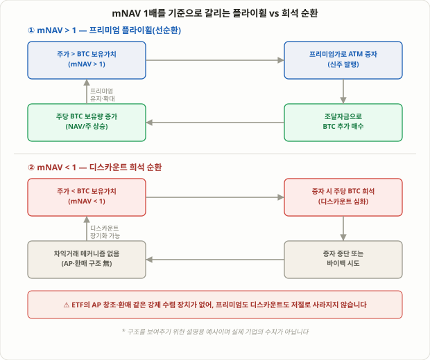

## mNAV란: 주가와 보유 비트코인 가치의 배수

**mNAV(market Net Asset Value)**는 비트코인 같은 디지털자산을 대량으로 사들여 재무상태표에 쌓아두는 "디지털자산 트레저리 기업(DAT, Digital Asset Treasury company)"의 핵심 밸류에이션 지표입니다. 공식은 겉보기엔 단순합니다.

```
mNAV = 기업가치(또는 시가총액) / 보유 비트코인의 현재 시장가치
```

mNAV가 1보다 크면 시장이 그 기업을 "보유한 비트코인보다 비싸게" 평가하고 있다는 뜻이고, 1보다 작으면 "보유한 비트코인보다 싸게" 거래되고 있다는 뜻입니다. 전략(Strategy, 구 마이크로스트래티지)이 2024년 11월 한때 3배를 넘는 mNAV로 거래되다가, 2026년 들어 여러 보도에서 1배 안팎까지 낮아졌다고 전해진 것이 이 지표가 대중적으로 알려진 계기입니다. 다만 이런 숫자는 보도 시점의 스냅샷일 뿐이며, 이 글을 읽는 시점의 실제 값은 직접 확인해야 한다는 점을 먼저 짚어둡니다.

여기서 함정이 하나 있습니다. "기업가치"를 어떻게 계산하느냐에 따라 같은 회사의 mNAV가 전혀 다른 숫자로 나옵니다. 실제로 한 시점에 전략의 mNAV가 보통주 시가총액 기준으로는 0.856, 전환사채 희석을 반영한 희석 기준으로는 0.954, 부채와 우선주를 더하고 현금을 뺀 기업가치(EV) 기준으로는 1.105로 동시에 보도된 적이 있습니다. 세 숫자 모두 "같은 회사, 같은 날"의 mNAV라고 불리지만 전혀 다른 값입니다. 그러므로 어떤 mNAV 수치를 보든 가장 먼저 할 일은 분모·분자에 무엇이 들어갔는지 확인하는 것입니다.

| mNAV 유형 | 분자 | 핵심 차이 |
|---|---|---|
| 기본(Basic) | 보통주 시가총액만 | 가장 단순하지만 부채·우선주 부담을 숨김 |
| 희석(Diluted) | 전환사채·옵션 희석 반영 시가총액 | 향후 전환 가능성까지 선반영 |
| 기업가치(EV) 기준 | 시가총액 + 부채 원금 + 우선주 − 현금 | 레버리지가 큰 기업일수록 기본 mNAV보다 1에 더 가깝거나 높게 나옴 |

## 프리미엄이 생기는 이유: 자기강화형 "플라이휠" 구조

mNAV가 1을 넘는 프리미엄 상태에서는, 이 기업이 시장에서 얻는 특권이 하나 생깁니다. 주식시장에서 공모증자(흔히 ATM, At-The-Market 발행 방식)로 신주를 팔아 현금을 모으면, 그 현금으로 비트코인을 더 사들일 수 있습니다. 핵심은 이 증자가 **주당 비트코인 보유량을 늘리는 방향으로 작동한다**는 점입니다. 프리미엄 상태에서는 신주 1주를 팔아 받는 돈이 그 주식이 대표하는 "원래 몫의 비트코인"보다 많기 때문에, 조달한 현금으로 비트코인을 사면 기존 주주의 주당 비트코인 보유량(BTC/share)이 오히려 늘어나는, 희석이 아니라 "증식"이 일어납니다.

이 순환이 반복되면 — 프리미엄 덕분에 증자 → 증자로 BTC/share 증가 → 늘어난 보유자산이 다시 프리미엄을 정당화 — 시장은 이를 **플라이휠(flywheel)**이라고 부릅니다. 전략의 초기 성장기에 이 구조가 주가를 비트코인 자체보다 훨씬 가파르게 끌어올린 핵심 동력으로 거론됐습니다. 반대로 mNAV가 1 밑으로 떨어지면 같은 메커니즘이 정반대로 작동합니다. 이제 신주를 팔아도 받는 돈이 그 주식의 원래 비트코인 몫보다 적기 때문에, 증자는 기존 주주의 BTC/share를 **깎아먹는** 희석 행위가 됩니다. 그러면 경영진은 증자를 멈추거나 오히려 자사주 매입으로 전환할 유인이 생기는데, 이는 성장 동력(새 비트코인 매수)을 스스로 포기하는 선택이기도 합니다.

<figure class="diagram">
  
  <figcaption>mNAV 1배를 기준으로 증자가 플라이휠(프리미엄)로 작동할지, 희석(디스카운트)으로 작동할지가 갈리며, 어느 쪽이든 외부 차익거래자가 가격을 강제로 되돌리는 장치는 없습니다.</figcaption>
</figure>

## mNAV를 활용한 두 가지 접근법

**① 평균회귀 베팅 — 디스카운트에서 매수, 프리미엄에서 매도.** 가장 단순한 접근은 mNAV가 1에서 크게 벗어났을 때 되돌림을 기대하고 반대 방향에 거는 것입니다. 하지만 [ETF 괴리율 매매법](/strategies/etf-premium-discount-nav-arbitrage/)에서 다룬 AP(지정참가회사)의 창조·환매 같은 강제 수렴 메커니즘이 DAT 주식에는 전혀 존재하지 않습니다. 디스카운트가 "싸다"는 신호가 아니라 "시장이 이 회사의 부채 부담이나 플라이휠 지속 가능성을 의심하고 있다"는 신호일 수 있다는 점을 먼저 가려내야 합니다. 디스카운트를 좁히는 현실적인 촉매는 자사주 매입, 혹은 — 업계 리서치에서 거론되는 흔치 않은 경우지만 — 프리미엄 상태의 다른 DAT가 디스카운트 상태의 DAT를 인수해 즉시 저평가 자산을 흡수하는 "DAT 간 인수"입니다.

**② 페어 트레이딩 — 방향성을 제거하고 mNAV 스프레드만 남기기.** [페어 트레이딩(통계적 차익거래)](/strategies/pairs-trading-stat-arb/)의 논리를 그대로 가져와, DAT 주식을 매수(또는 매도)하면서 동시에 비트코인 현물이나 무기한선물을 반대 방향으로 매도(또는 매수)하면, 비트코인 가격 자체의 방향성 위험을 상당 부분 제거하고 mNAV 스프레드의 변화만 남길 수 있습니다. 예를 들어 mNAV가 비정상적으로 높다고 판단되면 DAT 주식을 매도하고 비트코인을 매수해, 프리미엄이 정상화될 때 수익을 노립니다. 다만 이 구조에는 세 가지 마찰 비용이 따릅니다. 주식을 공매도하려면 대차 가능 여부와 대차 수수료를 확인해야 하고, 비트코인 쪽은 무기한선물의 펀딩비([펀딩비 차익거래](/strategies/funding-rate-arbitrage/) 참고)가 추가로 붙으며, DAT 주가는 비트코인 가격 변화에 단순 1배가 아니라 통상 1.5~2.5배 수준의 베타로 반응한다고 거론되기 때문에 헤지 비율을 비트코인 1단위 대 주식 1단위로 맞추면 안 됩니다.

## 숫자로 보는 가상 예시

아래 수치는 메커니즘을 보여주기 위한 가상의 예시이며, 특정 기업의 실제 공시 데이터가 아닙니다.

**① 프리미엄(mNAV 1.3배) 상황.** 가상 기업 A사는 비트코인 10,000개를 보유하고 있고, 비트코인 가격은 1개당 1억 원입니다. 보유 비트코인 가치는 1조 원입니다. 발행주식은 100만 주이고, 시가총액은 1조 3천억 원(mNAV = 1.3배)이라, 주가는 130만 원/주입니다. 증자 전 **BTC/주 = 10,000 / 1,000,000 = 0.0100개**입니다.

A사가 ATM 방식으로 1,300억 원 규모의 신주를 현재가(130만 원)에 발행하면 신주 100,000주(1,300억 / 130만 원)가 생겨 발행주식은 110만 주가 됩니다. 이 1,300억 원 전액으로 비트코인을 매수하면 1,300개(1,300억 / 1억)를 추가로 사들여 보유량은 11,300개가 됩니다. 증자 후 **BTC/주 = 11,300 / 1,100,000 ≈ 0.01027개**로, 기존 0.0100개보다 오히려 **늘어납니다**. 프리미엄 상태에서는 신주 1주를 팔아 받은 돈이 그 주식의 "원래 몫"보다 더 많은 비트코인을 사는 데 쓰이기 때문입니다.

**② 디스카운트(mNAV 0.8배) 상황.** 같은 A사가 비트코인·보유주식 구조는 동일하지만 시가총액이 8천억 원(mNAV = 0.8배, 주가 80만 원/주)이라고 가정합니다. 똑같이 1,300억 원 규모의 신주를 발행하면, 이번에는 주가가 낮기 때문에 신주 162,500주(1,300억 / 80만 원)가 필요해 발행주식은 1,162,500주로 늘어납니다. 조달한 1,300억 원으로 똑같이 비트코인 1,300개를 사들여 보유량은 11,300개가 되지만, **BTC/주 = 11,300 / 1,162,500 ≈ 0.00972개**로 기존 0.0100개보다 **줄어듭니다**.

| 구분 | 증자 전 BTC/주 | 증자 후 BTC/주 | 변화 |
|---|---|---|---|
| 프리미엄(mNAV 1.3배)에서 증자 | 0.0100 | 약 0.01027 | 증가(증식) |
| 디스카운트(mNAV 0.8배)에서 증자 | 0.0100 | 약 0.00972 | 감소(희석) |

같은 금액을 조달해 같은 금액만큼 비트코인을 사들여도, 결과는 정반대입니다. 이 예시에서 핵심은 숫자 자체가 아니라, **mNAV 1배가 "증자가 기존 주주에게 이득인지 손해인지"를 가르는 산술적 분기점**이라는 구조입니다.

## mNAV 매매 vs ETF 괴리율 vs 폐쇄형펀드 디스카운트

| 구분 | ETF 괴리율 | 폐쇄형펀드(CEF) 디스카운트 | DAT 주식의 mNAV |
|---|---|---|---|
| 차익거래 메커니즘 | AP 창조·환매로 상시 작동 | 공식 메커니즘 없음 | 공식 메커니즘 없음 |
| 괴리 지속 기간 | 보통 몇 시간~며칠 | 수개월~수년 | 수개월~수년, 혹은 구조적으로 영구화 가능 |
| 가격이 되돌아오는 경로 | AP의 무위험 차익거래 | 탠더오퍼, 행동주의 캠페인 | 경영진의 자발적 증자/바이백 결정, DAT 간 인수 |
| 경영진의 역할 | 중립적(차익거래자가 가격을 움직임) | 제한적 | **결정적**(증자·바이백 타이밍 자체가 플라이휠 방향을 바꿈) |
| 레버리지·부채 민감도 | 낮음(상품 구조에 한정) | 중간 | 높음(전환사채·우선주 발행 기업일수록 EV mNAV가 기본 mNAV와 크게 벌어짐) |

DAT 주식이 ETF나 CEF와 근본적으로 다른 지점은, 가격을 되돌리는 주체가 외부의 차익거래자가 아니라 **그 회사의 경영진 자신**이라는 데 있습니다. 경영진이 프리미엄을 지키기 위해 증자 속도를 조절하거나, 디스카운트를 좁히기 위해 바이백에 나서는 것 자체가 하나의 재무 정책이자 동시에 투자자가 읽어야 할 신호입니다.

## 실전 체크포인트

- **어떤 mNAV를 보고 있는지 먼저 확인**: 기본·희석·EV 기준 중 어느 것인지에 따라 같은 날 같은 회사의 숫자가 크게 달라집니다. 서로 다른 기준으로 산출된 숫자를 비교하면 안 됩니다.
- **부채·전환사채 만기 구조를 함께 확인**: [전환사채 차익거래](/strategies/convertible-bond-arbitrage/)에서 다룬 것처럼, 전환사채 발행이 많은 DAT 기업은 전환가 이하로 주가가 떨어지면 버스티드 컨버터블 리스크와 희석 가능성이 동시에 커집니다.
- **우선주 배당 부담을 비트코인 현금흐름과 비교**: 영구우선주로 조달한 기업은 매년 고정 배당 의무가 쌓이는데, 비트코인 보유 자체는 현금흐름을 만들지 않으므로 이 배당을 갚을 자금원을 따로 확인해야 합니다.
- **DAT 주식은 비트코인의 "순수한" 대리물이 아님**: 베타가 1.5~2.5배 수준으로 보도되는 경우가 많아, 비트코인 익스포저만 원한다면 현물이나 ETF가 더 깔끔한 선택일 수 있습니다.
- **같은 업종 내 기업 간 비교**: 모든 DAT 기업이 같은 방식으로 움직이지 않습니다. 부채 비중이 낮고 보유자산이 단순한 기업과, 전환사채·영구우선주를 적극 활용하는 기업은 같은 비트코인 가격 변동에도 전혀 다른 mNAV 반응을 보입니다.

## 자주 묻는 질문

### mNAV가 1 아래면 무조건 저평가된 매수 기회인가요?
아닙니다. 1 아래라는 것은 시장이 그 기업의 부채 부담, 플라이휠 지속 가능성, 또는 경영 신뢰도에 의문을 갖고 있다는 신호로 읽히는 경우가 많습니다. ETF처럼 가격을 강제로 되돌리는 메커니즘이 없기 때문에, 디스카운트가 "일시적 저평가"가 아니라 "구조적으로 정당한 가격"일 가능성을 먼저 배제해야 합니다.

### 모든 비트코인 트레저리 기업이 같은 패턴으로 움직이나요?
아닙니다. 부채와 우선주 발행 규모, 보유 비트코인 대비 시가총액 비율, 경영진의 자본배분 전략이 기업마다 달라서 같은 시점에도 어떤 회사는 프리미엄을, 다른 회사는 디스카운트를 기록하는 경우가 보고됩니다. 비교할 때는 반드시 같은 mNAV 산출 기준을 적용해야 합니다.

### mNAV 디스카운트는 ETF 괴리율처럼 금방 사라지나요?
아닙니다. ETF는 AP의 창조·환매라는 상시 차익거래 메커니즘 덕분에 괴리가 보통 몇 시간~며칠 내에 좁혀지지만, DAT 주식은 그런 장치가 없어 디스카운트가 수개월~수년간, 혹은 경영진이 자발적으로 대응하지 않는 한 그대로 유지될 수 있습니다.

## 한계와 유의점

- **정의가 통일돼 있지 않음**: 업계 리서치(NYDIG 등)에서도 mNAV의 원래 정의 자체가 운영 사업의 실질 가치나 전환사채의 현금 상환 위험을 반영하지 못한다는 비판이 제기됩니다. 하나의 숫자로 기업 전체를 평가하려는 시도는 과도한 단순화일 수 있습니다.
- **공시 지연과 보유량 변동**: 비트코인 보유량은 공시 시점과 실제 조회 시점 사이에 바뀌어 있을 수 있어, 최신 공시(예: 거래소 공시, 보도자료)를 직접 확인해야 합니다.
- **검증된 백테스트 전략이 아님**: 이 글의 체크포인트들은 초과수익을 보장하는 전략이 아니라, mNAV라는 숫자를 오독하지 않기 위한 점검 절차로 받아들여야 합니다.
- **규제·세제 변화 리스크**: 디지털자산 트레저리 기업에 대한 회계 처리나 규제 환경은 여전히 변화하는 영역이라, 과거 패턴이 그대로 이어진다고 가정하기 어렵습니다.

## 정리

- **mNAV** = 기업가치(또는 시가총액) ÷ 보유 비트코인 가치이며, 기본·희석·EV 기준에 따라 같은 회사라도 숫자가 크게 달라집니다.
- mNAV가 1을 넘으면 프리미엄가 증자가 주당 비트코인 보유량을 늘리는 **플라이휠**로 작동하고, 1 밑으로 떨어지면 같은 증자가 **희석**으로 작동해 정반대 압력을 만듭니다.
- ETF의 AP 차익거래나 CEF의 탠더오퍼와 달리, DAT 주식의 가격을 되돌리는 주체는 외부 차익거래자가 아니라 **경영진의 증자·바이백 결정** 자신입니다.
- 평균회귀 베팅보다는 비트코인 현물·선물과 짝을 이룬 **페어 트레이딩**으로 방향성 위험을 줄이는 접근이 구조적으로 더 명확하지만, 대차 비용·펀딩비·베타 불일치라는 별도의 마찰 비용이 따릅니다.
- 어떤 mNAV 산출 기준을 보고 있는지, 부채와 우선주 부담이 얼마나 큰지를 먼저 확인하는 것이 숫자 하나만 보고 판단하는 것보다 중요합니다.
