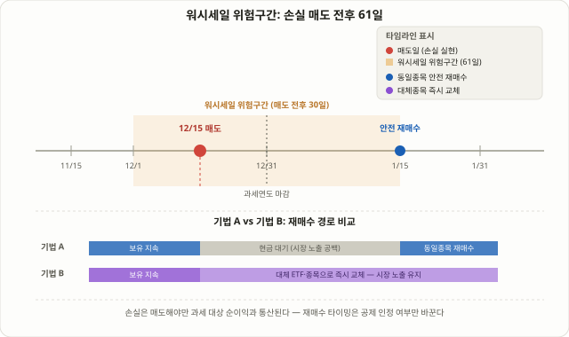

## 해외주식 양도소득세 절세란: 국내주식과는 완전히 다른 룰

연말이 다가오면 해외주식 투자자들 사이에서 꼭 한 번씩 올라오는 질문이 있습니다. "올해 수익 난 종목 세금 아끼려면 손실 난 종목을 지금 팔아야 하나요?" 이 질문에 답하는 기법이 **해외주식 양도소득세 절세(Tax-Loss Harvesting)**입니다. 쉽게 말하면, 평가손실 상태인 종목을 연말 전에 실제로 매도해 손실을 "확정"시키고, 이 손실을 같은 해에 실현한 양도차익과 합산(통산)해 과세 대상 금액 자체를 줄이는 기법입니다.

여기서 반드시 짚어야 할 전제가 있습니다. 이 기법은 **국내 상장주식에는 거의 적용되지 않습니다.** 금융투자소득세(금투세)가 폐지된 채 유지되고 있는 지금, 일반 개인투자자의 국내 상장주식 매매차익은 원칙적으로 비과세이기 때문입니다(종목당 보유 금액이 큰 대주주 등 예외는 있지만, 대부분의 개인투자자에게는 해당하지 않습니다). 반면 **해외주식은 다릅니다.** 해외주식 양도차익은 연 250만원의 기본공제를 넘는 순이익에 대해 22%(양도소득세 20% + 지방소득세 2%)가 과세되고, 이 구조이기 때문에 "손실을 일부러 확정해서 과세 대상 순이익을 줄인다"는 전략 자체가 실제로 돈이 되는 영역입니다. 이 강의는 해외주식을 보유한 국내 투자자를 기준으로 설명하며, 뒤에서 미국 자체의 제도도 비교해 다룹니다.

## 왜 효과가 있는가: 손실은 "실현"해야만 세금 계산에 들어간다

이 기법이 통하는 이유는 세법의 아주 단순한 전제 하나에서 나옵니다. 과세당국은 **아직 팔지 않은 평가손실을 손실로 인정하지 않습니다.** 어떤 종목이 매수가보다 30% 떨어진 채 계좌에 남아 있어도, 그 손실은 서류상으로만 존재하는 "미실현 손실"이며 양도소득세 계산에는 전혀 반영되지 않습니다. 반대로 올해 다른 종목을 팔아 이익을 실현했다면, 그 이익은 매도한 순간 과세 대상으로 확정됩니다.

이 비대칭이 핵심입니다. 이익은 팔면 바로 세금 계산에 들어오지만, 손실은 팔지 않으면 영원히 세금 계산 밖에 머뭅니다. 그래서 올해 다른 종목에서 이미 수익을 실현했다면, 손실이 난 종목도 연말 전에 함께 매도해 "실현된 손실"로 전환시켜야만 두 금액이 서로 상쇄됩니다. 이 과정을 거치지 않으면, 투자자는 포트폴리오 전체로는 돈을 벌지 못했는데도 실현된 이익분에 대해서는 그대로 세금을 내야 하는 상황에 놓일 수 있습니다. 즉 이 기법은 수익률을 올리는 기법이 아니라, **이미 발생한 세금 부담을 포트폴리오에 실제로 존재하는 손실로 상쇄하는 회계적 기법**입니다. 시장을 예측하거나 저평가 종목을 찾는 것과는 전혀 다른 성격의 엣지라는 점을 분명히 해둘 필요가 있습니다.

여기에 한국 제도만의 중요한 특징이 하나 더 있습니다. 해외주식 양도소득세는 **그 해에 실현한 손익만 통산**할 수 있고, 미국처럼 쓰지 못한 손실을 다음 해로 넘기는 이월결손금 제도가 적용되지 않는다는 점이 여러 세무 자료에서 공통적으로 확인됩니다. 올해 손실을 실현하지 않고 넘기면, 그 손실로 아낄 수 있었던 세금은 내년이 와도 되살릴 수 없습니다. 이 점이 한국 투자자에게는 미국 투자자보다 **연말 타이밍이 훨씬 더 중요한 이유**입니다.

## 재매수 제한: 한국엔 미국식 워시세일이 있는가

손실을 실현한 뒤, 그 종목을 여전히 좋다고 생각한다면 바로 다시 사면 되지 않을까요? 미국에는 이를 막는 명확한 규정이 있습니다. **워시세일 룰(Wash Sale Rule, IRC §1091)**은 매도 전후 30일 이내(총 61일 구간)에 동일하거나 "실질적으로 동일한(substantially identical)" 증권을 재매수하면, 그 손실에 대한 세금 공제를 인정하지 않는 제도입니다.

한국의 해외주식 양도소득세에는 이와 똑같은 조항이 법으로 명문화되어 있지 않습니다. 다만 그렇다고 "재매수가 완전히 안전하다"고 단정하기는 어렵습니다. 세무 자료들 사이에서도 이 부분은 결론이 갈립니다. 한쪽은 "한국 해외주식 양도세에는 미국식 재매수 제한이 없는 것으로 알려져 있다"고 설명하고, 다른 쪽은 "매도 직후 재매수하면 워시세일 의심을 받을 수 있다"고 경고합니다. 이 충돌 자체가 중요한 신호입니다. 국세기본법 14조의 **실질과세원칙**(형식이 아니라 실질적인 거래 내용을 기준으로 과세한다는 원칙)에 따라, 과세당국이 "손실 실현의 실질이 없는 형식적 거래"라고 판단할 여지가 이론적으로 남아 있기 때문입니다. 이 강의는 어느 한쪽 주장을 단정하지 않고, **보수적으로 접근할 것을 권장**합니다. 명문화된 숫자 규정이 없다는 이유로 공격적으로 당일 재매수를 반복하기보다는, 뒤에서 다룰 대체종목 교체나 최소한의 대기 기간을 두는 쪽이 안전합니다.

<figure class="diagram">
  
  <figcaption>매도일 전후 30일(총 61일)이 워시세일 위험구간이다. 동일종목 재매수는 이 구간이 끝난 뒤까지 기다려야 하지만, 유사하지 않은 대체 ETF로 즉시 교체하면 시장 노출을 유지한 채로 손실만 확정할 수 있다.</figcaption>
</figure>

## 기법 A vs 기법 B: 현금 대기 후 재매수 vs 유사종목으로 즉시 교체

손실을 확정한 뒤 시장에서 완전히 빠져 있을 필요는 없습니다. 실무에서는 크게 두 가지 접근이 쓰입니다.

**기법 A — 현금 보유 후 재매수.** 종목을 매도해 손실을 확정한 뒤, 워시세일 위험구간(61일)이 끝날 때까지 현금으로 대기하다가 똑같은 종목을 다시 매수하는 방식입니다. 가장 단순하고 분쟁의 여지가 가장 적은 방법이지만, 그 종목이 대기 기간 중 크게 반등하면 그 상승분을 놓치는 기회비용이 생깁니다.

**기법 B — 대체종목으로 즉시 교체.** 손실 난 종목을 매도하면서, 동시에 업종이나 투자 테마가 유사하지만 "동일 종목"은 아닌 다른 종목이나 ETF로 바로 갈아타는 방식입니다. 예를 들어 미국 대형 기술주 ETF를 손실 상태로 매도했다면, 운용사가 다른 S&P500 추종 ETF로 즉시 교체해 지수 노출은 유지하면서도 동일 종목 재매수는 피하는 식입니다. 개별 종목이라면 같은 섹터의 다른 대표 종목으로 교체하는 방식도 있습니다. 이 접근의 장점은 시장이 반등해도 그 움직임을 거의 그대로 따라갈 수 있다는 것이고, 단점은 "실질적으로 동일한 증권"에 해당하는지 애매한 경계가 존재한다는 점입니다. 예컨대 같은 지수를 추종하는 ETF를 운용사만 바꿔 교체하는 경우, 미국 기준으로도 실질적 동일성 여부에 대한 논쟁이 있을 수 있어 완전히 안전하다고 보기는 어렵습니다.

| 구분 | 기법 A: 현금 대기 후 재매수 | 기법 B: 대체종목 즉시 교체 |
|---|---|---|
| 핵심 방식 | 손실 확정 후 61일 대기, 동일종목 재매수 | 손실 확정과 동시에 유사·비동일 종목으로 교체 |
| 시장 노출 공백 | 대기 기간 동안 공백 발생 | 거의 공백 없음 |
| 과세 리스크 | 가장 낮음 (재매수 자체를 늦춰 분쟁 여지 최소화) | 교체 종목이 "실질적으로 동일"하지 않은지 스스로 판단해야 함 |
| 필요한 작업 | 거의 없음 (대기만 하면 됨) | 유사하되 동일하지 않은 대체 종목·ETF를 미리 찾아둬야 함 |
| 적합한 상황 | 단기 반등 가능성이 낮다고 보는 종목 | 지수·섹터 노출 자체를 계속 유지하고 싶은 경우 |
| 주요 리스크 | 대기 중 반등을 놓치는 기회비용 | 대체 종목 선택이 과세당국 기준에서 모호할 수 있음 |

두 기법 모두 "손실은 실제로 매도해야만 세금 계산에 반영된다"는 같은 전제에서 출발합니다. 기법 A는 재매수 타이밍을 늦춰 분쟁 가능성 자체를 줄이는 쪽이고, 기법 B는 포트폴리오의 시장 노출을 지키는 대가로 대체 종목 선택의 적절성을 투자자가 직접 책임지는 쪽입니다.

## 숫자로 보는 예시 (교육용 단순화 사례)

실제 특정 투자자의 데이터가 아니라, 손익 통산의 구조를 숫자로 보여주기 위한 가상의 단순화 사례입니다.

투자자 C가 올해 해외주식 A종목을 매도해 800만원의 양도차익을 이미 실현했다고 가정합니다. 동시에 B종목은 300만원 평가손실 상태로 아직 보유 중입니다.

- **손실을 매도하지 않을 경우**: 과세 대상 순이익 = 800만원 − 250만원(기본공제) = 550만원. 세금 = 550만원 × 22% = 121만원.
- **연말 전 B종목을 매도해 손실을 확정할 경우**: 과세 대상 순이익 = 800만원 − 300만원(손실 통산) − 250만원(기본공제) = 250만원. 세금 = 250만원 × 22% = 55만원.

같은 포트폴리오, 같은 시점인데도 B종목을 실현하느냐 아니냐에 따라 세금 차이가 66만원(121만원 − 55만원)이 발생합니다. 여기서 중요한 점은, 투자자가 B종목을 "믿고" 계속 들고 가고 싶다면 기법 B처럼 유사한 대체 종목으로 교체해 시장 노출은 유지하면서도 이 66만원의 절세 효과를 그대로 챙길 수 있다는 것입니다. 물론 이 숫자는 메커니즘을 보여주기 위한 가상의 예시일 뿐, 실제 세금은 다른 거래 내역·공제 항목·환율에 따라 달라집니다.

## 미국 시장은 어떨까: IRC §1091 워시세일 룰과 무기한 이월

이 기법의 원형은 미국 세법입니다. 미국은 자본손실을 그 해의 자본이익과 상쇄하고, 남는 손실은 일반소득에서 연 3,000달러까지 추가로 공제할 수 있습니다. 그리고 한국과 가장 크게 다른 점은, 그래도 남는 손실은 **무기한으로 다음 해 이후까지 이월(carryforward)**해서 쓸 수 있다는 것입니다. 앞서 설명했듯 한국의 해외주식 양도소득세는 이월결손금 제도가 적용되지 않기 때문에, 미국 투자자보다 한국 투자자에게 "연말 안에 실현하지 못하면 그 손실의 세금 효과는 사라진다"는 압박이 훨씬 크게 작동합니다.

워시세일 룰(IRC §1091)은 이 손실 공제를 남용하지 못하도록 거는 안전장치입니다. 매도일 전 30일부터 매도일 후 30일까지, 총 61일 구간 안에 동일하거나 실질적으로 동일한 증권(같은 종목의 콜옵션 매수 등도 포함될 수 있습니다)을 다시 사면 그 손실은 그 해 공제 대상에서 빠지고, 대신 재매수한 주식의 매수 단가에 그 손실분이 더해지는 방식으로 뒤로 이연됩니다. 즉 세금을 영원히 피하는 것이 아니라, 공제받는 시점만 미뤄지는 구조입니다.

## 한계와 함정

- **"워시세일이 없다"는 말을 안전 신호로 오해하지 말 것**: 한국 해외주식 양도세에 미국식 워시세일 조항이 명문화되어 있지 않다는 것이, 실질과세원칙에 따른 사후 판단 리스크까지 없다는 뜻은 아닙니다.
- **이월결손금이 적용되지 않는다**: 올해 실현하지 못한 손실은 내년으로 넘어가지 않습니다. 연말 타이밍을 놓치면 그 해의 절세 기회 자체가 사라집니다.
- **환율이 숫자를 흔든다**: 주가가 손실이어도, 매수·매도 시점의 환율 차이 때문에 원화 기준 손익은 달라질 수 있습니다. 세금 계산은 원화 환산 기준으로 이뤄진다는 점을 반드시 확인해야 합니다.
- **결제일(settlement date) 기준 컷오프**: 해외주식은 체결일이 아니라 결제가 완료되는 날짜를 기준으로 그 해 귀속 여부가 정해지는 경우가 많습니다. 미국 주식은 T+1 결제가 일반화됐지만, 증권사마다 공지하는 "연내 마지막 거래 가능일"을 반드시 연말 전에 확인해야 합니다.
- **거래비용이 절세 효과를 깎을 수 있다**: 수수료와 스프레드가 쌓이면, 소액 포지션에서는 절세 효과보다 거래비용이 더 커질 수 있습니다.
- **국내주식과는 통산되지 않는다**: 해외주식의 손익은 해외주식끼리만 합산됩니다. 국내 상장주식에서 난 손익과는 섞이지 않습니다.

## 자주 묻는 질문

### 해외주식 손실을 매도하면 무조건 세금이 줄어드나요?
올해 이미 실현한 양도차익이 있어야 상쇄 효과가 생깁니다. 올해 실현한 이익이 전혀 없다면 손실을 확정해도 당장 줄일 세금이 없고, 한국 제도에서는 그 손실을 다음 해로 넘길 수도 없다는 점을 함께 고려해야 합니다.

### 손실 확정 후 바로 같은 종목을 다시 사면 안 되나요?
법적으로 명문화된 금지 규정은 없는 것으로 알려져 있지만, 국세기본법의 실질과세원칙에 따라 사후에 거래의 실질을 문제 삼을 여지가 이론적으로 남아 있습니다. 확실한 안전을 원한다면 일정 기간 대기하거나, 유사하지만 동일하지 않은 종목으로 교체하는 쪽이 보수적인 선택입니다.

### 이 기법으로 수익률 자체가 좋아지나요?
아닙니다. 이 기법은 투자 수익률을 높이는 전략이 아니라, 이미 발생한 세금 부담을 실제 손실로 상쇄하는 회계적 기법입니다. 시장 방향이나 종목 선택과는 무관하며, 세금 계산 구조를 이해하고 타이밍을 맞추는 것이 전부입니다.

## 정리

- 해외주식 양도소득세 절세는 평가손실 종목을 연말 전 실제로 매도해 손실을 확정하고, 같은 해 실현한 양도차익과 통산해 과세 대상 순이익을 줄이는 기법입니다.
- 국내 상장주식은 대부분 비과세이므로 이 기법은 해외주식(연 250만원 기본공제, 22% 세율)에 한정해 의미가 있습니다.
- 한국은 이월결손금 제도가 없어, 그 해에 실현하지 못한 손실은 다음 해로 넘어가지 않습니다 — 이것이 미국보다 한국 투자자에게 연말 타이밍이 더 중요한 이유입니다.
- 미국식 워시세일 룰(61일 재매수 제한)이 한국 법에 명문화돼 있지는 않지만, 실질과세원칙에 따른 리스크가 이론적으로 남아 있어 당일 재매수보다는 대기 또는 대체종목 교체가 보수적인 선택입니다.
- 거래비용, 환율, 결제일 기준 컷오프를 함께 확인하지 않으면 계산상의 절세 효과가 실제로는 줄어들 수 있습니다.
