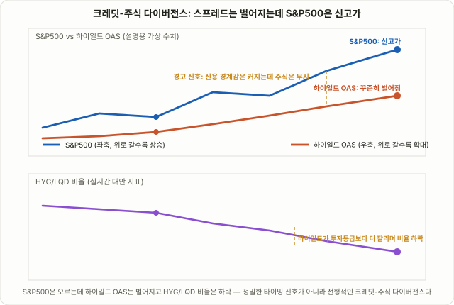

## 채권시장이 주식시장보다 먼저 안다는 말, 진짜일까

"채권시장이 주식시장보다 똑똑하다"는 말을 월가에서 종종 듣게 됩니다. 근거 없는 격언이 아닙니다. 회사가 망하면 가장 먼저 돈을 받는 쪽은 주주가 아니라 채권자입니다. 그래서 채권, 특히 신용등급이 낮은 하이일드(고수익) 채권에 돈을 넣는 투자자들은 기업의 펀더멘털 악화 신호에 주식 투자자보다 민감하게 반응할 수밖에 없는 구조적 이유가 있습니다. 이 긴장 관계를 숫자로 포착하는 지표가 바로 **하이일드 크레딧 스프레드**입니다. 지금까지 이 강좌에서는 [112강 인터마켓 분석](/strategies/intermarket-analysis/)을 통해 채권·주식·원자재·달러가 서로 어떤 선행-후행 관계를 보이는지 다뤘지만, 그 강의에서도 깊게 들어가지 않았던 영역이 하나 있습니다. 바로 국채가 아니라 **회사채**, 그중에서도 신용위험이 가장 크게 반영되는 하이일드 채권의 스프레드가 벌어지고 좁아지는 흐름입니다. 이번 강의에서는 이 지표가 정확히 무엇을 측정하는지, 왜 주식시장보다 먼저 경고음을 내는 경우가 있다고 이야기되는지, 그리고 개인 투자자가 실시간으로 확인할 때 가장 널리 쓰이는 HYG/LQD 비율이 왜 함정을 품고 있는지를 순서대로 짚어보겠습니다.

## OAS란 무엇인가: 신용 스프레드의 정체

하이일드 크레딧 스프레드를 가장 정밀하게 측정하는 지표는 **옵션조정스프레드(OAS, Option-Adjusted Spread)**입니다. 쉽게 말하면, 같은 만기의 국채 대비 회사채가 추가로 얹어주는 수익률입니다. 예를 들어 어떤 하이일드 채권 지수의 평균 수익률이 8%이고 비슷한 만기의 국채 수익률이 4.5%라면, 단순 스프레드는 3.5%포인트(350bp)입니다. 여기에 "옵션조정"이라는 수식어가 붙는 이유는, 많은 회사채가 발행사가 조기에 상환할 수 있는 콜옵션 같은 내재된 옵션을 가지고 있어서, 이 옵션이 수익률에 주는 왜곡 효과를 걸러내야 순수하게 신용위험(이 회사가 돈을 못 갚을 위험)만 남기 때문입니다.

가장 널리 참조되는 지수는 ICE BofA US 하이일드 지수의 OAS로, 미국 세인트루이스 연방준비은행의 FRED 데이터베이스에서 'BAMLH0A0HYM2'라는 코드로 무료로 매일 확인할 수 있습니다. 다만 이 데이터는 보통 하루 정도의 지연을 두고 갱신된다는 점을 염두에 두어야 합니다. 이 스프레드가 **좁아진다**는 것은 투자자들이 신용위험을 적게 요구한다는 뜻, 즉 "지금 같은 분위기라면 이 회사들이 돈을 못 갚을 가능성은 낮다"고 시장이 베팅하고 있다는 뜻입니다. 반대로 스프레드가 **벌어진다**는 것은 같은 돈을 빌려주는 데도 더 높은 보상을 요구한다는 뜻이고, 이는 신용위험에 대한 경계감이 커지고 있다는 신호로 읽힙니다.

## 왜 작동하는가: 선순위 채권자의 눈과 주식시장의 눈은 다르게 움직인다

크레딧 스프레드가 주식시장의 조기 경고 지표로 자주 언급되는 데는 세 가지 구조적인 이유가 있습니다.

첫째, **청산 우선순위가 다릅니다.** 기업이 파산하면 채권자가 자산을 먼저 회수하고, 남는 게 있어야 주주에게 돌아갑니다. 그래서 채권 투자자는 "이 회사가 원금을 돌려줄 수 있는가"라는 하한선에 집중하는 반면, 주식 투자자는 성장 스토리·밸류에이션 멀티플·내러티브처럼 상한선 쪽의 기대에도 함께 반응합니다. 펀더멘털이 나빠지기 시작하는 초기 국면에서는, 하한선을 지키는 데 집중하는 채권시장이 상한선의 기대를 함께 쫓는 주식시장보다 먼저 흔들리는 경우가 많다고 설명됩니다.

둘째, **참여자 구성이 다릅니다.** 하이일드 채권시장은 보험사, 연금, 신용 전문 헤지펀드 등 재무제표와 현금흐름을 정밀하게 분석하는 전문 기관투자자 중심으로 움직입니다. 반면 주식시장은 모멘텀, 수급, 소매 심리 같은 비펀더멘털 요인의 영향을 상대적으로 더 크게 받는 구간이 존재합니다. 신용 분석에 특화된 자금이 먼저 포지션을 조정하면, 그 신호가 주식시장 전체의 리스크 선호도로 퍼지기까지 시차가 생길 수 있습니다.

셋째, **스프레드는 비선형적으로 반응합니다.** 신용등급이 낮을수록 아주 작은 펀더멘털 악화에도 부도 확률 추정치가 크게 튀어 오릅니다. 이 때문에 하이일드 스프레드는 투자등급 스프레드보다 민감도가 훨씬 커서, 경기 사이클의 변곡점을 상대적으로 먼저, 또 상대적으로 크게 반영하는 경향이 있다고 자주 언급됩니다.

<figure class="diagram">
  
  <figcaption>크레딧 스프레드(주황색)가 벌어지는데 S&P500(파란색)은 신고가를 이어가는 다이버전스 구간과, 같은 구간에서 하락하는 HYG/LQD 비율(하단)을 함께 보여준다.</figcaption>
</figure>

여기서 꼭 짚어야 할 점이 있습니다. 한 민간 데이터 제공업체가 공개한 분석에서는 1997년 이후 발생한 주요 시장 하락 국면 전부에서 하이일드 OAS가 저점에서 먼저 반등하기 시작한 뒤 S&P500이 고점을 찍기까지 평균적으로 수개월의 시차가 있었다는 주장이 나온 적이 있습니다. 하지만 이는 특정 업체가 자체 기준으로 집계한 하나의 분석 결과일 뿐, 모든 하락장에 예외 없이 적용되는 검증된 법칙이 아닙니다. "스프레드가 일정 수준을 넘으면 반드시 주식이 몇 달 안에 떨어진다"는 식의 기계적 규칙으로 받아들여서는 안 되며, 참고할 만한 하나의 역사적 관찰 사례로 다뤄야 합니다.

## 실전 추적법: HYG/LQD 비율과 반드시 알아야 할 함정

OAS는 정밀하지만 FRED 같은 공식 소스는 하루 늦게 갱신되는 데이터입니다. 실시간으로 신용시장의 분위기를 체크하고 싶은 개인 투자자들이 널리 쓰는 대안은 두 ETF의 비율입니다.

- **HYG**: 하이일드(고수익) 회사채를 담는 대표적인 ETF
- **LQD**: 투자등급 회사채를 담는 대표적인 ETF

HYG/LQD 비율이 하락한다는 것은 하이일드 채권이 투자등급 채권보다 더 많이 팔린다는 뜻이고, 이는 "신용위험이 낮은 안전한 채권으로 돈이 몰리고, 위험이 큰 채권에서는 돈이 빠진다"는 전형적인 리스크오프(위험회피) 신호로 해석됩니다. 장중에 실시간으로 확인할 수 있고 누구나 접근 가능한 증권 계좌로 바로 볼 수 있다는 점에서 매력적인 지표입니다.

다만 여기에는 반드시 알아야 할 구조적 함정이 있습니다. **듀레이션 불일치**입니다. 신용등급이 높은 투자등급 기업은 낮은 금리로 돈을 오래 빌릴 수 있기 때문에 장기채를 선호하는 경향이 있고, 그래서 LQD의 평균 듀레이션은 보통 8~9년 수준으로 긴 편입니다. 반면 하이일드 기업은 장기로 돈을 빌리기 부담스러운 경우가 많아 상대적으로 만기가 짧은 채권을 발행하는 경향이 있어, HYG의 평균 듀레이션은 보통 3~4년 수준으로 짧은 편입니다.

이 차이가 왜 문제가 될까요. 금리가 신용위험과 무관하게 전반적으로 오르내리기만 해도, 듀레이션이 긴 LQD가 듀레이션이 짧은 HYG보다 가격이 훨씬 크게 움직입니다. 그래서 순수하게 금리만 움직였을 뿐 신용위험에는 변화가 전혀 없는 상황에서도 HYG/LQD 비율이 출렁일 수 있습니다. 가령 금리가 전반적으로 오르면 LQD가 HYG보다 더 크게 떨어져 비율 자체는 오히려 **올라가는** 가짜 "리스크온" 신호가 나올 수 있고, 금리가 전반적으로 내리면 반대의 가짜 "리스크온" 신호가 나올 수도 있습니다. 실제로 일부 시장 분석가들은 2018년처럼 주식시장이 신고가를 경신하는 동안에도 HYG/LQD 비율이 금리 요인 때문에 계속 밀리면서 신용시장 신호와 주식시장 신호가 엇갈린 사례를 지적하기도 했습니다. 이 함정 때문에 HYG/LQD 비율은 OAS를 완전히 대체하는 지표가 아니라, OAS의 흐름과 함께 교차 확인하는 보조 지표로 다뤄야 합니다.

## 크레딧 스프레드 vs VIX: 같은 '공포지표'지만 다른 것을 잰다

크레딧 스프레드는 종종 VIX와 비슷한 역할을 하는 지표로 묘사되지만, 둘은 서로 다른 시장에서 서로 다른 것을 측정합니다. 이 차이를 분명히 알아두면 둘을 혼동하지 않고 상호 보완적으로 쓸 수 있습니다.

| 비교 항목 | 하이일드 크레딧 스프레드(OAS) | VIX |
|---|---|---|
| 측정 대상 | 채권시장이 요구하는 신용위험 보상 | S&P500 옵션의 향후 30일 내재변동성 |
| 참여자 중심 | 보험사·연금·신용 전문 헤지펀드 등 펀더멘털 중심 기관 | 옵션 매매자·헤저·변동성 트레이더 |
| 반응 속도 | 서서히, 누적적으로 벌어지는 경향 | 뉴스·이벤트에 급격하게 튀는 경향 |
| 잘 잡아내는 위험 | 천천히 번지는 신용 사이클 악화(에너지 섹터, 지역은행 부실 등) | 갑작스러운 충격(플래시크래시, 팬데믹 쇼크 등) |
| 데이터 확인 | FRED 등 공식 소스, 하루 지연 | 실시간 시세 |

[28강 VIX 선물 기간구조 매매법](/strategies/vix-term-structure-contango-backwardation/)에서 다룬 VIX는 '지금 당장 시장이 얼마나 겁을 먹고 있는가'를 보여주는 데 강하고, 크레딧 스프레드는 '펀더멘털이 조용히 썩어가고 있는가'를 보여주는 데 강합니다. 가장 위험한 조합은 크레딧 스프레드는 꾸준히 벌어지는데 VIX는 여전히 낮게 깔려 있는 경우로, 이는 종종 "시장이 아직 겁을 먹지는 않았지만 신용시장은 이미 경계하고 있다"는 조합으로 해석됩니다.

## 숫자로 보는 예시 (가상의 설명용 수치)

다음은 두 지표가 실제로 어떻게 함께 움직이는지 보여주기 위한 **가상의 설명용 예시**이며, 실제 시장 데이터가 아닙니다. 어떤 6주 구간 동안 하이일드 OAS가 300bp에서 시작해 꾸준히 올라 380bp로 마감했다고 가정해봅시다. 같은 기간 S&P500은 오히려 신고가 대비 1% 이내에서 거래되며 전혀 흔들리지 않았습니다. 이것이 전형적인 "크레딧-주식 다이버전스" 패턴으로 묘사되는 구간입니다.

같은 구간에서 HYG가 77.0달러에서 75.5달러로, LQD가 108.0달러에서 109.8달러로 움직였다고 가정하면, HYG/LQD 비율은 77.0/108.0 ≈ 0.713에서 75.5/109.8 ≈ 0.688로 약 3.6% 하락합니다. 이 비율 하락은 OAS가 80bp(약 27%) 벌어진 것과 같은 방향의 신호를 가리키며, 두 지표가 서로를 교차 확인해주는 셈입니다. 하지만 앞서 설명한 듀레이션 함정 때문에, 같은 기간 금리가 전반적으로 큰 폭 움직였다면 이 비율 변화 중 일부는 신용위험이 아니라 순수한 금리 효과일 수 있다는 점을 항상 염두에 둬야 합니다. 이 숫자들은 계산 원리를 보여주기 위한 가정치일 뿐, 실제 과거 데이터를 그대로 재현한 것이 아닙니다.

이런 다이버전스를 발견했을 때 할 수 있는 실전 대응은 "주식을 당장 전량 매도하라"는 신호가 아니라, 포트폴리오의 베타(시장 민감도)를 낮추거나, 신규 매수 규모를 줄이거나, 풋옵션 같은 헤지를 검토하는 리스크 관리 오버레이로 쓰는 것이 더 현실적입니다. 크레딧 스프레드는 타이밍을 정확히 짚어주는 지표가 아니라, 리스크가 누적되고 있다는 배경 신호를 주는 지표이기 때문입니다.

## 반드시 알아야 할 한계

- **선행 시차는 고정값이 아닙니다.** 몇 달이 걸릴 수도, 전혀 이어지지 않을 수도 있습니다. 스프레드가 벌어졌는데 주식시장이 별일 없이 지나가는 경우도 드물지 않습니다.
- **HYG/LQD 비율은 금리 효과와 신용 효과가 섞여 있습니다.** 앞서 다룬 듀레이션 함정 때문에, 비율 하나만 보고 신용위험이 커졌다고 단정해서는 안 됩니다.
- **OAS는 하루 지연된 데이터입니다.** 장중 빠른 판단이 필요하다면 HYG/LQD 비율 같은 실시간 대안과 함께 봐야 합니다.
- **스프레드 자체를 직접 거래하기는 쉽지 않습니다.** 대부분의 개인 투자자는 OAS를 직접 매매할 수 없고, HYG·LQD 같은 ETF 또는 이들을 활용한 페어 트레이드로 근사적인 노출만 만들 수 있습니다. [18강 페어 트레이딩](/strategies/pairs-trading-stat-arb/)에서 다룬 스프레드 매매 개념과 접근 방식이 비슷합니다.
- **단독 매매 신호가 아니라 필터로 쓰는 것이 더 안전합니다.** 시장폭, VIX, 다른 매크로 지표와 함께 교차 확인했을 때 신뢰도가 높아집니다.

## 자주 묻는 질문

### 왜 하이일드 스프레드가 주식시장보다 먼저 움직인다고 하나요?
채권자는 회사가 파산했을 때 자산을 먼저 회수하는 선순위 청산권을 가지고 있어 펀더멘털 악화에 더 민감하게 반응하는 경향이 있고, 하이일드 채권시장은 재무 분석에 특화된 전문 기관투자자 비중이 높아 신용 악화 신호를 상대적으로 빠르게 가격에 반영하는 경향이 있다고 설명됩니다. 다만 이는 일반적인 경향에 대한 설명이며, 모든 경우에 해당되는 보장된 법칙은 아닙니다.

### HYG/LQD 비율이 오르면 무조건 좋은 신호인가요?
아닙니다. 비율이 오르는 데는 두 가지 전혀 다른 이유가 있을 수 있습니다. 하나는 실제로 신용위험 선호도가 개선된 경우이고, 다른 하나는 금리가 전반적으로 하락해서 듀레이션이 긴 LQD가 HYG보다 더 크게 오른 경우입니다. 둘을 구분하려면 같은 기간 금리(국채 수익률)가 어느 방향으로 움직였는지 함께 확인해야 합니다.

### 개인 투자자가 OAS 데이터를 어디서 볼 수 있나요?
미국 세인트루이스 연방준비은행이 운영하는 FRED 데이터베이스에서 'BAMLH0A0HYM2' 코드로 ICE BofA US 하이일드 지수의 OAS를 무료로 매일 확인할 수 있습니다. 다만 보통 하루 정도 지연되어 갱신된다는 점을 참고해야 합니다.

## 정리

- 하이일드 크레딧 스프레드(OAS)는 국채 대비 신용위험이 낮은 회사가 요구하는 추가 수익률로, 벌어지면 신용위험 경계감이 커졌다는 신호, 좁아지면 경계감이 완화됐다는 신호로 읽힙니다.
- 채권자의 선순위 청산권, 전문 기관투자자 중심의 참여자 구성, 신용등급이 낮을수록 커지는 비선형적 민감도라는 세 가지 구조적 이유 때문에, 크레딧 스프레드는 주식시장보다 먼저 경계 신호를 보낸다고 자주 언급되지만 이는 검증된 법칙이 아니라 역사적으로 관찰되는 경향입니다.
- 실시간 대안인 HYG/LQD 비율은 접근성이 높지만, LQD(평균 듀레이션 8~9년)와 HYG(평균 듀레이션 3~4년)의 듀레이션 차이 때문에 순수한 금리 변동만으로도 비율이 출렁일 수 있다는 함정을 반드시 감안해야 합니다.
- VIX는 갑작스러운 충격을 빠르게 반영하고, 크레딧 스프레드는 천천히 번지는 펀더멘털 악화를 반영하는 경향이 있어 두 지표는 서로 보완적으로 쓰는 것이 합리적입니다.
- 가장 위험하게 여겨지는 조합은 크레딧 스프레드가 꾸준히 벌어지는데 주식과 VIX는 조용한 다이버전스 구간이며, 이를 발견했을 때는 전량 매도가 아니라 베타 축소·헤지 검토 같은 리스크 관리 오버레이로 접근하는 것이 더 현실적입니다.
