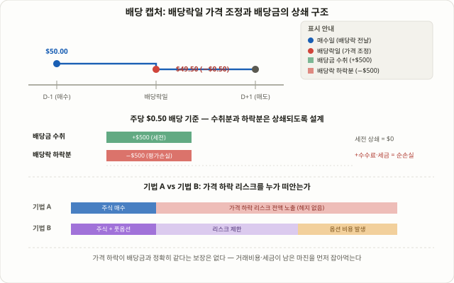

## 배당 캡처 전략이란: 배당만 받고 빠르게 손을 터는 기법

"배당 받으려고 주식 샀다가 배당받고 바로 팔아도 되나요?" — 배당 시즌마다 투자 커뮤니티에 반복해서 올라오는 질문입니다. 이 질문이 바로 **배당 캡처 전략(Dividend Capture Strategy)**의 핵심을 담고 있습니다. 장기 보유나 기업의 펀더멘털에는 관심 없이, 오직 배당금 하나만을 목표로 배당락일 직전에 주식을 매수해 배당 받을 권리를 확보한 뒤, 배당을 받고 나면 곧바로 매도해 빠져나가는 초단기 매매 기법입니다.

겉보기에는 단순합니다. 주가가 $50인 종목이 주당 $0.50의 배당을 준다면, 배당락일 전날까지만 들고 있으면 배당금을 받을 수 있고, 그 다음 날 바로 팔면 되는 것 아닌가 하는 생각이 듭니다. 하지만 이 전략이 실제로 돈이 되는지는 전혀 다른 이야기입니다. 이 강의에서는 왜 가격이 배당금만큼 떨어지도록 설계돼 있는지, 그 구조를 넘어서 세금과 거래비용까지 포함했을 때 정말 수익이 남는지를 숫자로 따라가 보겠습니다.

## 왜 배당락일에 가격이 떨어지는가: 시장 효율성과 배당락의 원리

배당 캡처가 "공짜 돈"처럼 보이지 않는 이유는 가격 자체에 있습니다. 기업이 배당을 지급하면, 그 돈은 기업의 현금에서 바로 빠져나갑니다. 기업의 내재가치가 그만큼 줄어드는 것이므로, 시장은 이를 즉시 가격에 반영합니다. 그래서 **배당락일(ex-dividend date)** 아침, 거래가 시작되는 순간 주가는 이론적으로 배당금만큼 낮게 조정됩니다. 배당락일 당일 매수하는 투자자는 이번 배당을 받을 권리가 없으므로, 그 사람이 지불할 "정당한" 가격은 배당 전 가격에서 배당금을 뺀 값이어야 한다는 논리입니다.

이 원리 때문에 배당 캡처의 손익 구조는 처음부터 균형을 이루도록 설계돼 있습니다. 배당락일 직전에 사서 배당을 받으면 +배당금이 생기지만, 동시에 주가는 이론적으로 −배당금만큼 떨어져 있습니다. 둘을 더하면 이론적으로는 0입니다. 즉 "배당금을 벌었다"는 느낌은 사실 포트폴리오 평가금액이 그대로인 상태에서 현금과 주식 사이의 형태만 바뀐 것에 가깝습니다. 이 지점을 이해하지 못하면 배당 캡처를 "매달 공짜로 배당을 받아가는 요령"으로 오해하기 쉽습니다.

물론 실제 시장은 교과서처럼 정확하게 움직이지 않습니다. 엘튼과 그루버(Elton & Gruber)를 비롯한 오래된 금융학 연구들은 실제 배당락일의 가격 하락분이 배당금 전액에는 못 미치는 경우가 많다고 보고해왔으며, 이를 세금 차이나 거래 미시구조 때문으로 설명하는 분석이 많습니다. 하지만 이것이 배당 캡처가 안정적으로 수익을 낸다는 뜻은 아닙니다. 하락분이 배당금보다 작을 때도 있고 더 클 때도 있으며, 그 차이는 종목의 변동성, 전체 시장 분위기, 그날의 수급에 따라 매번 달라지는 "노이즈"에 가깝다는 점을 분명히 해둘 필요가 있습니다.

<figure class="diagram">
  
  <figcaption>배당락일에 가격은 이론적으로 배당금만큼 조정된다. 배당금 수취분과 가격 하락분은 상쇄되도록 설계돼 있으며, 기법 A는 그 상쇄가 정확히 들어맞기를 기대하며 리스크를 그대로 안고, 기법 B는 풋옵션 비용을 치르고 그 리스크를 줄인다.</figcaption>
</figure>

## 타이밍이 전부다: T+1 결제와 배당기준일·배당락일 구조

배당을 받으려면 정확히 어느 날까지 주식을 들고 있어야 할까요? 여기에는 두 개의 핵심 날짜가 있습니다. **배당기준일(Record Date)**은 주주명부에 이름이 올라가 있어야 하는 날이고, **배당락일(Ex-Dividend Date)**은 그 날 이후에 산 주식에는 배당 권리가 없어지는 날입니다.

중요한 변화가 하나 있습니다. 미국 시장은 2024년 5월 28일부터 결제 기준을 T+2에서 T+1로 단축했고, 이 변화에 맞춰 거래소 규정도 바뀌면서 지금은 **배당기준일과 배당락일이 같은 날**로 통일돼 있습니다. 예전 T+2 체제에서는 배당락일이 배당기준일보다 하루 앞서 있었지만, 지금은 그 하루의 여유가 사라졌습니다. 실무적으로 이는, 배당을 받으려면 배당락일 전날까지는 매수 주문이 체결돼 있어야 한다는 뜻입니다. 배당락일 당일에 사면 그 배당은 이미 놓친 것입니다.

반대로 배당을 원하지 않는 투자자(배당소득세를 피하고 싶은 경우 등)라면, 배당락일 전날까지 매도를 완료해야 이번 배당 귀속에서 빠질 수 있습니다. 날짜를 하루라도 착각하면 전략 전체의 전제가 무너지므로, 실제로 매매하기 전에는 거래소 공시나 증권사가 제공하는 배당 캘린더로 정확한 배당락일을 반드시 재확인해야 합니다.

## 기법 A vs 기법 B: 단순 주식 캡처 vs 옵션 헤지형 배당 차익거래

배당 캡처를 실행하는 방식도 한 가지만 있는 것이 아닙니다. 리스크를 얼마나 떠안을지에 따라 크게 두 갈래로 나뉩니다.

**기법 A — 단순 주식 캡처.** 배당락일 전날까지 주식을 매수해 배당을 받은 뒤, 배당락일 당일이나 그 이후 적당한 시점에 그대로 매도하는 가장 단순한 방식입니다. 추가로 필요한 포지션이 없어 구조가 쉽지만, 그만큼 배당락일 당일 가격이 배당금보다 더 크게 떨어질 위험을 전부 투자자가 그대로 짊어집니다. 배당락 이후 전체 시장이 하락하거나 그 종목에 나쁜 뉴스가 겹치면, 배당으로 번 돈보다 훨씬 큰 손실을 떠안을 수 있습니다.

**기법 B — 옵션 헤지형 배당 차익거래.** 같은 주식을 사는 동시에, 비슷한 만기의 풋옵션을 매수하거나 [칼라(Collar) 전략](/strategies/collar-strategy-protective-hedge/)처럼 콜옵션을 함께 팔아 보호 풋의 비용을 일부 상쇄하는 방식입니다. 이렇게 하면 배당락일 이후 가격이 배당금보다 더 크게 빠지더라도, 풋옵션이 하락분을 막아주는 바닥 역할을 합니다. 이 방식의 약점은 명확합니다. 풋옵션에는 시간가치라는 비용이 붙고, 이 비용이 캡처하려는 배당금보다 크면 헤지를 거는 순간부터 이미 손실 구조가 됩니다. 그래서 이 기법은 배당수익률이 높고 변동성이 낮아 풋옵션 가격이 저렴한 종목에서만 의미가 있고, 수수료가 매우 낮은 마켓메이커나 기관 차익거래자들이 대규모로 반복할 때 비로소 작은 마진이 쌓이는 구조에 가깝습니다. 개인 투자자가 소규모로 실행하면 옵션 매매 수수료와 스프레드가 그 작은 마진을 그대로 잡아먹는 경우가 많습니다.

| 구분 | 기법 A: 단순 주식 캡처 | 기법 B: 옵션 헤지형 배당 차익거래 |
|---|---|---|
| 핵심 방식 | 주식만 매수해 배당 수취 후 매도 | 주식 매수 + 풋옵션(또는 칼라)으로 하락 방어 |
| 가격 하락 리스크 | 전액 노출 (헤지 없음) | 풋옵션이 바닥 역할, 하락 리스크 제한 |
| 추가 비용 | 거래수수료만 | 거래수수료 + 옵션 프리미엄(시간가치) |
| 적합한 투자자 | 소액·단발성으로 시도하는 개인 투자자 | 저비용 체결이 가능한 기관·마켓메이커 |
| 손익 구조 | 배당 ± 가격변동, 변동성에 그대로 노출 | 배당 − 옵션비용 ± 제한된 가격변동 |
| 주요 리스크 | 배당락 이후 추가 하락 시 손실 확대 | 옵션 비용이 배당금보다 크면 처음부터 손실 |

두 기법 모두 "배당금과 배당락 하락분은 이론상 상쇄된다"는 같은 전제에서 출발합니다. 기법 A는 그 상쇄가 정확히 들어맞기를 바라며 리스크를 그대로 받아들이는 쪽이고, 기법 B는 옵션 비용을 추가로 치르고 그 리스크를 깎아내는 쪽입니다.

## 숫자로 보는 예시 (교육용 단순화 사례)

실제 특정 종목의 데이터가 아니라, 손익 구조를 보여주기 위한 가상의 단순화 사례입니다.

투자자 D가 주가 $50인 XYZ 종목 1,000주를 배당락일 전날 매수했다고 가정합니다. 투입 금액은 $50,000이고, 분기 배당은 주당 $0.50(총 $500)입니다.

- **이론적으로 가격이 배당금만큼만 떨어지는 경우**: 배당락일 가격은 $49.50으로 조정됩니다. 다음 날 $49.50에 전량 매도하면 주식에서는 1,000주 × (−$0.50) = −$500의 평가손실이 나지만, 배당 $500을 받았으므로 세전 기준으로는 정확히 상쇄됩니다. 여기에 매수·매도 수수료와 스프레드(왕복 약 $10~20 가정)를 더하면 이미 소액의 순손실입니다.
- **세금까지 반영하면**: 이 투자자가 해외주식으로 미국 배당주를 보유한 한국 투자자라면, 배당 $500에는 한미 조세조약에 따른 15% 원천징수가 먼저 적용돼 순배당은 $425로 줄어듭니다. 이 금액은 국내에서 금융소득으로 분류돼, 다른 금융소득과 합쳐 연 2,000만원을 넘으면 종합과세 대상이 되어 세율이 더 올라갈 수 있습니다. 반면 주식에서 발생한 −$500의 평가손실은 전혀 다른 세금 바스켓인 해외주식 양도소득(22% 세율, 연 250만원 공제)에 속합니다.

이 두 번째 지점이 한국 투자자에게 특히 중요합니다. 배당소득과 양도차익(또는 손실)은 한국 세법상 서로 다른 소득 분류이기 때문에, 하나의 손실로 다른 하나의 세금을 줄이는 상쇄가 자동으로 일어나지 않습니다. 교과서적으로 가격 하락이 배당금과 정확히 같아 "본전"처럼 보이는 상황에서도, 배당소득에는 세금이 매겨지고 그에 대응하는 주식 손실은 양도소득 쪽 손익 통산에만 쓸 수 있을 뿐 배당소득세를 직접 줄여주지는 못합니다. [해외주식 양도소득세 절세 매매법](/strategies/tax-loss-harvesting-wash-sale/)에서 다뤘듯, 이 손실을 그냥 묵혀두면 같은 해의 다른 해외주식 양도차익과 통산할 수는 있지만, 그 기회조차 없다면 손실은 세금 혜택 없이 그대로 남습니다. 즉 이론상 중립적인 사례조차, 세금 구조의 비대칭 때문에 한국 투자자에게는 실질적으로 마이너스가 될 수 있습니다. 이 숫자들은 메커니즘을 보여주기 위한 가상의 예시이며, 실제 세율·공제·환율은 투자자의 상황과 시점에 따라 달라집니다.

## 한계와 함정

- **가격 하락이 배당금과 정확히 같지 않다**: 실제 하락분은 배당금보다 작을 수도, 전체 시장 변동성 때문에 훨씬 클 수도 있습니다. 배당락 당일의 변동성은 평소보다 커지는 경우가 많다는 점을 감안해야 합니다.
- **고배당률은 경고 신호일 수 있다**: 유독 높은 배당수익률을 내세우는 종목은 주가 약세, 현금흐름 악화, 또는 향후 배당 삭감 가능성을 반영한 결과일 수 있습니다. 배당만 보고 접근하면 그 뒤에 숨은 펀더멘털 위험을 놓치기 쉽습니다.
- **세금 바스켓이 다르다**: 앞서 다룬 대로, 배당소득과 양도손익은 과세 체계가 다르고 서로 상쇄되지 않는 경우가 많습니다. 미국 내 투자자라도 적격배당(qualified dividend) 혜택을 받으려면 배당락일을 중심으로 121일 구간 중 60일 넘게 보유해야 하는데, 배당 캡처는 애초에 이 조건을 충족할 수 없는 초단기 보유 구조입니다. 따라서 받은 배당은 미국 기준으로도 더 높은 일반소득세율로 과세될 가능성이 큽니다.
- **거래비용이 작은 마진을 전부 잡아먹는다**: 수수료와 스프레드는 거래 규모가 작을수록 비중이 커집니다. 기관·마켓메이커가 이 전략을 반복할 수 있는 이유는 체결 비용이 극단적으로 낮기 때문이며, 개인 투자자가 소규모로 흉내 내면 수익보다 비용이 앞서는 경우가 많습니다.
- **날짜를 착각하면 전략 자체가 무효화된다**: T+1 체제에서 배당기준일과 배당락일이 같은 날로 통일된 만큼, 배당락일 전날까지 체결을 완료해야 한다는 타이밍을 하루라도 놓치면 배당을 전혀 받지 못한 채 가격 리스크만 떠안게 됩니다.

## 자주 묻는 질문

### 배당받고 바로 팔아도 손해는 안 보나요?
이론적으로는 배당금과 배당락 하락분이 상쇄돼 본전에 가깝지만, 실제로는 거래비용과 세금이 추가로 빠져나가고 하락분이 배당금과 정확히 같지 않은 경우도 많아 소액 손실로 이어지는 경우가 흔합니다.

### 배당기준일과 배당락일 중 어느 날짜가 더 중요한가요?
2024년 5월 미국 T+1 결제 전환 이후로는 두 날짜가 같은 날로 통일됐습니다. 지금 중요한 기준은 하나뿐입니다 — 배당락일 전날까지 매수 체결이 끝나 있어야 배당을 받을 수 있습니다.

### 이 전략은 개인 투자자에게 적합한가요?
구조적으로는 체결비용이 극단적으로 낮은 기관·마켓메이커에게 더 유리합니다. 개인 투자자가 소규모로 반복하면 수수료·스프레드·세금이 이론적인 마진보다 커지는 경우가 많아, 수익을 내는 전략이라기보다 세금·비용 구조를 이해하기 위한 학습 사례로 보는 것이 안전합니다.

## 정리

- 배당 캡처 전략은 배당락일 직전에 주식을 매수해 배당을 받은 뒤 곧바로 매도하는 초단기 매매 기법입니다.
- 배당락일에 가격이 배당금만큼 떨어지도록 설계돼 있어, 이론적으로는 배당금과 가격 하락이 상쇄되는 "제로섬에 가까운" 구조입니다.
- 2024년 미국의 T+1 결제 전환으로 배당기준일과 배당락일이 같은 날로 통일됐고, 배당을 받으려면 배당락일 전날까지 매수가 체결돼 있어야 합니다.
- 단순 주식 캡처(기법 A)는 가격 리스크를 전부 떠안고, 옵션 헤지형 배당 차익거래(기법 B)는 풋옵션 비용을 대가로 그 리스크를 줄입니다.
- 한국 투자자에게는 배당소득과 양도손익이 서로 다른 세금 바스켓에 속해 상쇄되지 않는다는 점이 특히 중요하며, 이론상 중립적인 사례도 세금과 거래비용 때문에 실질적으로는 손실이 될 수 있습니다.
