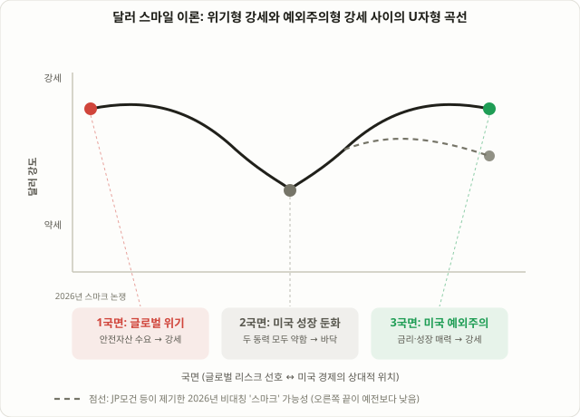

## 달러 스마일 이론이란: 환율은 일직선이 아니라 'U자형'으로 움직인다

"경기가 나빠지면 달러가 오른다"는 말과 "미국 경제가 너무 잘 나가도 달러가 오른다"는 말은 서로 모순처럼 들립니다. 하지만 **달러 스마일 이론(Dollar Smile Theory)**은 이 둘이 동시에 사실일 수 있다고 설명합니다. 이 이론은 2001년 당시 모건스탠리의 이코노미스트였던 스티븐 리 젠(Stephen Li Jen)이 처음 제시했고, 이후 공동 연구자들과의 후속 작업을 통해 다듬어졌습니다. 핵심은 간단합니다 — 달러의 강세·약세를 가로축(미국 경제 상황과 글로벌 리스크 선호)에 놓고 세로축(달러 가치)과 함께 그려보면, 양 끝이 올라가고 중간이 가라앉는 **U자형, 즉 웃는 입 모양**이 나타난다는 것입니다.

이 코스에서 지금까지 다룬 [캐리 트레이드](/strategies/carry-trade-yen-unwind/)는 "두 나라의 금리 차이"라는 한 가지 축만으로 환율 움직임을 설명했고, [인터마켓 분석](/strategies/intermarket-analysis/)은 채권·주식·원자재·달러 네 자산군의 선행-후행 관계를 다뤘습니다. 달러 스마일 이론은 이들과 달리, 달러 하나의 가치가 "지금 세계가 어떤 국면에 있는가"에 따라 전혀 다른 두 가지 이유로 강세를 보일 수 있다는 점에 초점을 맞춘 독립적인 환율 분석 틀입니다.

## 세 가지 국면: 입꼴의 양 끝과 바닥

달러 스마일을 이해하는 가장 쉬운 방법은 가로축을 세 구간으로 나눠보는 것입니다.

| 국면 | 위치 | 달러 방향 | 핵심 동력 |
|---|---|---|---|
| 1국면 — 글로벌 위기 | 입꼴의 왼쪽 끝 (가장 높음) | 강세 | 안전자산 수요 — 위기 때 전 세계 자본이 가장 깊고 유동성이 풍부한 미국 국채·달러로 몰림 |
| 2국면 — 미국 성장 둔화·완만한 연준 완화 | 입꼴의 바닥 (가장 낮음) | 약세 | 위기는 아니지만 미국 경제도 특별히 좋지 않은 "애매한" 구간 — 안전자산 수요도, 고금리 매력도 약함 |
| 3국면 — 미국 경제 예외주의 | 입꼴의 오른쪽 끝 (가장 높음) | 강세 | 미국 성장·금리가 다른 선진국보다 뚜렷하게 앞서 자본이 수익을 좇아 유입 |

왼쪽 끝과 오른쪽 끝은 **완전히 다른 이유**로 달러를 밀어 올립니다. 1국면은 "무서워서 달러를 산다"는 방어적 수요이고, 3국면은 "돈이 되니까 달러를 산다"는 공격적 수요입니다. 겉보기엔 둘 다 "달러 강세"로 보이지만, 트레이더에게는 완전히 다른 신호입니다 — 어느 쪽 끝에 있는지를 혼동하면 정반대 포지션을 잡기 쉽습니다.

## 왜 작동하는가: 기축통화 지위와 금리차라는 두 개의 엔진

달러 스마일이 성립하는 이유는 미국 달러가 두 가지 성격을 동시에 갖고 있기 때문입니다.

첫째, 달러는 **세계 기축통화이자 최종 안전자산**입니다. 전 세계 무역의 상당 부분이 달러로 결제되고, 많은 기업·국가가 달러 표시 채무를 지고 있습니다. 글로벌 위기가 터지면 이 달러 채무를 갚기 위한 수요(숏 커버링)와, 가장 깊고 유동적인 시장인 미국 국채로 도피하려는 수요가 동시에 몰립니다. 이 메커니즘은 2008년 금융위기와 2020년 코로나 패닉에서 모두 뚜렷하게 관찰됐습니다 — 역설적으로 위기의 발원지가 미국이었던 2008년에도 달러는 강세를 보였습니다.

둘째, 달러는 **금리·성장 사이클에 따라 자본을 끌어당기는 자산**입니다. 미국 경제가 유럽·일본보다 뚜렷하게 더 빨리 성장하고 연준이 다른 중앙은행보다 더 높은 금리를 유지하면, 투자자들은 수익률을 좇아 달러 자산을 사들입니다. 이건 [캐리 트레이드](/strategies/carry-trade-yen-unwind/)에서 다룬 금리차 논리와 비슷하지만, 여기서는 통화 하나(달러)가 조달 통화가 아니라 목표 통화 역할을 한다는 점이 다릅니다.

문제는 이 두 힘이 **겹치지 않는 구간**이 있다는 것입니다. 위기도 아니고, 미국이 특별히 예외적이지도 않은 "그냥 그런" 시기에는 안전자산 수요도 약하고 금리 매력도 약해, 달러가 가장 약한 바닥 구간이 만들어집니다. 이 구간에서는 흔히 연준이 선제적으로 금리를 내리거나, 미국 성장이 유럽·신흥국과 비슷한 속도로 수렴하면서 달러를 떠받치던 두 엔진이 동시에 식어버립니다.

<figure class="diagram">
  
  <figcaption>왼쪽 끝(글로벌 위기 — 안전자산 수요)과 오른쪽 끝(미국 경제 예외주의 — 금리·성장 매력)에서 달러가 강세를 보이고, 가운데(미국 성장 둔화·완만한 연준 완화)에서 가장 약한 U자형 곡선. 점선은 2026년 일부 기관이 제기한 '좌우 비대칭(스마크)' 가능성을 나타낸다.</figcaption>
</figure>

## 2026년 지금: '스마일'인가, 비대칭적인 '스마크'인가

달러 스마일 이론은 20여 년이 지난 2026년에도 여전히 환율을 설명하는 기본 틀로 자주 인용되지만, 최근 들어 **곡선의 모양 자체가 바뀌고 있다**는 논쟁이 나오고 있습니다.

JP모건 자산운용의 포트폴리오 매니저 관점 보고서는 지금의 달러 스마일이 예전처럼 좌우가 대칭적인 웃는 입이 아니라, 한쪽이 처진 **"스마크(smirk)"**에 더 가깝다고 평가합니다. 즉 위기 시 안전자산 수요(왼쪽 끝)는 여전히 작동하지만, 미국 경제 예외주의(오른쪽 끝)가 과거만큼 강하게 달러를 밀어 올리지 못하고 있다는 시각입니다. 반대편에서는 자산운용사 웰링턴의 분석이 흥미로운 대안을 제시합니다 — 관세 정책 등으로 해외 자본의 미국 유입이 둔화될 경우, 전통적으로 달러가 맡아온 안전자산 역할의 일부를 **엔화가 대체하는 "옌 스마일(Yen Smile)"** 구도가 나타날 수 있다는 것입니다.

이런 논쟁이 나오는 배경에는 몇 가지 2026년의 현실이 있습니다. 연준 차기 의장 인선을 둘러싼 불확실성(케빈 워시 등 여러 인물이 하마평에 오르내림), 관세를 둘러싼 무역 정책의 변동성, 그리고 꾸준히 제기되는 탈달러화(de-dollarization) 논의가 겹치면서, 오른쪽 끝을 밀어 올리던 "미국 예외주의"라는 전제 자체가 예전보다 불안정해졌다는 평가가 나오고 있습니다. 다만 이런 평가들은 기관별로 엇갈리고, 사후적으로도 검증이 쉽지 않다는 점을 분명히 해둘 필요가 있습니다 — 달러 스마일 이론은 매매 신호를 바로 찍어주는 공식이 아니라, 지금 국면을 해석하는 **틀(framework)**로 다뤄야 합니다.

## 실전 활용: 왼쪽 구간 전략 vs 오른쪽 구간 전략

왼쪽 끝(위기형 강세)과 오른쪽 끝(예외주의형 강세)은 같은 "달러 강세"라도 트리거와 활용 방식이 완전히 다릅니다. 두 구간을 구분해서 보면 실전 적용이 훨씬 명확해집니다.

| 구분 | 왼쪽 구간 전략 (위기형) | 오른쪽 구간 전략 (예외주의형) |
|---|---|---|
| 트리거 | 신용 위기, 증시 급락, 지정학적 충격 | 미국 고용·GDP 서프라이즈, 연준의 상대적 긴축 |
| 함께 보는 지표 | VIX 급등, 신용 스프레드 확대(118강) | 미-유럽/일본 금리차 확대, 미국 증시 상대강도 |
| 대표 확인 자산 | 미국 국채(TLT) 동시 강세, 금(GLD) | 미국 증시가 다른 선진국 증시보다 강한 상대강도 |
| 전형적 보유 기간 | 짧고 급격함 (며칠~몇 주) | 길고 완만함 (몇 달~몇 년) |
| 되돌림 리스크 | 위기가 진정되면 빠르게 되돌림 | '예외주의'가 꺾이는 신호(고용 둔화 등) 포착이 핵심 |

실전에서는 달러인덱스(DXY)나 ETF인 UUP(달러 강세)·UDN(달러 약세)으로 방향성 노출을 잡는 경우가 많습니다. 다만 둘 중 어느 구간의 강세인지를 먼저 구분해야 합니다. 예를 들어 VIX가 급등하면서 동시에 미국 국채와 금이 함께 오른다면 1국면(위기형)일 가능성이 높고, VIX는 잠잠한데 미국 고용지표가 유럽보다 훨씬 좋게 나오면서 달러가 오른다면 3국면(예외주의형)일 가능성이 높습니다. 이 구분이 중요한 이유는, 위기형 강세에 기대어 장기 포지션을 들고 있다가 위기가 진정되는 순간 되돌림을 맞을 수 있기 때문입니다.

## 숫자로 보는 예시 (설명을 위한 가상 궤적)

다음은 세 국면을 거치는 달러인덱스(DXY)의 **가상의 설명용 궤적**이며, 실제 특정 시기의 데이터가 아닙니다.

| 국면 | 가상 DXY 수준 | 당시 서사 |
|---|---|---|
| 1국면: 위기 진입 | 108 | 신용시장 충격으로 안전자산 수요 급증, VIX 급등 |
| 2국면: 위기 진정, 미국 성장도 평범 | 97 | 패닉은 가라앉았지만 미국 성장도 유럽과 비슷한 속도로 둔화, 연준 완만한 인하 |
| 3국면: 미국 예외주의 재부각 | 106 | 미국 고용·소비가 유럽·일본보다 뚜렷하게 앞서며 금리차 재확대 |

이 가상 궤적에서 DXY는 108 → 97 → 106으로 U자형을 그립니다. 중요한 점은 108(위기형 강세)과 106(예외주의형 강세)이라는 비슷한 숫자가 **전혀 다른 매크로 서사**에서 나왔다는 것입니다. 지수 레벨만 보고 "달러가 다시 강해졌다"고 뭉뚱그리면, 지금이 포지션을 유지해야 할 구간인지 되돌림을 조심해야 할 구간인지를 놓치게 됩니다.

## 캐리 트레이드·인터마켓 분석과 무엇이 다른가

세 분석법 모두 환율·매크로를 다루지만, 설명하는 질문이 서로 다릅니다.

| 구분 | 달러 스마일 이론 | 캐리 트레이드 | 인터마켓 분석 |
|---|---|---|---|
| 핵심 질문 | 지금 국면에서 달러가 왜 강세·약세인가 | 두 나라 금리차로 어떻게 수익을 내는가 | 자산군 간 선행-후행 관계는 무엇인가 |
| 분석 대상 | 달러 하나의 비선형적 국면 전환 | 특정 통화쌍(AUD/JPY 등)의 금리차 | 채권·주식·원자재·달러 네 자산군 |
| 쓰는 방식 | 지금이 스마일의 어느 지점인지 파악하는 매크로 국면 필터 | 금리차 자체를 수익원으로 거래 | 다른 전략의 상위 레벨 맥락 확인 |

세 가지를 함께 쓰면 서로를 보완할 수 있습니다. 예를 들어 [93강 캐리 트레이드](/strategies/carry-trade-yen-unwind/)에서 다룬 엔캐리 트레이드 청산은 보통 글로벌 리스크오프 국면, 즉 달러 스마일의 왼쪽 끝과 겹쳐서 발생하는 경우가 많습니다. 이 때문에 달러 스마일 이론으로 "지금이 위기형 달러 강세 구간인가"를 먼저 점검하면, 캐리 트레이드 포지션의 청산 리스크를 가늠하는 데도 참고가 됩니다.

## 한계와 리스크

- **매매 신호가 아니라 해석 틀이다.** 달러 스마일은 정확한 진입·청산 가격을 알려주지 않습니다. 지금이 입꼴의 어느 지점에 가까운지를 가늠하는 용도로 쓰고, 실제 포지션은 다른 전략과 결합해야 합니다.
- **곡선의 비대칭성 논쟁이 진행 중이다.** 2026년 기관들 사이에서도 오른쪽 끝(예외주의)이 과거만큼 강하게 작동하는지에 대한 평가가 엇갈립니다. 하나의 기관 보고서만 믿기보다 여러 관점을 함께 참고해야 합니다.
- **국면 전환 시점을 정확히 짚기 어렵다.** 위기가 언제 진정되는지, 예외주의가 언제 꺾이는지는 사후에만 명확해지는 경우가 많습니다.
- **다른 요인이 겹치면 패턴이 깨질 수 있다.** 관세, 지정학적 갈등, 탈달러화 논의처럼 구조적인 변수가 겹치면 교과서적인 스마일 모양에서 벗어나는 구간이 길게 이어질 수 있습니다.

## 자주 묻는 질문

### 달러 스마일 이론으로 지금 당장 매매 신호를 얻을 수 있나요?
아닙니다. 이 이론은 지금 국면을 해석하는 틀이며, 구체적인 진입·손절가를 제시하지 않습니다. VIX·신용 스프레드·미국과 다른 선진국의 금리차 같은 보조 지표와 함께 지금이 어느 구간에 가까운지를 가늠하는 용도로 써야 합니다.

### 위기형 강세와 예외주의형 강세를 구별하는 가장 쉬운 방법은 무엇인가요?
미국 국채와 금이 달러와 함께 동시에 오르는지를 보는 것이 한 가지 단서입니다. 셋이 함께 오르면 안전자산 수요가 몰리는 위기형(1국면)일 가능성이 높고, 미국 국채·금은 잠잠한데 미국 증시와 고용지표만 상대적으로 강하면 예외주의형(3국면)에 가깝습니다.

### 2026년 '스마일이 스마크로 바뀌었다'는 주장은 확정된 사실인가요?
아닙니다. 일부 기관(JP모건)은 비대칭성이 커졌다고 보지만, 다른 기관은 전통적인 스마일 구조가 여전히 유효하다고 봅니다. 이런 평가는 사후적으로도 검증이 쉽지 않으므로, 하나의 보고서를 절대적인 결론으로 받아들이기보다 여러 관점을 참고하는 것이 안전합니다.

## 정리

- 달러 스마일 이론은 달러가 글로벌 위기(안전자산 수요)와 미국 경제 예외주의(금리·성장 매력)라는 서로 다른 두 가지 이유로 강세를 보이고, 그 중간의 "애매한" 구간에서는 약세를 보인다는 환율 분석 틀입니다.
- 2001년 스티븐 리 젠이 처음 제시했으며, 가로축에 국면을 놓고 세로축에 달러 가치를 그리면 U자형, 즉 웃는 입 모양이 나타난다는 데서 이름이 붙었습니다.
- 왼쪽 끝과 오른쪽 끝은 모두 "달러 강세"로 보이지만 트리거와 함께 보는 지표, 되돌림 리스크가 완전히 다르므로 반드시 구분해서 접근해야 합니다.
- 2026년에는 JP모건의 "스마크" 평가와 웰링턴의 "옌 스마일" 대안 이론처럼, 곡선의 비대칭성을 둘러싼 논쟁이 진행 중이며 이는 확정된 결론이 아닙니다.
- 캐리 트레이드(93강)·인터마켓 분석(112강)과 함께 쓰면 서로의 맥락을 보완할 수 있지만, 세 분석법 모두 구체적인 매매 신호가 아니라 리스크 관리를 위한 국면 필터로 다뤄야 합니다.
